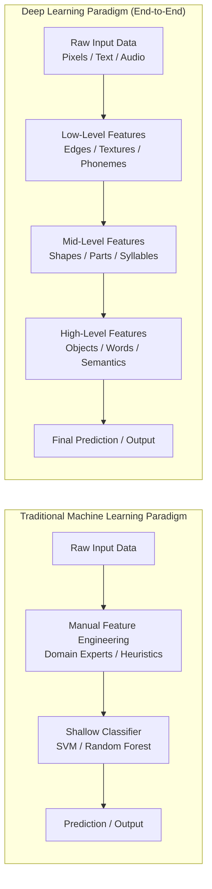
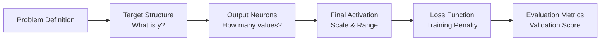
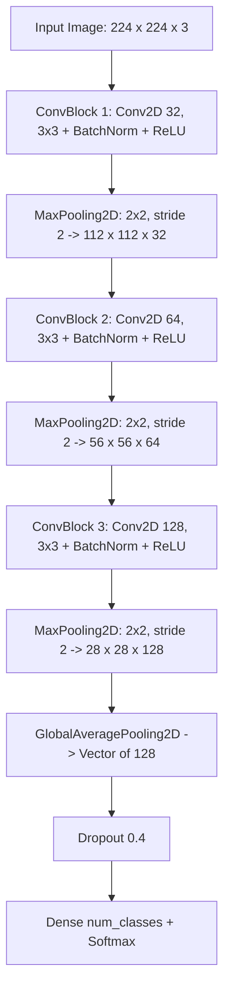
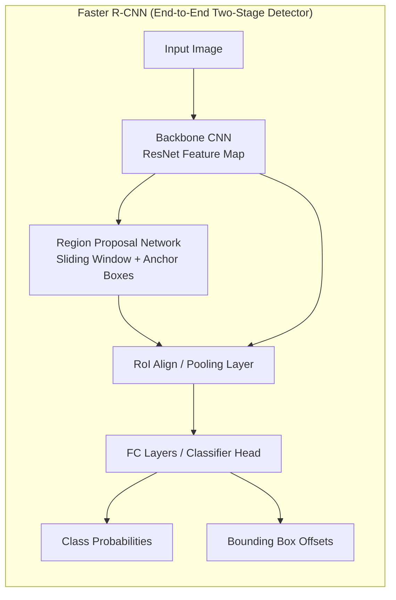
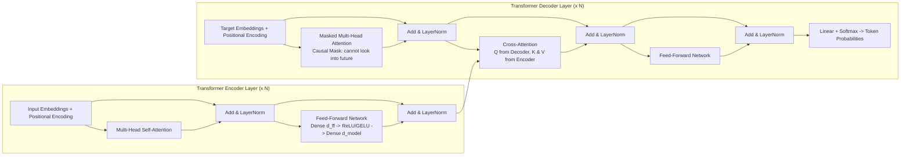
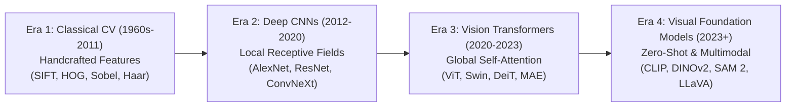
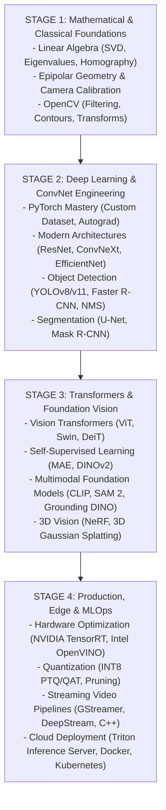

# Deep Learning Specialization — Complete Class Notes, Mathematics & Practical Implementation Guide

Welcome to **`ClassnoteDeepLearning.md`**! This document serves as an exhaustive, master-level repository of Deep Learning theoretical foundations, mathematical derivations, architectural diagrams, framework best practices (TensorFlow, Keras, PyTorch), model optimization techniques, computer vision, sequence modeling, transformers, unsupervised autoencoders, and industrial deployment pipelines.

---

## 📂 Table of Contents
0. [Key Industry Terminology](#0-key-industry-terminology)
1. [Overview & Deep Learning Fundamentals](#1-overview--deep-learning-fundamentals)
   - [1.1 The AI, Machine Learning & Deep Learning Hierarchy](#11-the-ai-machine-learning--deep-learning-hierarchy)
   - [1.2 Chronological Evolution & Historical Milestones](#12-chronological-evolution--historical-milestones)
   - [1.3 The Three Catalysts of the Deep Learning Revolution](#13-the-three-catalysts-of-the-deep-learning-revolution)
   - [1.4 Biological vs. Artificial Neurons](#14-biological-vs-artificial-neurons)
   - [1.5 The Perceptron Model: Mechanics, Math & Linear Separability](#15-the-perceptron-model-mechanics-math--linear-separability)
   - [1.6 The XOR Problem & The First AI Winter](#16-the-xor-problem--the-first-ai-winter)
2. [Artificial Neural Networks (ANN) & Architecture Foundations](#2-artificial-neural-networks-ann--architecture-foundations)
   - [2.1 Multi-Layer Perceptron (MLP) Architecture](#21-multi-layer-perceptron-mlp-architecture)
   - [2.2 Forward Propagation: Step-by-Step Mathematical Formulation](#22-forward-propagation-step-by-step-mathematical-formulation)
   - [2.3 Comprehensive Activation Function Taxonomy](#23-comprehensive-activation-function-taxonomy)
     - [A. Identity / Linear Activation](#a-identity--linear-activation)
     - [B. Sigmoid / Logistic Function](#b-sigmoid--logistic-function)
     - [C. Hyperbolic Tangent (Tanh)](#c-hyperbolic-tangent-tanh)
     - [D. Rectified Linear Unit (ReLU)](#d-rectified-linear-unit-relu)
     - [E. Leaky ReLU & Parametric ReLU (PReLU)](#e-leaky-relu--parametric-relu-prelu)
     - [F. Exponential Linear Unit (ELU) & Scaled ELU (SELU)](#f-exponential-linear-unit-elu--scaled-elu-selu)
     - [G. Modern Smooth Activations: GELU & Swish / SiLU](#g-modern-smooth-activations-gelu--swish--silu)
     - [H. Softmax Function (Multi-Class Probability Distribution)](#h-softmax-function-multi-class-probability-distribution)
     - [I. Master Activation Function Comparison Table](#i-master-activation-function-comparison-table)
   - [2.4 The Teacher's Core Chain: Target Structure → Output Layer → Activation → Loss → Metrics](#24-the-teachers-core-chain-target-structure--output-layer--activation--loss--metrics)
     - [A. Binary Classification](#a-binary-classification)
     - [B. Multiclass Single-Label Classification](#b-multiclass-single-label-classification)
     - [C. Multiclass Multi-Label Classification](#c-multiclass-multi-label-classification)
     - [D. Regression & Continuous Target Estimation](#d-regression--continuous-target-estimation)
     - [E. Master Output Layer Decision Matrix](#e-master-output-layer-decision-matrix)
3. [Deep Neural Networks (DNN) & Training Mechanics](#3-deep-neural-networks-dnn--training-mechanics)
   - [3.1 Hierarchical Representation & Universal Approximation Theorem](#31-hierarchical-representation--universal-approximation-theorem)
   - [3.2 End-to-End Mathematical Derivation of Backpropagation](#32-end-to-end-mathematical-derivation-of-backpropagation)
   - [3.3 The Vanishing and Exploding Gradient Problem](#33-the-vanishing-and-exploding-gradient-problem)
   - [3.4 Weight Initialization Strategies](#34-weight-initialization-strategies)
4. [Frameworks: TensorFlow & Keras In-Depth](#4-frameworks-tensorflow--keras-in-depth)
   - [4.1 TensorFlow Architecture: Tensors, Graphs & Eager Execution](#41-tensorflow-architecture-tensors-graphs--eager-execution)
   - [4.2 Tensor Manipulation: Shapes, Reshaping, Slicing & Operations](#42-tensor-manipulation-shapes-reshaping-slicing--operations)
     - [A. Deep Dive: Dot Product vs. Matrix Multiplication (Matmul) vs. Hadamard Product](#a-deep-dive-dot-product-vs-matrix-multiplication-matmul-vs-hadamard-product)
   - [4.3 Automatic Differentiation with `tf.GradientTape`](#43-automatic-differentiation-with-tfgradienttape)
   - [4.4 The Three Keras Modeling Paradigms: Sequential, Functional & Subclassing](#44-the-three-keras-modeling-paradigms-sequential-functional--subclassing)
   - [4.5 Training Workflow, Loss Nuances (`from_logits`) & Callbacks](#45-training-workflow-loss-nuances-from_logits--callbacks)
   - [4.6 TensorBoard: Architecture, Capabilities, Use Cases & Workflows](#46-tensorboard-architecture-capabilities-use-cases--workflows)
5. [Frameworks: PyTorch Foundations & Industry Comparison](#5-frameworks-pytorch-foundations--industry-comparison)
   - [5.1 PyTorch Philosophy: Dynamic Computation Graphs (Define-by-Run)](#51-pytorch-philosophy-dynamic-computation-graphs-define-by-run)
   - [5.2 PyTorch Tensors, Autograd & GPU Acceleration](#52-pytorch-tensors-autograd--gpu-acceleration)
   - [5.3 Building Models with `torch.nn.Module`](#53-building-models-with-torchnnmodule)
   - [5.4 The Canonical 5-Step PyTorch Training Loop](#54-the-canonical-5-step-pytorch-training-loop)
   - [5.5 Data Pipelines: `Dataset` and `DataLoader`](#55-data-pipelines-dataset-and-dataloader)
   - [5.6 Comprehensive Industry Comparison: PyTorch vs. TensorFlow/Keras](#56-comprehensive-industry-comparison-pytorch-vs-tensorflowkeras)
6. [Model Optimization, Loss Functions & Advanced Optimizers](#6-model-optimization-loss-functions--advanced-optimizers)
   - [6.1 Optimization Challenges: Non-Convex Surfaces, Saddle Points & Ravines](#61-optimization-challenges-non-convex-surfaces-saddle-points--ravines)
   - [6.2 Gradient Descent Variants: Batch, Stochastic (SGD) & Mini-Batch](#62-gradient-descent-variants-batch-stochastic-sgd--mini-batch)
   - [6.3 Advanced First-Order Optimizers](#63-advanced-first-order-optimizers)
     - [A. Momentum & Nesterov Accelerated Gradient (NAG)](#a-momentum--nesterov-accelerated-gradient-nag)
     - [B. AdaGrad (Adaptive Gradient Algorithm)](#b-adagrad-adaptive-gradient-algorithm)
     - [C. RMSProp (Root Mean Square Propagation)](#c-rmsprop-root-mean-square-propagation)
     - [D. Adadelta](#d-adadelta)
     - [E. Adam (Adaptive Moment Estimation) & Bias Correction](#e-adam-adaptive-moment-estimation--bias-correction)
     - [F. AdamW (Decoupled Weight Decay)](#f-adamw-decoupled-weight-decay)
   - [6.4 Learning Rate Schedules & Modern Strategies](#64-learning-rate-schedules--modern-strategies)
   - [6.5 Master Optimizer Benchmark & Selection Matrix](#65-master-optimizer-benchmark--selection-matrix)
7. [Regularization, Normalization & Hyperparameter Tuning](#7-regularization-normalization--hyperparameter-tuning)
   - [7.1 The Overfitting vs. Underfitting Dilemma](#71-the-overfitting-vs-underfitting-dilemma)
   - [7.2 Explicit Regularization: L1 (Lasso) vs. L2 (Weight Decay / Ridge)](#72-explicit-regularization-l1-lasso-vs-l2-weight-decay--ridge)
   - [7.3 Dropout Regularization & Inverted Dropout](#73-dropout-regularization--inverted-dropout)
   - [7.4 Normalization Techniques: Batch Normalization, Layer Normalization, Instance & Group Normalization](#74-normalization-techniques-batch-normalization-layer-normalization-instance--group-normalization)
   - [7.5 Implicit Regularization & Data Engineering: Data Augmentation vs. Transformation](#75-implicit-regularization--data-engineering-data-augmentation-vs-transformation)
      - [A. The Fundamental Distinction: Offline Data Augmentation vs. Online Transformation](#a-the-fundamental-distinction-offline-data-augmentation-vs-online-transformation)
      - [B. Teaching Neural Invariance: Why Flipping and Rotating Forces Pattern Learning](#b-teaching-neural-invariance-why-flipping-and-rotating-forces-pattern-learning)
      - [C. Deterministic Preprocessing vs. Stochastic Augmentation](#c-deterministic-preprocessing-vs-stochastic-augmentation)
      - [D. Taxonomy of Modern Vision Transformations](#d-taxonomy-of-modern-vision-transformations)
      - [E. Production Implementation: PyTorch transforms.v2 & Keras Preprocessing Layers](#e-production-implementation-pytorch-transformsv2--keras-preprocessing-layers)
      - [F. Early Stopping & Label Smoothing Mechanics](#f-early-stopping--label-smoothing-mechanics)
   - [7.6 Hyperparameter Tuning Strategies (Grid, Random, Bayesian / KerasTuner / Optuna)](#76-hyperparameter-tuning-strategies-grid-random-bayesian--kerastuner--optuna)
8. [Convolutional Neural Networks (CNN) & Computer Vision](#8-convolutional-neural-networks-cnn--computer-vision)
   - [8.1 Why CNNs over MLPs for Visual Data?](#81-why-cnns-over-mlps-for-visual-data)
   - [8.2 The 2D Convolution Operation: Kernels, Stride, Padding & Output Dimensions](#82-the-2d-convolution-operation-kernels-stride-padding--output-dimensions)
   - [8.3 Pooling Layers: Max Pooling, Average Pooling & Global Average Pooling (GAP)](#83-pooling-layers-max-pooling-average-pooling--global-average-pooling-gap)
   - [8.4 Multi-Channel Convolutions & Feature Maps](#84-multi-channel-convolutions--feature-maps)
   - [8.5 CNN Architecture Blueprint](#85-cnn-architecture-blueprint)
   - [8.6 Milestone Architectures: LeNet-5, AlexNet, VGGNet, GoogLeNet/Inception, ResNet, DenseNet, MobileNet, EfficientNet](#86-milestone-architectures-lenet-5-alexnet-vggnet-googlenetinception-resnet-densenet-mobilenet-efficientnet)
9. [Transfer Learning & Fine-Tuning](#9-transfer-learning--fine-tuning)
   - [9.1 The Transfer Learning Paradigm & Feature Hierarchy](#91-the-transfer-learning-paradigm--feature-hierarchy)
   - [9.2 The 4-Quadrant Strategy Matrix: Data Size vs. Domain Similarity](#92-the-4-quadrant-strategy-matrix-data-size-vs-domain-similarity)
   - [9.3 Positive vs. Negative Transfer & Catastrophic Forgetting](#93-positive-vs-negative-transfer--catastrophic-forgetting)
   - [9.4 Practical 2-Phase Fine-Tuning Workflow & Implementation](#94-practical-2-phase-fine-tuning-workflow--implementation)
10. [Object Detection & Localization](#10-object-detection--localization)
    - [10.1 The Computer Vision Task Hierarchy](#101-the-computer-vision-task-hierarchy)
    - [10.2 Bounding Box Representations & Evaluation Metrics (IoU, AP, mAP@0.5:0.95)](#102-bounding-box-representations--evaluation-metrics-iou-ap-map05095)
    - [10.3 Two-Stage Detectors: R-CNN, Fast R-CNN & Faster R-CNN (RPN)](#103-two-stage-detectors-r-cnn-fast-r-cnn--faster-r-cnn-rpn)
    - [10.4 One-Stage Detectors: SSD & YOLO (You Only Look Once)](#104-one-stage-detectors-ssd--yolo-you-only-look-once)
    - [10.5 YOLO Architecture Evolution (v1 to Modern v8/v11), Anchor Boxes & Grid Cells](#105-yolo-architecture-evolution-v1-to-modern-v8v11-anchor-boxes--grid-cells)
    - [10.6 Non-Maximum Suppression (NMS) Algorithm](#106-non-maximum-suppression-nms-algorithm)
    - [10.7 Edge Deployment & Quantization (TensorFlow Lite `.tflite`)](#107-edge-deployment--quantization-tensorflow-lite-tflite)
11. [Recurrent Neural Networks (RNN), LSTMs & Sequence Modeling](#11-recurrent-neural-networks-rnn-lstms--sequence-modeling)
    - [11.1 The Need for Recurrence & Sequential Data Formulations](#111-the-need-for-recurrence--sequential-data-formulations)
    - [11.2 Vanilla RNN Architecture & Forward Equations](#112-vanilla-rnn-architecture--forward-equations)
    - [11.3 Backpropagation Through Time (BPTT) & Exponential Gradient Decay](#113-backpropagation-through-time-bptt--exponential-gradient-decay)
    - [11.4 Long Short-Term Memory (LSTM) Networks: Constant Error Carousel & 3 Gates](#114-long-short-term-memory-lstm-networks-constant-error-carousel--3-gates)
    - [11.5 Gated Recurrent Unit (GRU): Reset & Update Gates](#115-gated-recurrent-unit-gru-reset--update-gates)
    - [11.6 Bidirectional RNNs & Hybrid Architectures (CNN-LSTM for Video Analysis)](#116-bidirectional-rnns--hybrid-architectures-cnn-lstm-for-video-analysis)
12. [Attention Mechanisms & Transformer Models for NLP](#12-attention-mechanisms--transformer-models-for-nlp)
    - [12.1 The Information Bottleneck of Seq2Seq Recurrent Models](#121-the-information-bottleneck-of-seq2seq-recurrent-models)
    - [12.2 The Attention Mechanism: Query, Key, Value ($Q, K, V$) Metaphor](#122-the-attention-mechanism-query-key-value-q-k-v-metaphor)
    - [12.3 Scaled Dot-Product Attention & Mathematical Formulation](#123-scaled-dot-product-attention--mathematical-formulation)
    - [12.4 Multi-Head Attention & Subspace Representation](#124-multi-head-attention--subspace-representation)
    - [12.5 Positional Encodings: The Sinusoidal Formulation](#125-positional-encodings-the-sinusoidal-formulation)
    - [12.6 The Transformer Architecture: Encoder & Decoder Stacks](#126-the-transformer-architecture-encoder--decoder-stacks)
    - [12.7 Modern Pretrained Transformer Archetypes: BERT vs. GPT vs. T5](#127-modern-pretrained-transformer-archetypes-bert-vs-gpt-vs-t5)
    - [12.8 Fine-Tuning BERT with Hugging Face & Keras](#128-fine-tuning-bert-with-hugging-face--keras)
13. [Autoencoders & Unsupervised Deep Learning](#13-autoencoders--unsupervised-deep-learning)
    - [13.1 Architecture: Encoder, Latent Bottleneck & Decoder](#131-architecture-encoder-latent-bottleneck--decoder)
    - [13.2 Reconstruction Loss: MSE vs. Binary Cross-Entropy](#132-reconstruction-loss-mse-vs-binary-cross-entropy)
    - [13.3 Autoencoder Taxonomy: Undercomplete, Denoising, Sparse, Contractive & Variational (VAE)](#133-autoencoder-taxonomy-undercomplete-denoising-sparse-contractive--variational-vae)
    - [13.4 Variational Autoencoders (VAE) & The Reparameterization Trick](#134-variational-autoencoders-vae--the-reparameterization-trick)
    - [13.5 Industrial Applications: Denoising, Anomaly Detection & Representation Learning](#135-industrial-applications-denoising-anomaly-detection--representation-learning)
14. [Production Best Practices, Debugging & Practical Cheatsheets](#14-production-best-practices-debugging--practical-cheatsheets)
    - [14.1 Diagnostic Troubleshooting Matrix (Loss is NaN, Dying Neurons, Overfitting, Metric Mismatches)](#141-diagnostic-troubleshooting-matrix-loss-is-nan-dying-neurons-overfitting-metric-mismatches)
    - [14.2 The 7 Cardinal Sins / Common Mistakes in Deep Learning](#142-the-7-cardinal-sins--common-mistakes-in-deep-learning)
    - [14.3 Complete End-to-End Implementation Cheatsheet (Keras & PyTorch)](#143-complete-end-to-end-implementation-cheatsheet-keras--pytorch)
15. [Reference Links, Seminal Papers & External Learning Resources](#15-reference-links-seminal-papers--external-learning-resources)
16. [Real-World Intuitive Analogies for Non-Technical Stakeholders](#16-real-world-intuitive-analogies-for-non-technical-stakeholders)
    - [16.1 Dot Product vs. Matrix Multiplication vs. Hadamard: The Grocery & Shopping Analogy](#161-dot-product-vs-matrix-multiplication-vs-hadamard-the-grocery--shopping-analogy)
    - [16.2 Artificial Neuron & Perceptron: The Bank Loan Approval Officer](#162-artificial-neuron--perceptron-the-bank-loan-approval-officer)
    - [16.3 Forward & Backpropagation: The Master Chef Adjusting Soup Recipes](#163-forward--backpropagation-the-master-chef-adjusting-soup-recipes)
    - [16.4 Learning Rate: Descending a Foggy Mountain in the Dark](#164-learning-rate-descending-a-foggy-mountain-in-the-dark)
    - [16.5 Overfitting vs. Underfitting: Memorizing Answers vs. Understanding Principles](#165-overfitting-vs-underfitting-memorizing-answers-vs-understanding-principles)
    - [16.6 Dropout Regularization: Cross-Training Office Employees](#166-dropout-regularization-cross-training-office-employees)
    - [16.7 Convolutional Neural Networks (CNN): Scanning a Dark Room with a Flashlight](#167-convolutional-neural-networks-cnn-scanning-a-dark-room-with-a-flashlight)
    - [16.8 Transfer Learning: Riding a Bicycle to Riding a Motorcycle](#168-transfer-learning-riding-a-bicycle-to-riding-a-motorcycle)
    - [16.9 Object Detection & YOLO: Glancing Across a Busy Crosswalk](#169-object-detection--yolo-glancing-across-a-busy-crosswalk)
    - [16.10 Recurrent Neural Networks (RNN & LSTM): The Detective Novel & Post-It Notepad](#1610-recurrent-neural-networks-rnn--lstm-the-detective-novel--post-it-notepad)
    - [16.11 Attention & Transformers: The Spotlight at a Loud Cocktail Party](#1611-attention--transformers-the-spotlight-at-a-loud-cocktail-party)
    - [16.12 Autoencoders: The Courtroom Caricature Sketch Artist](#1612-autoencoders-the-courtroom-caricature-sketch-artist)
    - [16.13 TensorBoard: The Racecar Telemetry & Smart Fitness Watch](#1613-tensorboard-the-racecar-telemetry--smart-fitness-watch)
    - [16.14 Deep Learning Frameworks (TensorFlow, Keras, TFLearn, PyTorch): The Automotive Hierarchy](#1614-deep-learning-frameworks-tensorflow-keras-tflearn-pytorch-the-automotive-hierarchy)
    - [16.15 Vision Transformers (ViT) vs. CNNs: The Jigsaw Puzzle Master vs. The Magnifying Glass Inspector](#1615-vision-transformers-vit-vs-cnns-the-jigsaw-puzzle-master-vs-the-magnifying-glass-inspector)
    - [16.16 Data Augmentation vs. Transformation: Photocopying Static Variations vs. Practicing Driving in Dynamic Weather](#1616-data-augmentation-vs-transformation-photocopying-static-variations-vs-practicing-driving-in-dynamic-weather)
17. [Complete A-to-Z Master Glossary & Keyword Quick Reference](#17-complete-a-to-z-master-glossary--keyword-quick-reference)
18. [Reference Links & Recommended Reading (RefLink)](#18-reference-links--recommended-reading-reflink)
19. [Cross-Platform Hardware Acceleration Guide: Windows, macOS & Linux (CUDA, MPS, OpenVINO, WSL2)](#19-cross-platform-hardware-acceleration-guide-windows-macos--linux-cuda-mps-openvino-wsl2)
    - [19.1 Cross-Platform Accelerator Compatibility Matrix](#191-cross-platform-accelerator-compatibility-matrix)
    - [19.2 Windows Deep Dive: WSL2 for TensorFlow GPU & OpenVINO for PyTorch Acceleration](#192-windows-deep-dive-wsl2-for-tensorflow-gpu--openvino-for-pytorch-acceleration)
    - [19.3 macOS Deep Dive: Apple Silicon (M1/M2/M3/M4) & Metal Performance Shaders (MPS)](#193-macos-deep-dive-apple-silicon-m1m2m3m4--metal-performance-shaders-mps)
    - [19.4 Linux Deep Dive: Tier-1 Production Environment (CUDA & ROCm)](#194-linux-deep-dive-tier-1-production-environment-cuda--rocm)
    - [19.5 Production Universal Device Selection Script (PyTorch & TensorFlow)](#195-production-universal-device-selection-script-pytorch--tensorflow)
20. [Modern Computer Vision Ecosystem: Vision Transformers (ViT), Visual Intelligence, Industry Applications & Career Pathways](#20-modern-computer-vision-ecosystem-vision-transformers-vit-visual-intelligence-industry-applications--career-pathways)
    - [20.1 The Modern Computer Vision Paradigm Shift: Classical CV to CNNs to Vision Transformers (ViT) to Foundation Models](#201-the-modern-computer-vision-paradigm-shift-classical-cv-to-cnns-to-vision-transformers-vit-to-foundation-models)
    - [20.2 Deep Dive into Vision Transformers (ViT): Mathematics, Architecture & Mechanics](#202-deep-dive-into-vision-transformers-vit-mathematics-architecture--mechanics)
    - [20.3 Modern Computer Vision Tasks Spectrum: Beyond Simple Classification](#203-modern-computer-vision-tasks-spectrum-beyond-simple-classification)
    - [20.4 High-Impact Industry Verticals & Multi-Billion Dollar Market Opportunities](#204-high-impact-industry-verticals--multi-billion-dollar-market-opportunities)
    - [20.5 Computer Vision Engineering Career Paths & Job Roles Breakdown](#205-computer-vision-engineering-career-paths--job-roles-breakdown)
    - [20.6 Hands-On Code Recipes: Building ViT from Scratch, Hugging Face Fine-Tuning & CLIP Zero-Shot Inference](#206-hands-on-code-recipes-building-vit-from-scratch-hugging-face-fine-tuning--clip-zero-shot-inference)
    - [20.7 The 2026+ Senior Vision Engineer Competency Roadmap](#207-the-2026-senior-vision-engineer-competency-roadmap)

---

## 0. Key Industry Terminology

| Term | Plain-Language Concept (In Simple Words) | How It Works & Why It Matters | Everyday Deep Learning Use Case (Real-World Example) |
| :--- | :--- | :--- | :--- |
| **ANN (Artificial Neural Network)** | A digital computing system inspired by biological brain neurons, connected in layers to solve problems by learning from data. | Ingests numerical inputs, passes them through connected artificial neurons with adjustable knobs (weights), and produces a prediction. | **Bank Loan Default Prediction:** Predicting whether a loan applicant will default based on credit score, annual income, age, and debt-to-income ratio. |
| **DNN (Deep Neural Network)** | An artificial neural network with multiple hidden layers stacked on top of each other like floors in a skyscraper. | Lower layers learn basic lines, middle layers learn shapes, and high layers learn complete concepts (faces, cars, voices). | **Voice Assistants (Alexa, Siri):** Translating raw acoustic sound vibrations through 20+ layers into clear written English text. |
| **Perceptron** | The simplest single artificial neuron invented in 1957; it adds up weighted inputs and flips a binary switch. | The historic ancestor of all deep learning; proved that machines can learn from data, though limited to straight-line separation. | **Simple Logic Decisions:** Determining binary yes/no decisions like an automated credit threshold check. |
| **Forward Propagation** | The one-way conveyor belt journey of input data passing through network layers to generate a prediction. | Multiplies inputs by weights, adds biases, and applies activations layer-by-layer until final output numbers appear. | **Live App Inference:** Snapping a picture of a plant on your phone and having the app tell you *"Aloe Vera"* in 50 milliseconds. |
| **Backpropagation** | The error-feedback loop where a neural network works backwards from its mistakes to adjust its internal knobs. | Uses the calculus chain rule to calculate exactly how much each individual weight contributed to the prediction mistake, telling the optimizer which direction to adjust. | **Handwritten Digit Recognition:** When the network misidentifies a handwritten "7" as a "1", Backpropagation nudges weights to pay closer attention to the horizontal top bar. |
| **Loss Function (Cost Function)** | The master report card formula calculating how far the AI's guesses are from the true ground truth. | Produces a single number representing error; the training goal is to drive this number as close to zero as possible. | **House Valuation Model:** Using Mean Squared Error to measure how many dollars the AI is off when predicting house prices. |
| **Activation Function** | A mathematical on/off switch and volume knob attached to every artificial neuron. | Without it, stacking 100 neural layers collapses into a single basic straight line ($y = mx + b$). It bends and shapes the math so the network can learn curves, circles, and complex non-linear patterns. | **Self-Driving Car Turn Detection:** Deciding whether a pedestrian is on the road requires sharp, non-linear decisions rather than a simple straight line. |
| **Epoch** | One complete study pass through every single page of your textbook (entire dataset). | Neural networks require seeing data multiple times (e.g. 20-50 epochs) to gradually adjust millions of weights toward minimal error. | **Tracking Model Training Progress:** Tracking accuracy improvements epoch-by-epoch (Epoch 1: 60%, Epoch 10: 92%, Epoch 30: 98%). |
| **Batch Size** | The number of practice questions a student studies before checking the answer key and updating their notes. | Balances GPU memory capacity and learning stability. A batch size of 32 or 64 trains faster and smoother on graphics cards than processing one sample at a time. | **GPU Training Efficiency:** Processing 64 chest X-rays in one parallel GPU burst instead of feeding them one by one. |
| **Iteration (Step)** | A single weight update performed on one batch of training data. | Total iterations per epoch $= \lceil \frac{N}{\text{Batch Size}} \rceil$. Every iteration moves the model one small step downhill toward minimal error. | **Step-by-Step Training:** In a dataset of 1,000 images with a batch size of 50, each epoch contains 20 iterations (steps). |
| **Learning Rate ($\eta$ or $\alpha$)** | The stride length or step size the AI takes when adjusting its weights toward better answers. | If too big, the model trips and misses the solution; if too small, training takes weeks to make tiny progress. | **Tuning Model Convergence:** Setting the learning rate to $0.001$ with Adam for fast, steady learning. |
| **Vanishing Gradient** | A training bug in deep networks where learning signals shrink to near-zero as they travel backwards, leaving early layers uneducated. | Caused by repeatedly multiplying fractions ($< 0.25$) in Sigmoid/Tanh derivatives across many layers; cured by ReLU and residual skip connections. | **Why Early Deep Networks Failed:** Why 1990s researchers couldn't train networks deeper than 4 layers until ReLU and ResNet were invented. |
| **Exploding Gradient** | An instability where gradient updates grow uncontrollably huge, blowing up weights and causing `NaN` errors. | Caused by multiplying large weights over deep steps; cured by Gradient Clipping and careful weight initialization. | **Unstable Recurrent Language Models:** A text generator crashing with `Loss: NaN` during sentence generation without gradient clipping. |
| **Xavier / Glorot Initialization** | A formula that tunes initial random weights so signals neither fade to zero nor blow up when using Sigmoid or Tanh activations. | Scales weight variance by $\frac{2}{n_{in} + n_{out}}$, ensuring electrical signals remain steady across forward and backward passes. | **Training Tanh Neural Networks:** Bootstrapping neural networks with symmetric S-shaped activations without training stalls. |
| **He / Kaiming Initialization** | A mathematical formula for setting initial weights so ReLU networks don't start off dead or overloaded. | Sets starting weights with variance scaled to input size ($\text{Var}(W) = \frac{2}{n_{in}}$), ensuring signals travel cleanly through 50+ layers on day one. | **Bootstrapping ResNet Training:** Allowing very deep vision models to begin learning immediately on the first epoch. |
| **Dropout** | Randomly blinding a percentage of neurons during practice so the remaining neurons learn to be self-reliant. | Prevents neurons from co-depending on each other. Mimics training thousands of smaller sub-networks, massively reducing overfitting. | **Customer Support Ticket Routing:** Training a ticket classifier so it doesn't over-rely on a single customer keyword. |
| **Batch Normalization (BN)** | An automatic volume leveler placed between internal neural network layers. | Standardizes intermediate activations across a mini-batch to have zero mean and unit variance. Keeps signals from blowing up or fading, speeding up training by up to $10\times$. | **High-Resolution Medical Imaging:** Allows very deep CNNs (like ResNet-101) to train reliably on MRI scans without crashing or freezing. |
| **Layer Normalization (LN)** | Normalizing values across all features of a single sentence or sample independently. | Unlike Batch Normalization, it does not rely on other samples in the batch, making it ideal for variable-length sentences in NLP. | **Transformer & ChatGPT Blocks:** Stabilizing internal token representations across long conversations. |
| **CNN (Convolutional Neural Network)** | A vision-specialized neural network that scans images like an inspector holding a magnifying glass. | Uses small sliding filters to find edges, textures, and shapes anywhere in an image, regardless of where the object appears (translation equivariance). | **Smartphone Face Unlock:** Unlocking your phone instantly by scanning and recognizing facial structures. |
| **Kernel / Filter** | A tiny square stamp (e.g. $3\times3$ pixels) designed to detect a specific visual cue like an edge or corner. | Slides across every patch of an image computing dot products, creating a map showing where its target pattern was found. | **Fingerprint Scanner:** Using specialized edge-detecting kernels to trace whorls and ridges on human fingertips. |
| **Dot Product (Inner Product)** | Multiplying matching numbers between two lists and adding them up to get a single similarity score. | If two vectors point in the same direction, the dot product is high; if perpendicular, it is zero. It is the fundamental math of similarity matching. | **Spotify Music Recommendation:** Matching your taste profile vector with song vectors to find which tracks you'll love. |
| **Matrix Multiplication (Matmul)** | Calculating multiple dot products in parallel by combining grids of numbers all at once. | Enables graphics cards (GPUs) to compute millions of neuron connections simultaneously in milliseconds using hardware matrix cores. | **Processing Batches of Data:** Feeding 64 images through 1,000 neurons in one lightning-fast GPU operation. |
| **Hadamard Product ($\odot$)** | Element-by-element multiplication of two tables of the exact same size without rotating or summing. | Multiplies each number by its direct neighbor in the other table without changing dimensions or rotating tables. | **Applying a Dropout or Attention Mask:** Multiplying neuron values by a mask of $[1, 0, 1, 0]$ to silence specific neurons or hide future words. |
| **Stride** | The number of pixels a convolutional filter jumps forward on each step across an image. | A stride of 1 inspects every pixel; a stride of 2 skips every other pixel, cutting the output spatial size in half. | **Fast Downsampling in Modern CNNs:** Replacing pooling layers with strided convolutions to shrink image dimensions efficiently. |
| **Padding (Valid vs. Same)** | Adding a border of zeros around an image so edge pixels aren't ignored during scanning. | "Valid" does not add borders (image shrinks); "Same" adds zero borders so the output image stays the exact same width and height. | **Preserving Edge Details:** Ensuring objects located on the far corners of an image aren't chopped off by convolutional filters. |
| **Pooling Layer** | A downsampling step that shrinks an image while keeping the most prominent details. | Replaces $2\times2$ pixel clusters with their single maximum number (Max Pooling), cutting computational work in half. | **Image Compression in ConvNets:** Reducing an image from $112\times112$ down to $56\times56$ while keeping key edges sharp. |
| **Global Average Pooling (GAP)** | Taking an entire 2D feature map and boiling it down to a single average number per channel. | Replaces massive, fragile Flatten layers containing millions of weights with a clean zero-parameter pooling step, slashing model size and stopping overfitting. | **Mobile Phone Vision Models:** Shrinking deep vision models so they fit into tiny 15MB app download packages. |
| **Transfer Learning** | Standing on the shoulders of giants: taking an AI already trained on millions of images and customizing it for your problem. | Reuses pre-learned visual features (edges, textures, shapes), requiring only a few hundred custom images to reach $95\%+$ accuracy. | **Custom Plant Disease Classifier:** Taking a Google MobileNet model trained on ImageNet and teaching it to spot wheat rust in 10 minutes. |
| **Fine-Tuning** | Taking an already educated AI and giving it specialized on-the-job training for your specific company task. | Reuses general visual or language features learned on millions of examples, training only top layers with a tiny learning rate on custom data. | **Legal Document Summarizer:** Fine-tuning an open-source general LLM on a law firm's contracts to summarize legal risks accurately. |
| **IoU (Intersection over Union)** | A scorecard measuring how accurately a drawn detection box overlaps the real object ($0\% = \text{miss}$, $100\% = \text{bullseye}$). | Divides the shared overlapping area by the total combined area. Anything above $50\%$ ($0.5$) is typically considered a correct hit. | **Self-Driving Car Pedestrian Detection:** Verifying that the car's bounding box accurately surrounds a walking person before braking. |
| **mAP (Mean Average Precision)** | The gold-standard Olympic scorecard for ranking object detection accuracy. | Combines how well the model finds all objects (Recall) with how accurate its labels are (Precision) across different strictness levels. | **Benchmarking YOLO on COCO Dataset:** Comparing whether YOLOv8 or YOLOv11 detects bicycles and traffic lights better. |
| **YOLO (You Only Look Once)** | An ultra-fast object detector that spots, locates, and boxes multiple objects in a picture in a single quick glance. | Unlike slow two-stage detectors that examine thousands of cropped patches, YOLO treats detection as a single regression pass at 60+ FPS. | **Real-Time Traffic & Security Cameras:** Detecting passing cars, pedestrians, and cyclists in live 60 FPS video streams. |
| **Non-Maximum Suppression (NMS)** | A clean-up filter that deletes duplicate overlapping boxes around the same object, keeping only the best one. | Object detectors predict 50 boxes around a single dog; NMS suppresses the 49 weaker duplicates based on IoU overlap. | **Clean Video Object Detection:** Ensuring an automated traffic camera shows one neat box around a passing car, not 20 messy boxes. |
| **RNN (Recurrent Neural Network)** | A neural network with a built-in memory loop that processes sequences step-by-step. | Passes its internal hidden state from one word or time step to the next, carrying memory forward across time. | **Stock Market Forecasting & Text Translation:** Reading sequences where current meaning depends heavily on what happened previously. |
| **BPTT (Backpropagation Through Time)** | Unrolling a recurrent memory network like a comic strip across time to trace where a prediction went wrong. | Spreads the error backwards across previous hours, words, or video frames so the model learns how past actions caused current outcomes. | **Speech Recognition (Voice to Text):** Tracing audio phoneme errors across past spoken syllables to correct words in real time. |
| **LSTM (Long Short-Term Memory)** | A memory-equipped neural network with gates that decide what to remember, update, and forget over time. | Maintains an uninterrupted linear memory conveyor belt ($C_t$), allowing information to survive across hundreds of sequence steps without vanishing. | **Predictive Typing on Keyboards (WhatsApp / Gboard):** Remembering the beginning of your sentence to suggest the correct next word. |
| **GRU (Gated Recurrent Unit)** | A streamlined, fast memory unit for sequential data that uses only two control gates (Reset and Update). | Does 95% of what an LSTM does with 25% fewer parameters, training significantly faster on sequential time series. | **Smart Thermostat Temperature Forecasting:** Predicting home temperature trends over the next 24 hours using minimal microcontroller CPU power. |
| **Attention Mechanism** | A dynamic digital spotlight that lets a neural network focus on the most important words or image regions at any moment. | Instead of cramming an entire paragraph into a single summary vector, it compares query keys and values to pull relevant details dynamically across long sequences. | **Google Translate:** In the sentence *"The animal didn't cross the street because **it** was too tired"*, Attention links "**it**" directly to "**animal**". |
| **Transformer** | The breakthrough architecture that replaced recurrent loops with parallel self-attention, powering all modern generative AI. | Processes entire paragraphs or image patch collections in parallel on GPUs, learning deep long-range context without bottlenecks. | **ChatGPT, Gemini, Claude:** The foundational architectural engine behind modern Large Language Models and Vision Transformers. |
| **BERT** | Google's master reading comprehension model that reads text forwards and backwards simultaneously. | Understands the rich bi-directional context of words from both left and right directions (e.g. distinguishing "river **bank**" from "money **bank**"). | **Google Search Intent:** Powering Google search to understand the exact conversational meaning behind queries like *"can you get medicine for someone pharmacy"*. |
| **Autoencoder** | An AI that compresses data into a tiny digital zipper and then tries to unzip and reconstruct the original. | Forces data through a narrow bottleneck (latent space). Because space is constrained, the network discards noise and only preserves the most essential underlying essence. | **Credit Card Fraud Detection:** Trained exclusively on normal transactions; when a fraudulent transaction appears, the model fails to reconstruct it, immediately raising an alarm. |
| **VAE (Variational Autoencoder)** | A creative autoencoder that compresses data into a smooth probability map so you can generate brand-new realistic samples. | Uses the "reparameterization trick" to learn a continuous bell-curve latent space, allowing smooth interpolation between data points. | **AI Drug Discovery & Avatar Generation:** Inventing brand-new chemical molecular structures that resemble known effective medicines. |
| **TensorBoard** | Google's real-time browser dashboard that lets you watch your neural network learn like a live racecar telemetry screen. | Plots live curves of loss dropping and accuracy rising, displays model architecture graphs, and visualizes weights and image outputs. | **Debugging Deep Learning Training:** Checking your browser during training to spot if your model's loss is diverging or flattening. |

---

## 1. Overview & Deep Learning Fundamentals

### 1.1 The AI, Machine Learning & Deep Learning Hierarchy

To understand Deep Learning, we must place it in the context of the broader computational intelligence spectrum:

```
┌────────────────────────────────────────────────────────────────────────┐
│  ARTIFICIAL INTELLIGENCE (AI) [1950s - Present]                       │
│  The broad discipline of engineering machines capable of simulating   │
│  human cognitive functions (reasoning, planning, learning, logic).    │
│  Includes expert systems, symbolic AI, search algorithms & heuristics. │
│                                                                        │
│   ┌────────────────────────────────────────────────────────────────┐   │
│   │  MACHINE LEARNING (ML) [1980s - Present]                       │   │
│   │  A subset of AI where algorithms infer patterns from data      │   │
│   │  statistically without explicit hand-crafted rules.            │   │
│   │  Algorithms: Linear/Logistic Reg, SVMs, Decision Trees, RFs.  │   │
│   │                                                                │   │
│   │   ┌────────────────────────────────────────────────────────┐   │   │
│   │   │  DEEP LEARNING (DL) [2010s - Present]                  │   │   │
│   │   │  A specialized branch of ML utilizing Multi-Layer      │   │   │
│   │   │  Neural Networks to perform automated hierarchical     │   │   │
│   │   │  feature extraction directly from raw, unstructured    │   │   │
│   │   │  data (images, text, speech, audio, graphs).           │   │   │
│   │   │                                                        │   │   │
│   │   │   ┌────────────────────────────────────────────────┐   │   │   │
│   │   │   │  GENERATIVE AI & FOUNDATION MODELS (2020s+)    │   │   │   │
│   │   │   │  Massive Transformer models (LLMs, Diffusion,  │   │   │   │
│   │   │   │  Multimodal) capable of generating novel text,  │   │   │   │
│   │   │   │  imagery, code, voice, and video.              │   │   │   │
│   │   │   └────────────────────────────────────────────────┘   │   │   │
│   │   └────────────────────────────────────────────────────────┘   │   │
│   └────────────────────────────────────────────────────────────────┘   │
└────────────────────────────────────────────────────────────────────────┘
```

#### Classical Machine Learning vs. Deep Learning Feature Engineering
In classical Machine Learning, domain experts must manually construct hand-engineered features (e.g., SIFT, HOG for images; TF-IDF, N-grams for text) before training a shallow classifier. If the engineered features are flawed, the classifier fails.

Deep Learning completely redefines this paradigm through **End-to-End Representation Learning**:



---

### 1.2 Chronological Evolution & Historical Milestones

```mermaid
flowchart TD
    M1["1943: Warren McCulloch & Walter Pitts\nFirst mathematical model of an artificial neuron (threshold logic unit)"]
    M2["1957: Frank Rosenblatt\nPerceptron model on Mark I hardware (first trainable linear classifier)"]
    M3["1969: Marvin Minsky & Seymour Papert\nPublished 'Perceptrons' proving single layer cannot solve XOR\nTriggered the 1st AI Winter (funding dried up for connectionism)"]
    M4["1986: Rumelhart, Hinton & Williams\nPopularized Backpropagation algorithm for training Multi-Layer Perceptrons (MLPs)"]
    M5["1989: Yann LeCun\nIntroduced Convolutional Neural Networks (LeNet) with backprop for digit recognition"]
    M6["1997: Hochreiter & Schmidhuber\nInvented Long Short-Term Memory (LSTM) solving vanishing gradient in RNNs"]
    M7["2012: Alex Krizhevsky, Ilya Sutskever & Geoffrey Hinton\nAlexNet crushes ImageNet by 10.8% error margin using GPUs & ReLU\nIgnites the modern Deep Learning Renaissance"]
    M8["2015: Kaiming He et al.\nResNet (Residual Networks, 152 layers) surpasses human performance on ImageNet (3.57% top-5 error)"]
    M9["2017: Vaswani et al. (Google Brain)\n'Attention Is All You Need' introduces the Transformer architecture"]
    M10["2020s: Generative AI & Foundation Models\nGPT-4, Claude, Gemini, Stable Diffusion, LLaMA democratize multimodal intelligence"]

    M1 --> M2 --> M3 --> M4 --> M5 --> M6 --> M7 --> M8 --> M9 --> M10
```



---

### 1.3 The Three Catalysts of the Deep Learning Revolution

Why did Deep Learning emerge into dominance in the 2010s rather than the 1980s when the underlying mathematics of backpropagation were already established?
Deep Learning requires the simultaneous convergence of three pillars:

```
               ┌────────────────────────────────────────────────────────┐
               │         THE 3 CATALYSTS OF DEEP LEARNING               │
               └────────────────────────────────────────────────────────┘
                                 ▲        ▲        ▲
           ┌─────────────────────┘        │        └─────────────────────┐
           │                              │                              │
 ┌───────────────────┐          ┌───────────────────┐          ┌───────────────────┐
 │ 1. Massive Data   │          │ 2. Hardware / GPUs│          │ 3. Algorithmic    │
 │ (Big Data Boom)   │          │ (Compute Power)   │          │ Innovations       │
 ├───────────────────┤          ├───────────────────┤          ├───────────────────┤
 │ • Internet & Web  │          │ • NVIDIA GPUs     │          │ • ReLU Activation │
 │ • Mobile devices  │          │ • Parallel Matrix │          │ • Dropout Regular.│
 │ • ImageNet (14M+) │          │   Multiplication  │          │ • Batch Normaliz. │
 │ • Common Crawl    │          │ • Google TPUs     │          │ • Adam Optimizer  │
 │ • YouTube / Sensor│          │ • Cloud Clusters  │          │ • ResNet Residuals│
 └───────────────────┘          └───────────────────┘          └───────────────────┘
```

#### Andrew Ng's Empirical Law of Deep Learning Scaling
Classical ML models plateau early. Deep Learning models with sufficient capacity continue improving as data and compute increase:

$$\text{Performance} \propto f\left(\text{Data Volume}, \text{Model Parameters}, \text{Compute FLOPs}\right)$$

---

### 1.4 Biological vs. Artificial Neurons

Deep Learning draws biological inspiration from the human nervous system:

| Biological Neuron Component | Biological Function | Artificial Neuron Analog | Mathematical Operation |
| :--- | :--- | :--- | :--- |
| **Dendrites** | Receive incoming biochemical signals from neighboring neurons | **Input Features ($x_1, x_2, \dots, x_m$)** | Input vector $\mathbf{x} \in \mathbb{R}^m$ |
| **Synaptic Terminals** | Modulate strength of connections via neurotransmitter efficiency | **Weights ($w_1, w_2, \dots, w_m$)** | Weight vector $\mathbf{w} \in \mathbb{R}^m$ |
| **Cell Body (Soma)** | Aggregates all incoming biochemical electrical potentials | **Summation Function ($\Sigma$) + Bias ($b$)** | Pre-activation: $z = \sum_{j=1}^m w_j x_j + b = \mathbf{w}^T \mathbf{x} + b$ |
| **Action Potential Threshold** | Fires only when aggregated membrane potential crosses a threshold | **Activation Function ($\sigma, \text{ReLU}, \dots$)** | Post-activation: $a = g(z)$ |
| **Axon** | Transmits the action potential spike to downstream neurons | **Neuron Output ($a$ or $\hat{y}$)** | Output transmitted to subsequent layer inputs |

```
BIOLOGICAL NEURON:
      Dendrites (Inputs) ──┐
      Dendrites (Inputs) ──┼──► [ Soma / Cell Body ] ──► [ Axon ] ──► Synaptic Terminals (Outputs)
      Dendrites (Inputs) ──┘

ARTIFICIAL NEURON (PERCEPTRON):
      x₁ ───[ * w₁ ]───┐
      x₂ ───[ * w₂ ]───┼──► Σ (Summation: w^T x + b) ──► [ g(z) Non-linear Activation ] ──► a (Output)
      ... ──[ * ... ]──┤              ▲
      xₘ ───[ * wₘ ]───┘              │
                                    Bias (b)
```

---

### 1.5 The Perceptron Model: Mechanics, Math & Linear Separability

> [!NOTE] 💡 Plain-Language Concept & Everyday Deep Learning Use Case: The Perceptron
> - **What is it? (Simple Definition):** The simplest single artificial neuron invented in 1957. It adds up incoming numerical signals, compares them to a threshold, and flips a binary decision switch (Yes/No or 1/0).
> - **How it works & Why it matters:** Multiplies each input feature by an adjustable importance knob (weight), adds a baseline constant offset (bias), and checks if the total crosses zero. If the total crosses zero, it outputs 1; otherwise, it outputs 0. It is the historical ancestor of all artificial intelligence and proved that machines can automatically learn from data.
> - **Everyday Deep Learning Use Case:** **Automated Loan Pre-Approval:** Ingesting an applicant's monthly income and credit score, weighting each, and instantly making a binary decision: Approved (1) or Declined (0).

The Perceptron, invented by Frank Rosenblatt in 1957, is the simplest supervised learning algorithm for binary classification.

#### Mathematical Formulation
Given an input vector $\mathbf{x} = [x_1, x_2, \dots, x_m]^T \in \mathbb{R}^m$, a weight vector $\mathbf{w} = [w_1, w_2, \dots, w_m]^T \in \mathbb{R}^m$, and a scalar bias $b \in \mathbb{R}$:

1. **Pre-activation Linear Combination ($z$):**
   $$z = \sum_{j=1}^m w_j x_j + b = \mathbf{w}^T \mathbf{x} + b$$

2. **Heaviside Step Activation Function ($g(z)$):**
   $$\hat{y} = g(z) = \begin{cases} 1, & \text{if } z \ge 0 \\ 0, & \text{if } z < 0 \end{cases}$$

3. **Perceptron Learning Rule:**
   For a misclassified training sample $(\mathbf{x}^{(i)}, y^{(i)})$, weights and bias are updated iteratively:
   $$w_j \leftarrow w_j + \eta \left(y^{(i)} - \hat{y}^{(i)}\right) x_j^{(i)}$$
   $$b \leftarrow b + \eta \left(y^{(i)} - \hat{y}^{(i)}\right)$$
   Where:
   - $y^{(i)} \in \{0, 1\}$ is the ground-truth target.
   - $\hat{y}^{(i)} \in \{0, 1\}$ is the predicted class.
   - $\eta \in (0, 1]$ is the learning rate.
   - If $y^{(i)} = \hat{y}^{(i)}$, error is $0 \implies$ no update occurs.
   - If $y^{(i)} = 1$ and $\hat{y}^{(i)} = 0$, error is $+1 \implies$ weights increase in direction of $\mathbf{x}^{(i)}$.
   - If $y^{(i)} = 0$ and $\hat{y}^{(i)} = 1$, error is $-1 \implies$ weights decrease in direction of $\mathbf{x}^{(i)}$.

#### Geometric Interpretation & The Decision Boundary
The decision boundary is the hyperplane defined by $z = \mathbf{w}^T \mathbf{x} + b = 0$.
In 2D space:
$$w_1 x_1 + w_2 x_2 + b = 0 \implies x_2 = -\frac{w_1}{w_2} x_1 - \frac{b}{w_2}$$
This is a straight line dividing the feature space into two half-spaces.

---

### 1.6 The XOR Problem & The First AI Winter

In 1969, MIT AI pioneers Marvin Minsky and Seymour Papert published the book *Perceptrons*. They mathematically demonstrated that single-layer perceptrons are strictly limited to **linearly separable** functions.

#### Truth Table Comparison: AND, OR vs. XOR

| $x_1$ | $x_2$ | AND ($x_1 \land x_2$) | OR ($x_1 \lor x_2$) | XOR ($x_1 \oplus x_2$) |
| :---: | :---: | :---: | :---: | :---: |
| 0 | 0 | 0 | 0 | **0** |
| 0 | 1 | 0 | 1 | **1** |
| 1 | 0 | 0 | 1 | **1** |
| 1 | 1 | 1 | 1 | **0** |

```
   AND Gate (Linearly Separable)           XOR Gate (NOT Linearly Separable)
   x₂                                     x₂
    ▲                                      ▲
  1 │      o (0,1)        * (1,1)        1 │      * (0,1)        o (1,1)
    │                                      │
    │     ───────────────────────          │          \             /
    │      Decision Boundary Line          │           \           /
  0 │      o (0,0)        o (1,0)        0 │      o (0,0) \       / * (1,0)
    └──────────────────────────► x₁        └──────────────────────────► x₁
           0              1                       0              1
   A single line separates * from o       NO single straight line can separate * from o!
```

#### Why XOR Failed on Single-Layer Perceptron
For XOR, the following four simultaneous linear inequalities must hold for weights $w_1, w_2$ and bias $b$:
1. $x=(0,0) \implies b < 0$
2. $x=(0,1) \implies w_2 + b \ge 0 \implies w_2 \ge -b > 0$
3. $x=(1,0) \implies w_1 + b \ge 0 \implies w_1 \ge -b > 0$
4. $x=(1,1) \implies w_1 + w_2 + b < 0$

Summing (2) and (3) gives: $w_1 + w_2 \ge -2b > 0$.
Adding $b$ to both sides gives: $w_1 + w_2 + b \ge -b > 0$.
This directly contradicts inequality (4) ($w_1 + w_2 + b < 0$).
Thus, **no solution exists**.

#### The Multi-Layer Solution (MLP)
Minsky & Papert showed that adding a hidden layer solves XOR by warping the feature space into a representation where the classes become linearly separable:
$$\text{XOR}(x_1, x_2) = (x_1 \lor x_2) \land \neg(x_1 \land x_2)$$
However, because no algorithm existed in 1969 to efficiently train multi-layer hidden representations, the field entered the **First AI Winter** until the backpropagation breakthrough of 1986.


---

## 2. Artificial Neural Networks (ANN) & Architecture Foundations

### 2.1 Multi-Layer Perceptron (MLP) Architecture

> [!NOTE] 💡 Plain-Language Concept & Everyday Deep Learning Use Case: Artificial Neural Networks (ANN / MLP)
> - **What is it? (Simple Definition):** A multi-floor digital computing network inspired by biological brain neurons, stacked in layers to solve complex, non-linear problems by learning from data.
> - **How it works & Why it matters:** Raw numbers enter an Input Layer, travel through intermediate "Hidden Layers" where weights and non-linear activation functions combine features into high-level concepts, and emerge at the Output Layer as predictions. Adding hidden layers is what solved the historical "XOR problem", allowing computers to learn curves, shapes, and complex manifolds.
> - **Everyday Deep Learning Use Case:** **Customer Churn Prediction:** A telecom company feeds a customer's monthly data usage, call minutes, support complaints, and billing history into an MLP to predict if they are about to cancel their subscription.

An Artificial Neural Network (specifically a Multi-Layer Perceptron) consists of three functional layer groups:
1. **Input Layer:** Directly ingests raw input feature vectors $\mathbf{x} \in \mathbb{R}^{d_{in}}$. It performs no mathematical transformations.
2. **Hidden Layer(s):** One or more intermediate layers that apply affine transformations followed by non-linear activations to project features into higher-order representational spaces.
3. **Output Layer:** Converts final latent activations into task-specific prediction representations (probabilities, regression scalars, multi-label vectors).

```
  INPUT LAYER              HIDDEN LAYER 1             HIDDEN LAYER 2             OUTPUT LAYER
   (d_in = 4)                (n₁ = 5)                   (n₂ = 4)                   (n_out = 2)

    [ x₁ ] ───────────► ○ ─────────────────────► ○ ─────────────────────► [ ŷ₁ ]
                   \  /   \                 /  /   \                 /
    [ x₂ ] ─────────► ○ ────► ○ ───────────► ○ ────► ○ ───────────► [ ŷ₂ ]
                   /  \   /   \                 /  \   /
    [ x₃ ] ───────────► ○ ────► ○ ─────────────► ○ ────► ○
                   \  /   \   /                 \  /   \
    [ x₄ ] ─────────► ○ ────► ○ ───────────► ○ ────► ○
                        \   /                   \   /
                          ○                       ○
                       z¹ = W¹x + b¹           z² = W²a¹ + b²           z³ = W³a² + b³
                       a¹ = g₁(z¹)             a² = g₂(z²)              ŷ = g_out(z³)
```

---

### 2.2 Forward Propagation: Step-by-Step Mathematical Formulation

> [!NOTE] 💡 Plain-Language Concept & Everyday Deep Learning Use Case: Forward Propagation
> - **What is it? (Simple Definition):** The one-way conveyor belt journey that input data takes from the front door (input layer) to the back door (output layer) to produce a prediction.
> - **How it works & Why it matters:** Inputs are multiplied by weights, biases are added, and activation functions fire layer-by-layer from left to right until the final prediction emerges. This is the exact math running in production whenever an AI model is put to work making live predictions.
> - **Everyday Deep Learning Use Case:** **Live Mobile Image Classification:** Snapping a photo of a plant with your smartphone camera and having the app tell you *"Aloe Vera (98% confidence)"* in 50 milliseconds.

Let $L$ denote the total number of layers in the network (layer $0$ is the input layer, layer $L$ is the final output layer).
For an arbitrary layer $l \in \{1, 2, \dots, L\}$:
- $n_l$: Number of neurons in layer $l$.
- $\mathbf{a}^{(l-1)} \in \mathbb{R}^{n_{l-1}}$: Activation vector from preceding layer ($\mathbf{a}^{(0)} = \mathbf{x}$).
- $W^{(l)} \in \mathbb{R}^{n_l \times n_{l-1}}$: Weight matrix for layer $l$. Here, $W^{(l)}_{jk}$ represents the connection weight from neuron $k$ in layer $l-1$ to neuron $j$ in layer $l$.
- $\mathbf{b}^{(l)} \in \mathbb{R}^{n_l}$: Bias vector for layer $l$.
- $\mathbf{z}^{(l)} \in \mathbb{R}^{n_l}$: Pre-activation linear vector.
- $g^{(l)}(\cdot)$: Element-wise non-linear activation function.
- $\mathbf{a}^{(l)} \in \mathbb{R}^{n_l}$: Post-activation vector.

#### Vectorized Layer Computations
$$\mathbf{z}^{(l)} = W^{(l)} \mathbf{a}^{(l-1)} + \mathbf{b}^{(l)}$$
$$\mathbf{a}^{(l)} = g^{(l)}\left(\mathbf{z}^{(l)}\right)$$

#### Mini-Batch Matrix Formulation (Batch Size $m$)
When processing $m$ samples simultaneously in vectorized form:
- $X \in \mathbb{R}^{m \times d_{in}}$
- $A^{(l-1)} \in \mathbb{R}^{m \times n_{l-1}}$
- $Z^{(l)} \in \mathbb{R}^{m \times n_l}$
$$Z^{(l)} = A^{(l-1)} \left(W^{(l)}\right)^T + \mathbf{1}_m \left(\mathbf{b}^{(l)}\right)^T$$
$$A^{(l)} = g^{(l)}\left(Z^{(l)}\right)$$
Where $\mathbf{1}_m \in \mathbb{R}^m$ is an all-ones column vector broadcasting the bias row across all $m$ examples.

---

### 2.3 Comprehensive Activation Function Taxonomy

> [!NOTE] 💡 Plain-Language Concept & Everyday Deep Learning Use Case: Activation Functions
> - **What is it? (Simple Definition):** A mathematical on/off switch and volume knob attached to every artificial neuron.
> - **How it works & Why it matters:** When incoming numbers arrive at a neuron, the activation function decides whether and how strongly the neuron should fire. Without activation functions, stacking 100 neural layers is mathematically identical to a single basic straight line ($y = mx + b$). Activation functions bend and warp the math so the AI can learn curves, boundaries, and intricate real-world patterns.
> - **Everyday Deep Learning Use Case:** **Self-Driving Car Emergency Braking:** Making a crisp, non-linear decision to apply emergency brakes when a pedestrian suddenly steps into the street, rather than a linear reaction that slowly brakes proportionally.

Without non-linear activation functions, any deep neural network with $L$ layers collapses into a single trivial linear transformation:
$$\hat{\mathbf{y}} = W^{(L)} \left(W^{(L-1)} \dots (W^{(1)} \mathbf{x} + \mathbf{b}^{(1)}) \dots + \mathbf{b}^{(L-1)}\right) + \mathbf{b}^{(L)} = W_{eff} \mathbf{x} + \mathbf{b}_{eff}$$
Non-linear activations allow networks to learn non-linear decision boundaries and complex topological manifolds.

---

#### A. Identity / Linear Activation
- **Formula:** $g(z) = z$
- **Derivative:** $g'(z) = 1$
- **Range:** $(-\infty, +\infty)$
- **Use Case:** Output layer for regression problems. Never used in hidden layers because multiple linear layers collapse to a single linear layer.

---

#### B. Sigmoid / Logistic Function
- **Formula:** 
  $$\sigma(z) = \frac{1}{1 + e^{-z}}$$
- **Derivative:**
  $$\sigma'(z) = \sigma(z) \cdot (1 - \sigma(z))$$
- **Range:** $(0, 1)$
- **Characteristics:**
  - S-shaped smooth curve.
  - Maps any real number to a valid probability.
- **Key Drawbacks:**
  1. **Vanishing Gradient:** For $|z| > 4$, the curve saturates (flattens). Maximum derivative is $\sigma'(0) = 0.25$. As gradients multiply backwards through layers, they shrink exponentially:
     $$\prod_{l=1}^L \sigma'(z^{(l)}) \le (0.25)^L \xrightarrow[L \to \infty]{} 0$$
  2. **Not Zero-Centered:** Outputs are strictly positive ($\sigma(z) > 0$). This causes the gradients of weights entering a neuron to have the same sign (all positive or all negative), introducing inefficient "zigzagging" dynamics during gradient descent.
  3. **Computationally Expensive:** Computing $e^{-z}$ involves exponential operations.

---

#### C. Hyperbolic Tangent (Tanh)
- **Formula:**
  $$\tanh(z) = \frac{e^z - e^{-z}}{e^z + e^{-z}} = \frac{2}{1 + e^{-2z}} - 1 = 2\sigma(2z) - 1$$
- **Derivative:**
  $$\tanh'(z) = 1 - \tanh^2(z)$$
- **Range:** $(-1, 1)$
- **Characteristics:**
  - **Zero-centered:** Strongly preferred over Sigmoid in hidden layers because mean output is close to 0, alleviating the weight update zigzagging problem.
  - Maximum derivative is $\tanh'(0) = 1.0$ (at $z=0$).
- **Key Drawback:**
  - Still suffers from **vanishing gradient** saturation for $|z| > 3$ where $\tanh'(z) \to 0$.

---

#### D. Rectified Linear Unit (ReLU)
Introduced to deep networks by Nair & Hinton (2010), ReLU is the default activation function for hidden layers in modern deep learning:
- **Formula:**
  $$\text{ReLU}(z) = \max(0, z) = \begin{cases} z, & \text{if } z > 0 \\ 0, & \text{if } z \le 0 \end{cases}$$
- **Derivative:**
  $$\text{ReLU}'(z) = \begin{cases} 1, & \text{if } z > 0 \\ 0, & \text{if } z < 0 \\ \text{undefined / subgradient } [0, 1], & \text{if } z = 0 \end{cases}$$
- **Range:** $[0, +\infty)$
- **Why ReLU Revolutionized Deep Learning:**
  1. **No Vanishing Gradient in Positive Regime:** Derivative is strictly $1.0$ for all $z > 0$, allowing gradients to flow unimpeded through hundreds of layers.
  2. **Computational Efficiency:** Involves only a simple CPU/GPU threshold comparison (`z > 0 ? z : 0`), requiring zero floating-point exponentials.
  3. **True Representational Sparsity:** Outputs exact zero for negative inputs. On average, ~50% of neurons in a hidden layer are active at any time, producing sparse, robust representations.
- **The "Dying ReLU" Problem:**
  If a large gradient update shifts a neuron's weights such that $z = \mathbf{w}^T \mathbf{x} + b < 0$ for all samples in the dataset, the neuron will permanently output $0$, its gradient will always be $0$, and it will never recover. The neuron is functionally "dead".

---

#### E. Leaky ReLU & Parametric ReLU (PReLU)
Designed to cure the Dying ReLU problem by maintaining a small, non-zero slope for negative inputs:

##### Leaky ReLU (Maas et al., 2013)
$$\text{LeakyReLU}(z) = \max(\alpha z, z) = \begin{cases} z, & \text{if } z > 0 \\ \alpha z, & \text{if } z \le 0 \end{cases}$$
Where $\alpha$ is a fixed small constant, typically $\alpha = 0.01$.
- **Derivative:**
  $$\text{LeakyReLU}'(z) = \begin{cases} 1, & \text{if } z > 0 \\ \alpha, & \text{if } z \le 0 \end{cases}$$
Because the slope is never zero ($\alpha = 0.01$), gradients can always backpropagate, preventing dead neurons.

##### Parametric ReLU (PReLU - He et al., 2015)
Same mathematical formula as Leaky ReLU, but $\alpha$ is treated as a **learnable parameter** optimized via backpropagation alongside weights and biases:
$$\frac{\partial \mathcal{L}}{\partial \alpha} = \sum_i \delta_i \cdot \min(0, z_i)$$

---

#### F. Exponential Linear Unit (ELU) & Scaled ELU (SELU)

##### ELU (Clevert et al., 2015)
$$\text{ELU}(z) = \begin{cases} z, & \text{if } z > 0 \\ \alpha(e^z - 1), & \text{if } z \le 0 \end{cases}$$
(Typically $\alpha = 1.0$).
- Smoothly saturates to $-\alpha$ for negative values, making the mean activation closer to zero while providing robustness against noise.

##### SELU (Klambauer et al., 2017)
$$\text{SELU}(z) = \lambda \begin{cases} z, & \text{if } z > 0 \\ \alpha(e^z - 1), & \text{if } z \le 0 \end{cases}$$
With fixed constants $\lambda \approx 1.0507$ and $\alpha \approx 1.6733$.
- In networks constructed exclusively of Dense layers initialized with LeCun Normal, SELU guarantees **self-normalization** (activations automatically preserve mean $0$ and variance $1$ across arbitrary depths without Batch Normalization).

---

#### G. Modern Smooth Activations: GELU & Swish / SiLU

##### GELU (Gaussian Error Linear Unit - Hendrycks & Gimpel, 2016)
The standard activation function used in modern Transformers, BERT, GPT-3, GPT-4, and ViT:
$$\text{GELU}(z) = z \cdot \Phi(z) = z \cdot P(X \le z), \quad X \sim \mathcal{N}(0, 1)$$
Approximation formula:
$$\text{GELU}(z) \approx 0.5z \left(1 + \tanh\left(\sqrt{\frac{2}{\pi}} \left(z + 0.044715 z^3\right)\right)\right)$$
- Unlike ReLU which hard-gates at $0$, GELU weighs inputs by their probability under a standard normal distribution, providing smooth probabilistic gating.

##### Swish / SiLU (Ramachandran, Zoph & Le, 2017)
Discovered by Google researchers via automated neural architecture search:
$$\text{Swish}(z) = z \cdot \sigma(\beta z) = \frac{z}{1 + e^{-\beta z}}$$
When $\beta = 1$, it is also known as the **SiLU (Sigmoid Linear Unit)** (standard in YOLOv5, YOLOv8, and LLaMA).
- Smooth, non-monotonic curve with negative dip around $z \approx -1.28$, outperforming ReLU in very deep networks.

---

#### H. Softmax Function (Multi-Class Probability Distribution)
Applied to the final layer when predicting mutually exclusive categories among $C$ classes:
$$\hat{y}_i = \text{softmax}(\mathbf{z})_i = \frac{e^{z_i}}{\sum_{j=1}^C e^{z_j}}, \quad \text{for } i \in \{1, 2, \dots, C\}$$

##### Mathematical Properties
1. **Valid Probability Distribution:**
   $$\sum_{i=1}^C \hat{y}_i = 1.0 \quad \text{and} \quad 0 \le \hat{y}_i \le 1, \quad \forall i$$
2. **Shift Invariance & Numerical Stability:**
   For any constant $c \in \mathbb{R}$:
   $$\frac{e^{z_i + c}}{\sum_j e^{z_j + c}} = \frac{e^c \cdot e^{z_i}}{e^c \sum_j e^{z_j}} = \frac{e^{z_i}}{\sum_j e^{z_j}}$$
   *Practical Implementation Rule:* To prevent numerical overflow (`NaN`) when $z_i$ is large, always subtract $c = \max(\mathbf{z})$ before exponentiating:
   $$\text{softmax}(\mathbf{z})_i = \frac{e^{z_i - \max(\mathbf{z})}}{\sum_{j=1}^C e^{z_j - \max(\mathbf{z})}}$$
3. **Temperature Scaling ($T$):**
   $$\hat{y}_i = \frac{e^{z_i / T}}{\sum_j e^{z_j / T}}$$
   - As $T \to 0$: Softmax approaches $\text{argmax}$ (one-hot peak, high confidence).
   - As $T \to \infty$: Softmax approaches uniform distribution ($1/C$, high entropy).

---

#### I. Master Activation Function Comparison Table

| Activation Function | Mathematical Formula | Output Range | Derivative $\frac{dg}{dz}$ | Primary Use Case | Key Weakness / Risk |
| :--- | :--- | :--- | :--- | :--- | :--- |
| **Identity (Linear)** | $g(z) = z$ | $(-\infty, +\infty)$ | $1$ | Regression output layer | No non-linearity |
| **Sigmoid** | $\frac{1}{1 + e^{-z}}$ | $(0, 1)$ | $g(z)(1 - g(z))$ | Binary classification output; Multi-label output | Severe vanishing gradient; Not zero-centered |
| **Tanh** | $\frac{e^z - e^{-z}}{e^z + e^{-z}}$ | $(-1, 1)$ | $1 - g^2(z)$ | RNN / LSTM hidden state gating | Vanishing gradient at saturation |
| **ReLU** | $\max(0, z)$ | $[0, +\infty)$ | $1 \text{ if } z>0 \text{ else } 0$ | Standard default for CNN/DNN hidden layers | Dying ReLU problem |
| **Leaky ReLU** | $\max(\alpha z, z)$ | $(-\infty, +\infty)$ | $1 \text{ if } z>0 \text{ else } \alpha$ | Hidden layers prone to dying neurons | Fixed $\alpha$ hyperparameter |
| **PReLU** | $\max(\alpha z, z)$ | $(-\infty, +\infty)$ | $1 \text{ if } z>0 \text{ else } \alpha$ | Deep CNNs with large datasets | Adds trainable parameters |
| **ELU** | $z \text{ if } z>0 \text{ else } \alpha(e^z - 1)$ | $(-\alpha, +\infty)$ | $1 \text{ if } z>0 \text{ else } g(z)+\alpha$ | Noise-robust deep representations | Exponentials are slow to compute |
| **GELU** | $z \cdot \Phi(z)$ | $[-0.17, +\infty)$ | Smooth probabilistic | Modern Transformers (BERT, GPT, ViT) | Slightly higher compute cost |
| **Swish / SiLU** | $z \cdot \sigma(z)$ | $[-0.278, +\infty)$ | $\sigma(z) + z\sigma(z)(1-\sigma(z))$ | Modern CNNs & LLMs (YOLOv8, LLaMA) | Non-monotonicity complicates analysis |
| **Softmax** | $\frac{e^{z_i}}{\sum_j e^{z_j}}$ | $(0, 1), \sum=1$ | $\hat{y}_i(\delta_{ij} - \hat{y}_j)$ | Multiclass single-label output layer | Computationally intense for large $C$ |

---

### 2.4 The Teacher's Core Chain: Target Structure → Output Layer → Activation → Loss → Metrics

Never pick the final layer activation or loss function arbitrarily!
Follow the **Foundational Teaching Chain**:



---

#### A. Binary Classification
- **Core Question:** Which of two mutually exclusive outcomes is true?
- **Target Format ($y$):** Scalar $y \in \{0, 1\}$ (e.g., $0 = \text{ham}, 1 = \text{spam}$).
- **Output Layer:** Exactly **1 neuron** producing estimated probability $\hat{y} = P(y=1|\mathbf{x})$.
- **Final Activation:** **Sigmoid** ($\sigma(z) \in (0, 1)$).
- **Loss Function:** **Binary Cross-Entropy (BCE) / Log Loss**:
  $$\mathcal{L}_{BCE}(y, \hat{y}) = -\frac{1}{N} \sum_{i=1}^N \left[ y_i \log(\hat{y}_i) + (1 - y_i) \log(1 - \hat{y}_i) \right]$$
- **Evaluation Metrics:**
  - `accuracy`: Fraction of thresholded decisions correct ($\hat{y} \ge 0.5 \implies 1$).
  - `precision` $= \frac{TP}{TP + FP}$: Purity of positive predictions.
  - `recall` $= \frac{TP}{TP + FN}$: Completeness of finding actual positives.
  - `f1_score` $= 2 \cdot \frac{\text{Precision} \cdot \text{Recall}}{\text{Precision} + \text{Recall}}$.
  - `AUC-ROC`: Discrimination capability across all classification thresholds.

```python
# Keras Implementation Pattern: Binary Classification
from tensorflow import keras
from keras import layers

model = keras.Sequential([
    layers.Dense(64, activation='relu', input_shape=(input_dim,)),
    layers.Dropout(0.3),
    layers.Dense(32, activation='relu'),
    layers.Dense(1, activation='sigmoid')  # 1 neuron + Sigmoid
])

model.compile(
    optimizer=keras.optimizers.Adam(learning_rate=1e-3),
    loss='binary_crossentropy',
    metrics=['accuracy', keras.metrics.AUC(name='auc')]
)
```

---

#### B. Multiclass Single-Label Classification
- **Core Question:** Which ONE of $C$ mutually exclusive classes does this sample belong to?
- **Target Format ($y$):**
  - **One-Hot Encoded:** Vector of length $C$ with single $1$ (e.g., class 2 of 4: $[0, 0, 1, 0]$).
  - **Integer Encoded:** Scalar class index $y \in \{0, 1, \dots, C-1\}$ (e.g., $y = 2$).
- **Output Layer:** Exactly **$C$ neurons** representing competing class probabilities.
- **Final Activation:** **Softmax** ($\sum_{j=1}^C \hat{y}_j = 1.0$).
- **Loss Function:**
  - For **One-Hot Targets**: **Categorical Cross-Entropy (CCE)**:
    $$\mathcal{L}_{CCE}(y, \hat{y}) = -\frac{1}{N} \sum_{i=1}^N \sum_{c=1}^C y_{i,c} \log(\hat{y}_{i,c})$$
  - For **Integer Targets**: **Sparse Categorical Cross-Entropy (SCCE)**:
    Mathematically identical to CCE, but computationally faster because it avoids constructing sparse $N \times C$ one-hot matrices in memory.
- **Evaluation Metrics:**
  - `categorical_accuracy` (for one-hot) or `sparse_categorical_accuracy` (for integers).
  - `top_k_categorical_accuracy` (checks if true class is in top $k$ predictions).

```python
# Keras Pattern: Multiclass Single-Label (Integer Targets)
model = keras.Sequential([
    layers.Dense(128, activation='relu', input_shape=(input_dim,)),
    layers.Dense(64, activation='relu'),
    layers.Dense(num_classes, activation='softmax')  # C neurons + Softmax
])

model.compile(
    optimizer='adam',
    loss='sparse_categorical_crossentropy',  # For integer targets (0, 1, 2...)
    metrics=['sparse_categorical_accuracy']
)
```

---

#### C. Multiclass Multi-Label Classification
- **Core Question:** Which subset of $C$ classes are present simultaneously? (Multiple labels can be simultaneously true).
  - *Example:* Image containing a car ($1$), a person ($1$), and a bicycle ($0$); or a medical report indicating diabetes ($1$) and hypertension ($1$).
- **Target Format ($y$):** Binary vector of length $C$ where multiple elements can be $1$ (e.g., $[1, 1, 0, 1]$).
- **Output Layer:** Exactly **$C$ neurons**, each performing an **independent binary decision**.
- **Final Activation:** **Sigmoid** on all $C$ neurons!
  *(CRITICAL: Do NOT use Softmax! Softmax forces probabilities to sum to 1, creating artificial competition between independent labels).*
- **Loss Function:** **Binary Cross-Entropy (BCE)** averaged across all $C$ output neurons:
  $$\mathcal{L}_{MultiLabel}(y, \hat{y}) = -\frac{1}{N} \sum_{i=1}^N \sum_{c=1}^C \left[ y_{i,c} \log(\hat{y}_{i,c}) + (1 - y_{i,c}) \log(1 - \hat{y}_{i,c}) \right]$$
- **Evaluation Metrics:** `binary_accuracy`, `AUC`, Macro/Micro `f1_score`, Hamming Loss.

```python
# Keras Pattern: Multiclass Multi-Label
model = keras.Sequential([
    layers.Dense(128, activation='relu', input_shape=(input_dim,)),
    layers.Dense(64, activation='relu'),
    layers.Dense(num_classes, activation='sigmoid')  # C neurons + SIGMOID (NOT Softmax!)
])

model.compile(
    optimizer='adam',
    loss='binary_crossentropy',  # BCE on each of the C independent heads
    metrics=['binary_accuracy']
)
```

---

#### D. Regression & Continuous Target Estimation
- **Core Question:** What is the continuous numerical value of the target? (e.g., house price, temperature, delivery duration).
- **Target Format ($y$):** Real-valued continuous scalar $y \in \mathbb{R}$ (or vector $\mathbf{y} \in \mathbb{R}^k$ for multi-output regression).
- **Output Layer:** **1 neuron** (or $k$ neurons for multi-output).
- **Final Activation:** **Linear / None** (Allows unbounded positive or negative values).
  *(Note: If the target is strictly bounded, e.g., saturation percentage in $[0, 1]$, Sigmoid may be used; if strictly non-negative, ReLU or Softplus can be used).*
- **Loss Functions:**
  1. **Mean Squared Error (MSE / L2 Loss):**
     $$\mathcal{L}_{MSE} = \frac{1}{N} \sum_{i=1}^N (y_i - \hat{y}_i)^2$$
     - Strongly penalizes large outlier errors (due to squaring).
  2. **Mean Absolute Error (MAE / L1 Loss):**
     $$\mathcal{L}_{MAE} = \frac{1}{N} \sum_{i=1}^N |y_i - \hat{y}_i|$$
     - Robust to extreme outliers; intuitive direct interpretation in native target units.
  3. **Huber Loss (Smooth L1):**
     $$\mathcal{L}_{\delta}(y, \hat{y}) = \begin{cases} \frac{1}{2}(y - \hat{y})^2, & \text{for } |y - \hat{y}| \le \delta \\ \delta |y - \hat{y}| - \frac{1}{2}\delta^2, & \text{otherwise} \end{cases}$$
     - Combines MSE efficiency for small errors with MAE outlier robustness for errors $> \delta$.
- **Evaluation Metrics:** `mae`, `mse`, `rmse`, `mape`, $R^2$ score.

```python
# Keras Pattern: Regression
model = keras.Sequential([
    layers.Dense(64, activation='relu', input_shape=(input_dim,)),
    layers.Dense(32, activation='relu'),
    layers.Dense(1)  # 1 neuron with NO activation (Linear)
])

model.compile(
    optimizer='adam',
    loss='mean_squared_error',
    metrics=['mean_absolute_error']  # MAE is easily interpretable
)
```

---

#### E. Master Output Layer Decision Matrix

| Task Type | Target Format $y$ | Output Neurons | Final Activation | Loss Function (`loss=`) | Recommended Primary Metric |
| :--- | :--- | :---: | :---: | :--- | :--- |
| **Binary Classification** | Scalar $y \in \{0, 1\}$ | `1` | `sigmoid` | `'binary_crossentropy'` | `accuracy`, `AUC` |
| **Multiclass Single-Label (One-Hot)** | Vector length $C$, one `1` | `C` | `softmax` | `'categorical_crossentropy'` | `categorical_accuracy` |
| **Multiclass Single-Label (Integers)** | Integer $y \in \{0, \dots, C-1\}$ | `C` | `softmax` | `'sparse_categorical_crossentropy'` | `sparse_categorical_accuracy` |
| **Multiclass Multi-Label** | Binary vector length $C$ | `C` | `sigmoid` | `'binary_crossentropy'` | `binary_accuracy`, `AUC` |
| **Continuous Regression** | Continuous scalar $y \in \mathbb{R}$ | `1` | `None` (Linear) | `'mean_squared_error'` or `'huber'` | `mean_absolute_error` |
| **Multi-Output Regression** | Vector $\mathbf{y} \in \mathbb{R}^k$ | `k` | `None` (Linear) | `'mean_squared_error'` | `mean_absolute_error` |
| **Bounded Regression ($[0, 1]$)** | Percentage/ratio $y \in [0, 1]$ | `1` | `sigmoid` | `'mean_squared_error'` or `'bce'` | `mean_absolute_error` |


---

## 3. Deep Neural Networks (DNN) & Training Mechanics

### 3.1 Hierarchical Representation & Universal Approximation Theorem

A Deep Neural Network (DNN) differs fundamentally from a shallow single-layer network in its ability to compose **hierarchical abstractions**:
- **Layer 1:** Detects primitive edges, color gradients, and pixel orientations.
- **Layer 2:** Combines edges into textures, corners, contours, and simple geometric motifs.
- **Layer 3:** Aggregates motifs into object parts (e.g., eyes, noses, wheels, pedals).
- **Layer $L$:** Assembles complete semantic concepts (e.g., human faces, automobiles, dog breeds).

#### The Universal Approximation Theorem (Cybenko 1989, Hornik 1991)
> *A feedforward neural network with a single hidden layer containing a finite number of non-linear neurons can approximate any continuous function $f: \mathbb{R}^n \to \mathbb{R}^m$ on compact subsets of $\mathbb{R}^n$ to any arbitrary degree of accuracy $\epsilon > 0$.*

**Why Go Deep Instead of Just Wide?**
While a single wide hidden layer is mathematically capable of approximating any function, it may require an **exponentially vast number of neurons** ($2^n$), making training practically impossible and leading to catastrophic overfitting. Deep networks achieve the same representational power with **exponentially fewer parameters** through functional composition:
$$f(\mathbf{x}) = g^{(L)}\left(W^{(L)} g^{(L-1)}\left(\dots g^{(1)}(W^{(1)}\mathbf{x})\dots\right)\right)$$

---

### 3.2 End-to-End Mathematical Derivation of Backpropagation

> [!NOTE] 💡 Plain-Language Concept & Everyday Deep Learning Use Case: Backpropagation
> - **What is it? (Simple Definition):** The error-feedback loop where a neural network works backwards from its mistakes to adjust its internal knobs (weights).
> - **How it works & Why it matters:** After the model makes a prediction, it compares its output against the correct ground-truth answer to compute the error. Using the chain rule of calculus, Backpropagation flows that error backwards layer-by-layer, calculating exactly how much each individual neuron contributed to the mistake so the optimizer knows how to adjust them. Without Backpropagation, modern deep neural networks could never learn from data.
> - **Everyday Deep Learning Use Case:** **Handwritten Digit Recognition (Postal Zip Codes):** When a sorting machine AI mistakes a handwritten "7" for a "1", Backpropagation flows back through all layers and nudges the weights so that next time it pays closer attention to the top horizontal stroke.

Backpropagation computes the exact gradient of the scalar loss $\mathcal{L}$ with respect to all trainable parameters ($W^{(l)}, \mathbf{b}^{(l)}$) for all layers $l \in \{1, 2, \dots, L\}$.

#### Notation & Forward Equations
For layer $l$:
$$\mathbf{z}^{(l)} = W^{(l)} \mathbf{a}^{(l-1)} + \mathbf{b}^{(l)}$$
$$\mathbf{a}^{(l)} = g^{(l)}\left(\mathbf{z}^{(l)}\right)$$
Where $\mathbf{a}^{(0)} = \mathbf{x}$ and $\mathbf{a}^{(L)} = \hat{\mathbf{y}}$.

#### The Error Vector Definition ($\delta^{(l)}$)
We define the error vector (sensitivity) of layer $l$ as the partial derivative of the loss $\mathcal{L}$ with respect to the pre-activation vector $\mathbf{z}^{(l)}$:
$$\boldsymbol{\delta}^{(l)} \equiv \frac{\partial \mathcal{L}}{\partial \mathbf{z}^{(l)}} \in \mathbb{R}^{n_l}$$

---

#### Step 1: Compute Error at the Output Layer ($l = L$)
Using the Chain Rule:
$$\delta_j^{(L)} = \frac{\partial \mathcal{L}}{\partial z_j^{(L)}} = \sum_k \frac{\partial \mathcal{L}}{\partial a_k^{(L)}} \frac{\partial a_k^{(L)}}{\partial z_j^{(L)}}$$
For element-wise activations ($a_j^{(L)} = g(z_j^{(L)})$):
$$\boldsymbol{\delta}^{(L)} = \nabla_{\mathbf{a}^{(L)}} \mathcal{L} \odot g'^{(L)}\left(\mathbf{z}^{(L)}\right)$$
Where $\odot$ represents the Hadamard (element-wise) product.

##### Case A: MSE Loss with Linear Output
$$\mathcal{L} = \frac{1}{2} \|\mathbf{y} - \mathbf{a}^{(L)}\|^2 \implies \nabla_{\mathbf{a}^{(L)}} \mathcal{L} = (\mathbf{a}^{(L)} - \mathbf{y}), \quad g'(z) = 1$$
$$\boldsymbol{\delta}^{(L)} = (\hat{\mathbf{y}} - \mathbf{y})$$

##### Case B: Binary Cross-Entropy with Sigmoid Output
$$\mathcal{L} = - [y \log \hat{y} + (1-y) \log(1 - \hat{y})]$$
$$\frac{\partial \mathcal{L}}{\partial \hat{y}} = \frac{\hat{y} - y}{\hat{y}(1 - \hat{y})}, \quad \sigma'(z) = \hat{y}(1 - \hat{y})$$
$$\delta^{(L)} = \frac{\hat{y} - y}{\hat{y}(1 - \hat{y})} \cdot \hat{y}(1 - \hat{y}) = (\hat{y} - y)$$
*(Notice the elegant cancellation of non-linear terms!)*

##### Case C: Categorical Cross-Entropy with Softmax Output
$$\mathcal{L} = -\sum_{k} y_k \log \hat{y}_k \implies \boldsymbol{\delta}^{(L)} = (\hat{\mathbf{y}} - \mathbf{y})$$

---

#### Step 2: Backpropagate Error to Hidden Layers ($l = L-1, \dots, 1$)
To compute $\boldsymbol{\delta}^{(l)}$ from $\boldsymbol{\delta}^{(l+1)}$:
By the multivariate chain rule:
$$\delta_j^{(l)} = \frac{\partial \mathcal{L}}{\partial z_j^{(l)}} = \sum_{k=1}^{n_{l+1}} \frac{\partial \mathcal{L}}{\partial z_k^{(l+1)}} \frac{\partial z_k^{(l+1)}}{\partial a_j^{(l)}} \frac{\partial a_j^{(l)}}{\partial z_j^{(l)}}$$
Recall that $z_k^{(l+1)} = \sum_j W_{kj}^{(l+1)} a_j^{(l)} + b_k^{(l+1)} \implies \frac{\partial z_k^{(l+1)}}{\partial a_j^{(l)}} = W_{kj}^{(l+1)}$.
And $\frac{\partial a_j^{(l)}}{\partial z_j^{(l)}} = g'^{(l)}(z_j^{(l)})$.
Substituting:
$$\delta_j^{(l)} = \left( \sum_{k=1}^{n_{l+1}} \delta_k^{(l+1)} W_{kj}^{(l+1)} \right) g'^{(l)}\left(z_j^{(l)}\right)$$

In compact matrix-vector form:
$$\boldsymbol{\delta}^{(l)} = \left[ \left(W^{(l+1)}\right)^T \boldsymbol{\delta}^{(l+1)} \right] \odot g'^{(l)}\left(\mathbf{z}^{(l)}\right)$$

---

#### Step 3: Compute Parameter Gradients
Now that sensitivities $\boldsymbol{\delta}^{(l)}$ are known for all layers:

1. **Gradients with respect to Weights ($W^{(l)}$):**
   $$\frac{\partial \mathcal{L}}{\partial W_{jk}^{(l)}} = \frac{\partial \mathcal{L}}{\partial z_j^{(l)}} \frac{\partial z_j^{(l)}}{\partial W_{jk}^{(l)}} = \delta_j^{(l)} a_k^{(l-1)}$$
   In outer-product matrix form:
   $$\frac{\partial \mathcal{L}}{\partial W^{(l)}} = \boldsymbol{\delta}^{(l)} \left(\mathbf{a}^{(l-1)}\right)^T$$

2. **Gradients with respect to Biases ($\mathbf{b}^{(l)}$):**
   $$\frac{\partial \mathcal{L}}{\partial b_j^{(l)}} = \frac{\partial \mathcal{L}}{\partial z_j^{(l)}} \frac{\partial z_j^{(l)}}{\partial b_j^{(l)}} = \delta_j^{(l)} \cdot 1 \implies \frac{\partial \mathcal{L}}{\partial \mathbf{b}^{(l)}} = \boldsymbol{\delta}^{(l)}$$

---

#### Step 4: Parameter Updates (Gradient Descent)
For learning rate $\eta$:
$$W^{(l)} \leftarrow W^{(l)} - \eta \frac{\partial \mathcal{L}}{\partial W^{(l)}}$$
$$\mathbf{b}^{(l)} \leftarrow \mathbf{b}^{(l)} - \eta \frac{\partial \mathcal{L}}{\partial \mathbf{b}^{(l)}}$$

---

#### Complete Concrete Worked Numerical Example
Let us compute one full forward and backward pass on a toy network:
- Input: $\mathbf{x} = [0.05, 0.10]^T$, Target: $y = 0.01$
- Layer 1 (Hidden): 2 neurons, weights $W^{(1)} = \begin{bmatrix} 0.15 & 0.20 \\ 0.25 & 0.30 \end{bmatrix}$, bias $\mathbf{b}^{(1)} = [0.35, 0.35]^T$, activation: Sigmoid $\sigma$.
- Layer 2 (Output): 1 neuron, weights $W^{(2)} = \begin{bmatrix} 0.40 & 0.45 \end{bmatrix}$, bias $b^{(2)} = 0.60$, activation: Sigmoid $\sigma$.
- Loss: $\mathcal{L} = \frac{1}{2} (y - \hat{y})^2$. Learning rate $\eta = 0.5$.

```
Forward Pass:
z₁⁽¹⁾ = 0.15(0.05) + 0.20(0.10) + 0.35 = 0.0075 + 0.02 + 0.35 = 0.3775
a₁⁽¹⁾ = σ(0.3775) = 1 / (1 + e^(-0.3775)) = 0.59327

z₂⁽¹⁾ = 0.25(0.05) + 0.30(0.10) + 0.35 = 0.0125 + 0.03 + 0.35 = 0.3925
a₂⁽¹⁾ = σ(0.3925) = 1 / (1 + e^(-0.3925)) = 0.59688

z₁⁽²⁾ = 0.40(0.59327) + 0.45(0.59688) + 0.60 = 0.23731 + 0.26860 + 0.60 = 1.10591
ŷ = a₁⁽²⁾ = σ(1.10591) = 0.75137

Loss L = 0.5 * (0.01 - 0.75137)² = 0.27481

Backward Pass:
Output Error δ₁⁽²⁾:
∂L/∂ŷ = ŷ - y = 0.75137 - 0.01 = 0.74137
σ'(z₁⁽²⁾) = ŷ(1 - ŷ) = 0.75137(1 - 0.75137) = 0.18682
δ₁⁽²⁾ = 0.74137 * 0.18682 = 0.13850

Weight Gradients for Layer 2:
∂L/∂W₁₁⁽²⁾ = δ₁⁽²⁾ * a₁⁽¹⁾ = 0.13850 * 0.59327 = 0.08217
∂L/∂W₁₂⁽²⁾ = δ₁⁽²⁾ * a₂⁽¹⁾ = 0.13850 * 0.59688 = 0.08267
∂L/∂b⁽²⁾   = δ₁⁽²⁾ = 0.13850

Backpropagate to Hidden Layer 1:
δ₁⁽¹⁾ = (W₁₁⁽²⁾ * δ₁⁽²⁾) * σ'(z₁⁽¹⁾)
      = (0.40 * 0.13850) * [0.59327 * (1 - 0.59327)]
      = 0.05540 * 0.24130 = 0.01337

δ₂⁽¹⁾ = (W₁₂⁽²⁾ * δ₁⁽²⁾) * σ'(z₂⁽¹⁾)
      = (0.45 * 0.13850) * [0.59688 * (1 - 0.59688)]
      = 0.062325 * 0.24061 = 0.01499

Weight Gradients for Layer 1:
∂L/∂W₁₁⁽¹⁾ = δ₁⁽¹⁾ * x₁ = 0.01337 * 0.05 = 0.0006685
∂L/∂W₁₂⁽¹⁾ = δ₁⁽¹⁾ * x₂ = 0.01337 * 0.10 = 0.001337

Parameter Updates (η = 0.5):
W₁₁⁽²⁾_new = 0.40 - 0.5(0.08217) = 0.3589
W₁₁⁽¹⁾_new = 0.15 - 0.5(0.0006685) = 0.14966
```

---

### 3.3 The Vanishing and Exploding Gradient Problem

> [!NOTE] 💡 Plain-Language Concept & Everyday Deep Learning Use Case: Vanishing & Exploding Gradients
> - **What is it? (Simple Definition):** A training failure in deep neural networks where the learning signal either shrinks to near-zero (vanishes) or blows up to infinity (explodes) as it travels backwards through many layers.
> - **How it works & Why it matters:** During backpropagation, error gradients are repeatedly multiplied across layers. Multiplying fractions ($< 0.25$, typical of Sigmoid/Tanh derivatives) across 20 layers shrinks the learning signal to $0.0000000001$, so the front layers stop updating and never learn. Conversely, multiplying numbers $> 1$ causes weights to balloon into astronomical numbers, causing `NaN` (Not a Number) crashes. Modern deep learning solves this using ReLU activations, He weight initialization, and ResNet skip connections.
> - **Everyday Deep Learning Use Case:** **Why 1990s AI Could Not Build Deep Vision:** In the 1990s, researchers were stuck training shallow 3-to-5 layer networks because gradients vanished. Fixing this issue with ReLU and ResNets allowed models to scale to 152+ layers, making modern autonomous vehicles and facial recognition possible.

#### Mathematical Root Cause
Consider a deep neural network with $L$ layers. The gradient of the loss with respect to pre-activations in an early layer $l$ is obtained by expanding the chain rule:
$$\frac{\partial \mathcal{L}}{\partial \mathbf{z}^{(l)}} = \frac{\partial \mathcal{L}}{\partial \mathbf{z}^{(L)}} \cdot \prod_{k=l}^{L-1} \left( \frac{\partial \mathbf{z}^{(k+1)}}{\partial \mathbf{z}^{(k)}} \right) = \boldsymbol{\delta}^{(L)} \cdot \prod_{k=l}^{L-1} \left( W^{(k+1)} \cdot \text{diag}\left(g'\left(\mathbf{z}^{(k)}\right)\right) \right)$$

This expression is an iterative product of $L - l$ weight matrices and activation derivative matrices.

1. **Vanishing Gradients ($\|W^{(k)} \cdot \text{diag}(g')\| < 1$):**
   - For Sigmoid: $g'(z) \le 0.25$.
   - If weights are initialized small (e.g., standard deviation $< 1$):
     $$\lim_{(L-l) \to \infty} \prod_{k=l}^{L-1} (0.25 \cdot \|W\|) \to 0$$
   - Result: Gradients at layer $1$ become $\approx 10^{-10}$. Early layers stop updating completely, while output layers train normally. The deep network reduces to a shallow model.

2. **Exploding Gradients ($\|W^{(k)} \cdot \text{diag}(g')\| > 1$):**
   - If weights are initialized too large:
     $$\lim_{(L-l) \to \infty} \prod_{k=l}^{L-1} \|W\| \to \infty$$
   - Result: Gradients grow exponentially, weights become astronomical, and numerical overflow (`NaN` loss) occurs.

#### Industrial Remedies for Vanishing / Exploding Gradients
1. **Switch to Non-Saturating Activations:** Use ReLU, Leaky ReLU, ELU, or GELU instead of Sigmoid/Tanh for hidden layers.
2. **Variance-Preserving Weight Initialization:** Use Xavier/Glorot for Tanh; He/Kaiming for ReLU.
3. **Batch Normalization / Layer Normalization:** Keeps internal activations bounded around mean 0 and variance 1 across layers.
4. **Residual Connections (ResNet):** Skip connections provide a direct additive gradient highway:
   $$\frac{\partial \mathcal{L}}{\partial \mathbf{x}} = \frac{\partial \mathcal{L}}{\partial \mathbf{y}} \left( \frac{\partial \mathcal{F}(\mathbf{x})}{\partial \mathbf{x}} + I \right)$$
   Even if $\frac{\partial \mathcal{F}}{\partial \mathbf{x}} \to 0$, the identity gradient $I$ guarantees gradients pass backwards unattenuated.
5. **Gradient Clipping (for Exploding Gradients):**
   $$\mathbf{g} \leftarrow \begin{cases} \mathbf{g}, & \text{if } \|\mathbf{g}\| \le c \\ c \cdot \frac{\mathbf{g}}{\|\mathbf{g}\|}, & \text{if } \|\mathbf{g}\| > c \end{cases}$$

---

### 3.4 Weight Initialization Strategies

How we initialize weights before the first step of training dictates whether signals vanish, explode, or remain stable.

```
INITIALIZATION FAILURE MODES:
Zero Init:       W = 0  ──► All hidden neurons identical ──► Symmetry trap (network is 1 neuron)
Too Small:       W ~ N(0, 0.01) ──► Activations shrink to 0 across layers ──► Vanishing signal
Too Large:       W ~ N(0, 1.0)  ──► Activations explode to saturation ──► Gradients vanish or blow up
Variance-Preserving:  Var(output) = Var(input) ──► Stable signal propagation!
```

---

#### A. The Fatal Zero / Constant Initialization (The Symmetry Problem)
If all weights are initialized to $0$ (or any constant $c$):
- In forward pass: $z_j^{(1)} = \sum_k 0 \cdot x_k + b = b$. All neurons in layer 1 receive identical inputs.
- In backward pass: $\delta_j^{(1)}$ and $\frac{\partial \mathcal{L}}{\partial W_{jk}}$ are identical for all neurons $j$.
- During gradient descent: All neurons update by the exact same amount.
- **Outcome:** Neurons remain identical across all epochs. The network suffers from **symmetry** and cannot learn diverse feature representations.

---

#### B. Xavier / Glorot Initialization (Glorot & Bengio, 2010)
Designed for **symmetric, zero-centered activation functions (Tanh, Sigmoid)**.
- **Mathematical Goal:** Maintain $\text{Var}(z^{(l)}) = \text{Var}(z^{(l-1)})$ in forward pass and $\text{Var}(\delta^{(l)}) = \text{Var}(\delta^{(l+1)})$ in backward pass.
- For a neuron with $n_{in}$ inputs and $n_{out}$ outputs:
  $$\text{Var}(W) = \frac{2}{n_{in} + n_{out}}$$

##### Implementations:
1. **Glorot Normal:**
   $$W \sim \mathcal{N}\left(0, \sigma^2 = \frac{2}{n_{in} + n_{out}}\right)$$
2. **Glorot Uniform:**
   $$W \sim \mathcal{U}\left(-\sqrt{\frac{6}{n_{in} + n_{out}}}, +\sqrt{\frac{6}{n_{in} + n_{out}}}\right)$$

---

#### C. He / Kaiming Initialization (He et al., 2015)
Designed specifically for **non-symmetric activations like ReLU and Leaky ReLU**.
- Because ReLU zeroes out approximately $50\%$ of inputs, it halves the variance of the propagated signal: $\text{Var}(\text{ReLU}(z)) = \frac{1}{2} \text{Var}(z)$.
- To compensate for this $50\%$ energy loss, Kaiming He doubled the required weight variance:
  $$\text{Var}(W) = \frac{2}{n_{in}}$$

##### Implementations:
1. **He Normal (Default for modern deep ReLU networks):**
   $$W \sim \mathcal{N}\left(0, \sigma^2 = \frac{2}{n_{in}}\right)$$
2. **He Uniform:**
   $$W \sim \mathcal{U}\left(-\sqrt{\frac{6}{n_{in}}}, +\sqrt{\frac{6}{n_{in}}}\right)$$

---

#### D. LeCun Initialization (LeCun et al., 1998)
Designed for **SELU and Scaled Hyperbolic Tangent activations**:
$$\text{Var}(W) = \frac{1}{n_{in}}$$
- **LeCun Normal:** $W \sim \mathcal{N}\left(0, \frac{1}{n_{in}}\right)$. Mandatory when pairing Dense layers with SELU for self-normalizing neural networks.

---

#### Master Weight Initialization Selection Guide

| Activation in Layer | Recommended Weight Initializer | Keras String Identifier | PyTorch Function |
| :--- | :--- | :--- | :--- |
| **ReLU / Leaky ReLU / PReLU** | **He Normal / Kaiming Normal** | `kernel_initializer='he_normal'` | `nn.init.kaiming_normal_(w, nonlinearity='relu')` |
| **Tanh / Logistic (Sigmoid)** | **Glorot / Xavier Normal** | `kernel_initializer='glorot_normal'` | `nn.init.xavier_normal_(w)` |
| **SELU** | **LeCun Normal** | `kernel_initializer='lecun_normal'` | `nn.init.kaiming_normal_(w, mode='fan_in')` |
| **Linear / Identity** | **Glorot Uniform** | `kernel_initializer='glorot_uniform'` | `nn.init.xavier_uniform_(w)` |
| **Bias Vectors** | **Zeros** | `bias_initializer='zeros'` | `nn.init.zeros_(b)` |


---

## 4. Frameworks: TensorFlow & Keras In-Depth

### 4.1 TensorFlow Architecture: Tensors, Graphs & Eager Execution

> [!NOTE] 💡 Plain-Language Concept & Everyday Deep Learning Use Case: TensorFlow
> - **What is it? (Simple Definition):** Google's industrial-grade computational engine and software platform built for training and serving deep learning models at global enterprise scale.
> - **How it works & Why it matters:** Represents all data as multi-dimensional numerical arrays (Tensors) and coordinates mathematical operations across CPUs, GPUs, and TPUs. It provides Eager Execution for easy Python debugging while allowing `@tf.function` graph compilation for blazingly fast deployment.
> - **Everyday Deep Learning Use Case:** **Google Photos & YouTube Recommendations:** Powering real-time video recommendations and search queries across billions of global users with rock-solid server uptime.

Google's TensorFlow is an end-to-end open-source platform for numerical computation and large-scale machine learning.

#### Evolution: Static Graphs (TF 1.x) vs. Eager Execution (TF 2.x)
- **TensorFlow 1.x (Static Graph):**
  Required constructing a symbolic computation graph first, followed by launching an explicit `tf.Session()` to execute operations. Difficult to debug, non-Pythonic, and cumbersome control flow.
- **TensorFlow 2.x (Eager Execution by Default):**
  Evaluates operations immediately as they are called from Python, returning concrete values rather than symbolic node handles. Enables standard Python debugging (`pdb`, `print()`), dynamic control flow (`if`, `for`), and intuitive inspection.
- **`@tf.function` & AutoGraph:**
  Combines the debugging ease of eager execution with the high-performance execution of static graphs. Decorating a Python function with `@tf.function` compiles it into an optimized, portable TensorFlow computation graph for deployment.

#### ⚠️ Important Industry Note: TFLearn is Deprecated — Keras is the Modern Standard

> [!WARNING] TFLearn Deprecation & Industry Status
> While older curricula, legacy textbooks, and early TensorFlow 1.x tutorials occasionally reference **TFLearn** (`import tflearn`), it is crucial to recognize that:
> 1. **TFLearn is completely DEPRECATED and no longer maintained.** It was created as an unofficial, third-party wrapper in the mid-2010s to provide a Scikit-Learn-style `.fit()` and `.predict()` syntax over complex, verbose TensorFlow 1.x session graphs.
> 2. **Keras is the Official Industry Standard:** Google formally integrated **Keras** (`tf.keras`) directly into core TensorFlow starting with TF 2.0. Keras completely absorbed and replaced TFLearn, TF-Slim, and `tf.contrib.layers`.
> 3. **Modern Industry Practice:** Today, **no modern enterprise, production pipeline, or cutting-edge research team uses TFLearn**. All current deep learning practitioners use **Keras (`tf.keras`)** or **PyTorch**. Whenever legacy lecture slides or older notebooks mention TFLearn, the modern standard is always **`tf.keras`**.

```python
import tensorflow as tf

@tf.function
def optimized_matmul(a, b):
    return tf.matmul(a, b)
```

---

### 4.2 Tensor Manipulation: Shapes, Reshaping, Slicing & Operations

A **Tensor** is a multidimensional array of uniform type (dtype).

```
TENSOR RANK TAXONOMY:
Rank 0: Scalar       s = tf.constant(42)                    Shape: ()
Rank 1: Vector       v = tf.constant([1.0, 2.0, 3.0])       Shape: (3,)
Rank 2: Matrix       m = tf.constant([[1, 2], [3, 4]])      Shape: (2, 2)
Rank 3: 3D Tensor    t3 = tf.zeros([100, 28, 28])           Shape: (100, 28, 28)  [Batch, H, W]
Rank 4: 4D Tensor    t4 = tf.zeros([32, 224, 224, 3])       Shape: (32, 224, 224, 3) [Batch, H, W, Channels]
```

#### Core Tensor Operations
```python
import tensorflow as tf

# 1. Creation: Constants vs Variables (Trainable parameters)
c = tf.constant([[1.0, 2.0], [3.0, 4.0]], dtype=tf.float32)
v = tf.Variable([[1.0, 2.0], [3.0, 4.0]], trainable=True)
v.assign_add([[0.5, 0.5], [0.5, 0.5]])  # In-place parameter update

# 2. Reshaping, Flattening, Transposing
t = tf.random.normal([32, 28, 28, 1])
t_flat = tf.reshape(t, [32, 784])        # Flatten spatial pixels
t_trans = tf.transpose(t, perm=[0, 3, 1, 2]) # Convert [B,H,W,C] to [B,C,H,W]

# 3. Matrix Multiplication vs Element-wise Multiplication
A = tf.constant([[1.0, 2.0], [3.0, 4.0]])
B = tf.constant([[5.0, 6.0], [7.0, 8.0]])
elem_mult = A * B               # Hadamard product: [[5, 12], [21, 32]]
mat_mult  = tf.matmul(A, B)     # Matrix multiplication: [[19, 22], [43, 50]]

# 4. Slicing, Squeezing, Expanding Dims
first_batch = t[0, :, :, :]     # Shape: (28, 28, 1)
expanded = tf.expand_dims(first_batch, axis=0) # Shape: (1, 28, 28, 1)
squeezed = tf.squeeze(expanded, axis=0)        # Shape: (28, 28, 1)
```

#### A. Deep Dive: Dot Product vs. Matrix Multiplication (Matmul) vs. Hadamard Product

> [!NOTE] 💡 Plain-Language Concept & Everyday Deep Learning Use Case: Dot Product vs. Matmul vs. Hadamard
> - **Dot Product (1D · 1D $\to$ 1 Number):** Multiplying matching items in two lists and adding them up into a single score. Measures directional alignment or similarity.  
>   *Real-World Use Case:* **Spotify Music Recommendation:** Comparing your listening profile vector with a new song vector to see if they match.
> - **Matrix Multiplication / Matmul (Grid $\times$ Grid $\to$ New Grid):** Performing hundreds of dot products all at once across rows and columns.  
>   *Real-World Use Case:* **Batch Processing on GPUs:** Passing 64 images through 1,000 artificial neurons simultaneously in a single millisecond.
> - **Hadamard Product (Grid $\odot$ Grid $\to$ Same Size Grid):** Multiplying each cell by its direct counterpart in an identical grid without rotating or summing.  
>   *Real-World Use Case:* **Dropout & Masking:** Multiplying neurons by a mask of $[1, 0, 1, 0]$ to randomly silence half the neurons during training.

In Deep Learning, confusion frequently arises between **Dot Product**, **Matrix Multiplication (Matmul)**, and **Element-Wise Multiplication (Hadamard Product)**. While closely interrelated mathematically, their dimensional requirements, computational complexities, and architectural applications differ fundamentally.

```
┌─────────────────────────────────────────────────────────────────────────────┐
│                 THE THREE FUNDAMENTAL MULTIPLICATIVE TENSOR OPERATIONS      │
├─────────────────────────┬─────────────────────────┬─────────────────────────┤
│ 1. Dot Product          │ 2. Matrix Multiply      │ 3. Hadamard Product     │
│    (Inner Product)      │    (Matmul / GEMM)      │    (Element-wise *)     │
├─────────────────────────┼─────────────────────────┼─────────────────────────┤
│ Inputs: 1D Vectors      │ Inputs: 2D/3D Matrices  │ Inputs: Identical Shapes│
│ u · v = ∑ uᵢ vᵢ         │ C_ij = ∑ A_ik B_kj      │ [A ⊙ B]_ij = A_ij * B_ij│
│ Result: SCALAR (Rank 0) │ Result: MATRIX (Rank 2) │ Result: SAME SHAPE      │
│ Output: Single number   │ Output: Grid of numbers │ Output: Grid of numbers │
└─────────────────────────┴─────────────────────────┴─────────────────────────┘
```

---

##### 1. The Dot Product (Inner Product / Scalar Product)
The Dot Product is strictly defined between **two 1D vectors of identical length** ($\mathbf{u}, \mathbf{v} \in \mathbb{R}^n$).

- **Algebraic Formula:**
  $$\mathbf{u} \cdot \mathbf{v} = \langle \mathbf{u}, \mathbf{v} \rangle = \sum_{i=1}^n u_i v_i = u_1 v_1 + u_2 v_2 + \dots + u_n v_n$$
- **Geometric Formula:**
  $$\mathbf{u} \cdot \mathbf{v} = \|\mathbf{u}\| \|\mathbf{v}\| \cos(\theta)$$
  Where $\|\mathbf{u}\|$ is Euclidean length ($L_2$ norm) and $\theta$ is the angle between the vectors in vector space.
- **Physical Meaning:** Quantifies **directional alignment and similarity**.
  - If $\theta = 0^\circ$ (pointing same way) $\implies \cos(0^\circ) = 1 \implies$ maximum positive alignment.
  - If $\theta = 90^\circ$ (orthogonal / perpendicular) $\implies \cos(90^\circ) = 0 \implies$ completely uncorrelated / independent.
  - If $\theta = 180^\circ$ (pointing opposite ways) $\implies \cos(180^\circ) = -1 \implies$ maximal opposition.
- **Output:** Always a **Scalar (Rank 0 Tensor)**.

---

##### 2. Matrix Multiplication (Matmul / GEMM — General Matrix Multiply)
Matrix multiplication operates on **2D matrices** (or batched higher-rank tensors) $A \in \mathbb{R}^{m \times k}$ and $B \in \mathbb{R}^{k \times n}$.

- **Dimensional Requirement:** The **inner dimensions must match** ($k = k$). The number of columns in $A$ must equal the number of rows in $B$.
- **Algebraic Formula:**
  $$C_{ij} = (A B)_{ij} = \sum_{p=1}^k A_{ip} B_{pj} = \text{row}_i(A) \cdot \text{col}_j(B)$$
- **Output Shape:** A new matrix $C \in \mathbb{R}^{m \times n}$.
- **THE PROFOUND RELATIONSHIP:**
  > **Every single element $C_{ij}$ in the output matrix is literally the DOT PRODUCT of the $i$-th row of $A$ and the $j$-th column of $B$!**
  >
  > Therefore, **Matrix Multiplication is a highly structured, massively parallel collection of $m \times n$ individual dot products**, optimized on GPUs via specialized Tensor Cores and cuBLAS GEMM routines.

```
       MATRIX MULTIPLICATION AS A GRID OF DOT PRODUCTS:
                Matrix A (m x k)              Matrix B (k x n)                   Matrix C (m x n)
          ┌──                   ──┐     ┌──                     ──┐     ┌──                     ──┐
          │ —— Row 1 (Vector) —— │     │   │      │         │   │     │ (Row 1 · Col 1)  (R1 · C2) ...│
          │ —— Row 2 (Vector) —— │  *  │ Col 1  Col 2 ... Col n │  =  │ (Row 2 · Col 1)  (R2 · C2) ...│
          │         ...           │     │   │      │         │   │     │            ...               │
          │ —— Row m (Vector) —— │     └──                     ──┘     └──                     ──┘
          └──                   ──┘
```

- **Higher-Rank Batch Matrix Multiplication (BMM):**
  When multiplying 3D or 4D tensors (such as Attention tensors in Transformers: `[Batch, Heads, Seq_Len, Head_Dim]`), deep learning frameworks automatically perform **Batch Matmul**:
  $$(B, H, S, D) \times (B, H, D, S) \xrightarrow{\text{matmul}} (B, H, S, S)$$
  The leading batch/head dimensions are broadcasted, and standard 2D matrix multiplication is applied to the trailing two spatial dimensions.

---

##### 3. Element-Wise Multiplication (Hadamard Product $\odot$)
The Hadamard product multiplies two tensors **element by element**:
$$[A \odot B]_{ij} = A_{ij} \cdot B_{ij}$$
- **Dimensional Requirement:** Operands must have the **exact same shape** (or be broadcastable to the same shape under NumPy/TF broadcasting rules).
- **Output Shape:** Preserves the identical shape of the operands $(m \times n)$.
- Unlike Matmul, the Hadamard product is strictly **commutative**: $A \odot B = B \odot A$.

---

##### Master Comparison Matrix

| Property | Dot Product ($\mathbf{u} \cdot \mathbf{v}$) | Matrix Multiplication ($A B$ or $A \text{ @ } B$) | Hadamard Product ($A \odot B$ or $A * B$) |
| :--- | :--- | :--- | :--- |
| **Input Ranks** | Two 1D Vectors (Rank 1) | Two 2D Matrices (or batched Rank $\ge 2$) | Any Rank (Shapes must match/broadcast) |
| **Shape Constraint** | Same length: $(n,) \text{ and } (n,)$ | Inner match: $(m, k) \text{ and } (k, n)$ | Exact match: $(m, n) \text{ and } (m, n)$ |
| **Output Shape** | **Scalar** $()$ | **Matrix** $(m, n)$ | **Same Shape** $(m, n)$ |
| **Commutative?** | **Yes:** $\mathbf{u} \cdot \mathbf{v} = \mathbf{v} \cdot \mathbf{u}$ | **No:** $A B \neq B A$ | **Yes:** $A \odot B = B \odot A$ |
| **Geometric Meaning** | Vector alignment / similarity | Linear transformation / projection | Scaling / masking feature intensities |
| **Python Operator** | `np.dot(u, v)` or `torch.dot(u, v)` | `@` or `tf.matmul(A, B)` / `torch.matmul` | `*` or `tf.multiply(A, B)` / `torch.mul` |

---

##### Architectural Roles in Deep Learning

1. **Where Dot Product Appears:**
   - **Attention Scores in Transformers:** The raw attention score between token $i$ (Query) and token $j$ (Key) is their scaled dot product:
     $$\text{score}(q_i, k_j) = \frac{q_i \cdot k_j}{\sqrt{d_k}}$$
   - **Neuron Pre-activation (Single Sample):**
     $$z = \mathbf{w} \cdot \mathbf{x} + b = \sum_{j} w_j x_j + b$$
   - **Cosine Similarity:** Used in contrastive learning (CLIP, SimCLR) and embedding retrieval (Vector DBs / RAG):
     $$\text{Sim}(\mathbf{u}, \mathbf{v}) = \frac{\mathbf{u} \cdot \mathbf{v}}{\|\mathbf{u}\|_2 \|\mathbf{v}\|_2}$$

2. **Where Matrix Multiplication (Matmul) Appears:**
   - **Dense / Fully Connected Forward Pass (Batched):**
     $$Z = X W^T + \mathbf{b} \quad \left[ (m, d_{in}) \times (d_{in}, d_{out}) = (m, d_{out}) \right]$$
   - **Multi-Head Attention Matrices (Batched):**
     $$\text{Attention}(Q, K, V) = \text{softmax}\left( \frac{Q K^T}{\sqrt{d_k}} \right) V$$
     *(Here, $Q K^T$ is a batched matmul, and the resulting attention map multiplied by $V$ is a second batched matmul).*
   - **Backpropagation Error Propagation:** Backpropagating sensitivities $\boldsymbol{\delta}$ through layers:
     $$\boldsymbol{\delta}^{(l)} = (W^{(l+1)})^T \boldsymbol{\delta}^{(l+1)}$$

3. **Where Element-Wise (Hadamard) Multiplication Appears:**
   - **Dropout Masking:** Severing neurons by zeroing activations during training:
     $$\tilde{A} = A \odot R, \quad R \sim \text{Bernoulli}(1 - p)$$
   - **LSTM / GRU Gating:** Applying the Forget Gate and Input Gate to the cell state:
     $$C_t = f_t \odot C_{t-1} + i_t \odot \tilde{C}_t$$
     $$\mathbf{h}_t = o_t \odot \tanh(C_t)$$
   - **Loss Functions:** Computing squared error terms in MSE before summation:
     $$\mathcal{L} = \frac{1}{N} \sum (y - \hat{y}) \odot (y - \hat{y})$$

---

##### Complete Code Comparison: NumPy vs. TensorFlow vs. PyTorch

```python
import numpy as np
import tensorflow as tf
import torch

# ─── 1. THE DOT PRODUCT (1D Vectors -> Scalar) ─────────────────────
u_np = np.array([1.0, 2.0, 3.0])
v_np = np.array([4.0, 5.0, 6.0])

dot_np = np.dot(u_np, v_np)                                      # 1*4 + 2*5 + 3*6 = 32.0
dot_tf = tf.tensordot(tf.constant(u_np), tf.constant(v_np), axes=1) # 32.0 (Scalar)
dot_pt = torch.dot(torch.tensor(u_np), torch.tensor(v_np))       # 32.0 (Scalar)

# ─── 2. MATRIX MULTIPLICATION (2D Matrices -> Matrix) ──────────────
A_np = np.array([[1.0, 2.0], 
                 [3.0, 4.0]])  # Shape: (2, 2)
B_np = np.array([[5.0, 6.0], 
                 [7.0, 8.0]])  # Shape: (2, 2)

# Using Python's native @ infix operator (supported across NumPy, TF, and PyTorch!)
matmul_np = A_np @ B_np                                          # [[19.0, 22.0], [43.0, 50.0]]
matmul_tf = tf.matmul(tf.constant(A_np), tf.constant(B_np))       # [[19.0, 22.0], [43.0, 50.0]]
matmul_pt = torch.matmul(torch.tensor(A_np), torch.tensor(B_np)) # [[19.0, 22.0], [43.0, 50.0]]

# ─── 3. ELEMENT-WISE HADAMARD PRODUCT (Identical Shapes -> Same Shape)
hadamard_np = A_np * B_np                                        # [[5.0, 12.0], [21.0, 32.0]]
hadamard_tf = tf.constant(A_np) * tf.constant(B_np)             # [[5.0, 12.0], [21.0, 32.0]]
hadamard_pt = torch.tensor(A_np) * torch.tensor(B_np)           # [[5.0, 12.0], [21.0, 32.0]]
```

---

### 4.3 Automatic Differentiation with `tf.GradientTape`

Under the hood, TensorFlow computes gradients using Reverse-Mode Automatic Differentiation via `tf.GradientTape`.

```python
import tensorflow as tf

# Example 1: Basic scalar gradient
x = tf.Variable(3.0)
with tf.GradientTape() as tape:
    y = x**2 + 2*x + 1  # y = (x+1)^2
dy_dx = tape.gradient(y, x)
print("dy/dx at x=3 is:", dy_dx.numpy()) # 2(3) + 2 = 8.0

# Example 2: Custom DNN Training Step from Scratch
def custom_train_step(model, optimizer, loss_fn, x_batch, y_batch):
    with tf.GradientTape() as tape:
        predictions = model(x_batch, training=True)
        loss = loss_fn(y_batch, predictions)
    
    # Calculate gradients of loss with respect to all trainable model weights
    gradients = tape.gradient(loss, model.trainable_variables)
    
    # Apply gradients via optimizer
    optimizer.apply_gradients(zip(gradients, model.trainable_variables))
    return loss
```

---

### 4.4 The Three Keras Modeling Paradigms: Sequential, Functional & Subclassing

> [!NOTE] 💡 Plain-Language Concept & Everyday Deep Learning Use Case: Keras
> - **What is it? (Simple Definition):** The world's most popular human-friendly library for deep learning, designed like snapping LEGO blocks together.
> - **How it works & Why it matters:** Hides low-level complex plumbing (hardware threads, CUDA memory management) behind clean, readable commands like `model.add()` and `model.fit()`. Offers three levels of freedom: **Sequential** (simple stacks), **Functional** (complex multi-branch graphs with skip connections), and **Subclassing** (total custom algorithmic control).
> - **Everyday Deep Learning Use Case:** **Rapid Medical Prototyping:** A healthcare data scientist building a pneumonia detector from chest X-rays in just 30 lines of clean, error-free Python code.

Keras (now tightly integrated into TensorFlow as `tf.keras`) provides three levels of abstraction:

```
┌────────────────────────────────────────────────────────────────────────┐
│                   THE THREE KERAS MODELING PARADIGMS                   │
├──────────────────────┬──────────────────────────┬──────────────────────┤
│ 1. Sequential API    │ 2. Functional API        │ 3. Model Subclassing │
├──────────────────────┼──────────────────────────┼──────────────────────┤
│ Simple linear stack  │ Non-linear, multi-input, │ Dynamic, imperative, │
│ of layers. No skips. │ multi-output, skip conns.│ custom forward loops.│
│                      │ Graph of symbolic tensors│ Highly flexible.     │
│ Best for: Beginners  │ Best for: 95% of industry│ Best for: Researchers│
│ & straightforward nets│ ResNet, Inception, Multi-│ Custom algorithms,   │
│                      │ modal architectures      │ Dynamic loops/trees  │
└──────────────────────┴──────────────────────────┴──────────────────────┘
```

#### 1. Sequential API
```python
from tensorflow import keras
from keras import layers

sequential_model = keras.Sequential([
    layers.Input(shape=(784,)),
    layers.Dense(128, activation='relu'),
    layers.Dropout(0.2),
    layers.Dense(10, activation='softmax')
], name="Sequential_Classifier")
```

#### 2. Functional API (Industry Workhorse)
Allows residual skip connections, multi-input, and multi-output configurations:
```python
inputs = layers.Input(shape=(32, 32, 3), name="image_input")
x = layers.Conv2D(32, (3, 3), padding='same', activation='relu')(inputs)
x = layers.BatchNormalization()(x)
residual = x  # Save skip connection

x = layers.Conv2D(32, (3, 3), padding='same', activation='relu')(x)
x = layers.BatchNormalization()(x)
x = layers.add([x, residual])  # Add residual shortcut!

x = layers.GlobalAveragePooling2D()(x)
classification_output = layers.Dense(10, activation='softmax', name="class_out")(x)
auxiliary_regression_output = layers.Dense(1, name="price_out")(x)

functional_model = keras.Model(
    inputs=inputs, 
    outputs=[classification_output, auxiliary_regression_output],
    name="Residual_MultiOutput_Model"
)
```

#### 3. Model Subclassing API (Research / Custom Imperative)
```python
class CustomResidualBlock(keras.Model):
    def __init__(self, filters, **kwargs):
        super().__init__(**kwargs)
        self.conv1 = layers.Conv2D(filters, 3, padding='same')
        self.bn1 = layers.BatchNormalization()
        self.conv2 = layers.Conv2D(filters, 3, padding='same')
        self.bn2 = layers.BatchNormalization()
        self.relu = layers.Activation('relu')

    def call(self, inputs, training=False):
        residual = inputs
        x = self.relu(self.bn1(self.conv1(inputs), training=training))
        x = self.bn2(self.conv2(x), training=training)
        return self.relu(x + residual)
```

---

### 4.5 Training Workflow, Loss Nuances (`from_logits`) & Callbacks

#### The Crucial `from_logits` Argument
When computing cross-entropy loss, numerical instability occurs when computing $\log(\text{softmax}(z))$ because extreme values of $z$ cause $\text{softmax}(z)$ to round to $0.0$, making $\log(0.0) = -\infty$ (`NaN`).
- **Best Practice:** Output raw linear scores (logits) from the final Dense layer (`Dense(num_classes)`) without activation, and set `from_logits=True` in the loss function:
```python
# RECOMMENDED INDUSTRIAL CONFIGURATION (Prevents NaN overflows)
model = keras.Sequential([
    layers.Dense(64, activation='relu', input_shape=(20,)),
    layers.Dense(5)  # NO activation! Raw logits
])

model.compile(
    optimizer='adam',
    loss=keras.losses.SparseCategoricalCrossentropy(from_logits=True), # Numerically stable!
    metrics=['accuracy']
)
```

#### Essential Production Callbacks
```python
from keras.callbacks import EarlyStopping, ModelCheckpoint, ReduceLROnPlateau, TensorBoard

callbacks_list = [
    # 1. Stop training when validation loss stops improving for 5 epochs
    EarlyStopping(
        monitor='val_loss',
        patience=5,
        restore_best_weights=True,
        verbose=1
    ),
    # 2. Save only the best checkpoint to disk
    ModelCheckpoint(
        filepath='best_deep_model.keras',
        monitor='val_loss',
        save_best_only=True,
        verbose=1
    ),
    # 3. Reduce learning rate when validation metric plateaus
    ReduceLROnPlateau(
        monitor='val_loss',
        factor=0.2,       # New LR = 0.2 * Old LR
        patience=3,
        min_lr=1e-6,
        verbose=1
    ),
    # 4. Stream training metrics and graph to TensorBoard
    TensorBoard(
        log_dir='./logs',
        histogram_freq=1
    )
]

history = model.fit(
    X_train, y_train,
    epochs=100,
    batch_size=64,
    validation_split=0.2,
    callbacks=callbacks_list
)
```

---

### 4.6 TensorBoard: Architecture, Capabilities, Use Cases & Workflows

> [!NOTE] 💡 Plain-Language Concept & Everyday Deep Learning Use Case: TensorBoard
> - **What is it? (Simple Definition):** An interactive browser dashboard that acts like a live racecar telemetry screen and smart fitness watch for your deep learning model while it trains.
> - **How it works & Why it matters:** As the model trains, it logs training loss, validation accuracy, layer weights, and predicted images to disk. TensorBoard runs a local web server (port 6006) displaying real-time live graphs, interactive neural network architectural diagrams, weight histograms, and 3D embedding clouds so you don't fly blind.
> - **Everyday Deep Learning Use Case:** **Monitoring Overnight Multi-GPU Training:** Launching a 12-hour training run on AWS or your local machine and checking your browser to ensure the loss is dropping smoothly without exploding or plateauing.

#### 1. What is TensorBoard?
**TensorBoard** is Google's official interactive visualization and diagnostic toolkit designed for machine learning experimentation. It acts as an observational control room for deep learning models, enabling researchers and engineers to inspect, analyze, debug, and optimize neural networks during and after training.

##### Decoupled Architecture
TensorBoard operates on an asynchronous, decoupled client-server architecture:
1. **Logging Engine:** During training, callbacks or summary writers serialize events (scalars, tensors, graphs, images) into highly efficient binary protocol buffer event files (`events.out.tfevents.*`) stored in a specified directory (`log_dir`).
2. **Web Server Backend:** The TensorBoard backend process reads these event logs from disk.
3. **Interactive Frontend:** A responsive web application (accessible via web browser at `http://localhost:6006` or embedded in Jupyter / Google Colab) renders dynamic charts, graphs, and projections with live auto-refresh capabilities.

```
+-------------------------------------------------------------------------+
|                        TENSORBOARD ARCHITECTURE                         |
+-------------------------------------------------------------------------+
|                                                                         |
|  [ Training Script ] (Keras / PyTorch)                                  |
|         │                                                               |
|         ▼ (Serializes metrics, weights, graphs)                         |
|  [ Event Files on Disk ] (logs/fit/events.out.tfevents.xxx)             |
|         │                                                               |
|         ▼ (Parses protocol buffers asynchronously)                      |
|  [ TensorBoard Web Server ] (Python Backend: Port 6006)                 |
|         │                                                               |
|         ▼ (HTTP / WebSockets REST API)                                  |
|  [ Browser Frontend ] (Interactive UI: Scalars, Histograms, Graphs,...) |
|                                                                         |
+-------------------------------------------------------------------------+
```

---

#### 2. Why Use TensorBoard? (Primary Use Cases)

| Use Case Category | Practical Problem Solved | TensorBoard Dashboard |
| :--- | :--- | :--- |
| **Real-Time Metric Tracking** | Monitoring whether training loss is decreasing, if validation loss is diverging (overfitting), or if accuracy is plateauing across thousands of epochs. | **Scalars** |
| **Model Graph & Topology Inspection** | Verifying layer connectivity, tensor dimension compatibility, skip connections in ResNets, and ensuring complex multi-input/output architectures match design. | **Graphs** |
| **Gradient & Weight Health** | Diagnosing **vanishing gradients** (weights remain frozen across epochs) or **exploding gradients** (weight distributions suddenly blow up to extreme values). | **Histograms & Distributions** |
| **Qualitative Output Inspection** | Visually inspecting intermediate generated samples (e.g., reconstructed images in Autoencoders/VAEs, audio spectrograms, bounding boxes in object detection). | **Images / Audio / Text** |
| **High-Dimensional Latent Visualization** | Projecting high-dimensional embeddings (e.g., word vectors, user embeddings, bottleneck feature vectors) onto 2D or 3D interactive manifolds using PCA, t-SNE, or UMAP. | **Projector (Embedding Projector)** |
| **Hyperparameter Optimization** | Comparing hundreds of tuning trials (learning rates, batch sizes, dropout rates) on parallel coordinates plots to isolate winning configurations. | **HParams** |
| **Hardware Bottleneck Profiling** | Profiling CPU vs. GPU compute efficiency, memory bandwidth saturation, and input pipeline data-loading bottlenecks. | **Profile** |
| **Decision Threshold Tuning** | Analyzing Precision-Recall curves and ROC curves interactively across diverse classification thresholds. | **Custom Scalars / PR Curves** |

---

#### 3. How to Use TensorBoard: Step-by-Step Practical Implementations

##### A. Workflow with TensorFlow & Keras
In Keras, integrating TensorBoard requires adding `tf.keras.callbacks.TensorBoard` to `model.fit()`:

```python
import datetime
import tensorflow as tf
from tensorflow import keras
from keras import layers, callbacks

# 1. Define a unique timestamped logging directory per run
log_dir = "logs/fit/" + datetime.datetime.now().strftime("%Y%m%d-%H%M%S")

# 2. Configure the TensorBoard Callback
tensorboard_callback = callbacks.TensorBoard(
    log_dir=log_dir,
    histogram_freq=1,      # Log weight and bias histograms every epoch
    write_graph=True,       # Visualize the computational graph
    write_images=True,      # Log model weight images
    update_freq='epoch',    # Log metrics every epoch (or 'batch')
    profile_batch='10, 20'  # Profile GPU hardware performance between batches 10 and 20
)

# 3. Train the model with the callback
model.fit(
    X_train, y_train,
    validation_data=(X_val, y_val),
    epochs=25,
    batch_size=64,
    callbacks=[tensorboard_callback]
)
```

##### B. Workflow with PyTorch (`torch.utils.tensorboard`)
PyTorch provides native TensorBoard integration via `SummaryWriter`:

```python
import torch
from torch.utils.tensorboard import SummaryWriter

# 1. Initialize the SummaryWriter
writer = SummaryWriter(log_dir="runs/experiment_resnet18")

# 2. Log Model Architecture Graph
dummy_input = torch.randn(1, 3, 224, 224).to(device)
writer.add_graph(model, dummy_input)

# 3. Log Scalars and Weight Histograms in Training Loop
for epoch in range(num_epochs):
    train_loss, train_acc = train_one_epoch()
    val_loss, val_acc = evaluate()
    
    # Log scalar loss and accuracy curves
    writer.add_scalar('Loss/train', train_loss, epoch)
    writer.add_scalar('Loss/val', val_loss, epoch)
    writer.add_scalar('Accuracy/train', train_acc, epoch)
    writer.add_scalar('Accuracy/val', val_acc, epoch)
    
    # Log weight & gradient histograms to monitor health
    for name, param in model.named_parameters():
        writer.add_histogram(f'Weights/{name}', param, epoch)
        if param.grad is not None:
            writer.add_histogram(f'Gradients/{name}', param.grad, epoch)

# 4. Flush and close the writer
writer.close()
```

---

#### 4. Launching & Viewing TensorBoard

##### Option 1: From the Operating System Terminal (Production / Local)
```bash
# Launch TensorBoard server pointing to your log directory
tensorboard --logdir logs/fit --port 6006

# For remote servers (binding to all interfaces so you can view from local browser):
tensorboard --logdir logs/fit --port 6006 --bind_all
```
Open your browser and navigate to: **`http://localhost:6006`**

##### Option 2: Embedded Directly Inside Jupyter Notebook / Google Colab
```python
# Load the TensorBoard notebook extension
%load_ext tensorboard

# Launch and embed the UI inside the notebook cell
%tensorboard --logdir logs/fit
```

---

#### 5. Tool Comparison: TensorBoard vs. Alternative Experiment Trackers

| Feature / Dimension | TensorBoard | Weights & Biases (W&B) | MLflow Tracking | Neptune.ai |
| :--- | :--- | :--- | :--- | :--- |
| **Host Environment** | **100% Local / Self-Hosted** | Cloud SaaS (or enterprise on-prem) | Self-hosted server or Databricks | Cloud SaaS |
| **Cost & Licensing** | **Free, Open-Source (Apache 2.0)** | Freemium (Paid for teams) | Free, Open-Source (Apache 2.0) | Freemium (Commercial) |
| **Offline Privacy** | **Air-gapped secure (no data leaves machine)** | Requires internet / cloud sync | Can run fully local | Cloud-based |
| **Model Graph Viewer** | **Native, deep interactive graph inspection** | Limited graph visualization | Basic model artifact storage | Basic |
| **Embedding Projector** | **Built-in 3D PCA, t-SNE, UMAP** | Table-based visualization | External integration | External integration |
| **Team Collaboration** | Basic (share log folder or TensorBoard.dev) | **Superior team dashboards & reports** | Strong model registry integration | Strong team features |

---

## 5. Frameworks: PyTorch Foundations & Industry Comparison

### 5.1 PyTorch Philosophy: Dynamic Computation Graphs (Define-by-Run)

> [!NOTE] 💡 Plain-Language Concept & Everyday Deep Learning Use Case: PyTorch
> - **What is it? (Simple Definition):** Meta's open-source deep learning framework that behaves just like native Python, making AI programming intuitive, transparent, and debuggable.
> - **How it works & Why it matters:** Uses a "Define-by-Run" dynamic computation graph, meaning the math graph is built dynamically as your code runs line-by-line. You can pause execution with standard Python `print()` or `pdb` debuggers, change layer sizes on the fly, and write standard Python `for` loops and `if` statements. This makes it the undisputed favorite of AI researchers worldwide.
> - **Everyday Deep Learning Use Case:** **Cutting-Edge Generative AI (LLMs & Diffusion Models):** The primary framework used by OpenAI, Meta, and research labs to build ChatGPT prototypes, LLaMA models, Stable Diffusion, and Midjourney.

Developed primarily by Meta AI Research, PyTorch operates on the **Define-by-Run** dynamic paradigm:
- The computational graph is built on-the-fly dynamically during the forward pass.
- Every forward pass can take completely different paths, loops, or branch lengths based on runtime conditions (crucial for variable-length NLP sequences, trees, and reinforcement learning).
- Behave identically to standard Python: native debugging via `pdb.set_trace()` or IDE breakpoints works seamlessly on any line.

---

### 5.2 PyTorch Tensors, Autograd & GPU Acceleration

```python
import torch

# 1. Check device acceleration (CUDA / MPS / CPU)
device = torch.device('cuda' if torch.cuda.is_available() else 'cpu')

# 2. Tensor Creation and GPU Transfer
x = torch.tensor([[1.0, 2.0], [3.0, 4.0]], dtype=torch.float32, device=device)
w = torch.randn((2, 2), requires_grad=True, device=device) # Track gradients

# 3. Autograd forward and backward pass
y = torch.matmul(x, w).sum()
y.backward()  # Computes ∂y/∂w

print("Gradients ∂y/∂w:\n", w.grad)

# 4. Disable gradient computation during evaluation/inference (saves VRAM)
with torch.no_grad():
    inference_preds = torch.matmul(x, w)
```

---

### 5.3 Building Models with `torch.nn.Module`

In PyTorch, every neural network architecture inherits from `torch.nn.Module`:
- `__init__(self)`: Instantiates layers and parameter tensors.
- `forward(self, x)`: Defines the computational flow.

```python
import torch
import torch.nn as nn
import torch.nn.functional as F

class MultiLayerPerceptron(nn.Module):
    def __init__(self, input_dim, hidden_dim, num_classes, dropout_p=0.3):
        super(MultiLayerPerceptron, self).__init__()
        self.fc1 = nn.Linear(input_dim, hidden_dim)
        self.bn1 = nn.BatchNorm1d(hidden_dim)
        self.dropout = nn.Dropout(dropout_p)
        self.fc2 = nn.Linear(hidden_dim, hidden_dim // 2)
        self.out = nn.Linear(hidden_dim // 2, num_classes)
        
        # Initialize weights with Kaiming / He Normal for ReLU
        nn.init.kaiming_normal_(self.fc1.weight, nonlinearity='relu')
        nn.init.kaiming_normal_(self.fc2.weight, nonlinearity='relu')
        nn.init.zeros_(self.fc1.bias)
        nn.init.zeros_(self.fc2.bias)

    def forward(self, x):
        # x shape: (batch_size, input_dim)
        x = F.relu(self.bn1(self.fc1(x)))
        x = self.dropout(x)
        x = F.relu(self.fc2(x))
        x = self.out(x) # Return raw logits (CrossEntropyLoss includes Softmax)
        return x
```

---

### 5.4 The Canonical 5-Step PyTorch Training Loop

Unlike Keras which wraps training in `model.fit()`, PyTorch makes the loop explicit:

```python
import torch.optim as optim

model = MultiLayerPerceptron(input_dim=784, hidden_dim=256, num_classes=10).to(device)
criterion = nn.CrossEntropyLoss()  # Automatically applies LogSoftmax + NLLLoss
optimizer = optim.AdamW(model.parameters(), lr=1e-3, weight_decay=1e-2)

epochs = 20
for epoch in range(epochs):
    # Set model to training mode (enables Dropout, BatchNorm updates)
    model.train()
    running_loss = 0.0
    
    for inputs, labels in train_loader:
        inputs, labels = inputs.to(device), labels.to(device)

        # ─── THE CANONICAL 5 STEPS ──────────────────────────────
        optimizer.zero_grad()               # Step 1: Clear old accumulated gradients
        outputs = model(inputs)             # Step 2: Forward pass (compute predictions)
        loss = criterion(outputs, labels)   # Step 3: Compute scalar loss
        loss.backward()                     # Step 4: Backward pass (compute gradients)
        optimizer.step()                    # Step 5: Update weights via optimizer
        # ────────────────────────────────────────────────────────

        running_loss += loss.item() * inputs.size(0)

    # Validation Phase
    model.eval() # Set model to evaluation mode (disables Dropout, freezes BN)
    val_loss, correct, total = 0.0, 0, 0
    with torch.no_grad(): # Disable gradient tracking
        for val_inputs, val_labels in val_loader:
            val_inputs, val_labels = val_inputs.to(device), val_labels.to(device)
            preds = model(val_inputs)
            val_loss += criterion(preds, val_labels).item() * val_inputs.size(0)
            _, predicted_classes = torch.max(preds, 1)
            total += val_labels.size(0)
            correct += (predicted_classes == val_labels).sum().item()

    epoch_loss = running_loss / len(train_loader.dataset)
    epoch_acc = correct / total
    print(f"Epoch {epoch+1:02d} | Train Loss: {epoch_loss:.4f} | Val Acc: {epoch_acc:.4f}")
```

---

### 5.5 Data Pipelines: `Dataset` and `DataLoader`

PyTorch decouples the dataset storage from the data loading and batching mechanics:
1. `torch.utils.data.Dataset`: Defines `__len__()` and `__getitem__(index)`.
2. `torch.utils.data.DataLoader`: Wraps the dataset with multi-process batching, shuffling, and memory pinning.

```python
from torch.utils.data import Dataset, DataLoader

class CustomTabularDataset(Dataset):
    def __init__(self, X, y):
        self.X = torch.tensor(X, dtype=torch.float32)
        self.y = torch.tensor(y, dtype=torch.long)

    def __len__(self):
        return len(self.y)

    def __getitem__(self, idx):
        return self.X[idx], self.y[idx]

dataset = CustomTabularDataset(X_data, y_data)
train_loader = DataLoader(
    dataset,
    batch_size=64,
    shuffle=True,       # Shuffle every epoch
    num_workers=4,      # Multi-process CPU data loading
    pin_memory=True     # Fast page-locked CPU-to-GPU transfer
)
```

---

### 5.6 Comprehensive Industry Comparison: PyTorch vs. TensorFlow/Keras

| Feature / Dimension | TensorFlow / Keras | PyTorch |
| :--- | :--- | :--- |
| **Origin & Backing** | Google Brain (2015) | Meta AI Research (2016) |
| **Core Philosophy** | Production-first, declarative, streamlined high-level APIs | Pythonic-first, imperative, transparent, research-centric |
| **Computation Graph** | Static Graph via `@tf.function` / Eager in TF2 | Dynamic Define-by-Run Graph |
| **Debugging** | Symbolic tracing can obscure graph errors | Native Python debugger (`pdb`, standard breakpoints) |
| **Research Dominance** | Decreasing in cutting-edge academic AI papers | **Dominant (~80%+)** in NeurIPS, ICML, CVPR, ICLR |
| **Industry Production** | Mature ecosystem: TF Serving, TFLite, TF.js | Strong through TorchScript, ONNX, TensorRT, LibTorch |
| **Mobile & Edge** | **TFLite** is exceptionally mature with hardware NPU support | PyTorch Mobile / ExecuTorch rapidly growing |
| **Model Hubs** | TF Hub, Kaggle Models | **Hugging Face**, Torchvision, PyTorch Hub |
| **Learning Curve** | Keras Sequential API has the lowest barrier to entry | Steeper initial learning curve; greater long-term clarity |


---

## 6. Model Optimization, Loss Functions & Advanced Optimizers

### 6.1 Optimization Challenges: Non-Convex Surfaces, Saddle Points & Ravines

In deep learning, the loss surface $\mathcal{L}(\boldsymbol{\theta})$ in high-dimensional parameter space ($\mathbb{R}^D$ where $D \sim 10^6 - 10^{11}$) is highly non-convex and chaotic:
- **Local Minima vs. Global Minima:** In very high dimensions, almost all local minima have nearly identical loss values to the global minimum. True local minima are rarely the main obstacle.
- **Saddle Points:** Points where the gradient is zero ($\nabla \mathcal{L} = \mathbf{0}$), but some eigenvalues of the Hessian matrix are positive (curves up) and some are negative (curves down). In high dimensions, **saddle points are exponentially more prevalent than local minima**. First-order optimizers can stall indefinitely near saddle points without momentum.
- **Pathological Curvature (Ravines):** The loss surface forms long, steep, narrow valleys where the gradient along the sides is massive, but the gradient along the valley floor toward the minimum is minuscule. Standard gradient descent bounces back and forth between walls with agonizingly slow progress.

```
                  PATHOLOGICAL CURVATURE (RAVINE)
       High gradient (steep wall)
                \      /\      /
                 \    /  \    /   Oscillates violently across walls!
                  \  /    \  /
                   \/      \/
        ────────────────────────► Low gradient along valley floor
```

---

### 6.2 Gradient Descent Variants: Batch, Stochastic (SGD) & Mini-Batch

> [!NOTE] 💡 Plain-Language Concept & Everyday Deep Learning Use Case: Gradient Descent Variants
> - **What is it? (Simple Definition):** The strategy for deciding how much homework (training data) the model reviews before checking the answer key and updating its brain (weights).
> - **How it works & Why it matters:** 
>   - **Batch GD:** Studies the *entire* textbook before adjusting anything (very slow, huge memory, but steady).
>   - **Stochastic GD (SGD):** Adjusts weights after *every single example* (fast but wildly erratic like a pinball).
>   - **Mini-Batch GD:** Studies small bite-sized packets (e.g., 32 or 64 images at once). This hits the sweet spot: GPUs process batches in lightning-fast parallel matrix operations while keeping training stable.
> - **Everyday Deep Learning Use Case:** **Streaming Audio & Vision Training:** Mini-batch training allows modern vision models (like ResNet or YOLO) to train over millions of high-resolution images across multi-GPU servers without crashing GPU memory.

| Dimension | Batch Gradient Descent (BGD) | Stochastic Gradient Descent (SGD) | Mini-Batch Gradient Descent (MBGD) |
| :--- | :--- | :--- | :--- |
| **Batch Size ($m$)** | $m = N$ (Entire training set) | $m = 1$ (Single sample) | $m \in [16, 1024]$ (Typical: 32, 64, 128) |
| **Weight Updates** | 1 update per epoch | $N$ updates per epoch | $\lceil N/m \rceil$ updates per epoch |
| **Gradient Accuracy** | Exact true gradient $\nabla \mathcal{L}$ | High variance / noisy estimate | Low-variance, balanced estimate |
| **Computational Speed** | Very slow for large $N$; OOM risk | Slow due to lack of vectorization | **Extremely fast via GPU SIMD parallelism** |
| **Saddle Point Escape** | Frequently gets trapped | Fluctuations help bounce out | **Optimal balance of noise & stability** |
| **Convergence Curve** | Monotonic, smooth descent | Erratic, noisy oscillations | Steady descent with mild healthy noise |

---

### 6.3 Advanced First-Order Optimizers

> [!NOTE] 💡 Plain-Language Concept & Everyday Deep Learning Use Case: Advanced Optimizers (Momentum, Adam & AdamW)
> - **What is it? (Simple Definition):** Smart navigation systems that steer the AI downhill toward minimum error as fast as possible without getting stuck in valleys or bouncing off cliffs.
> - **How it works & Why it matters:** 
>   - **Momentum:** Acts like a heavy boulder rolling downhill—it builds up speed in consistent directions and plows through flat spots or tiny bumps.
>   - **Adam (Adaptive Moment Estimation):** Combines momentum with adaptive per-parameter learning rates (like giving each weight its own personalized accelerator pedal).
>   - **AdamW:** Fixes how weight decay is calculated in Adam so models generalize much better without weight explosion. It is the de facto engine behind modern LLMs and vision models.
> - **Everyday Deep Learning Use Case:** **Training ChatGPT & Stable Diffusion:** Standard SGD would take months and get stuck in saddle points; Adam and AdamW enable large language models and diffusion models to converge smoothly across billions of parameters.

To address the limitations of vanilla mini-batch gradient descent, modern optimizers incorporate **momentum** and **adaptive per-parameter learning rates**.

Let $g_t = \nabla_{\boldsymbol{\theta}} \mathcal{L}(\boldsymbol{\theta}_t)$ denote the gradient vector at iteration $t$.

---

#### A. Momentum & Nesterov Accelerated Gradient (NAG)

##### 1. Classical Momentum (Polyak, 1964)
Simulates a heavy ball rolling down a hilly landscape with friction. It accumulates an exponentially decaying moving average of past gradients into a velocity vector $\mathbf{v}_t$:
$$\mathbf{v}_t = \beta \mathbf{v}_{t-1} + (1 - \beta) g_t$$
$$\boldsymbol{\theta}_{t+1} = \boldsymbol{\theta}_t - \eta \mathbf{v}_t$$
*(Where $\beta \in [0.9, 0.99]$ is the momentum coefficient).*
- **Effect:** Gradients pointing in persistent directions build velocity. Oscillating gradients cancel each other out, dampening zigzags in narrow ravines.

##### 2. Nesterov Accelerated Gradient (NAG - Nesterov, 1983)
Instead of calculating the gradient at the current position $\boldsymbol{\theta}_t$, NAG computes a **look-ahead gradient** at the projected future position $\boldsymbol{\theta}_t - \beta \mathbf{v}_{t-1}$:
$$\mathbf{v}_t = \beta \mathbf{v}_{t-1} + \eta \nabla \mathcal{L}\left(\boldsymbol{\theta}_t - \beta \mathbf{v}_{t-1}\right)$$
$$\boldsymbol{\theta}_{t+1} = \boldsymbol{\theta}_t - \mathbf{v}_t$$
- **Effect:** Acts as an adaptive predictive brake, decelerating before overshooting steep valley bottoms.

---

#### B. AdaGrad (Adaptive Gradient Algorithm - Duchi et al., 2011)
Adapts the learning rate individually to each parameter: frequently updated parameters get smaller steps; infrequent/sparse features get larger steps.
$$G_t = G_{t-1} + g_t \odot g_t$$
$$\boldsymbol{\theta}_{t+1} = \boldsymbol{\theta}_t - \frac{\eta}{\sqrt{G_t + \epsilon}} \odot g_t$$
Where $G_t$ is a running sum of squared gradients, and $\epsilon \approx 10^{-8}$ prevents division by zero.
- **The Fatal AdaGrad Flaw:** Because $g_t^2 \ge 0$, $G_t$ monotonically grows with every step ($G_t \to \infty$). Consequently, the effective learning rate $\frac{\eta}{\sqrt{G_t}}$ shrinks toward zero prematurely, causing the model to completely halt learning before reaching the minimum.

---

#### C. RMSProp (Root Mean Square Propagation - Geoffrey Hinton, 2012)
Cures AdaGrad's premature stopping problem by replacing the monotonic sum with an **exponentially decaying moving average of squared gradients**:
$$v_t = \rho v_{t-1} + (1 - \rho) g_t^2$$
$$\boldsymbol{\theta}_{t+1} = \boldsymbol{\theta}_t - \frac{\eta}{\sqrt{v_t + \epsilon}} \odot g_t$$
Where $\rho$ is the decay rate (typically $\rho = 0.9$).
- **Effect:** Forgets distant historical gradients, keeping effective learning rates vibrant throughout late training. Extremely popular for RNNs and sequence models.

---

#### D. Adadelta (Zeiler, 2012)
Extends RMSProp to eliminate the manual learning rate hyperparameter $\eta$ entirely by matching parameter update units via running RMS parameter differences $\Delta \boldsymbol{\theta}$:
$$v_t = \rho v_{t-1} + (1 - \rho) g_t^2$$
$$\Delta \boldsymbol{\theta}_t = -\frac{\sqrt{u_{t-1} + \epsilon}}{\sqrt{v_t + \epsilon}} \odot g_t$$
$$u_t = \rho u_{t-1} + (1 - \rho) \Delta \boldsymbol{\theta}_t^2$$
$$\boldsymbol{\theta}_{t+1} = \boldsymbol{\theta}_t + \Delta \boldsymbol{\theta}_t$$

---

#### E. Adam (Adaptive Moment Estimation - Kingma & Ba, 2014)
The gold standard optimizer for deep learning. Adam combines the advantages of **Momentum** (tracking the 1st raw moment: mean of gradients) and **RMSProp** (tracking the 2nd uncentered moment: variance of gradients).

##### Mathematical Derivation & Update Equations
1. **Compute First Moment (Direction / Momentum):**
   $$m_t = \beta_1 m_{t-1} + (1 - \beta_1) g_t$$
2. **Compute Second Moment (Scale / Curvature):**
   $$v_t = \beta_2 v_{t-1} + (1 - \beta_2) g_t^2$$
   *(Standard defaults: $\beta_1 = 0.9$, $\beta_2 = 0.999$, $\epsilon = 10^{-8}$).*

3. **Derivation of Bias Correction:**
   Since $m_0 = \mathbf{0}$ and $v_0 = \mathbf{0}$, during early training steps ($t \approx 1, 2, \dots$), $m_t$ and $v_t$ are heavily biased toward zero.
   Expanding the recurrence for $m_t$:
   $$m_t = (1 - \beta_1) \sum_{i=1}^t \beta_1^{t-i} g_i$$
   Taking expectations under the assumption that gradients $g_i$ come from the same distribution:
   $$\mathbb{E}[m_t] = \mathbb{E}\left[(1 - \beta_1) \sum_{i=1}^t \beta_1^{t-i} g_i\right] = \mathbb{E}[g_t] (1 - \beta_1) \sum_{i=1}^t \beta_1^{t-i} = \mathbb{E}[g_t] (1 - \beta_1) \frac{1 - \beta_1^t}{1 - \beta_1} = \mathbb{E}[g_t] (1 - \beta_1^t)$$
   Therefore, dividing by $(1 - \beta_1^t)$ removes the zero-bias:
   $$\hat{m}_t = \frac{m_t}{1 - \beta_1^t}$$
   Similarly, for the second moment:
   $$\hat{v}_t = \frac{v_t}{1 - \beta_2^t}$$

4. **Final Parameter Update:**
   $$\boldsymbol{\theta}_{t+1} = \boldsymbol{\theta}_t - \frac{\eta}{\sqrt{\hat{v}_t} + \epsilon} \hat{m}_t$$

---

#### F. AdamW (Decoupled Weight Decay - Loshchilov & Hutter, 2017)
In standard SGD, $L_2$ regularization ($\frac{1}{2} \lambda \|\boldsymbol{\theta}\|^2$) and weight decay ($\boldsymbol{\theta} \leftarrow (1 - \eta \lambda)\boldsymbol{\theta}$) are mathematically identical.
However, in adaptive optimizers like Adam, $L_2$ regularization is added directly to the gradient $g_t \leftarrow g_t + \lambda \boldsymbol{\theta}_t$. Because the gradient is divided by $\sqrt{v_t}$, weights with historically large gradients receive **less weight decay**, while weights with small gradients are over-penalized.

AdamW fixes this by decoupling weight decay from the gradient update:
$$\boldsymbol{\theta}_{t+1} = \boldsymbol{\theta}_t - \eta \lambda \boldsymbol{\theta}_t - \frac{\eta}{\sqrt{\hat{v}_t} + \epsilon} \hat{m}_t$$
*Industry Rule:* **Always use AdamW for Transformers, BERT, LLMs, and modern ConvNets!**

---

### 6.4 Learning Rate Schedules & Modern Strategies

A constant learning rate is sub-optimal: large steps are required early to escape plateaus, while small steps are needed late to settle into sharp minima.

```
LR SCHEDULE VISUALIZATIONS:
Step Decay:         ┌───┐
                    │   └───┐
                    │       └───
Cosine Annealing:   \
                     \
                      \____...
Warmup + Cosine:      /\
 (Standard for LLMs) /  \
                    /    \____
```

1. **Step Decay / Exponential Decay:** Multiplies $\eta$ by decay factor $\gamma$ (e.g., $0.1$) every $K$ epochs.
   $$\eta_t = \eta_0 \cdot e^{-k t}$$
2. **Cosine Annealing (Loshchilov & Hutter, 2016):**
   $$\eta_t = \eta_{\min} + \frac{1}{2}(\eta_{\max} - \eta_{\min})\left(1 + \cos\left(\frac{T_{cur}}{T_{max}} \pi\right)\right)$$
3. **Linear Warmup + Cosine Decay:** Starts near $0$, linearly ramps up to $\eta_{\max}$ over $W$ steps to stabilize initial random weights, followed by cosine decay to $\eta_{\min}$.

---

### 6.5 Master Optimizer Benchmark & Selection Matrix

| Optimizer | Memory Overhead | Hyperparameters to Tune | Convergence Speed | Generalization Quality | Recommended Use Cases |
| :--- | :---: | :--- | :---: | :---: | :--- |
| **SGD with Momentum** | Low ($+1\times$) | $\eta$, $\beta = 0.9$ | Moderate | **Highest / Best** | ResNets, Computer Vision baselines |
| **RMSProp** | Moderate ($+1\times$) | $\eta$, $\rho = 0.9$ | Fast | Good | RNNs, LSTMs, Reinforcement Learning |
| **Adam** | High ($+2\times$) | $\eta = 10^{-3}$, $\beta_1=0.9, \beta_2=0.999$ | **Very Fast** | Good | Default exploratory baseline for all DNNs |
| **AdamW** | High ($+2\times$) | $\eta, \lambda$ (weight decay $= 10^{-2}$) | **Very Fast** | **Superior to Adam** | **Transformers, LLMs, ViTs, ConvNeXt** |

---

## 7. Regularization, Normalization & Hyperparameter Tuning

### 7.1 The Overfitting vs. Underfitting Dilemma

Due to massive parameter counts, deep neural networks possess colossal representational capacity and can easily memorize random noise in training data:
- **Underfitting (High Bias):** Model capacity is too low; high training error and high validation error.
- **Overfitting (High Variance):** Model memorizes training noise; near-zero training error, but validation error spikes.

```
                  THE LOSS DIVERGENCE SIGNATURE OF OVERFITTING
    Loss
     ▲
     │              Overfitting Region: Validation Loss climbs!
     │                     /
     │      Validation Loss  /  /─── Minimum Val Loss (Optimal Stop point)
     │            \      \──
     │             \
     │  Training Loss ───────────────────────────► Approaches 0
     └────────────────────────────────────────────────────────► Epochs
```

---

### 7.2 Explicit Regularization: L1 (Lasso) vs. L2 (Weight Decay / Ridge)

> [!NOTE] 💡 Plain-Language Concept & Everyday Deep Learning Use Case: L1 and L2 Regularization
> - **What is it? (Simple Definition):** Built-in speed limiters and penalties that prevent a neural network from becoming an "over-obsessive student" who memorizes specific practice test answers instead of understanding the underlying concepts.
> - **How it works & Why it matters:** 
>   - **L1 (Lasso):** Penalizes the absolute values of weights ($|w|$), driving unimportant weights to *exact zero*. This acts as automatic feature selection by silencing irrelevant inputs.
>   - **L2 (Ridge / Weight Decay):** Penalizes squared weight values ($w^2$), gently shrinking all weights toward zero so no single feature dominates the decision.
> - **Everyday Deep Learning Use Case:** **Predicting Patient Hospital Readmission:** In healthcare tabular data with 500 patient lab variables, L1 zeroes out noisy non-predictive blood markers, while L2 prevents the model from relying disproportionately on a single volatile vital sign.

We penalize complex models by augmenting the empirical loss function $\mathcal{L}_0$ with a weight norm penalty:
$$\mathcal{L}_{total}(\boldsymbol{\theta}) = \mathcal{L}_0(\boldsymbol{\theta}) + \Omega(\mathbf{w})$$

#### 1. L2 Regularization (Weight Decay / Ridge)
$$\Omega(\mathbf{w}) = \frac{\lambda}{2} \|\mathbf{w}\|_2^2 = \frac{\lambda}{2} \sum_{j} w_j^2$$
Gradient update:
$$w \leftarrow w - \eta \left( \frac{\partial \mathcal{L}_0}{\partial w} + \lambda w \right) = (1 - \eta \lambda) w - \eta \frac{\partial \mathcal{L}_0}{\partial w}$$
- **Effect:** In every step, weights are multiplied by a shrinkage factor $(1 - \eta \lambda) < 1$. It suppresses extreme weight values, forcing the network to distribute representational load smoothly across all neurons.

#### 2. L1 Regularization (Lasso)
$$\Omega(\mathbf{w}) = \lambda \|\mathbf{w}\|_1 = \lambda \sum_{j} |w_j|$$
Gradient update:
$$w \leftarrow w - \eta \frac{\partial \mathcal{L}_0}{\partial w} - \eta \lambda \cdot \text{sign}(w)$$
- **Effect:** Subtracts a constant amount $\eta \lambda$ regardless of weight magnitude, driving small weights to **exact zero**. Produces sparse weight matrices (natural feature selection).

---

### 7.3 Dropout Regularization & Inverted Dropout

> [!NOTE] 💡 Plain-Language Concept & Everyday Deep Learning Use Case: Dropout Regularization
> - **What is it? (Simple Definition):** A training technique where random neurons are randomly "turned off" on every practice round so the network never relies on any single neuron or clique.
> - **How it works & Why it matters:** Think of a sports team where 50% of players are randomly benched during each training drill. Every player is forced to learn how to score, defend, and pass independently. At game time (inference), all players return to the field, making the team vastly more resilient and preventing memorization of training quirks.
> - **Everyday Deep Learning Use Case:** **Facial Recognition Under Occlusion:** By dropping random neuron pathways during training, a security camera model learns to recognize a face even if the person is wearing sunglasses, a mask, or is partially in the dark.

Introduced by Srivastava, Hinton et al. (2014), Dropout is one of the most effective regularizers in deep learning.

#### Mechanism: Ensemble of Sub-Networks
At each training step, every neuron in a layer is independently dropped (set to zero) with probability $p \in (0, 1)$ (retention probability $q = 1 - p$):
$$\mathbf{r} \sim \text{Bernoulli}(1 - p)$$
$$\tilde{\mathbf{a}} = \mathbf{a} \odot \mathbf{r}$$
This prevents **co-adaptation**—no neuron can rely on the presence of a specific neighboring neuron, forcing every neuron to learn robust, generalizable features. It implicitly trains an ensemble of $2^N$ thinned networks sharing weights.

```
       DURING TRAINING (Dropout p = 0.5)                 DURING TEST / INFERENCE
       [ x₁ ]    [ x₂ ]    [ x₃ ]                      [ x₁ ]    [ x₂ ]    [ x₃ ]
         \      /         /                              \    \   |   /    /
          ○   [X]        ○                                 ○      ○      ○
          |              |                                 \     / \    /
         [X]             ○                                    ○       ○
            \           /                                      \     /
              [ Output ]                                     [ Output ]
       Random neurons temporarily severed!             ALL connections active!
```

#### Inverted Dropout (Standard in Modern Frameworks)
In naive dropout, because only $(1-p)$ of neurons are active during training, the expected sum of inputs during testing (when all neurons are active) would be $\frac{1}{1-p}$ times higher!
To eliminate any special scaling at inference time, modern frameworks use **Inverted Dropout** by scaling active activations up by $\frac{1}{1-p}$ during the training pass:
$$\tilde{\mathbf{a}}_{train} = \frac{\mathbf{a} \odot \mathbf{r}}{1 - p}$$
$$\tilde{\mathbf{a}}_{test} = \mathbf{a}$$
*Benefit:* Testing requires zero arithmetic overhead!

---

### 7.4 Normalization Techniques: Batch Normalization, Layer Normalization, Instance & Group Normalization

> [!NOTE] 💡 Plain-Language Concept & Everyday Deep Learning Use Case: Batch & Layer Normalization
> - **What is it? (Simple Definition):** Calibration stations placed between network layers that constantly re-center and standardize signals so intermediate calculations do not drift out of control.
> - **How it works & Why it matters:** 
>   - **Batch Normalization (BatchNorm):** Normalizes activations across the batch dimension. It stabilizes vision networks (CNNs), acts as a mild regularizer, and allows 10x higher learning rates.
>   - **Layer Normalization (LayerNorm):** Normalizes activations across the hidden features of a single sample independently. It does not depend on batch size, making it the universal standard for Transformers and LLMs.
> - **Everyday Deep Learning Use Case:** **Deep ResNets and Large Language Models:** Without normalization, a 100-layer CNN or a 32-layer GPT model fails to train because activations either blow up to infinity or collapse to zero. Normalization keeps numbers bounded and healthy.

#### The Internal Covariate Shift Problem
As parameters in early layers update during training, the distribution of inputs to later layers shifts continuously. Later layers must constantly adapt to changing input distributions, requiring ultra-small learning rates and slowing down convergence.

---

#### 1. Batch Normalization (Ioffe & Szegedy, 2015)
Normalizes the pre-activations across the mini-batch dimension:

##### Training Step on Mini-Batch $\mathcal{B} = \{z_1, \dots, z_m\}$:
1. **Mini-Batch Mean:**
   $$\mu_{\mathcal{B}} = \frac{1}{m} \sum_{i=1}^m z_i$$
2. **Mini-Batch Variance:**
   $$\sigma_{\mathcal{B}}^2 = \frac{1}{m} \sum_{i=1}^m (z_i - \mu_{\mathcal{B}})^2$$
3. **Normalize:**
   $$\hat{z}_i = \frac{z_i - \mu_{\mathcal{B}}}{\sqrt{\sigma_{\mathcal{B}}^2 + \epsilon}}$$
4. **Scale and Shift (Learnable Parameters $\gamma, \beta$):**
   $$y_i = \gamma \hat{z}_i + \beta$$
   *(If the network prefers the unnormalized distribution, it can learn $\gamma = \sqrt{\sigma^2}, \beta = \mu$ to restore identity).*

##### Inference Step:
At test time, a single sample has no mini-batch. BN uses **running exponential moving averages** accumulated during training:
$$\mu_{run} \leftarrow \alpha \mu_{run} + (1 - \alpha) \mu_{\mathcal{B}}$$
$$\sigma_{run}^2 \leftarrow \alpha \sigma_{run}^2 + (1 - \alpha) \sigma_{\mathcal{B}}^2$$

##### Key Benefits of Batch Normalization:
- Enables $10\times$ larger learning rates without diverging.
- Dramatically reduces sensitivity to weight initialization.
- Acts as a mild regularizer (mini-batch sampling noise reduces the need for Dropout).

---

#### 2. Layer Normalization (Ba, Kiros & Hinton, 2016)
Unlike BN which computes statistics across the batch dimension $N$, **Layer Normalization computes mean and variance across the feature/channel dimension for each sample independently**:
$$\mu_i = \frac{1}{D} \sum_{j=1}^D x_{i,j}, \quad \sigma_i^2 = \frac{1}{D} \sum_{j=1}^D (x_{i,j} - \mu_i)^2$$
- **Why LN is Mandatory for Transformers & RNNs:**
  Batch Normalization fails when batch size is small ($m < 8$) or sequences vary in length. Layer Normalization is sample-independent, making it the universal standard in BERT, GPT, and LSTMs.

---

#### Visual Comparison of Normalization Across Tensor Dimensions $(N, C, H, W)$
```
  BATCH NORM (BN)          LAYER NORM (LN)        INSTANCE NORM (IN)      GROUP NORM (GN)
 (Normalizes across N)    (Normalizes across C)   (Normalizes H,W only)  (Normalizes groups of C)
     C                        C                        C                       C
     ▲                        ▲                        ▲                       ▲
     │  ██████                │  ██████                │  █                    │  ███
     │  ██████                │  ██████                │  █                    │  ███
   N ┼────────► H,W         N ┼────────► H,W         N ┼────────► H,W        N ┼────────► H,W
```

---

### 7.5 Implicit Regularization & Data Engineering: Data Augmentation vs. Transformation

> [!NOTE] 💡 Plain-Language Concept & Everyday Deep Learning Use Case: Data Augmentation vs. Online Transformation
> - **What is it? (Simple Definition):** 
>   - **Data Augmentation (Offline):** Creating and saving permanent new image files to disk ahead of time (e.g., turning 1,000 photos into 10,000 saved files through crops, flips, and rotations to artificially expand dataset size).
>   - **Online Transformation (In-Flight):** Feeding the original image to the GPU and applying random alterations (flipping, rotating, color jitter) dynamically in RAM/VRAM on every training epoch so the model never sees the exact same image twice—without consuming extra hard drive space.
> - **How it works & Why it matters:** Teaches the network *invariance*: a dog flipped horizontally, rotated 10 degrees, or viewed in dim light is still a dog.
> - **Everyday Deep Learning Use Case:** **Self-Driving Car Lane & Pedestrian Detection:** Autonomous vehicle cameras must detect pedestrians in heavy rain, bright sunlight, twilight, or when shadows fall across the street. Online transformation simulates these environmental variations in real time during training.

In deep learning, data volume and data diversity govern generalizability. When training neural networks with millions of parameters, models easily memorize individual training samples rather than extracting underlying concepts. To prevent overfitting without acquiring expensive new datasets, practitioners rely on **Data Augmentation** and **Data Transformation**.

While often used interchangeably in casual conversation, they represent two fundamentally distinct engineering methodologies:

---

#### A. The Fundamental Distinction: Offline Data Augmentation vs. Online Transformation

```
┌────────────────────────────────────────────────────────────────────────────────────────┐
│              OFFLINE DATA AUGMENTATION vs. ONLINE DATA TRANSFORMATION                  │
├───────────────────────────────────────────┬────────────────────────────────────────────┤
│ OFFLINE DATA AUGMENTATION (Dataset Exp.)  │ ONLINE DATA TRANSFORMATION (In-Flight)     │
├───────────────────────────────────────────┼────────────────────────────────────────────┤
│ 1 Original Image on Disk                  │ 1 Original Image on Disk                   │
│         │ (Run offline script once)       │         │ (Inside Training DataLoader)     │
│         ▼                                 │         ▼                                  │
│ Generate & Save 10 New Files to Disk:     │ Epoch 1: In-memory Random Flip (0° rot)    │
│  - image_rot15.jpg                        │ Epoch 2: In-memory Random Rotation (+12°)  │
│  - image_flip.jpg                         │ Epoch 3: In-memory Random Crop (scale=0.8) │
│  - image_blur.jpg                         │ Epoch 4: In-memory Color Jitter (darker)   │
│  ... (Disk storage multiplies 10x!)       │ ... (Zero extra disk files created!)       │
└───────────────────────────────────────────┴────────────────────────────────────────────┘
```

##### Deep Comparison Matrix:

| Architectural Metric | Data Augmentation (Offline / Dataset Expansion) | Data Transformation (Online / On-the-Fly Augmentation) |
| :--- | :--- | :--- |
| **Operational Definition** | Generating permanent new image files on storage disk ahead of time by applying a fixed set of transforms. | Dynamically altering images in-memory (RAM / VRAM) per mini-batch during the active training loop. |
| **Physical Dataset Size** | **Multiplies dataset size on disk:** $N \to k \cdot N$ (e.g., 1,000 images become 10,000 saved `.jpg` files). | **Dataset size on disk remains constant:** $N \to N$ (1,000 images remain exactly 1,000 files). |
| **Storage Impact** | Consumes significant hard drive storage ($5\times\text{--}10\times$ more disk space required). | **Zero additional disk storage** required. |
| **Epoch Sample Diversity** | **Static Repetition:** The model encounters the exact same augmented copies across repeated epochs. | **Near-Infinite Diversity:** The model practically **never encounters the exact same pixel matrix twice**, as stochastic parameters vary continuously. |
| **Computational Cost** | Precomputed once offline; zero compute overhead during GPU training iterations. | Consumes CPU/GPU compute during data loading (requires multi-threaded DataLoader `num_workers > 0`). |
| **Primary Engineering Goal** | **Data volume expansion:** Increasing raw dataset count when data collection is scarce. | **Pattern invariance & regularization:** Forcing the network to learn robust semantic features rather than memorizing pixel coordinates. |
| **Primary Industry Use** | Small datasets on compute-constrained training machines (weak CPU, strong disk space). | Production-grade deep learning pipelines (PyTorch `torchvision.transforms.v2`, Albumentations, Keras `keras.layers`). |

---

#### B. Teaching Neural Invariance: Why Flipping and Rotating Forces Pattern Learning

Why does applying geometric and photometric transformations prevent overfitting and produce superior models?

##### 1. The Coordinate Memorization Trap:
Without transformation, a convolutional network might learn:
$$\text{"A golden retriever is a cluster of golden pixels situated specifically at }(x=112, y=112)\text{ with eyes aligned horizontally."}$$
If a test image depicts the retriever running sideways, upside down, or cropped tightly, the model fails because it memorized localized coordinate coordinates rather than the underlying semantic concept.

##### 2. Invariance vs. Equivariance:
- **Translation Equivariance:** Inherent in convolutional kernels: shifting an object in the input shifts its activation feature map by the same displacement:
  $$f(g(x)) = g(f(x))$$
- **Rotation & Scale Invariance:** Standard convolutions are **NOT inherently rotation or scale invariant**! If an image is rotated by $90^\circ$ or scaled by $2\times$, convolutional filters produce radically different feature activations.
- **By transforming the image (flipping, rotating $\pm 15^\circ$, cropping, zooming):**
  You mathematically force the loss gradient to penalize coordinate-specific shortcuts. The network is forced to learn features that remain invariant across orientations: floppy ears, snout geometry, texture distributions, and relative spatial topology.

---

#### C. Deterministic Preprocessing vs. Stochastic Augmentation

Every production computer vision pipeline divides data transformations into two non-negotiable stages:

```
┌────────────────────────────────────────────────────────────────────────┐
│               DATA PIPELINE TRANSFORMATION TAXONOMY                    │
├───────────────────────────────────┬────────────────────────────────────┤
│ STAGE 1: STOCHASTIC AUGMENTATION  │ STAGE 2: DETERMINISTIC PREPROCESS  │
│ (Training Split ONLY)             │ (Train, Validation & Test Splits)  │
├───────────────────────────────────┼────────────────────────────────────┤
│ - RandomHorizontalFlip(p=0.5)     │ - Resize((224, 224))               │
│ - RandomRotation(degrees=15)      │ - ToTensor() / ToDtype(float32)    │
│ - RandomResizedCrop(scale=(0.8,1))│ - Normalize(mean=[0.485, 0.456,    │
│ - ColorJitter(brightness=0.2)     │             0.406], std=[0.229,    │
│ - CutMix / MixUp                  │             0.224, 0.225])         │
└───────────────────────────────────┴────────────────────────────────────┘
```

> [!CAUTION] The Golden Rule of Data Transformation
> **NEVER apply stochastic augmentation (random flips, rotations, color jitter, crops) to the Validation or Test datasets!**
> - The Validation and Test sets must provide a faithful, unbiased, reproducible benchmark of real-world performance.
> - Validation data should ONLY undergo **Deterministic Preprocessing** (standard resize, center crop, and channel normalization).

---

#### D. Comprehensive Taxonomy of Vision Transformations

Modern computer vision utilizes four families of transformations:

##### 1. Geometric Transformations (Spatial Alterations):
- **Random Horizontal / Vertical Flip:** Flips horizontally ($p=0.5$). (*Caution: Do NOT use vertical flip for natural driving or medical upright images where orientation matters!*)
- **Random Rotation & Affine:** Rotates by $\theta \in [-\alpha, +\alpha]$ degrees and applies shear/scaling.
- **Random Resized Crop:** Crops a random bounding box with area $s \in [0.08, 1.0]$ and aspect ratio $r \in [3/4, 4/3]$, then resizes to target resolution (the standard ImageNet recipe).

##### 2. Photometric Transformations (Color & Lighting Invariance):
- **Color Jitter:** Randomly perturbs brightness, contrast, saturation, and hue.
- **Gaussian Blur & Noise:** Injects Gaussian noise or applies blur kernels to mimic sensor grain and motion blur.
- **AutoAugment & RandAugment:** Learned reinforcement-learning policies that dynamically select optimal transformation sequences.

##### 3. Information-Dropping Transformations (Occlusion Robustness):
- **Cutout / Random Erasing (Zhong et al., 2020):** Zeroes out random rectangular patches in the image, forcing the model to rely on multiple redundant features rather than a single salient spot.

##### 4. Image-Mixing Transformations (Modern Advanced Regularization):
- **MixUp (Zhang et al., 2018):** Computes a linear convex interpolation of two images and their one-hot label vectors:
  $$\tilde{\mathbf{x}} = \lambda \mathbf{x}_i + (1 - \lambda) \mathbf{x}_j, \quad \tilde{\mathbf{y}} = \lambda \mathbf{y}_i + (1 - \lambda) \mathbf{y}_j, \quad \lambda \sim \text{Beta}(\alpha, \alpha)$$
- **CutMix (Yun et al., 2019):** Cuts a rectangular patch from image B and pastes it over image A, mixing ground truth labels proportionally to the bounding box pixel area.
- **Mosaic (YOLOv4/v5/v8):** Combines 4 different training images into a single $2 \times 2$ stitched canvas, drastically improving multi-scale detection.

---

#### E. Production Implementation: PyTorch transforms.v2 vs. Keras Preprocessing Layers

##### 1. PyTorch Implementation with `torchvision.transforms.v2`:

```python
import torch
from torchvision.transforms import v2
from torch.utils.data import DataLoader, Dataset

# TRAINING PIPELINE: Stochastic Augmentations + Deterministic Normalization
train_transform = v2.Compose([
    v2.ToImage(),                                        # Convert PIL/NumPy to Tensor
    v2.RandomResizedCrop(size=(224, 224), scale=(0.8, 1.0), antialias=True),
    v2.RandomHorizontalFlip(p=0.5),                      # 50% probability flip
    v2.RandomRotation(degrees=15),                       # Rotation between -15° and +15°
    v2.ColorJitter(brightness=0.2, contrast=0.2),        # Photometric jitter
    v2.ToDtype(torch.float32, scale=True),               # Scale pixel values [0, 255] -> [0.0, 1.0]
    v2.Normalize(mean=[0.485, 0.456, 0.406], std=[0.229, 0.224, 0.225])
])

# VALIDATION / TEST PIPELINE: Deterministic Preprocessing ONLY (No Random Augmentations!)
val_transform = v2.Compose([
    v2.ToImage(),
    v2.Resize(size=(256, 256), antialias=True),
    v2.CenterCrop(size=(224, 224)),                      # Deterministic center crop
    v2.ToDtype(torch.float32, scale=True),
    v2.Normalize(mean=[0.485, 0.456, 0.406], std=[0.229, 0.224, 0.225])
])
```

##### 2. Keras Implementation with `keras.layers` (Runs Seamlessly on GPU):

```python
from tensorflow import keras
from keras import layers

# In Keras, preprocessing layers can be embedded directly inside the model architecture!
# When model.fit() runs, these layers are active; when model.predict() runs, they automatically deactivate!
data_augmentation_layers = keras.Sequential([
    layers.RandomFlip("horizontal"),                     # Random flip on the fly
    layers.RandomRotation(factor=0.05),                  # +/- 5% rotation (~18 degrees)
    layers.RandomZoom(height_factor=(-0.1, 0.1)),        # Zoom in/out dynamically
    layers.Rescaling(1.0 / 255.0)                        # Scale [0, 255] -> [0.0, 1.0]
], name="data_augmentation")

# Embed into full classification model
inputs = keras.Input(shape=(224, 224, 3))
x = data_augmentation_layers(inputs)                     # Active during training only!
x = layers.Conv2D(32, (3, 3), activation="relu")(x)
x = layers.GlobalAveragePooling2D()(x)
outputs = layers.Dense(10, activation="softmax")(x)

model = keras.Model(inputs=inputs, outputs=outputs)
```

---

#### F. Early Stopping & Label Smoothing Mechanics

##### 1. Early Stopping Callback:
Monitors validation loss; terminates training once loss fails to improve for `patience` consecutive epochs and restores model weights from the best checkpoint.
- **Patience Parameter:** Number of epochs to tolerate worsening validation loss before halting (typical: $5\text{--}15$ epochs).
- **Restore Best Weights:** Mandatory setting (`restore_best_weights=True`) to prevent deploying the final overfitted epoch.

##### 2. Label Smoothing:
Prevents overconfident softmax probabilities by replacing hard one-hot targets $y \in \{0, 1\}$ with softened distributions:
$$y_{smooth} = (1 - \alpha) y + \frac{\alpha}{C}$$
where $\alpha \in [0.05, 0.1]$ is the smoothing factor and $C$ is the number of classes. This prevents logits from exploding toward $\pm \infty$ and improves model calibration.

---

### 7.6 Hyperparameter Tuning Strategies (Grid, Random, Bayesian / KerasTuner / Optuna)

```
┌────────────────────────────────────────────────────────────────────────┐
│                   HYPERPARAMETER SEARCH COMPARISON                     │
├──────────────────────┬──────────────────────────┬──────────────────────┤
│ Grid Search          │ Random Search            │ Bayesian (Optuna)    │
├──────────────────────┼──────────────────────────┼──────────────────────┤
│ Exhaustive grid scan │ Uniform random samples   │ Gaussian Process /   │
│ of all combinations. │ across search space.     │ Tree of Parzen Estim.│
│ Inefficient: wastes  │ 80/20 rule: samples high │ Models prior trials to│
│ compute on unimport- │ priority dimensions much │ intelligently explore│
│ ant dimensions.      │ more efficiently.        │ optimal subspaces.   │
└──────────────────────┴──────────────────────────┴──────────────────────┘
```

```python
# KerasTuner / Optuna Industrial Optimization Pattern
import keras_tuner as kt

def build_tuned_model(hp):
    model = keras.Sequential()
    # Tune number of hidden layers
    for i in range(hp.Int('num_layers', 1, 3)):
        model.add(layers.Dense(
            units=hp.Int(f'units_{i}', min_value=32, max_value=256, step=32),
            activation='relu'
        ))
        if hp.Boolean(f'dropout_{i}'):
            model.add(layers.Dropout(hp.Float(f'drop_rate_{i}', 0.1, 0.5, step=0.1)))
            
    model.add(layers.Dense(1, activation='sigmoid'))
    
    # Tune learning rate
    lr = hp.Choice('learning_rate', values=[1e-2, 1e-3, 1e-4])
    model.compile(optimizer=keras.optimizers.Adam(learning_rate=lr),
                  loss='binary_crossentropy', metrics=['accuracy'])
    return model

tuner = kt.Hyperband(
    build_tuned_model,
    objective='val_accuracy',
    max_epochs=20,
    directory='tuning_dir',
    project_name='churn_hyperband'
)
tuner.search(X_train, y_train, epochs=20, validation_split=0.2)
best_model = tuner.get_best_models(num_models=1)[0]
```


---

## 8. Convolutional Neural Networks (CNN) & Computer Vision

### 8.1 Why CNNs over MLPs for Visual Data?

> [!NOTE] 💡 Plain-Language Concept & Everyday Deep Learning Use Case: CNNs vs. MLPs for Vision
> - **What is it? (Simple Definition):** A specialized neural architecture designed like the human visual cortex that looks at images in 2D patches rather than flattening everything into a meaningless 1D list of numbers.
> - **How it works & Why it matters:** 
>   - Flattening a high-res image into an MLP requires billions of weights and destroys 2D spatial relationships (which pixel touches which).
>   - CNNs use small sliding filters that preserve spatial layout and recognize patterns (like an eye or an edge) anywhere in the photo, using 99% fewer parameters.
> - **Everyday Deep Learning Use Case:** **Smartphone Photo Library Search:** When you search "dog" in Apple Photos or Google Photos, CNNs scan through pictures to spot canine features whether the dog is centered, in the corner, large, or small.

Feeding high-resolution images into standard Fully Connected Multi-Layer Perceptrons fails catastrophically for three fundamental reasons:

1. **Catastrophic Parameter Explosion:**
   Consider an ordinary RGB color image of size $1000 \times 1000 \times 3 = 3,000,000$ inputs. A single hidden layer with 1,000 neurons would require:
   $$\text{Parameters} = 3,000,000 \times 1,000 = 3,000,000,000 \text{ weights (3 Billion!)}$$
   This would instantly exceed GPU RAM and cause extreme overfitting.
2. **Loss of Spatial 2D Topology:**
   Flattening a 2D image matrix into a 1D vector destroys the spatial adjacency between neighboring pixels. To an MLP, a pixel at $(0, 0)$ is conceptually as distant from $(0, 1)$ as it is from $(1000, 1000)$.
3. **Lack of Translation Invariance:**
   If an MLP learns to recognize a cat in the top-left corner of an image, it has learned weights specifically linked to those top-left input indices. If the cat moves to the bottom-right corner, the MLP fails completely because it lacks translation invariance.

**The CNN Solution:**
CNNs resolve all three limitations through **Local Receptive Fields**, **Shared Weights (Kernels)**, and **Spatial Pooling Hierarchy**.

---

### 8.2 The 2D Convolution Operation: Kernels, Stride, Padding & Output Dimensions

> [!NOTE] 💡 Plain-Language Concept & Everyday Deep Learning Use Case: 2D Convolution Operation
> - **What is it? (Simple Definition):** Sliding a tiny magnifying glass (filter/kernel, e.g., $3 \times 3$ grid) across every patch of an image to scan for specific patterns like vertical edges, textures, or color blobs.
> - **How it works & Why it matters:** 
>   - **Kernel/Filter:** A small grid of numbers that lights up when it matches a specific visual texture.
>   - **Stride:** How many pixels the magnifying glass hops on each step (Stride 1 = smooth slide; Stride 2 = skips every other pixel to downsample).
>   - **Padding:** Adding a picture frame of zeros around the edge so border pixels aren't ignored and the image doesn't shrink prematurely.
> - **Everyday Deep Learning Use Case:** **Medical X-Ray Micro-Fracture Detection:** The early convolution layers slide micro-filters across bone scans to highlight hairline cracks, bone densities, and foreign objects that human radiologists might miss.

In a convolutional layer, a small learnable tensor called a **Kernel (or Filter)** slides across the input feature map, computing local Frobenius dot products.

```
       INPUT FEATURE MAP (5 x 5)                 KERNEL (3 x 3)           CONVOLVED FEATURE (3 x 3)
     [ 1  0  1  2  1 ]
     [ 0  3  2  1  0 ]                             [ 1  0 -1 ]                  [ 5   3  -1 ]
     [ 2  1  0  2  3 ]              *              [ 1  0 -1 ]        =         [ 2   4   1 ]
     [ 1  2  3  0  1 ]                             [ 1  0 -1 ]                  [ 6   1  -3 ]
     [ 0  1  2  1  0 ]
   (Sliding window dot product: (1*1 + 0*0 + 1*-1) + (0*1 + 3*0 + 2*-1) + ... = 5)
```

#### The Master Output Dimension Formula
Given:
- Input Spatial Width/Height: $W_{in}, H_{in}$
- Kernel Spatial Size: $K$ (e.g., $3 \times 3$)
- Padding: $P$ (number of zero pixels added to each border)
- Stride: $S$ (step size of kernel slide)

The spatial dimensions of the output feature map are given by:
$$W_{out} = \left\lfloor \frac{W_{in} - K + 2P}{S} \right\rfloor + 1$$
$$H_{out} = \left\lfloor \frac{H_{in} - K + 2P}{S} \right\rfloor + 1$$

---

#### Padding Strategies: Valid vs. Same

1. **Valid Padding ($P = 0$):**
   No border padding is applied. The kernel only visits pixels where it fits completely inside the image.
   $$W_{out} = \left\lfloor \frac{W_{in} - K}{S} \right\rfloor + 1$$
   *(Spatial dimensions shrink at every convolutional layer).*

2. **Same Padding:**
   Zeros are padded evenly around the borders such that the output spatial dimension **exactly equals the input spatial dimension** when stride $S = 1$:
   $$W_{out} = W_{in} \implies P = \frac{K - 1}{2} \quad (\text{for odd } K)$$
   *Example:* For a $3 \times 3$ kernel ($K=3$), setting $P = \frac{3-1}{2} = 1$ pixel of border zeros preserves dimensions.

---

#### Multi-Channel Convolutions & Parameter Count
- An image or feature map has depth $C_{in}$ channels (e.g., RGB has $C_{in} = 3$).
- A single convolutional filter must span **the full depth of the input**: its dimensions are $K_h \times K_w \times C_{in}$.
- To produce $C_{out}$ output feature channels, the layer employs **$C_{out}$ independent filters**.

$$\text{Trainable Parameters} = \left( K_h \times K_w \times C_{in} + 1 \right) \times C_{out}$$
*(Where $+1$ accounts for the learnable bias per output filter).*

*Example Calculation:*
A Conv2D layer with 64 filters of size $3 \times 3$ applied to an input with 32 channels:
$$\text{Params} = (3 \times 3 \times 32 + 1) \times 64 = (288 + 1) \times 64 = 18,496 \text{ parameters!}$$
*(Notice this parameter count is completely independent of the image width and height!)*

---

### 8.3 Pooling Layers: Max Pooling, Average Pooling & Global Average Pooling (GAP)

> [!NOTE] 💡 Plain-Language Concept & Everyday Deep Learning Use Case: Pooling Layers (Max Pooling & GAP)
> - **What is it? (Simple Definition):** Digital zoom-out lenses that compress image resolution while keeping only the most important features, making processing faster and resilient to small shifts.
> - **How it works & Why it matters:** 
>   - **Max Pooling:** Looks at a $2 \times 2$ block and keeps only the highest value (the strongest visual signal), discarding the rest.
>   - **Global Average Pooling (GAP):** Averages entire feature maps down into a single number before classification, eliminating millions of brittle dense layer weights.
> - **Everyday Deep Learning Use Case:** **Automated Airport Passport Gates:** If you tilt your head by 2 degrees or stand 6 inches closer, Max Pooling ensures the facial recognition camera still matches your features without failing.

Pooling layers perform spatial downsampling to reduce computational overhead, broaden downstream receptive fields, and induce **translation invariance**.

```
          MAX POOLING (2 x 2, Stride 2)                AVERAGE POOLING (2 x 2, Stride 2)
              [ 12   20  |  30    0 ]                             [ 12   20  |  30    0 ]
              [  8   16  |   2   14 ]            ──►              [  8   16  |   2   14 ]
              ───┼───                             ───┼───
              [ 34   12  |   4    8 ]                             [ 34   12  |   4    8 ]
              [ 10   22  |   6   18 ]                             [ 10   22  |   6   18 ]
                   ▼                                                   ▼
              [ 20   30 ]                                         [ 14   11.5 ]
              [ 34   18 ]                                         [ 19.5  9.0 ]
       (Extracts sharpest prominent feature)                (Extracts smoothed average energy)
```

#### Global Average Pooling (GAP - Lin et al., 2013)
Instead of flattening a final $7 \times 7 \times 512$ feature map into a massive $25,088$-dimensional vector entering Dense layers (which contains millions of parameters prone to overfitting), **GAP averages each entire $H \times W$ feature map slice into a single scalar**:
$$\text{GAP}(F_c) = \frac{1}{H \times W} \sum_{i=1}^H \sum_{j=1}^W F_c(i, j) \implies \text{Output Shape: } (1 \times 1 \times C)$$
- **Benefits:** Has zero learnable parameters; enforces direct correspondence between feature maps and category semantics; robust to spatial translations.

---

### 8.4 CNN Architecture Blueprint

A production-grade ConvNet follows a modular **Conv-BN-Activation Block** design:



```python
# Keras Implementation: Production CNN Classifier
from tensorflow import keras
from keras import layers

def create_production_cnn(input_shape=(32, 32, 3), num_classes=10):
    inputs = layers.Input(shape=input_shape)
    
    # Block 1
    x = layers.Conv2D(32, (3, 3), padding='same')(inputs)
    x = layers.BatchNormalization()(x)
    x = layers.Activation('relu')(x)
    x = layers.Conv2D(32, (3, 3), padding='same')(x)
    x = layers.BatchNormalization()(x)
    x = layers.Activation('relu')(x)
    x = layers.MaxPooling2D(pool_size=(2, 2))(x)
    x = layers.Dropout(0.2)(x)
    
    # Block 2
    x = layers.Conv2D(64, (3, 3), padding='same')(x)
    x = layers.BatchNormalization()(x)
    x = layers.Activation('relu')(x)
    x = layers.MaxPooling2D(pool_size=(2, 2))(x)
    x = layers.Dropout(0.3)(x)
    
    # Classifier Head using Global Average Pooling
    x = layers.GlobalAveragePooling2D()(x)
    x = layers.Dense(128, activation='relu')(x)
    x = layers.BatchNormalization()(x)
    x = layers.Dropout(0.4)(x)
    outputs = layers.Dense(num_classes, activation='softmax')(x)
    
    return keras.Model(inputs=inputs, outputs=outputs, name="Modern_CNN")
```

---

### 8.5 Milestone Architectures: LeNet-5 to EfficientNet

```
                               THE EVOLUTION OF CONVNETS
  Year  Architecture     Key Innovation                              Top-5 ImageNet Error
  1998  LeNet-5          Conv + Subsampling + Tanh for digits         (Pre-ImageNet)
  2012  AlexNet          ReLU, Dropout, GPUs, 11x11 & 5x5 filters    16.4%
  2013  ZFNet            Deconvnet visualization, 7x7 filter tuning   11.7%
  2014  VGGNet           Homogeneous stacks of 3x3 conv filters       7.3%
  2014  GoogLeNet        Inception multi-scale module, 1x1 convs      6.7%
  2015  ResNet           Residual skip connections (152 layers)       3.57% (Beats Humans!)
  2017  DenseNet         Dense connectivity (reuses all prior maps)   3.46%
  2017  MobileNet        Depthwise Separable Convolutions for Edge    Mobile-efficient
  2019  EfficientNet     Compound scaling (depth, width, resolution)  1.9%
```

#### Detailed Breakdown of Key Innovations

##### 1. AlexNet (Krizhevsky et al., 2012)
- Replaced saturating Tanh/Sigmoid with **ReLU**, accelerating gradient descent $6\times$.
- Used **Dropout (0.5)** in fully connected layers to prevent overfitting on 60M parameters.
- Split model across two 3GB NVIDIA GTX 580 GPUs.

##### 2. VGGNet (Simonyan & Zisserman, 2014)
- **The Philosophy of Small Filters:** Replaced large filters ($7 \times 7, 11 \times 11$) with stacks of small $3 \times 3$ filters.
- *Mathematical Insight:* Two stacked $3 \times 3$ conv layers have an effective receptive field of $5 \times 5$, but use:
  $$2 \times (3^2 \cdot C^2) = 18 C^2 \text{ parameters vs. } 1 \times (5^2 \cdot C^2) = 25 C^2 \text{ parameters (28% fewer!)}$$
  Plus, it incorporates two non-linear ReLU activations instead of one, increasing expressive capacity.

##### 3. GoogLeNet / Inception (Szegedy et al., 2014)
- **The Inception Module:** Computes convolutions of multiple sizes ($1 \times 1, 3 \times 3, 5 \times 5$) and $3 \times 3$ max pooling in parallel, concatenating their output channels.
- **$1 \times 1$ Convolutions as Bottlenecks:** Applied before expensive $3 \times 3$ and $5 \times 5$ filters to project channel dimensions down (e.g., from 256 to 64), dramatically reducing FLOPs.

##### 4. ResNet (Residual Networks - He et al., 2015)
- **The Degradation Problem:** As networks became deeper (e.g., 20 layers vs 56 layers), training error got worse—not because of overfitting, but because optimization degraded.
- **The Residual Shortcut:** Instead of forcing layers to fit an underlying mapping $\mathcal{H}(\mathbf{x})$, ResNet forces them to fit a residual mapping $\mathcal{F}(\mathbf{x}) = \mathcal{H}(\mathbf{x}) - \mathbf{x}$:
  $$\mathcal{H}(\mathbf{x}) = \mathcal{F}(\mathbf{x}) + \mathbf{x}$$

```
                RESIDUAL BUILDING BLOCK
                    x (Identity)
             ────────┬────────
                     │       │ (Skip Connection / Shortcut)
                 [ Conv 3x3 ]│
                 [ BatchNorm ]
                 [   ReLU   ]│
                     │       │
                 [ Conv 3x3 ]│
                 [ BatchNorm ]
                     │       │
                     ▼       ▼
                     Σ ◄─────┘ (Element-wise Addition: F(x) + x)
                     │
                 [  ReLU  ]
                     │
                   Output
```
If the optimal mapping is an identity, it is trivial for the optimizer to drive residual weights $\mathcal{F}(\mathbf{x}) \to \mathbf{0}$, guaranteeing that deeper networks perform at least as well as shallow counterparts. Enabled networks up to 152+ layers!

##### 5. MobileNet (Howard et al., 2017)
- Replaces standard 2D convolution with **Depthwise Separable Convolution**:
  1. **Depthwise Convolution:** Applies a single $3 \times 3$ filter per input channel independently (spatial filtering).
  2. **Pointwise Convolution:** Applies a $1 \times 1$ convolution across all channels (channel combination).
- **Computation Reduction:**
  $$\frac{\text{Depthwise Separable FLOPs}}{\text{Standard Conv FLOPs}} = \frac{K^2 \cdot C_{in} \cdot H \cdot W + C_{in} \cdot C_{out} \cdot H \cdot W}{K^2 \cdot C_{in} \cdot C_{out} \cdot H \cdot W} = \frac{1}{C_{out}} + \frac{1}{K^2} \approx \frac{1}{9} \approx 89\% \text{ reduction!}$$

---

## 9. Transfer Learning & Fine-Tuning

### 9.1 The Transfer Learning Paradigm & Feature Hierarchy

> [!NOTE] 💡 Plain-Language Concept & Everyday Deep Learning Use Case: Transfer Learning
> - **What is it? (Simple Definition):** Reusing the knowledge of an AI that already studied millions of general photos (like ImageNet) and adapting it to your specific task using just a few hundred custom pictures.
> - **How it works & Why it matters:** Instead of spending \$100,000 and months training a giant vision model from scratch, you "freeze" its pre-trained visual backbone (which already knows edges, textures, and shapes) and train only the final decision layer on your specific classes.
> - **Everyday Deep Learning Use Case:** **Skin Cancer Screening App:** Training a dermatologist-grade melanoma detector starting from a model that was pre-trained on ImageNet. Even with only 500 clinical clinic biopsies, transfer learning achieves >95% accuracy.

Transfer learning leverages representations learned by a model pre-trained on a massive source dataset (e.g., ImageNet with 1.4M images across 1,000 classes) and transfers them to a target task with limited labeled data.

```
                  THE FEATURE GENERALITY SPECTRUM
   Input Layer ──► Early Layers ──► Intermediate Layers ──► Deep Layers ──► Classifier Head
   [ Pixels ]      [ Gabor Edges ]   [ Shapes / Textures ]  [ Object Parts ] [ Specific Classes ]
                   ◄──────── GENERAL FEATURES ─────────►    ◄── TASK SPECIFIC ──►
                   (Keep Frozen: universal features)       (Fine-tune / Replace)
```

---

### 9.2 The 4-Quadrant Strategy Matrix: Data Size vs. Domain Similarity

Your strategy depends strictly on two factors: the **size of your target dataset** and its **domain similarity** to the source pre-training dataset:

```
                          TARGET DATASET SIZE
                     Small                    Large
          ┌─────────────────────────┬─────────────────────────┐
          │ Quadrant 1: FREEZE      │ Quadrant 2: FINE-TUNE   │
     High │ • Freeze backbone       │ • Fine-tune full network│
          │ • Train only new linear │ • Use very small LR     │
SIMI-     │   classifier head       │   (e.g., 1e-4 / 1e-5)   │
LARITY    ├─────────────────────────┼─────────────────────────┤
          │ Quadrant 3: DELICATE    │ Quadrant 4: SCRATCH /   │
     Low  │ • Extract from earlier  │   FULL FINE-TUNE        │
          │   layers (edges/shapes) │ • Pre-trained weights as│
          │ • Train shallow model   │   smart initialization  │
          │ • High risk of overfit  │ • Train all layers      │
          └─────────────────────────┴─────────────────────────┘
```

---

### 9.3 Positive vs. Negative Transfer & Catastrophic Forgetting

1. **Positive Transfer:** Pre-trained representations accelerate training convergence and produce higher test accuracy than training from scratch.
2. **Negative Transfer:** Occurs when the source domain is completely uncorrelated or adversarial to the target domain, impairing target performance.
3. **Catastrophic Forgetting:** If a pre-trained network is updated with a large learning rate on a new task, backpropagation abruptly wipes out the rich pre-trained representations.
   *Protection Rule:* Always use a **2-Phase Training Workflow** with differential learning rates!

---

### 9.4 Practical 2-Phase Fine-Tuning Workflow & Implementation

```mermaid
flowchart TD
    P1[Phase 1: Feature Extraction\nFreeze Pretrained Backbone -> Train Only New Head (5-10 Epochs, LR=1e-3)]
    P1 --> Check[Validate Head Convergence]
    Check --> P2[Phase 2: Fine-Tuning\nUnfreeze Top Convolutional Blocks -> Train End-to-End with Tiny LR (1e-5)]
```

```python
# Complete 2-Phase Transfer Learning Implementation with ResNet50
import tensorflow as tf
from tensorflow import keras
from keras import layers

# Step 1: Instantiate Pre-trained Backbone without top classification head
base_model = keras.applications.ResNet50(
    weights='imagenet',
    include_top=False,
    input_shape=(224, 224, 3)
)

# Step 2: Freeze the entire backbone initially
base_model.trainable = False

# Step 3: Attach custom task-specific classifier head
inputs = layers.Input(shape=(224, 224, 3))
x = keras.applications.resnet50.preprocess_input(inputs) # ImageNet standardization
x = base_model(x, training=False)                       # Ensure BN stays in inference mode
x = layers.GlobalAveragePooling2D()(x)
x = layers.BatchNormalization()(x)
x = layers.Dropout(0.4)(x)
x = layers.Dense(128, activation='relu')(x)
outputs = layers.Dense(5, activation='softmax')(x)       # Target task: 5 classes

transfer_model = keras.Model(inputs=inputs, outputs=outputs)

# Phase 1: Train ONLY the custom head
transfer_model.compile(
    optimizer=keras.optimizers.Adam(learning_rate=1e-3),
    loss='sparse_categorical_crossentropy',
    metrics=['accuracy']
)
print("=== Starting Phase 1: Training Head Only ===")
transfer_model.fit(train_ds, epochs=5, validation_data=val_ds)

# Phase 2: Unfreeze top blocks of ResNet50 for fine-tuning
base_model.trainable = True
# Freeze all layers except the last 20 layers
for layer in base_model.layers[:-20]:
    layer.trainable = False

# Recompile with a 10x to 100x smaller learning rate to prevent catastrophic forgetting
transfer_model.compile(
    optimizer=keras.optimizers.Adam(learning_rate=1e-5), # CRITICAL: Tiny LR!
    loss='sparse_categorical_crossentropy',
    metrics=['accuracy']
)
print("=== Starting Phase 2: Fine-Tuning Top Layers ===")
transfer_model.fit(train_ds, epochs=15, validation_data=val_ds)
```


---

## 10. Object Detection & Localization

### 10.1 The Computer Vision Task Hierarchy

> [!NOTE] 💡 Plain-Language Concept & Everyday Deep Learning Use Case: The Computer Vision Task Hierarchy
> - **What is it? (Simple Definition):** The ladder of visual understanding: from simply answering *"What is this?"* to pinpointing *"Where is everything?"* and coloring *"Every single pixel"*.
> - **How it works & Why it matters:** 
>   - **Classification:** "There is a cat in this image."
>   - **Object Detection:** "There is a cat inside box [x=50, y=80, w=120, h=150] and a dog at [x=200, y=100, w=180, h=210]."
>   - **Instance Segmentation:** Outlining the exact silhouette boundary of every individual object pixel-by-pixel.
> - **Everyday Deep Learning Use Case:** **Autonomous Vehicle Safety System:** An autonomous car cannot just classify "pedestrian"; it must detect bounding boxes for 5 different pedestrians, track their exact distances, and segment the drivable road boundaries in real time.

```
┌─────────────────────────┬─────────────────────────┬─────────────────────────┐
│ 1. Classification       │ 2. Classification + Loc │ 3. Object Detection     │
├─────────────────────────┼─────────────────────────┼─────────────────────────┤
│ "What is in this image?"│ "What is it and WHERE   │ "Identify and LOCATE    │
│ (Single object, label)  │ is it?" (Single bbox)   │ MULTIPLE objects"       │
│ Output: Class label     │ Output: Class + 4 coords│ Output: List of [Class, │
│                         │                         │  4 coords, Confidence]  │
└─────────────────────────┴─────────────────────────┴─────────────────────────┘
┌─────────────────────────┬─────────────────────────┐
│ 4. Semantic Segmentation│ 5. Instance Segmentation│
├─────────────────────────┼─────────────────────────┤
│ Pixel-level class label │ Distinguishes individual│
│ (No instance distinction│ object instances per    │
│ All 'cars' same color)  │ pixel (Car 1 vs Car 2)  │
└─────────────────────────┴─────────────────────────┘
```

---

### 10.2 Bounding Box Representations & Evaluation Metrics

#### 1. Bounding Box Geometry Formats
- **Format A (Corner Coordinates):** $[x_{\min}, y_{\min}, x_{\max}, y_{\max}]$ (common in Pascal VOC).
- **Format B (Center-Width-Height):** $[x_c, y_c, w, h]$ normalized to $[0, 1]$ (standard in YOLO).

#### 2. Intersection over Union (IoU / Jaccard Index)
Measures the spatial overlap between predicted bounding box $B_p$ and ground truth box $B_{gt}$:
$$\text{IoU} = \frac{\text{Area}(B_p \cap B_{gt})}{\text{Area}(B_p \cup B_{gt})} = \frac{\text{Overlap Area}}{\text{Area}(B_p) + \text{Area}(B_{gt}) - \text{Overlap Area}}$$
- **IoU $\ge 0.5$:** Standard benchmark threshold for a True Positive (TP).
- **IoU $\ge 0.75$:** Strict localization threshold.

```
       BOUNDING BOX INTERSECTION OVER UNION (IoU)
       ┌────────────────────────┐
       │ Ground Truth (B_gt)    │
       │       ┌────────────────┼───────────────┐
       │       │  INTERSECTION  │               │
       │       │  (B_p ∩ B_gt)  │               │
       └───────┼────────────────┘               │
               │               Predicted (B_p)  │
               └────────────────────────────────┘
       IoU = Area of Overlap / Area of Total Union
```

#### 3. Average Precision (AP) & Mean Average Precision (mAP)
- Detections are ranked in descending order of confidence score.
- For each threshold, **Precision** ($\frac{TP}{TP+FP}$) and **Recall** ($\frac{TP}{TP+FN}$) are computed, tracing a **Precision-Recall Curve**.
- **Average Precision (AP):** Area under the Precision-Recall curve for a single class:
  $$\text{AP} = \int_0^1 p(r) \, dr$$
- **Mean Average Precision (mAP):** Mean AP across all $C$ classes:
  $$\text{mAP} = \frac{1}{C} \sum_{c=1}^C \text{AP}_c$$
  - **mAP@0.5:** Computed strictly at $\text{IoU} = 0.50$ (PASCAL VOC metric).
  - **mAP@0.5:0.95:** Averaged across 10 IoU thresholds from $0.50$ to $0.95$ in steps of $0.05$ (COCO benchmark gold standard).

---

### 10.3 Two-Stage Detectors: R-CNN, Fast R-CNN & Faster R-CNN

Two-stage detectors decouple the problem into: **Stage 1 (Region Proposal)** $\rightarrow$ **Stage 2 (Classification & Bounding Box Refinement)**.



#### Evolution of Two-Stage Detectors:
1. **R-CNN (Girshick et al., 2014):**
   - Used classical **Selective Search** to generate ~2,000 region proposals per image.
   - Warped each crop to $227 \times 227$ and ran AlexNet 2,000 times per image!
   - *Inference speed:* ~47 seconds per image (completely impractical for real-time).
2. **Fast R-CNN (Girshick, 2015):**
   - Passes the entire image through the CNN **only once** to obtain a global feature map.
   - Uses **RoI Pooling** to crop and reshape feature map patches corresponding to proposals.
   - *Speedup:* $25\times$ faster training; 0.3s inference.
3. **Faster R-CNN (Ren et al., 2015):**
   - Replaced slow external Selective Search with a learned neural **Region Proposal Network (RPN)** sharing backbone convolutional weights.
   - Introduced **Anchor Boxes** (fixed reference boxes of diverse scales and aspect ratios).
   - Achieved true near-real-time detection (~5-10 FPS).

---

### 10.4 One-Stage Detectors: SSD & YOLO (You Only Look Once)

> [!NOTE] 💡 Plain-Language Concept & Everyday Deep Learning Use Case: YOLO (You Only Look Once)
> - **What is it? (Simple Definition):** A lightning-fast object detector that scans the entire image in a single glance (one forward pass) instead of inspecting thousands of proposed crops one-by-one.
> - **How it works & Why it matters:** Divides the image into an $S \times S$ grid. Each cell predicts whether an object center lies inside it, its bounding box dimensions, and what category it belongs to all in one shot, running at 30 to 150+ frames per second.
> - **Everyday Deep Learning Use Case:** **Real-Time Sports Analytics & Drones:** Tracking soccer players and the ball during a live 60 FPS broadcast or detecting obstacles on a high-speed racing drone using an onboard battery-powered chip.

Unlike two-stage models that propose regions first, **One-Stage Detectors** predict bounding box coordinates and class probabilities across the entire image in a **single forward pass**, achieving ultra-high inference speeds (30–120+ FPS).

---

### 10.5 YOLO Architecture Evolution (v1 to Modern v8/v11), Anchor Boxes & Grid Cells

Introduced by Joseph Redmon et al. (2015), YOLO treats object detection as a regression problem.

#### The Core YOLO Grid Cell Mechanism
1. The input image is partitioned into an $S \times S$ grid (e.g., $7 \times 7$ or $19 \times 19$).
2. If the ground-truth center of an object falls inside a grid cell, that specific cell is **responsible** for detecting it.
3. Each grid cell predicts $B$ bounding boxes. For each box, it outputs 5 values:
   $$[t_x, t_y, t_w, t_h, \text{Confidence Score}]$$
   Where $\text{Confidence} = P(\text{Object}) \times \text{IoU}_{pred}^{truth}$.
4. Each cell also outputs conditional class probabilities $P(\text{Class}_c | \text{Object})$ for $C$ classes.
5. Final Output Tensor Dimensions:
   $$\text{Output Tensor Shape} = S \times S \times \left( B \times 5 + C \right)$$

```
                       YOLO S x S GRID PREDICTION
     ┌───┬───┬───┬───┬───┐
     │   │   │   │   │   │   Grid Cell (i, j) detects object center!
     ├───┼───┼───┼───┼───┤   Outputs:
     │   │ █ │ █ │   │   │   - Box 1: [tx, ty, tw, th, conf]
     ├───┼───┼─*─┼───┼───┤   - Box 2: [tx, ty, tw, th, conf]
     │   │ █ │ █ │   │   │   - Class Scores: [P(dog), P(cat), P(car)...]
     └───┴───┴───┴───┴───┘
```

#### YOLO Generational Evolution:
- **YOLOv1 (2015):** Single-pass grid regression, fast (45 FPS), but struggled with small crowded objects.
- **YOLOv2 / YOLO9000 (2016):** Added Anchor Boxes, Batch Normalization, and multi-scale training.
- **YOLOv3 (2018):** Introduced Darknet-53 backbone and multi-scale detection across 3 feature pyramids (predicting at scales $13 \times 13$, $26 \times 26$, and $52 \times 52$) to detect tiny objects.
- **YOLOv4 / v5 (2020):** CSPDarknet, Mosaic data augmentation, and PANet path aggregation.
- **YOLOv8 / v11 (2023–2025):** Anchor-free split detection head, task-aligned assigner, SiLU activations, and export optimization for mobile edge hardware.

---

### 10.6 Non-Maximum Suppression (NMS) Algorithm

> [!NOTE] 💡 Plain-Language Concept & Everyday Deep Learning Use Case: Non-Maximum Suppression (NMS)
> - **What is it? (Simple Definition):** The duplicate eliminator that cleans up cluttered object detection boxes, keeping only the single best box for each real object.
> - **How it works & Why it matters:** When YOLO looks at a car, 20 overlapping grid cells all shout *"I found a car!"*. NMS finds the prediction with the highest confidence score and deletes all other overlapping boxes that cover the same car (using IoU overlap threshold).
> - **Everyday Deep Learning Use Case:** **Retail Self-Checkout Kiosks:** When a customer places a basket of 10 grocery items on the scanner, NMS ensures the screen registers exactly 10 clean bounding boxes rather than 200 duplicate clutter boxes.

Because adjacent grid cells and multiple anchor boxes often detect the same physical object, the raw model outputs hundreds of duplicate overlapping boxes. NMS filters out duplicates.

#### The NMS Algorithm Step-by-Step
1. **Confidence Filtering:** Discard all bounding boxes with confidence score below a threshold (e.g., $\text{conf} < 0.3$).
2. **Sort:** Sort the remaining bounding boxes in descending order of their confidence score.
3. **Select Best:** Pick the box $B_{best}$ with the highest confidence; save it to final output.
4. **Suppress Duplicates:** Calculate $\text{IoU}(B_{best}, B_i)$ for all remaining boxes. Discard any box $B_i$ whose $\text{IoU} > \text{threshold}$ (typically $\text{IoU}_{thresh} = 0.45$).
5. **Iterate:** Repeat Steps 3 & 4 until no candidate boxes remain.

```python
import tensorflow as tf

# Keras / TensorFlow built-in NMS
selected_indices = tf.image.non_max_suppression(
    boxes=boxes,            # Shape: [num_boxes, 4] -> [y_min, x_min, y_max, x_max]
    scores=confidences,     # Shape: [num_boxes]
    max_output_size=50,     # Maximum objects to detect
    iou_threshold=0.5,      # Suppress overlap above 0.5
    score_threshold=0.3     # Filter low confidence
)
filtered_boxes = tf.gather(boxes, selected_indices)
```

---

### 10.7 Edge Deployment & Quantization (TensorFlow Lite `.tflite`)

To deploy deep neural networks on edge devices (Raspberry Pi, smartphones, drones), models must be compressed via **Quantization** (converting FP32 floating points to INT8 integers).

```python
# Converting a Keras SavedModel to Quantized TensorFlow Lite (.tflite)
import tensorflow as tf

converter = tf.lite.TFLiteConverter.from_keras_model(model)

# Apply Post-Training Dynamic Range Quantization (4x memory reduction!)
converter.optimizations = [tf.lite.Optimize.DEFAULT]

tflite_quantized_model = converter.convert()

# Save the compressed binary to disk
with open("detector_quantized.tflite", "wb") as f:
    f.write(tflite_quantized_model)
```

---

## 11. Recurrent Neural Networks (RNN), LSTMs & Sequence Modeling

### 11.1 The Need for Recurrence & Sequential Data Formulations

Standard Feed-Forward Networks fail on sequential and temporal data (time series, text, speech, financial market prices, DNA sequences) because:
1. They assume all inputs $\mathbf{x}_i$ and outputs $\mathbf{y}_i$ are independent and identically distributed (i.i.d.).
2. They cannot handle variable-length input sequences without artificial padding/truncation.
3. They fail to share parameters across different temporal positions.

```
                         THE 4 SEQUENCE MODELING PATTERNS
  1. One-to-One:       Vanilla Feedforward (Image -> Classification)
  2. One-to-Many:      Image Captioning (Image -> Sequence of Words)
  3. Many-to-One:      Sentiment Analysis (Sequence of Words -> Sentiment 0/1)
  4. Many-to-Many (A): Machine Translation (Encoder Seq -> Decoder Seq)
  5. Many-to-Many (B): Video Frame Classification / Named Entity Recognition (Token-by-Token)
```

---

### 11.2 Vanilla RNN Architecture & Forward Equations

> [!NOTE] 💡 Plain-Language Concept & Everyday Deep Learning Use Case: Recurrent Neural Networks (RNN)
> - **What is it? (Simple Definition):** A neural network with an internal looping memory that reads words, sounds, or prices one step at a time, carrying forward context from earlier steps.
> - **How it works & Why it matters:** Standard neural networks treat every input as completely independent. An RNN maintains a persistent "hidden state" (internal memory) that updates with each new word in a sentence, allowing the model to remember what came before.
> - **Everyday Deep Learning Use Case:** **Customer Service Sentiment Analysis:** Reading an incoming customer message token-by-token: *"I waited 3 hours, but the manager was super helpful!"* The model remembers the initial complaint but captures how the concluding clause shifts overall sentiment to positive.

A Recurrent Neural Network processes sequence tokens $\mathbf{x}_1, \mathbf{x}_2, \dots, \mathbf{x}_T$ step-by-step, maintaining an internal **hidden state vector $\mathbf{h}_t$** that acts as the network's working memory.

```
       RECURRENT FOLDED VIEW                       UNROLLED THROUGH TIME
              y_t                                   y₁           y₂           y_T
               ▲                                    ▲            ▲            ▲
               │                                    │            │            │
             [ O ]                                [ O ]        [ O ]        [ O ]
               ▲                                    ▲            ▲            ▲
               │ W_hy                               │            │            │
          ┌──►[ h ]──┐ W_hh                         │ W_hh       │ W_hh       │
          └───┴─▲────┘             ──►        h₀ ──►[ h₁ ]─────►[ h₂ ]─────►[ h_T ]
                │ W_xh                              ▲            ▲            ▲
              [ x ]                                 │            │            │
                                                  [ x₁ ]       [ x₂ ]       [ x_T ]
```

#### Mathematical Equations at Time Step $t$:
1. **Hidden State Transition:**
   $$\mathbf{h}_t = \tanh\left( W_{xh} \mathbf{x}_t + W_{hh} \mathbf{h}_{t-1} + \mathbf{b}_h \right)$$
2. **Output Prediction:**
   $$\hat{\mathbf{y}}_t = \text{softmax}\left( W_{hy} \mathbf{h}_t + \mathbf{b}_y \right)$$
*(Notice: Weight matrices $W_{xh}, W_{hh}, W_{hy}$ and biases are **strictly shared across all time steps**).*

---

### 11.3 Backpropagation Through Time (BPTT) & Exponential Gradient Decay

During training, the recurrence is unrolled across all $T$ time steps. The total loss is:
$$\mathcal{L}_{total} = \sum_{t=1}^T \mathcal{L}_t$$
To calculate the gradient with respect to recurrent weights $W_{hh}$:
$$\frac{\partial \mathcal{L}_{total}}{\partial W_{hh}} = \sum_{t=1}^T \frac{\partial \mathcal{L}_t}{\partial W_{hh}}$$
By the chain rule, the loss at step $t$ depends on past hidden states $\mathbf{h}_k$ ($k \le t$):
$$\frac{\partial \mathcal{L}_t}{\partial W_{hh}} = \sum_{k=1}^t \frac{\partial \mathcal{L}_t}{\partial \mathbf{h}_t} \left( \prod_{j=k+1}^t \frac{\partial \mathbf{h}_j}{\partial \mathbf{h}_{j-1}} \right) \frac{\partial \mathbf{h}_k}{\partial W_{hh}}$$

#### The Exponential Gradient Decay
The Jacobian matrix of the hidden state transition is:
$$\frac{\partial \mathbf{h}_j}{\partial \mathbf{h}_{j-1}} = \text{diag}\left( 1 - \tanh^2(\mathbf{z}_j) \right) W_{hh}^T$$
As the temporal sequence length $(t - k)$ increases:
$$\prod_{j=k+1}^t \frac{\partial \mathbf{h}_j}{\partial \mathbf{h}_{j-1}} \approx \left( W_{hh}^T \right)^{t - k}$$
- If the largest eigenvalue $\lambda_{\max}(W_{hh}) < 1$: The product **decays exponentially to zero**, causing vanishing gradients. The network completely forgets distant past context beyond 10-15 steps.
- If $\lambda_{\max}(W_{hh}) > 1$: The product **explodes exponentially to infinity**, causing numerical overflow.

---

### 11.4 Long Short-Term Memory (LSTM) Networks: Constant Error Carousel & 3 Gates

> [!NOTE] 💡 Plain-Language Concept & Everyday Deep Learning Use Case: Long Short-Term Memory (LSTM)
> - **What is it? (Simple Definition):** A smart memory network equipped with three security gates that decides what to remember, what to forget, and what to say next over long sequences.
> - **How it works & Why it matters:** Vanilla RNNs have "short-term amnesia" because gradients vanish after 10-15 words. LSTMs introduce an internal express conveyor belt (Cell State) protected by:
>   - **Forget Gate:** Throws away irrelevant old information.
>   - **Input Gate:** Writes fresh important details into memory.
>   - **Output Gate:** Decides what memory to surface in the current prediction.
> - **Everyday Deep Learning Use Case:** **Stock Market & Energy Grid Forecasting:** Predicting electricity grid demand 48 hours in advance by learning recurring weekly business patterns, hourly weather shifts, and seasonal holiday spikes across hundreds of time steps.

Invented by Sepp Hochreiter and Jürgen Schmidhuber (1997), LSTMs solve the vanishing gradient problem by introducing a dedicated **Cell State ($C_t$)** that acts as an additive linear highway (the **Constant Error Carousel**), regulated by three multiplicative gating mechanisms.

```
                           THE INTERNAL ANATOMY OF AN LSTM CELL
      C_{t-1} ───────────────────[*]───────────────────[+]───────────────────► C_t
                                  ▲                     ▲
                                  │ (Forget Gate)       │ (Add new memory)
                                  │                     │
                       ┌─────────[f_t]       ┌─────────[*]────────┐
                       │          ▲          │          ▲         │
                       │          │          │          │         │
                       │         (σ)        (σ)       (tanh)     (σ) ◄── [o_t Output Gate]
                       │          │          │          │         │       │
                       │          │          │          │         ▼       ▼
      h_{t-1} ─────────┴──────────┴──────────┴──────────┴───────►[tanh]──[*]──► h_t
          ▲
          │
         x_t
```

#### The Complete LSTM Mathematical Formulations:

##### Step 1: Forget Gate ($f_t$)
Decides what percentage of old information to discard from the cell state:
$$f_t = \sigma\left( W_f \cdot [\mathbf{h}_{t-1}, \mathbf{x}_t] + \mathbf{b}_f \right) \in (0, 1)$$
*(If $f_t = 0$: completely wipe memory; if $f_t = 1$: retain 100% of memory).*

##### Step 2: Input Gate ($i_t$) & Candidate Cell State ($\tilde{C}_t$)
Decides what new information to store in the cell state:
$$i_t = \sigma\left( W_i \cdot [\mathbf{h}_{t-1}, \mathbf{x}_t] + \mathbf{b}_i \right) \in (0, 1)$$
$$\tilde{C}_t = \tanh\left( W_c \cdot [\mathbf{h}_{t-1}, \mathbf{x}_t] + \mathbf{b}_c \right) \in (-1, 1)$$

##### Step 3: Update Cell State ($C_t$)
Applies the forgetting and additive update:
$$C_t = f_t \odot C_{t-1} + i_t \odot \tilde{C}_t$$
*Why this prevents Vanishing Gradient:* The gradient term $\frac{\partial C_t}{\partial C_{t-1}} = f_t$. Because this relationship is **additive rather than purely multiplicative**, if $f_t \approx 1$, the gradient flows backwards through hundreds of time steps without decaying!

##### Step 4: Output Gate ($o_t$) & Hidden State ($\mathbf{h}_t$)
Decides what filtered part of the cell state to emit to the hidden state output:
$$o_t = \sigma\left( W_o \cdot [\mathbf{h}_{t-1}, \mathbf{x}_t] + \mathbf{b}_o \right)$$
$$\mathbf{h}_t = o_t \odot \tanh(C_t)$$

---

### 11.5 Gated Recurrent Unit (GRU)

> [!NOTE] 💡 Plain-Language Concept & Everyday Deep Learning Use Case: Gated Recurrent Unit (GRU)
> - **What is it? (Simple Definition):** A streamlined, faster sibling of the LSTM that does the same long-term memory job using only two gates instead of three.
> - **How it works & Why it matters:** By combining the cell state and hidden state, and merging gates into an **Update Gate** and a **Reset Gate**, GRU trains 20% to 30% faster than LSTM and needs fewer parameters while retaining comparable sequence memory.
> - **Everyday Deep Learning Use Case:** **Smartwatch Voice Command Recognition:** Low-power embedded chips on smartwatches (e.g., wake-word detection like *"Hey Siri"*) use GRUs because they execute faster and use less RAM and battery than full LSTMs.

Introduced by Cho et al. (2014), the GRU simplifies LSTM by:
1. Merging the cell state and hidden state into a single state vector $\mathbf{h}_t$.
2. Combining the input and forget gates into a single **Update Gate ($z_t$)**.
3. Using a **Reset Gate ($r_t$)** to control how much past memory influences candidate state.

#### GRU Mathematical Formulation:
1. **Reset Gate:**
   $$r_t = \sigma\left( W_r \cdot [\mathbf{h}_{t-1}, \mathbf{x}_t] + \mathbf{b}_r \right)$$
2. **Update Gate:**
   $$z_t = \sigma\left( W_z \cdot [\mathbf{h}_{t-1}, \mathbf{x}_t] + \mathbf{b}_z \right)$$
3. **Candidate Hidden State:**
   $$\tilde{\mathbf{h}}_t = \tanh\left( W_h \cdot [r_t \odot \mathbf{h}_{t-1}, \mathbf{x}_t] + \mathbf{b}_h \right)$$
4. **Final Hidden State (Linear Interpolation):**
   $$\mathbf{h}_t = (1 - z_t) \odot \mathbf{h}_{t-1} + z_t \odot \tilde{\mathbf{h}}_t$$

---

#### Architecture Comparison: Vanilla RNN vs. LSTM vs. GRU

| Dimension | Vanilla RNN | LSTM | GRU |
| :--- | :--- | :--- | :--- |
| **Number of Gates** | 0 | **3** (Forget, Input, Output) | **2** (Reset, Update) |
| **Internal States** | Hidden state $\mathbf{h}_t$ | **Two states:** Hidden $\mathbf{h}_t$ & Cell $C_t$ | Single Hidden state $\mathbf{h}_t$ |
| **Parameter Count** | Baseline ($1\times$) | **$4\times$ Parameters** of Vanilla RNN | **$3\times$ Parameters** (~25% fewer than LSTM) |
| **Long-Range Memory** | Poor ($<15$ steps) | **Superior ($100+$ steps)** | **Excellent ($100+$ steps)** |
| **Training Speed** | Fast (unstable) | Slower (computationally heavy) | **Faster than LSTM by 20–30%** |
| **Recommended Choice** | Deprecated in practice | Complex sequences, financial series | Standard NLP, limited data / fast inference |

---

### 11.6 Bidirectional RNNs & Hybrid Architectures (CNN-LSTM for Video Analysis)

#### 1. Bidirectional LSTM (BiLSTM) & GRU
In NLP tasks (sentiment analysis, named entity recognition, speech synthesis), future context is just as informative as past context (e.g., in the sentence *"Apple announced a new smartphone today"*, seeing the word *"smartphone"* downstream disambiguates whether *"Apple"* is a tech conglomerate or an orchard fruit).

A Bidirectional RNN maintains two separate hidden state passes:
- **Forward Hidden Pass ($\overrightarrow{\mathbf{h}}_t$):** Processes tokens sequentially from $t = 1 \to T$.
- **Backward Hidden Pass ($\overleftarrow{\mathbf{h}}_t$):** Processes tokens sequentially in reverse from $t = T \to 1$.
- **Concatenated Output:** Both representations are concatenated at each time step:
  $$\mathbf{h}_t^{bi} = \left[ \overrightarrow{\mathbf{h}}_t \,;\, \overleftarrow{\mathbf{h}}_t \right] \in \mathbb{R}^{2 \cdot d_h}$$

```
                          BIDIRECTIONAL RNN FLOW
               Forward Pass (Past to Future)
      [ x₁ ] ───────► [ h₁_fwd ] ───────► [ h₂_fwd ] ───────► [ h_T_fwd ]
         │                   │                   │                   │
         │                   ▼ [concat]          ▼ [concat]          ▼ [concat]
         │                  y₁                  y₂                  y_T
         │                   ▲                   ▲                   ▲
         │                   │                   │                   │
      [ x₁ ] ◄─────── [ h₁_bwd ] ◄─────── [ h₂_bwd ] ◄─────── [ h_T_bwd ]
               Backward Pass (Future to Past)
```

##### Recipe A: Bidirectional LSTM in Keras / TensorFlow

```python
import keras
from keras import layers

def build_bilstm_keras_model(vocab_size: int = 10000, embed_dim: int = 128, max_len: int = 200):
    model = keras.Sequential([
        layers.Input(shape=(max_len,)),
        layers.Embedding(input_dim=vocab_size, output_dim=embed_dim),
        # Bidirectional wrapper duplicates the layer for forward and backward passes
        layers.Bidirectional(layers.LSTM(64, return_sequences=True)),
        layers.Bidirectional(layers.LSTM(32)),
        layers.Dense(32, activation="relu"),
        layers.Dropout(0.3),
        layers.Dense(1, activation="sigmoid")  # Binary sentiment classification (0=Neg, 1=Pos)
    ])
    model.compile(optimizer="adam", loss="binary_crossentropy", metrics=["accuracy"])
    return model

if __name__ == "__main__":
    model = build_bilstm_keras_model()
    model.summary()
```

##### Recipe B: Bidirectional LSTM & GRU in PyTorch

```python
import torch
import torch.nn as nn

class PyTorchBiLSTMClassifier(nn.Module):
    """
    Production Bidirectional LSTM classifier in PyTorch.
    Demonstrates proper handling of bidirectional hidden states and tensor slicing.
    """
    def __init__(self, vocab_size: int = 10000, embed_dim: int = 128, hidden_dim: int = 64, num_classes: int = 2):
        super().__init__()
        self.embedding = nn.Embedding(vocab_size, embed_dim, padding_idx=0)
        
        # bidirectional=True doubles the output feature dimension (hidden_dim * 2)
        self.bilstm = nn.LSTM(
            input_size=embed_dim,
            hidden_size=hidden_dim,
            num_layers=2,
            batch_first=True,
            bidirectional=True,
            dropout=0.3
        )
        # 2 directions * hidden_dim
        self.fc = nn.Sequential(
            nn.Linear(hidden_dim * 2, 32),
            nn.ReLU(),
            nn.Dropout(0.3),
            nn.Linear(32, num_classes)
        )

    def forward(self, x):
        # x shape: [batch_size, seq_len]
        embeds = self.embedding(x)  # [batch_size, seq_len, embed_dim]
        
        # out shape: [batch_size, seq_len, hidden_dim * 2]
        # h_n shape: [num_layers * 2, batch_size, hidden_dim]
        out, (h_n, c_n) = self.bilstm(embeds)
        
        # Concatenate final forward hidden state and final backward hidden state from top layer:
        # h_n[-2] is the forward direction of top layer; h_n[-1] is the backward direction
        forward_final = h_n[-2, :, :]
        backward_final = h_n[-1, :, :]
        final_rep = torch.cat([forward_final, backward_final], dim=1)  # [batch_size, hidden_dim * 2]
        
        logits = self.fc(final_rep)
        return logits


class PyTorchGRUClassifier(nn.Module):
    """Efficient Gated Recurrent Unit (GRU) in PyTorch (20-30% faster training than LSTM)."""
    def __init__(self, vocab_size: int = 10000, embed_dim: int = 128, hidden_dim: int = 64, num_classes: int = 2):
        super().__init__()
        self.embedding = nn.Embedding(vocab_size, embed_dim, padding_idx=0)
        self.gru = nn.GRU(
            input_size=embed_dim,
            hidden_size=hidden_dim,
            num_layers=1,
            batch_first=True
        )
        self.classifier = nn.Linear(hidden_dim, num_classes)

    def forward(self, x):
        embeds = self.embedding(x)
        out, h_n = self.gru(embeds)  # h_n shape: [1, batch_size, hidden_dim]
        return self.classifier(h_n.squeeze(0))


if __name__ == "__main__":
    dummy_input = torch.randint(0, 10000, (4, 50))  # Batch of 4, seq_len 50
    bilstm = PyTorchBiLSTMClassifier()
    gru = PyTorchGRUClassifier()
    print("PyTorch BiLSTM output shape:", bilstm(dummy_input).shape)  # [4, 2]
    print("PyTorch GRU output shape:   ", gru(dummy_input).shape)     # [4, 2]
```

---

#### 2. Hybrid CNN-LSTM for Video Action Recognition

Videos are high-dimensional spatio-temporal structures composed of sequential 2D image frames:
$$\mathbf{X}_{\text{video}} \in \mathbb{R}^{\text{Batch} \times \text{Frames} \times H \times W \times C}$$

A standard CNN cannot reason across time, and a standard LSTM cannot process raw $224 \times 224$ pixels directly. The **Hybrid CNN-LSTM (LRCN: Long-Term Recurrent Convolutional Network)** solves this by decoupling spatial analysis from temporal sequence tracking:

```
                      HYBRID CNN-LSTM VIDEO PIPELINE
Frame 1  ──► [ 2D CNN Backbone ] ──► Spatial Feature Vector v₁ ──┐
Frame 2  ──► [ 2D CNN Backbone ] ──► Spatial Feature Vector v₂ ──┼──► [ Temporal LSTM / GRU ] ──► [ Dense Head ] ──► "Running"
Frame 3  ──► [ 2D CNN Backbone ] ──► Spatial Feature Vector v₃ ──┤    (Tracks motion across time)
Frame T  ──► [ 2D CNN Backbone ] ──► Spatial Feature Vector v_T ──┘
```

1. **Spatial Feature Extractor (2D CNN):** Processes each individual video frame independently, extracting a high-level spatial visual representation vector $\mathbf{v}_t \in \mathbb{R}^d$ (e.g., via `TimeDistributed(Conv2D)` or a pretrained MobileNet/ResNet feature backbone).
2. **Temporal Aggregator (LSTM / GRU):** Ingests the ordered sequence of feature vectors $[\mathbf{v}_1, \mathbf{v}_2, \dots, \mathbf{v}_T]$ and models dynamics, acceleration, optical flow transitions, and human posture evolutions over time.
3. **Classification Head:** Emits the predicted action category (e.g., *Walking*, *Running*, *Diving*, *Cooking*).

##### Recipe A: Keras `TimeDistributed` CNN-LSTM Architecture

```python
import keras
from keras import layers

def build_keras_cnn_lstm_video_classifier(
    frames: int = 16, height: int = 64, width: int = 64, channels: int = 3, num_classes: int = 10
):
    """
    Keras CNN-LSTM for video action recognition using TimeDistributed layers.
    Input Shape: (Batch, Frames, Height, Width, Channels) = (B, 16, 64, 64, 3)
    """
    model = keras.Sequential([
        layers.Input(shape=(frames, height, width, channels)),
        
        # 1. Spatial Feature Extraction (applied to each frame independently across time)
        layers.TimeDistributed(layers.Conv2D(32, (3, 3), activation="relu", padding="same")),
        layers.TimeDistributed(layers.MaxPooling2D((2, 2))),
        layers.TimeDistributed(layers.Conv2D(64, (3, 3), activation="relu", padding="same")),
        layers.TimeDistributed(layers.MaxPooling2D((2, 2))),
        layers.TimeDistributed(layers.Conv2D(128, (3, 3), activation="relu", padding="same")),
        layers.TimeDistributed(layers.GlobalAveragePooling2D()),  # Emits [Batch, Frames, 128]
        
        # 2. Temporal Sequence Modeling
        layers.LSTM(64, return_sequences=False, dropout=0.3),    # Emits [Batch, 64]
        
        # 3. Action Classification Head
        layers.Dense(64, activation="relu"),
        layers.Dropout(0.4),
        layers.Dense(num_classes, activation="softmax")
    ])
    
    model.compile(optimizer="adam", loss="categorical_crossentropy", metrics=["accuracy"])
    return model

if __name__ == "__main__":
    video_model = build_keras_cnn_lstm_video_classifier()
    video_model.summary()
```

##### Recipe B: PyTorch CNN-LSTM Video Pipeline with Pretrained MobileNetV2

```python
import torch
import torch.nn as nn
from torchvision.models import mobilenet_v2, MobileNet_V2_Weights

class PyTorchCNNLSTMVideoClassifier(nn.Module):
    """
    Production PyTorch Video Classifier:
    - Pretrained MobileNetV2 spatial feature extractor
    - 2-layer temporal LSTM
    - Action prediction classifier
    """
    def __init__(self, num_classes: int = 10, hidden_dim: int = 128, num_layers: int = 2):
        super().__init__()
        # 1. Use pretrained lightweight MobileNetV2 as spatial feature extractor
        weights = MobileNet_V2_Weights.DEFAULT
        backbone = mobilenet_v2(weights=weights)
        # Remove top classification head; keep feature backbone + pool
        self.spatial_extractor = backbone.features
        self.pool = nn.AdaptiveAvgPool2d((1, 1))
        # Freeze early spatial layers for faster convergence
        for param in self.spatial_extractor[:10].parameters():
            param.requires_grad = False
            
        feature_dim = 1280  # MobileNetV2 feature vector size
        
        # 2. Temporal sequence model
        self.lstm = nn.LSTM(
            input_size=feature_dim,
            hidden_size=hidden_dim,
            num_layers=num_layers,
            batch_first=True,
            dropout=0.3
        )
        
        # 3. Classification Head
        self.fc = nn.Sequential(
            nn.Linear(hidden_dim, 64),
            nn.ReLU(),
            nn.Dropout(0.4),
            nn.Linear(64, num_classes)
        )

    def forward(self, x):
        # x shape: [batch_size, num_frames, C, H, W]
        b, t, c, h, w = x.shape
        
        # Merge batch and time dimensions to pass all frames through 2D CNN in parallel
        x = x.view(b * t, c, h, w)
        features = self.spatial_extractor(x)           # [b * t, 1280, h', w']
        features = self.pool(features).squeeze(-1).squeeze(-1)  # [b * t, 1280]
        
        # Reshape back to sequence of frame feature vectors
        features = features.view(b, t, -1)             # [b, t, 1280]
        
        # Pass sequence through LSTM
        lstm_out, (h_n, c_n) = self.lstm(features)     # h_n shape: [num_layers, b, hidden_dim]
        
        # Use final temporal hidden state from top LSTM layer
        final_hidden = h_n[-1]                         # [b, hidden_dim]
        logits = self.fc(final_hidden)                 # [b, num_classes]
        return logits

if __name__ == "__main__":
    # Test with dummy video batch: 2 video clips, 8 frames each, 3x224x224 resolution
    dummy_video = torch.randn(2, 8, 3, 224, 224)
    model = PyTorchCNNLSTMVideoClassifier(num_classes=5)
    model.eval()
    with torch.no_grad():
        out = model(dummy_video)
    print("PyTorch Video Action Recognition Output shape:", out.shape)  # [2, 5]
```


---

## 12. Attention Mechanisms & Transformer Models for NLP

### 12.1 The Information Bottleneck of Seq2Seq Recurrent Models

Prior to 2017, the state-of-the-art for sequence transduction (machine translation, speech recognition) was the Recurrent Sequence-to-Sequence (Seq2Seq) model:
- **Encoder:** An RNN compresses an entire input sentence of arbitrary length ($T$ tokens) into a single, fixed-size context vector $\mathbf{c} \in \mathbb{R}^d$.
- **Decoder:** Another RNN unpacks $\mathbf{c}$ into the target language.

```
                    THE INFORMATION BOTTLENECK IN SEQ2SEQ
    [ "The" ]  ──► ○ ──┐
    [ "quick" ] ──► ○ ──┼──► [ Fixed Context Vector c ] ──► [ Decoder RNN ] ──► "El" "zorro"...
    [ "brown" ] ──► ○ ──┤      (Forced to compress 50+
    [ "fox" ]  ──► ○ ──┘       words into 512 numbers!)
```

#### Why This Failed on Long Sequences:
1. **Severe Information Compression:** Squeezing 50+ words of rich relational semantics into a fixed 512-dimensional vector causes loss of distant contextual nuance.
2. **Sequential Dependency Bottleneck:** Recurrence requires computing step $t$ sequentially before step $t+1$, completely preventing GPU parallelization across tokens.

---

### 12.2 The Attention Mechanism: Query, Key, Value ($Q, K, V$) Metaphor

> [!NOTE] 💡 Plain-Language Concept & Everyday Deep Learning Use Case: Attention Mechanism ($Q, K, V$)
> - **What is it? (Simple Definition):** An active search mechanism that lets a model dynamically focus its spotlight on the most relevant words in a sentence, exactly like a student highlighting key phrases in a textbook.
> - **How it works & Why it matters:** 
>   - **Query ($Q$):** The question or current word looking for context (e.g., "bank").
>   - **Key ($K$):** The index tags of surrounding words (e.g., "river", "money", "vault").
>   - **Value ($V$):** The actual meaning payload stored at each key.
>   The dot product between $Q$ and $K$ measures similarity, determining how much weight ($V$) to pull into the meaning of $Q$.
> - **Everyday Deep Learning Use Case:** **Google Translate:** In the sentence *"The animal didn't cross the street because it was too tired"*, attention connects *"it"* directly to *"animal"* rather than *"street"*, enabling accurate pronoun translation into gendered languages like French or Spanish.

Introduced by Bahdanau et al. (2014) and Luong et al. (2015), **Attention** eliminates the fixed vector bottleneck by providing the decoder with a direct dynamic window into all encoder hidden states.

#### The Database Retrieval Metaphor
Think of Attention like querying a database or search engine:
- **Query ($Q$):** What you are looking for (e.g., current word in decoder or current token seeking context).
- **Key ($K$):** The index tags or labels describing what each piece of information in storage is about.
- **Value ($V$):** The actual substantive content payload stored at each key.

$$\text{Attention Output} = \sum_{i} \text{Similarity}(Q, K_i) \cdot V_i$$

---

### 12.3 Scaled Dot-Product Attention & Mathematical Formulation

> [!NOTE] 💡 Plain-Language Concept & Everyday Deep Learning Use Case: Scaled Dot-Product Attention
> - **What is it? (Simple Definition):** The core mathematical calculation behind all modern AI that measures how much every token in a sentence relates to every other token using parallel matrix multiplication.
> - **How it works & Why it matters:** Multiplies Queries ($Q$) with Keys ($K^T$) to get similarity scores, divides by $\sqrt{d_k}$ (scaling to stop gradients from vanishing into flat Softmax extremes), and multiplies by Values ($V$). Because it uses pure matrix math (`matmul`), GPUs compute it in parallel across thousands of words at once.
> - **Everyday Deep Learning Use Case:** **Document Summarization & Legal Contract Search:** Scanning a 100-page contract in milliseconds to locate and cross-reference indemnity clauses scattered across different chapters.

In "Attention Is All You Need" (Vaswani et al., 2017), the authors replaced recurrence entirely with **Scaled Dot-Product Attention**:

```
                       SCALED DOT-PRODUCT ATTENTION
                          Q             K
                          │             │
                          └──────┬──────┘
                                 ▼
                           [ MatMul (Q * K^T) ]
                                 │
                                 ▼
                           [ Scale (/ sqrt(d_k)) ]
                                 │
                                 ▼
                           [ Mask (Optional Causal) ]
                                 │
                                 ▼
                           [ Softmax ] ──► Attention Weights (Sum to 1)
                                 │
                        V        │
                        │        ▼
                        └──────►[ MatMul ]
                                 │
                                 ▼
                              Output
```

#### Mathematical Formulation
Given matrices $Q \in \mathbb{R}^{n \times d_k}$, $K \in \mathbb{R}^{m \times d_k}$, and $V \in \mathbb{R}^{m \times d_v}$:
$$\text{Attention}(Q, K, V) = \text{softmax}\left( \frac{Q K^T}{\sqrt{d_k}} \right) V$$

#### Why Scale by $\frac{1}{\sqrt{d_k}}$?
Assume the components of $q$ and $k$ are independent random variables with mean $0$ and variance $1$.
Their dot product is:
$$q \cdot k = \sum_{i=1}^{d_k} q_i k_i$$
The expected value is $\mathbb{E}[q \cdot k] = 0$, and the variance is:
$$\text{Var}(q \cdot k) = \sum_{i=1}^{d_k} \text{Var}(q_i k_i) = \sum_{i=1}^{d_k} 1 = d_k$$
For large projection dimensions (e.g., $d_k = 64$ or $128$), the dot products grow very large in magnitude. Large values push the Softmax function into regions with extremely steep saturation where gradients are infinitesimally small ($\approx 0$), leading to **vanishing gradients**.
Dividing by $\sqrt{d_k}$ normalizes the variance back to $1.0$, preserving healthy gradient flow!

---

### 12.4 Multi-Head Attention & Subspace Representation

Rather than computing a single attention function with dimension $d_{\text{model}}$, Multi-Head Attention projects $Q, K, V$ into $h$ distinct lower-dimensional subspaces:
- Head 1 might focus on subject-verb agreements.
- Head 2 might track pronoun coreferences (e.g., "he" $\to$ "John").
- Head 3 might capture prepositional phrasing.

$$\text{MultiHead}(Q, K, V) = \text{Concat}(\text{head}_1, \dots, \text{head}_h) W^O$$
$$\text{head}_i = \text{Attention}\left( Q W_i^Q, \, K W_i^K, \, V W_i^V \right)$$
Where projections are learnable parameter matrices:
- $W_i^Q \in \mathbb{R}^{d_{\text{model}} \times d_k}$
- $W_i^K \in \mathbb{R}^{d_{\text{model}} \times d_k}$
- $W_i^V \in \mathbb{R}^{d_{\text{model}} \times d_v}$
- $W^O \in \mathbb{R}^{h d_v \times d_{\text{model}}}$

---

### 12.5 Positional Encodings: The Sinusoidal Formulation

Because the Transformer architecture contains neither recurrence nor convolution, **it is completely permutation-invariant**: shuffling the words in a sentence yields the exact same attention outputs!
To inject word order awareness, **Positional Encodings** are added directly to the input token embeddings before the first layer:
$$\mathbf{x}_{input} = \text{Embedding}(\text{token}) + \mathbf{PE}_{(pos)}$$

#### Sinusoidal Positional Encoding Equations
For token position $pos$ and dimension index $i \in \{0, 1, \dots, \frac{d_{\text{model}}}{2} - 1\}$:
$$PE_{(pos, 2i)} = \sin\left( \frac{pos}{10000^{2i / d_{\text{model}}}} \right)$$
$$PE_{(pos, 2i+1)} = \cos\left( \frac{pos}{10000^{2i / d_{\text{model}}}} \right)$$

##### Key Properties:
- Each dimension corresponds to a sinusoid with wavelength forming a geometric progression from $2\pi$ to $10000 \cdot 2\pi$.
- Allows the model to easily learn relative positions via linear transformations, since for any fixed offset $k$, $PE_{(pos+k)}$ can be expressed as a linear function of $PE_{(pos)}$.

---

### 12.6 The Transformer Architecture: Encoder & Decoder Stacks

> [!NOTE] 💡 Plain-Language Concept & Everyday Deep Learning Use Case: The Transformer Architecture
> - **What is it? (Simple Definition):** The revolutionary AI blueprint behind ChatGPT, Gemini, and Claude that completely discarded recurrent loops in favor of pure parallel self-attention and feed-forward layers.
> - **How it works & Why it matters:** 
>   - **Encoder:** Analyzes the full input all at once, creating rich bidirectional understanding (e.g., BERT).
>   - **Decoder:** Generates output token-by-token using causal masking so it cannot peek into the future (e.g., GPT).
>   - **Residual Connections & LayerNorm:** Keep deep signal flow clean across dozens of stacked blocks.
> - **Everyday Deep Learning Use Case:** **Conversational AI & Code Copilots:** Powers coding assistants that read entire source code files and autocomplete complex multi-line functions in real time.



---

### 12.7 Modern Pretrained Transformer Archetypes: BERT vs. GPT vs. T5

```
┌────────────────────────────────────────────────────────────────────────┐
│                   THE 3 TRANSFORMER ARCHETYPAL FAMILIES                │
├──────────────────────┬──────────────────────────┬──────────────────────┤
│ 1. Encoder-Only      │ 2. Decoder-Only          │ 3. Encoder-Decoder   │
│ (BERT, RoBERTa)      │ (GPT-1/2/3/4, LLaMA)     │ (T5, BART)           │
├──────────────────────┼──────────────────────────┼──────────────────────┤
│ • Bi-directional     │ • Unidirectional/Causal  │ • Full Seq2Seq       │
│ • Masked Language    │ • Autoregressive Next    │ • Encodes source seq │
│   Model (MLM)        │   Token Prediction       │   Decodes target seq │
│ • Next Sentence Pred │ • Causal Attention Mask  │ • Cross-Attention    │
│ • Best for: Classi-  │ • Best for: Text genera- │ • Best for: Transla- │
│   fication, NER, Ext-│   tion, Creative writing,│   tion, Abstractive  │
│   ractive QA, Search │   Code generation, LLMs  │   Summarization      │
└──────────────────────┴──────────────────────────┴──────────────────────┘
```

---

### 12.8 Fine-Tuning BERT with Hugging Face & Keras

```python
# Fine-Tuning BERT for Sentiment Classification using Hugging Face & TensorFlow
from transformers import AutoTokenizer, TFAutoModelForSequenceClassification
import tensorflow as tf

# Step 1: Load pre-trained tokenizer and model backbone
checkpoint = "bert-base-uncased"
tokenizer = AutoTokenizer.from_pretrained(checkpoint)
model = TFAutoModelForSequenceClassification.from_pretrained(checkpoint, num_labels=2)

# Step 2: Tokenize raw text dataset
texts = ["This film was an absolute masterpiece!", "Terrible plot and boring acting."]
labels = [1, 0]

encoded_inputs = tokenizer(
    texts,
    padding=True,
    truncation=True,
    max_length=128,
    return_tensors="tf"
)

# Step 3: Compile with AdamW and small learning rate
optimizer = tf.keras.optimizers.Adam(learning_rate=2e-5) # Tiny LR for fine-tuning
loss = tf.keras.losses.SparseCategoricalCrossentropy(from_logits=True)
model.compile(optimizer=optimizer, loss=loss, metrics=['accuracy'])

# Step 4: Fine-tune
model.fit(
    dict(encoded_inputs),
    tf.constant(labels),
    epochs=3,
    batch_size=16
)
```

---

## 13. Autoencoders & Unsupervised Deep Learning

### 13.1 Architecture: Encoder, Latent Bottleneck & Decoder

> [!NOTE] 💡 Plain-Language Concept & Everyday Deep Learning Use Case: Autoencoders
> - **What is it? (Simple Definition):** A neural compression machine that squeezes data down through an hourglass bottleneck (Encoder) and then reconstructs the original from that tiny summary (Decoder).
> - **How it works & Why it matters:** Because the middle layer (bottleneck) is very narrow, the network is forced to throw away noise and keep only the core essence (latent representation). No human labels are required (self-supervised).
> - **Everyday Deep Learning Use Case:** **Credit Card Fraud Detection:** An autoencoder trained solely on normal card transactions will easily reconstruct everyday purchases. When an unusual fraudulent transaction occurs, the autoencoder fails to reconstruct it—instantly flagging an anomaly.

An Autoencoder is an unsupervised neural network trained to reconstruct its input features:
$$\hat{\mathbf{x}} = g(f(\mathbf{x})) \approx \mathbf{x}$$

```
                THE AUTOENCODER INFORMATIONAL BOTTLENECK
        INPUT (x)            ENCODER             LATENT CODE (z)         DECODER            RECONSTRUCTED (x̂)
        [ x₁ ] ───────────► ○ ────────┐                               ┌────────── ○ ───────────► [ x̂₁ ]
        [ x₂ ] ───────────► ○ ────────┼────────► [ z₁ ] ──────────────┼────────── ○ ───────────► [ x̂₂ ]
        [ x₃ ] ───────────► ○ ────────┤          [ z₂ ] ──────────────┤          ○ ───────────► [ x̂₃ ]
        [ x₄ ] ───────────► ○ ────────┘                               └────────── ○ ───────────► [ x̂₄ ]
     (Dimension D)     (Compresses)           (Bottleneck d << D)    (Reconstructs)          (Dimension D)
```

1. **Encoder ($f_{\boldsymbol{\theta}}$):** Maps high-dimensional input $\mathbf{x} \in \mathbb{R}^D$ into a compressed latent bottleneck code $\mathbf{z} \in \mathbb{R}^d$ ($d \ll D$):
   $$\mathbf{z} = \sigma\left( W_e \mathbf{x} + \mathbf{b}_e \right)$$
2. **Bottleneck Layer:** Forces the network to discard noise and discover the lowest-dimensional manifold governing the data.
3. **Decoder ($g_{\boldsymbol{\phi}}$):** Reconstructs the original input from the latent code:
   $$\hat{\mathbf{x}} = \sigma\left( W_d \mathbf{z} + \mathbf{b}_d \right)$$

---

### 13.2 Reconstruction Loss: MSE vs. Binary Cross-Entropy

The objective is to minimize the reconstruction error $\mathcal{L}(\mathbf{x}, \hat{\mathbf{x}})$:

1. **Mean Squared Error (for Continuous/Real-Valued Data):**
   $$\mathcal{L}_{MSE}(\mathbf{x}, \hat{\mathbf{x}}) = \frac{1}{D} \sum_{j=1}^D (x_j - \hat{x}_j)^2$$
2. **Binary Cross-Entropy (for Normalized Pixel Intensities $x_j \in [0, 1]$):**
   $$\mathcal{L}_{BCE}(\mathbf{x}, \hat{\mathbf{x}}) = -\sum_{j=1}^D \left[ x_j \log \hat{x}_j + (1 - x_j) \log (1 - \hat{x}_j) \right]$$

---

### 13.3 Autoencoder Taxonomy

```
┌────────────────────────────────────────────────────────────────────────┐
│                   THE AUTOENCODER TAXONOMY                             │
├──────────────────────┬──────────────────────────┬──────────────────────┤
│ Undercomplete AE     │ Denoising AE (DAE)       │ Sparse AE            │
├──────────────────────┼──────────────────────────┼──────────────────────┤
│ Bottleneck dim d < D.│ Injects noise to input:  │ Enforces sparsity    │
│ Non-linear general-  │ x̃ ~ q(x̃|x). Forces model │ penalty on latent    │
│ ization of PCA.      │ to reconstruct CLEAN x.  │ activations.         │
├──────────────────────┼──────────────────────────┼──────────────────────┤
│ Contractive AE (CAE) │ Variational AE (VAE)     │ Vector Quantized VAE │
├──────────────────────┼──────────────────────────┼──────────────────────┤
│ Penalizes Frobenius  │ Directed probabilistic   │ Discrete codebooks   │
│ norm of Jacobian     │ generative model with    │ for high-fidelity    │
│ ||∂h/∂x||_F^2.       │ continuous latent space. │ image generation.    │
└──────────────────────┴──────────────────────────┴──────────────────────┘
```

---

### 13.4 Variational Autoencoders (VAE) & The Reparameterization Trick

> [!NOTE] 💡 Plain-Language Concept & Everyday Deep Learning Use Case: Variational Autoencoders (VAE)
> - **What is it? (Simple Definition):** A creative generative model that maps data into a smooth, continuous landscape of probabilities rather than fixed isolated dots, allowing it to invent brand-new realistic samples.
> - **How it works & Why it matters:** 
>   - Regular autoencoders leave empty gaps in latent space where random points decode into nonsense.
>   - VAEs force latent codes into smooth bell curves (Gaussian distributions).
>   - **Reparameterization Trick:** Enables backpropagation through random sampling by adding external noise ($\epsilon$), letting gradients adjust mean and variance.
> - **Everyday Deep Learning Use Case:** **AI Drug Molecule Generation & Avatar Customization:** Exploring continuous sliders in latent space to generate synthetic chemical molecules with target binding affinities, or smoothly morphing a photo from a smile to a frown.

Unlike standard autoencoders that map inputs to discrete, isolated points in latent space (which creates disjoint voids unsuitable for generative sampling), **VAEs map inputs to probabilistic probability distributions**:
$$q_{\boldsymbol{\phi}}(\mathbf{z}|\mathbf{x}) = \mathcal{N}\left( \boldsymbol{\mu}(\mathbf{x}), \, \boldsymbol{\sigma}^2(\mathbf{x}) \right)$$

#### The VAE Loss Function (ELBO)
$$\mathcal{L}_{VAE} = \mathbb{E}_{q(\mathbf{z}|\mathbf{x})}[\log p_{\boldsymbol{\theta}}(\mathbf{x}|\mathbf{z})] - \mathcal{D}_{KL}\left( q_{\boldsymbol{\phi}}(\mathbf{z}|\mathbf{x}) \,\parallel\, \mathcal{N}(\mathbf{0}, I) \right)$$
- **Term 1 (Reconstruction Loss):** Ensures faithful output reconstruction.
- **Term 2 (Kullback-Leibler Divergence):** Forces the latent distributions to conform smoothly to a standard normal prior $\mathcal{N}(\mathbf{0}, I)$, ensuring the latent space is continuous, centered, and smooth for generative interpolation.

#### The Reparameterization Trick
Sampling $\mathbf{z} \sim \mathcal{N}(\boldsymbol{\mu}, \boldsymbol{\sigma}^2)$ directly is a stochastic operation that has no derivative, blocking backpropagation!
**The Trick:** Separate the random sampling from the network parameters:
$$\mathbf{z} = \boldsymbol{\mu} + \boldsymbol{\sigma} \odot \boldsymbol{\epsilon}, \quad \text{where } \boldsymbol{\epsilon} \sim \mathcal{N}(\mathbf{0}, I)$$
Now, $\boldsymbol{\epsilon}$ is external random noise, while gradients with respect to $\boldsymbol{\mu}$ and $\boldsymbol{\sigma}$ flow smoothly through standard backpropagation!

```python
# Keras Sampling Layer with Reparameterization Trick
import tensorflow as tf
from keras import layers

class Sampling(layers.Layer):
    """Uses (z_mean, z_log_var) to sample z via reparameterization trick."""
    def call(self, inputs):
        z_mean, z_log_var = inputs
        batch = tf.shape(z_mean)[0]
        dim = tf.shape(z_mean)[1]
        epsilon = tf.random.normal(shape=(batch, dim))
        return z_mean + tf.exp(0.5 * z_log_var) * epsilon
```

---

### 13.5 Industrial Applications: Denoising & Anomaly Detection

#### Unsupervised Anomaly Detection Workflow
1. Train an Autoencoder **exclusively on normal samples** (e.g., normal credit card transactions, healthy MRI scans, defect-free manufactured engine parts).
2. The network learns to compress and reconstruct normal patterns with near-zero error ($\mathcal{L}_{recon} \approx 0$).
3. At test time, pass incoming unseen samples. If an anomalous sample (fraud, tumor, engine crack) enters, the model fails to reconstruct it because it never learned its topological manifold.
4. **Reconstruction Error Spike ($\mathcal{L}_{recon} > \tau$):** Flags an anomaly immediately!

---

## 14. Production Best Practices, Debugging & Practical Cheatsheets

### 14.1 Diagnostic Troubleshooting Matrix

| Symptom / Failure Mode | Root Causes | Actionable Fix / Solution |
| :--- | :--- | :--- |
| **Loss is `NaN` or `Inf`** | 1. Learning rate is too high.<br>2. Exploding gradients.<br>3. Zero division in loss ($\log(0)$). | 1. Reduce learning rate ($10^{-3} \to 10^{-4}$).<br>2. Apply gradient clipping (`clipnorm=1.0`).<br>3. Use `from_logits=True` in cross-entropy. |
| **Training loss does not drop** | 1. Learning rate is too low.<br>2. Weights initialized to zero.<br>3. Dying ReLUs. | 1. Increase learning rate; verify data normalization.<br>2. Switch to He/Glorot initialization.<br>3. Replace ReLU with Leaky ReLU or GELU. |
| **Severe Overfitting** | 1. Network capacity too large.<br>2. Insufficient training data. | 1. Add Dropout ($0.3–0.5$).<br>2. Add $L_2$ Weight Decay (`1e-4`).<br>3. Apply Data Augmentation & Early Stopping. |
| **Validation Loss Fluctuates Wildly** | 1. Batch size too small.<br>2. High learning rate.<br>3. Unshuffled training data. | 1. Increase batch size ($16 \to 64$).<br>2. Add learning rate warmup & cosine decay.<br>3. Ensure `shuffle=True` in DataLoader. |
| **Stuck at Majority Class Accuracy** | Extreme class imbalance. | 1. Set `class_weight='balanced'`.<br>2. Use Focal Loss.<br>3. Monitor PR-AUC rather than Accuracy. |

---

### 14.2 The 7 Cardinal Sins / Common Mistakes in Deep Learning

1. **"Multiclass always means Softmax."**
   *False!* Only if the task is single-label. Multiclass multi-label classification requires independent **Sigmoid** outputs on all $C$ neurons.
2. **"Sigmoid is for binary classification only."**
   *False!* Sigmoid is used independently across all $C$ output neurons in multi-label classification.
3. **Categorical vs. Sparse Categorical Cross-Entropy Confusion:**
   `categorical_crossentropy` requires **one-hot encoded targets** (shape: `[N, C]`). `sparse_categorical_crossentropy` requires **integer class labels** (shape: `[N]`).
4. **Treating Loss and Metrics as Identical:**
   Loss is the differentiable optimization objective driving gradient updates. Metrics are human-interpretable scorecards for reporting performance.
5. **Evaluating Imbalanced Classification with Plain Accuracy:**
   A dataset with 99% negative cases yields 99% accuracy by predicting all negatives! Always monitor Precision, Recall, F1, and PR-AUC.
6. **Forgetting to Normalize Inputs:**
   Raw pixel values $[0, 255]$ cause erratic gradients and slow convergence. Always scale inputs to $[0, 1]$ or standardize to mean $0$ and std $1$.
7. **Using Softmax on Regression Tasks:**
   Softmax constrains outputs to sum to $1.0$. Continuous regression targets require a **Linear (no activation)** final layer.

---

### 14.3 Complete End-to-End Implementation Cheatsheet (Keras & PyTorch)

#### A. Universal Keras End-to-End Boilerplate
```python
import tensorflow as tf
from tensorflow import keras
from keras import layers, callbacks

# 1. Pipeline Definition
model = keras.Sequential([
    layers.Input(shape=(input_dim,)),
    layers.Dense(128, kernel_initializer='he_normal'),
    layers.BatchNormalization(),
    layers.Activation('relu'),
    layers.Dropout(0.3),
    layers.Dense(64, kernel_initializer='he_normal'),
    layers.BatchNormalization(),
    layers.Activation('relu'),
    layers.Dense(num_classes)  # Logits output (from_logits=True)
])

# 2. Compilation
model.compile(
    optimizer=keras.optimizers.AdamW(learning_rate=1e-3, weight_decay=1e-4),
    loss=keras.losses.SparseCategoricalCrossentropy(from_logits=True),
    metrics=['accuracy']
)

# 3. Training with Production Callbacks
cb = [
    callbacks.EarlyStopping(monitor='val_loss', patience=7, restore_best_weights=True),
    callbacks.ReduceLROnPlateau(monitor='val_loss', factor=0.5, patience=3, min_lr=1e-6)
]
history = model.fit(X_tr, y_tr, validation_data=(X_val, y_val), epochs=50, batch_size=64, callbacks=cb)
```

#### B. Universal PyTorch End-to-End Boilerplate
```python
import torch
import torch.nn as nn
import torch.optim as optim

device = torch.device('cuda' if torch.cuda.is_available() else 'cpu')

class ProductionNet(nn.Module):
    def __init__(self, in_features, num_classes):
        super().__init__()
        self.net = nn.Sequential(
            nn.Linear(in_features, 128),
            nn.BatchNorm1d(128),
            nn.ReLU(),
            nn.Dropout(0.3),
            nn.Linear(128, 64),
            nn.BatchNorm1d(64),
            nn.ReLU(),
            nn.Linear(64, num_classes) # Logits output
        )
    def forward(self, x):
        return self.net(x)

model = ProductionNet(in_features=20, num_classes=5).to(device)
criterion = nn.CrossEntropyLoss()
optimizer = optim.AdamW(model.parameters(), lr=1e-3, weight_decay=1e-4)

# Training loop
for epoch in range(25):
    model.train()
    for x_b, y_b in train_loader:
        x_b, y_b = x_b.to(device), y_b.to(device)
        optimizer.zero_grad()
        loss = criterion(model(x_b), y_b)
        loss.backward()
        nn.utils.clip_grad_norm_(model.parameters(), max_norm=1.0)
        optimizer.step()
```

---

## 15. Reference Links, Seminal Papers & External Learning Resources

### 15.1 Seminal Deep Learning Research Papers
1. **Perceptrons & Backpropagation:**
   - Rosenblatt, F. (1958). *The Perceptron: A Probabilistic Model for Information Storage and Organization in the Brain*. Psychological Review.
   - Rumelhart, D. E., Hinton, G. E., & Williams, R. J. (1986). *Learning representations by back-propagating errors*. Nature, 323(6088), 533-536.
2. **Computer Vision & CNNs:**
   - LeCun, Y., et al. (1998). *Gradient-based learning applied to document recognition* (LeNet-5). Proceedings of the IEEE.
   - Krizhevsky, A., Sutskever, I., & Hinton, G. E. (2012). *ImageNet Classification with Deep Convolutional Neural Networks* (AlexNet). NeurIPS.
   - Simonyan, K., & Zisserman, A. (2014). *Very Deep Convolutional Networks for Large-Scale Image Recognition* (VGG). arXiv:1409.1556.
   - He, K., Zhang, X., Ren, S., & Sun, J. (2016). *Deep Residual Learning for Image Recognition* (ResNet). CVPR.
3. **Object Detection:**
   - Redmon, J., Divvala, S., Girshick, R., & Farhadi, A. (2016). *You Only Look Once: Unified, Real-Time Object Detection* (YOLO). CVPR.
   - Ren, S., He, K., Girshick, R., & Sun, J. (2015). *Faster R-CNN: Towards Real-Time Object Detection with Region Proposal Networks*. NeurIPS.
4. **Sequence Modeling & Attention:**
   - Hochreiter, S., & Schmidhuber, J. (1997). *Long Short-Term Memory*. Neural Computation.
   - Vaswani, A., et al. (2017). *Attention Is All You Need* (Transformers). NeurIPS.
   - Devlin, J., et al. (2018). *BERT: Pre-training of Deep Bidirectional Transformers for Language Understanding*. NAACL.
5. **Optimization & Regularization:**
   - Kingma, D. P., & Ba, J. (2014). *Adam: A Method for Stochastic Optimization*. ICLR.
   - Loshchilov, I., & Hutter, F. (2017). *Decoupled Weight Decay Regularization* (AdamW). ICLR.
   - Ioffe, S., & Szegedy, C. (2015). *Batch Normalization: Accelerating Deep Network Training by Reducing Internal Covariate Shift*. ICML.
   - Srivastava, N., Hinton, G., et al. (2014). *Dropout: A Simple Way to Prevent Neural Networks from Overfitting*. JMLR.

### 15.2 Official Documentation & Reference Guides
- [TensorFlow Official Documentation](https://www.tensorflow.org/api_docs)
- [Keras API Documentation](https://keras.io/api/)
- [PyTorch Official Documentation & Tutorials](https://pytorch.org/docs/stable/index.html)
- [Hugging Face Transformers Documentation](https://huggingface.co/docs/transformers)
- [Deep Learning Book by Ian Goodfellow, Yoshua Bengio, and Aaron Courville](https://www.deeplearningbook.org/)
- [Deep Learning with Python — Chapter 3: Introduction to Keras and TensorFlow (François Chollet)](https://deeplearningwithpython.io/chapters/chapter03_introduction-to-ml-frameworks/)

---

## 16. Real-World Intuitive Analogies for Non-Technical Stakeholders

When communicating deep learning principles to business leaders, product managers, non-technical clients, or new students, mathematical equations can obscure simple underlying concepts. Use these concrete real-world metaphors to make the core ideas immediately intuitive.

---

### 16.1 Dot Product vs. Matrix Multiplication vs. Hadamard: The Grocery & Shopping Analogy

Imagine walking into a grocery store:

#### 1. The Dot Product: A Single Person at Checkout
You have a shopping basket with item quantities: **$[3 \text{ apples}, 2 \text{ milks}, 1 \text{ loaf of bread}]$**.
The store has fixed unit prices: **$[\$2/\text{apple}, \$3/\text{milk}, \$4/\text{bread}]$**.
At the checkout counter, the cashier multiplies each quantity by its price and sums them up:
$$\text{Total Bill} = (3 \times 2) + (2 \times 3) + (1 \times 4) = 6 + 6 + 4 = \$16$$
- **Two lists of numbers (vectors) collapsed into a single final dollar amount (scalar).**
- That is the **Dot Product**!

#### 2. Matrix Multiplication: Multiple Shoppers Across Multiple Supermarkets
Now imagine **3 different roommates** (Alice, Bob, Charlie) each with their own unique grocery basket, shopping across **2 rival supermarkets** (Walmart vs. Whole Foods):
- **Shopper Baskets (Matrix A, $3 \times 3$):** Each row is one person's shopping list.
- **Store Prices (Matrix B, $3 \times 2$):** Each column is a store's price catalog for those 3 items.
When you multiply Matrix A by Matrix B, the result is a **$3 \times 2$ Matrix**:
- Row 1 gives Alice's total bill at Walmart vs. Whole Foods.
- Row 2 gives Bob's total bill at Walmart vs. Whole Foods.
- Row 3 gives Charlie's total bill at Walmart vs. Whole Foods.
- **Matrix Multiplication is simply running 6 independent checkout cashiers simultaneously in parallel!**

#### 3. The Hadamard Product (Element-wise): The Itemized Discount Coupon
Suppose you bought $[3 \text{ apples}, 2 \text{ milks}, 1 \text{ bread}]$, and the store manager gives you an itemized discount voucher with percentage discounts $[10\%, 20\%, 50\%]$.
You multiply each item's price by its specific discount factor. The output is **still an itemized list of 3 items**, not a single total number.
- **Identical shape in $\implies$ identical shape out.** That is the **Hadamard Product** ($\odot$).

---

### 16.2 Artificial Neuron & Perceptron: The Bank Loan Approval Officer
Imagine a bank loan officer deciding whether to approve your loan:
- **Inputs ($x$):** Your annual salary, credit score, and current debt.
- **Weights ($w$):** How much the bank values each factor. (e.g., Credit score might have high weight $w_1 = 0.6$, while age might have low weight $w_2 = 0.05$).
- **Summation ($\Sigma$):** The officer tallies your overall score: $\text{Score} = (w_1 \times \text{Salary}) + (w_2 \times \text{Credit}) + \dots$
- **Bias ($b$):** The bank's baseline economic optimism. In a booming economy, the bank is lenient ($b > 0$, easy to get approved); in a recession, the bank is strict ($b < 0$, hard to qualify).
- **Activation Function ($g$):** The final decision rule. If total score crosses the threshold, approve ($1$); otherwise, reject ($0$).

---

### 16.3 Forward & Backpropagation: The Master Chef Adjusting Soup Recipes
Imagine an apprentice chef learning to make the perfect tomato soup:
1. **Forward Propagation:** The chef follows the current recipe, mixes tomatoes, garlic, salt, and cream, cooks the soup, and serves a bowl to the Head Chef.
2. **Loss (Error Calculation):** The Head Chef tastes the soup and says: *"This is too salty by 2 units, and lacks garlic flavor by 3 units!"* (The discrepancy between actual taste and desired taste).
3. **Backpropagation:** The apprentice chef works **backwards from the taste buds to the spice rack**. They trace back which ingredient caused the saltiness (the salt shaker) and which caused the blandness (the garlic bulb), calculating exactly how much to adjust each ingredient dial.
4. **Parameter Update (Gradient Descent):** On the next batch, the chef reduces salt by a pinch and adds two cloves of garlic. After repeating this 100 times (100 epochs), the soup recipe converges to perfection.

---

### 16.4 Learning Rate: Descending a Foggy Mountain in the Dark
You are stranded on top of a mountain in pitch darkness and thick fog, and you need to find the bottom of the valley (the minimum loss):
- You can only feel the slope of the ground under your boots (the gradient).
- **Learning rate is the size of each step you take:**
  - **Too Large:** You take giant 20-meter leaps. You overshoot the valley floor completely and bounce violently from one cliff wall to another, or tumble off a precipice (`NaN` explosion).
  - **Too Small:** You take microscopic 1-millimeter baby shuffles. It will take you 40 years to reach the bottom of the valley, and you might get stuck in a tiny shallow puddle (a saddle point).
  - **Adaptive (Adam):** You take confident, brisk strides on gentle downhill paths, but cautiously slow down to careful steps when approaching steep, rocky curves.

---

### 16.5 Overfitting vs. Underfitting: Memorizing Answers vs. Understanding Principles
Imagine a high school student preparing for a physics exam:
- **Underfitting (High Bias):** The student barely studied, skipped classes, and guesses random letters on every test question. They fail homework and fail the exam.
- **Overfitting (High Variance):** The student memorized all 20 practice questions from the homework word-for-word, including punctuation typos. On the practice test, they score 100%! But on the real final exam, the teacher changes the numbers from $5\text{ kg}$ to $10\text{ kg}$, and the student fails completely because they never learned $F = ma$.
- **Good Generalization:** The student practiced problems, understood the core equations, and successfully applies them to solve brand-new, unseen questions on exam day.

---

### 16.6 Dropout Regularization: Cross-Training Office Employees
Imagine an accounting office with 10 employees:
- If Employee Bob is the **only person** who knows how to run the payroll software, everyone else becomes lazy and relies entirely on Bob (co-adaptation). If Bob suddenly gets sick or quits, the entire company collapses!
- **Dropout Strategy:** The office manager institutes a policy: every morning, 3 random employees are forced to take the day off.
- Now, other employees are forced to learn payroll, tax filing, and invoicing. No single employee can become a fragile crutch. When everyone returns to work together (testing/inference), the entire team is robust, versatile, and resilient to unexpected problems.

---

### 16.7 Convolutional Neural Networks (CNN): Scanning a Dark Room with a Flashlight
When you enter a dark room looking for a chair:
- You don't flood the entire room with a blinding flash of light all at once.
- Instead, you shine a focused flashlight beam (the kernel/filter) across small patches of the room, scanning left to right, top to bottom (stride).
- When your beam hits a vertical wooden pole (edge detection), your brain takes note. When it hits a horizontal cushion (texture), your brain links them. When it spots 4 legs connected to a seat (object part), your brain concludes: *"That's a chair!"*

---

### 16.8 Transfer Learning: Riding a Bicycle to Riding a Motorcycle
If an adult who has ridden a bicycle for 15 years decides to learn how to ride a motorcycle:
- Do they start from infancy, learning how to balance, how to steer with handlebars, how momentum works, and what traffic signs mean? **No!**
- They transfer 90% of their existing balance and road reflexes (pre-trained backbone weights).
- They only need a few afternoon lessons to master the engine clutch and hand throttle (training the new classifier head).
- That is why Transfer Learning requires 99% less data and compute than training from scratch!

---

### 16.9 Object Detection & YOLO: Glancing Across a Busy Crosswalk
- **Old Two-Stage Detectors (R-CNN):** You stand at a busy street corner with a magnifying glass. You crop out 2,000 tiny random squares of your view, inspect each square individually under a microscope, and ask: *"Is this a car? Is this a dog?"* It takes 45 seconds to cross the street.
- **YOLO (You Only Look Once):** You open your eyes once, glance at the intersection in a fraction of a second, and your brain instantly identifies 3 cars, 2 pedestrians, and a red traffic light all at the exact same time.

---

### 16.10 Recurrent Neural Networks (RNN & LSTM): The Detective Novel & Post-It Notepad
- **Vanilla RNN:** Imagine reading a 500-page murder mystery novel while suffering from short-term amnesia. By Chapter 15, you have forgotten who was introduced in Chapter 1. If the killer dropped a clue on page 10, you can't connect it to the crime on page 450 (vanishing gradient).
- **LSTM:** The detective carries a dedicated pocket notebook (**Cell State**) with three colored pens:
  1. **Forget Gate:** Cross out clues that turned out to be red herrings.
  2. **Input Gate:** Write down critical new clues revealed in the current chapter.
  3. **Output Gate:** Use the highlighted clues in the notebook to deduce who the prime suspect is right now.

---

### 16.11 Attention & Transformers: The Spotlight at a Loud Cocktail Party
Imagine being in a noisy room with 50 people talking simultaneously:
- A simple recording device captures a wall of indistinguishable noise.
- The human brain uses **Selective Attention**: when someone across the room mentions your name, your attention mechanism immediately filters out the 49 other voices and focuses 95% of your mental bandwidth on that specific conversation.
- In Transformers, every word projects a **Query** ("Who relates to me?"), scans all other words' **Keys** ("Here is what I describe"), and pulls in the most relevant **Values** to understand context!

---

### 16.12 Autoencoders: The Courtroom Caricature Sketch Artist
Imagine a sketch artist in a courtroom who needs to convey a suspect's appearance:
- They cannot draw every individual pore, freckle, or strand of hair (input data is too high-dimensional).
- Instead, they capture the 4 essential features: bushy eyebrows, hooked nose, round jaw, and square glasses (**the latent bottleneck code**).
- When the sketch is broadcast on the evening news, millions of viewers instantly recognize the suspect (**decoder reconstruction**).

---

### 16.13 TensorBoard: The Racecar Telemetry & Smart Fitness Watch
Imagine running a marathon:
- **Training without TensorBoard:** Running 42 km with your eyes closed, no watch, and no coach. You only find out if you won or collapsed of dehydration at the finish line 4 hours later.
- **Training with TensorBoard:** Running with a smart sports watch and telemetry sensors showing your real-time heart rate (loss curve), pace per kilometer (accuracy), hydration level (learning rate decay), and stride cadence (gradient distributions). If your heart rate spikes dangerously at km 5, you adjust your pace immediately instead of wasting the whole race.

---

### 16.14 Deep Learning Frameworks: The Automotive Hierarchy
- **TensorFlow:** The industrial heavy-duty commercial truck engine. Engineered for massive enterprise fleets, production pipelines, Google-scale data centers, and rock-solid mobile deployment.
- **Keras:** The luxury automatic transmission cockpit. High-level, beautifully designed, intuitive, and lets you drive the truck engine without getting grease on your hands.
- **TFLearn (DEPRECATED):** An early, historical aftermarket cruise-control kit built during the TensorFlow 1.x era to make TensorFlow look like Scikit-Learn. **Now officially deprecated, unmaintained, and not widely used in modern industry**; Keras (`tf.keras`) is the universal standard that completely replaced it.
- **PyTorch:** The custom Formula 1 research racecar. Every wire, gear, and valve is exposed in plain Python. It allows racing engineers (AI researchers) to dismantle the engine mid-lap to test experimental parts.

---

### 16.15 Vision Transformers (ViT) vs. CNNs: The Jigsaw Puzzle Master vs. The Magnifying Glass Inspector
Imagine solving a complex 1,000-piece landscape jigsaw puzzle of a mountain village:
- **The Convolutional Neural Network (CNN) Approach — The Magnifying Glass Inspector:**
  - A detective holds a small $3 \times 3$ inch magnifying glass and slides it meticulously across the table, one inch at a time (**convolutional sliding window & stride**).
  - First, they spot a green leaf texture, then a stone texture, then an edge of a roof (**hierarchical local features**).
  - They build up a picture by slowly expanding their view layer by layer (**receptive field growth**).
  - *Advantage:* They immediately recognize local patterns no matter where they appear on the table (**translation equivariance**).
  - *Limitation:* If a church steeple in the top-left corner is related to a reflection in a lake in the bottom-right corner, the magnifying glass cannot connect them until the very last layers.
- **The Vision Transformer (ViT) Approach — The Jigsaw Puzzle Master:**
  - The puzzle master cuts the entire picture into $16 \times 16$ square tiles (**patch tokenization**).
  - They lay all tiles on a massive table at once and compare every single tile with every other tile simultaneously (**all-to-all self-attention**).
  - In a single glance, they immediately connect the blue sky tile with the blue water reflection across the entire table, regardless of distance (**global context modeling from layer 1**).
  - *Advantage:* Infinite expressive capacity, zero blindness to distant relationships, and scales dramatically when fed massive datasets.
  - *Limitation:* It has no built-in instinct that neighboring pixels belong together (**minimal inductive bias**). It needs to see millions of puzzles before it learns that adjacent tiles usually fit together!

---

### 16.16 Data Augmentation vs. Transformation: Photocopying Static Variations vs. Practicing Driving in Dynamic Weather
Imagine preparing a student driver for a licensing exam:

- **Data Augmentation (Offline Dataset Expansion):**
  - An instructor takes a single printed photo of a roundabout.
  - They photocopy it 10 times: one with a yellow tint, one zoomed in by 10%, one tilted slightly, and one laminated (**pre-generating static copies on disk**).
  - They put all 10 photocopies into a thick binder (**multiplying physical storage size on disk by 10x**).
  - *Outcome:* The student studies the same 10 photocopies every day. After 20 practice sessions (**20 epochs**), the student has memorized every exact crease on all 10 photocopies. When an actual unfamiliar car cuts them off in real life, they freeze.

- **Data Transformation (Online Invariance & On-the-Fly Dynamic Alteration):**
  - The instructor places the student in an advanced real-time flight / driving simulator with **only 1 simulated road map** (**single original file on disk**).
  - Every time the simulation runs (**each training epoch**), the simulator dynamically randomizes the conditions:
    - Lap 1: Heavy rain and glare (**Color Jitter**).
    - Lap 2: Strong wind angling the car by 10° (**Random Rotation**).
    - Lap 3: A bus blocking the left half of the windshield (**Cutout / Occlusion**).
    - Lap 4: The road flipped from a right-hand drive to a left-hand drive country (**Random Horizontal Flip**).
  - *Outcome:* The student practically **never sees the exact same scenario twice**. They cannot memorize static pixel landmarks; instead, they are forced to learn true **driving reflexes and pattern invariance** that generalize to any weather or country in the real world!

---

## 17. Complete A-to-Z Master Glossary & Keyword Quick Reference

Use this quick-lookup master glossary to review definitions, mechanics, and industrial use cases for all major deep learning terminology.

| Keyword / Term | Plain-Language Concept (In Simple Words) | How It Works & Why It Matters | Everyday Deep Learning Use Case (Real-World Example) |
| :--- | :--- | :--- | :--- |
| **Activation Function** | A mathematical on/off switch and volume knob attached to every artificial neuron. | Without it, stacking 100 neural layers collapses into a single basic straight line ($y = mx + b$). It bends and shapes the math so the network can learn curves, circles, and complex non-linear patterns. | **Self-Driving Car Turn Detection:** Deciding whether a pedestrian is on the road requires sharp, non-linear decisions rather than a simple straight line. |
| **AdaGrad** | An adaptive optimizer that gives rare, infrequent features bigger learning steps and frequent features smaller steps. | Keeps a running history of past gradients and scales learning rates inversely; prevents overshooting on common inputs, though historical sums can shrink step sizes to zero prematurely. | **Text Search & Rare Keywords:** Learning aggressively from rare domain keywords while not overreacting to common words like "the" or "is". |
| **Adam (Adaptive Moment Estimation)** | The premier, gold-standard smart cruise control for training neural networks. | Combines Momentum (smoothly coasting through flat areas) and RMSProp (adapting step size per parameter) with initial bias correction. Converges fast and requires minimal manual tweaking. | **Universal Default in Deep Learning:** Default optimizer used out-of-the-box for 95% of image classification, speech recognition, and sentiment analysis tasks. |
| **AdamW** | A bug-fixed, modern version of Adam that handles weight decay (simplifying the model) correctly. | Decouples $L_2$ weight penalty from adaptive gradient scaling; prevents weights from growing uncontrollably while maintaining steady optimization dynamics. | **Training Modern Transformers & LLMs:** The mandatory industry standard optimizer for training ChatGPT, LLaMA, BERT, and Vision Transformers. |
| **ANN (Artificial Neural Network)** | A digital computing system inspired by biological brain neurons, connected in layers to solve problems by example. | Ingests numerical inputs, passes them through connected artificial neurons with adjustable knobs (weights), and produces a prediction. | **Bank Loan Default Prediction:** Predicting whether a loan applicant will default based on credit score, annual income, age, and debt-to-income ratio. |
| **Attention Mechanism** | A dynamic digital spotlight that lets a neural network focus on the most important words or image regions at any moment. | Instead of cramming an entire paragraph into a single summary vector, it compares query keys and values to pull relevant details dynamically across long sequences. | **Google Translate:** In the sentence *"The animal didn't cross the street because **it** was too tired"*, Attention links "**it**" directly to "**animal**". |
| **Autoencoder** | An AI that compresses data into a tiny digital zipper and then tries to unzip and reconstruct the original. | Forces data through a narrow bottleneck (latent space). Because space is constrained, the network discards noise and only preserves the most essential underlying essence. | **Credit Card Fraud Detection:** Trained exclusively on normal transactions; when a fraudulent transaction appears, the model fails to reconstruct it, immediately raising an alarm. |
| **Backpropagation** | The error-feedback loop where a neural network works backwards from its mistakes to adjust its internal knobs. | Uses the calculus chain rule to calculate exactly how much each individual weight contributed to the prediction mistake, telling the optimizer which direction to adjust. | **Handwritten Digit Recognition:** When the network misidentifies a handwritten "7" as a "1", Backpropagation nudges weights to pay closer attention to the horizontal top bar. |
| **Batch Normalization (BN)** | An automatic volume leveler placed between internal neural network layers. | Standardizes intermediate activations across a mini-batch to have zero mean and unit variance. Keeps signals from blowing up or fading, speeding up training by up to $10\times$. | **High-Resolution Medical Imaging:** Allows very deep CNNs (like ResNet-101) to train reliably on MRI scans without crashing or freezing. |
| **Batch Size** | The number of practice questions a student studies before checking the answer key and updating their notes. | Balances GPU memory capacity and learning stability. A batch size of 32 or 64 trains faster and smoother on graphics cards than processing one sample at a time. | **GPU Training Efficiency:** Processing 64 chest X-rays in one parallel GPU burst instead of feeding them one by one. |
| **BERT** | Google's master reading comprehension model that reads text forwards and backwards simultaneously. | Understands the rich bi-directional context of words from both left and right directions (e.g. distinguishing "river **bank**" from "money **bank**"). | **Google Search Intent:** Powering Google search to understand the exact conversational meaning behind queries like *"can you get medicine for someone pharmacy"*. |
| **Bird's Eye View (BEV) Perception** | Transforming multiple flat camera views around a vehicle into an overhead 3D video game map. | Eliminates blind spots and perspective distortions by projecting 2D camera pixels into a unified 3D spatial ground plane. | **Tesla & Waymo Self-Driving Cars:** Merging 8 surround cameras to create a top-down view of cars, pedestrians, and lanes for real-time collision avoidance. |
| **Bias ($b$)** | A default baseline offset that allows a neuron to produce an output even when all inputs are zero. | Shifts the activation curve horizontally, giving the model flexibility so it doesn't force its decision boundary through the origin $(0, 0)$. | **House Price Valuation:** Setting a base land price of \$50,000 even if a house has 0 square feet or 0 rooms. |
| **Binary Cross-Entropy (BCE)** | The penalty scorecard used when an AI answers a yes/no question. | Heavily penalizes the model when it is confidently wrong (e.g., predicting 99% probability of "No" when the true answer was "Yes"). | **Email Spam Filter:** Scoring whether an incoming email is Spam (1) or Not Spam (0). |
| **BPTT (Backpropagation Through Time)** | Unrolling a recurrent memory network like a comic strip across time to trace where a prediction went wrong. | Spreads the error backwards across previous hours, words, or video frames so the model learns how past actions caused current outcomes. | **Speech Recognition (Voice to Text):** Tracing audio phoneme errors across past spoken syllables to correct words in real time. |
| **Categorical Cross-Entropy (CCE)** | The penalty scorecard used when choosing one correct answer out of many mutually exclusive categories. | Measures how close the predicted probability distribution matches the true one-hot target vector (e.g., $[0, 1, 0]$ for Cat). | **E-Commerce Product Categorization:** Sorting an uploaded product photo into one of 50 categories (Shoes, Electronics, Books, Toys). |
| **CLIP (Contrastive Language-Image Pretraining)** | OpenAI's dual-brain model that connects visual photos with natural English descriptions in the same conceptual space. | Maps images and text into identical vector coordinates. Allows you to search or classify images using any sentence without training a new model. | **Photo Library Search:** Typing *"grandma laughing on the beach at sunset"* and instantly finding that exact picture among 50,000 photos. |
| **CNN (Convolutional Neural Network)** | A vision-specialized neural network that scans images like an inspector holding a magnifying glass. | Uses small sliding filters to find edges, textures, and shapes anywhere in an image, regardless of where the object appears (translation equivariance). | **Smartphone Face Unlock:** Unlocking your phone instantly by scanning and recognizing facial structures. |
| **Computer Vision Engineer** | An applied AI engineer who teaches computers how to see, understand, and act upon visual data in the real world. | Connects deep learning research models to physical cameras, drones, robots, and edge chips to solve visual problems reliably at high speed. | **Automated Factory Quality Control:** Building camera systems on assembly lines that spot micro-cracks in smartphone glass at 120 items per minute. |
| **Convolution** | The mathematical action of sliding a small filter pattern across an image to see where it matches. | Multiplies filter numbers with pixel numbers to create a new "feature map" highlighting corners, edges, or colors. | **Medical Tumor Detection:** Highlighting irregular circular shapes in a mammogram scan. |
| **Cosine Annealing** | A learning rate schedule that gradually cools down the step size following a smooth wave. | Starts with bold exploration steps, then smoothly slows down into tiny precision steps so the model settles into the deepest, lowest error valley. | **Training High-Accuracy Image Models:** Squeezing the last 1-2% of top-tier accuracy out of a ResNet or EfficientNet on ImageNet. |
| **Data Augmentation** | Artificially expanding dataset diversity through random flips, rotations, crops, and color shifts. | Inexpensive, highly effective technique to prevent overfitting in computer vision by forcing the model to learn invariant concepts. | **Rare Disease Classification:** Expanding 100 rare X-rays into 1,000 diverse training examples to prevent the model from memorizing the background scanner border. |
| **Dense Layer (Fully Connected)** | A standard neural layer where every single input wire connects to every single output wire. | Pools all features gathered by earlier specialized layers to make final decisions and predictions. | **Final Decision Stage of an Image Classifier:** Taking visual features found by a CNN and producing final probabilities: 85% Dog, 10% Cat, 5% Wolf. |
| **DINO / DINOv2** | Meta's self-taught vision AI that learns to understand images purely by looking at billions of photos without any human labels. | Uses self-distillation to train Vision Transformers, generating universal visual features that work across depth, segmentation, and tracking out of the box. | **Underwater Robot Navigation:** Detecting obstacles, coral reefs, and sea creatures underwater where no labeled training datasets exist. |
| **DirectML** | Microsoft's universal graphics driver bridge that lets machine learning run on any DirectX 12 GPU on Windows. | Allows developers on Windows PCs with AMD Radeon or Intel Arc GPUs to run accelerated AI models without needing an NVIDIA CUDA card. | **Gaming Laptop Local AI:** Running local chat assistants or image generators on an AMD-powered Windows laptop. |
| **DNN (Deep Neural Network)** | An artificial neural network with multiple hidden layers stacked on top of each other like floors in a skyscraper. | Lower layers learn basic lines, middle layers learn shapes, and high layers learn complete concepts (faces, cars, voices). | **Voice Assistants (Alexa, Siri):** Translating raw acoustic sound vibrations through 20+ layers into clear written English text. |
| **Dot Product (Inner Product)** | Multiplying matching numbers between two lists and adding them up to get a single similarity score. | If two vectors point in the same direction, the dot product is high; if perpendicular, it is zero. It is the fundamental math of similarity matching. | **Spotify Music Recommendation:** Matching your taste profile vector with song vectors to find which tracks you'll love. |
| **Dropout** | Randomly blinding a percentage of neurons during practice so the remaining neurons learn to be self-reliant. | Prevents neurons from co-depending on each other. Mimics training thousands of smaller sub-networks, massively reducing overfitting. | **Customer Support Ticket Routing:** Training a ticket classifier so it doesn't over-rely on a single customer keyword. |
| **Early Stopping** | An automated referee that blows the whistle and stops training when the model stops getting smarter on validation data. | Monitors validation loss; if loss starts rising (indicating the model is beginning to memorize training answers), it halts training and saves the best model. | **Saving Cloud GPU Bills:** Stopping a 24-hour training run at hour 6 when peak accuracy is reached, saving hundreds of dollars. |
| **Equivariance** | The mathematical property where shifting the input causes the output feature map to shift by the exact same amount. | If a cat moves 10 pixels to the right in an image, a convolutional feature map moves 10 pixels to the right, preserving spatial position. | **Object Tracking in Security Cameras:** Following a car as it moves across camera pixels without losing its location. |
| **Invariance (Rotation / Scale)** | The property where transforming an input leaves the model's final prediction completely unchanged. | Standard neural networks do not have this built-in; dynamic training transformations teach the model to ignore irrelevant orientation differences. | **Automated Passport Face Verification:** Recognizing a passenger's face whether their head is tilted slightly left, right, or straight ahead. |
| **ELU (Exponential Linear Unit)** | An activation function that bends smoothly below zero instead of cutting off sharply at flat zero. | Brings the average output closer to zero, speeding up learning while completely avoiding "dead/dying neurons". | **Deep Audio Synthesis:** Training audio generation models where smooth gradient transitions below zero are critical. |
| **Epoch** | One complete study pass through every single page of your textbook (entire dataset). | Neural networks require seeing data multiple times (e.g. 20-50 epochs) to gradually adjust millions of weights toward minimal error. | **Tracking Model Training Progress:** Tracking accuracy improvements epoch-by-epoch (Epoch 1: 60%, Epoch 10: 92%, Epoch 30: 98%). |
| **Fine-Tuning** | Taking an already educated AI and giving it specialized on-the-job training for your specific company task. | Reuses general visual or language features learned on millions of examples, training only top layers with a tiny learning rate on custom data. | **Legal Document Summarizer:** Fine-tuning an open-source general LLM on a law firm's contracts to summarize legal risks accurately. |
| **Forward Propagation** | The one-way conveyor belt journey of input data passing through network layers to generate a prediction. | Multiplies inputs by weights, adds biases, and applies activations layer-by-layer until final output numbers appear. | **Live App Inference:** Snapping a picture of a plant on your phone and having the app tell you *"Aloe Vera"* in 50 milliseconds. |
| **Gaussian Splatting (3DGS)** | Creating photorealistic 3D virtual worlds from 2D photos using millions of tiny colored fuzzy 3D splats. | Renders 3D environments at 100+ frames per second with real-time lighting, replacing slow traditional ray-tracing. | **Real Estate Virtual Tours:** Walking through a photorealistic 3D scan of a luxury apartment in a web browser. |
| **GELU (Gaussian Error Linear Unit)** | A modern, smooth activation function that lets numbers pass based on their statistical probability. | Replaces standard ReLU in modern Transformers because its smooth curve provides cleaner gradients for deep attention layers. | **Core Component of GPT & BERT:** Powers the feed-forward reasoning layers inside modern generative chatbots. |
| **Global Average Pooling (GAP)** | Taking an entire 2D feature map and boiling it down to a single average number per channel. | Replaces massive, fragile Flatten layers containing millions of weights with a clean zero-parameter pooling step, slashing model size and stopping overfitting. | **Mobile Phone Vision Models:** Shrinking deep vision models so they fit into tiny 15MB app download packages. |
| **Gradient Clipping** | A safety fuse that limits how large an error update step can be so the model doesn't explode. | If gradients spike above a threshold (e.g., norm $> 1.0$), it rescales them down to prevent `NaN` errors and training crashes. | **Training Recurrent Language Models:** Keeping long text generation models stable when processing 1,000-word paragraphs. |
| **Gradient Descent** | The mathematical method of stepping downhill in the dark to find the lowest valley of mistakes (loss). | Uses slopes (derivatives) to determine whether to increase or decrease each weight to make predictions more accurate. | **Foundational Learning Engine:** The core algorithm that trains every single neural network on Earth. |
| **GRU (Gated Recurrent Unit)** | A streamlined, fast memory unit for sequential data that uses only two control gates (Reset and Update). | Does 95% of what an LSTM does with 25% fewer parameters, training significantly faster on sequential time series. | **Smart Thermostat Temperature Forecasting:** Predicting home temperature trends over the next 24 hours using minimal microcontroller CPU power. |
| **Hadamard Product ($\odot$)** | Element-by-element multiplication of two tables of the exact same size without rotating or summing. | Multiplies each number by its direct neighbor in the other table without changing dimensions or rotating tables. | **Applying a Dropout or Attention Mask:** Multiplying neuron values by a mask of $[1, 0, 1, 0]$ to silence specific neurons or hide future words. |
| **He / Kaiming Initialization** | A mathematical formula for setting initial weights so ReLU networks don't start off dead or overloaded. | Sets starting weights with variance scaled to input size ($\text{Var}(W) = \frac{2}{n_{in}}$), ensuring signals travel cleanly through 50+ layers on day one. | **Bootstrapping ResNet Training:** Allowing very deep vision models to begin learning immediately on the first epoch. |
| **Huber Loss** | A gentle loss function that treats small errors like a square curve and huge outlier errors like a straight line. | Prevents rare extreme freak errors (outliers) from blowing up the entire model's training trajectory. | **Real Estate Pricing with Luxury Outliers:** Predicting house prices accurately without getting derailed by a random \$50,000,000 mansion in the dataset. |
| **Inverted Dropout** | Scaling surviving neuron values up during practice so you don't have to adjust anything during the real test. | Multiplies kept activations by $\frac{1}{1-p}$ during training, making test-time inference $100\%$ free of dropout overhead. | **Zero-Overhead Mobile App Inference:** Ensuring model inference on smartphones runs at maximum battery efficiency. |
| **IoU (Intersection over Union)** | A scorecard measuring how accurately a drawn detection box overlaps the real object ($0\% = \text{miss}$, $100\% = \text{bullseye}$). | Divides the shared overlapping area by the total combined area. Anything above $50\%$ ($0.5$) is typically considered a correct hit. | **Self-Driving Car Pedestrian Detection:** Verifying that the car's bounding box accurately surrounds a walking person before braking. |
| **Keras** | The world's most popular human-friendly library for building deep learning models easily. | Provides high-level LEGO-brick components (`layers.Dense`, `layers.Conv2D`, `model.fit`), removing thousands of lines of boilerplate math code. | **Rapid Production Prototyping:** Building and shipping an enterprise image or text classification model in an afternoon. |
| **Kernel / Filter** | A tiny square stamp (e.g. $3\times3$ pixels) designed to detect a specific visual cue like an edge or corner. | Slides across every patch of an image computing dot products, creating a map showing where its target pattern was found. | **Fingerprint Scanner:** Using specialized edge-detecting kernels to trace whorls and ridges on human fingertips. |
| **Layer Normalization (LN)** | Normalizing values across all features of a single sentence or sample independently. | Unlike Batch Normalization, it does not rely on other samples in the batch, making it ideal for variable-length sentences in NLP. | **Transformer & ChatGPT Blocks:** Stabilizing internal token representations across long conversations. |
| **Learning Rate ($\eta$)** | The stride length or step size the AI takes when adjusting its weights toward better answers. | If too big, the model trips and misses the solution; if too small, training takes weeks to make tiny progress. | **Tuning Model Convergence:** Setting the learning rate to $0.001$ with Adam for fast, steady learning. |
| **Leaky ReLU** | A variation of ReLU that lets a tiny trickle of negative signal pass through instead of blocking it completely. | Gives negative inputs a slight slope ($0.01z$), preventing neurons from "dying" and permanently refusing to learn. | **Generative Adversarial Networks (GANs):** Training discriminator networks in image generation without freezing neurons. |
| **Loss Function** | The master report card formula calculating how far the AI's guesses are from the truth. | Produces a single number representing error; the training goal is to drive this number as close to zero as possible. | **Guiding Model Learning:** Using Mean Squared Error to guide a house price predictor toward exact valuations. |
| **LSTM (Long Short-Term Memory)** | A memory-equipped neural network with gates that decide what to remember, update, and forget over time. | Maintains an uninterrupted linear memory conveyor belt ($C_t$), allowing information to survive across hundreds of sequence steps without vanishing. | **Predictive Typing on Keyboards (WhatsApp / Gboard):** Remembering the beginning of your sentence to suggest the correct next word. |
| **mAP (Mean Average Precision)** | The gold-standard Olympic scorecard for ranking object detection accuracy. | Combines how well the model finds all objects (Recall) with how accurate its labels are (Precision) across different strictness levels. | **Benchmarking YOLO on COCO Dataset:** Comparing whether YOLOv8 or YOLOv11 detects bicycles and traffic lights better. |
| **Masked Autoencoder (MAE)** | A self-supervised vision model that covers up $75\%$ of an image with black squares and learns by guessing what's underneath. | Forces Vision Transformers to learn deep holistic visual understanding of objects, lighting, and physics without human labels. | **Training Giant Vision Foundation Models:** Pretraining massive models on billions of unlabeled photos before fine-tuning for cancer detection. |
| **Matrix Multiplication (Matmul)** | Calculating multiple dot products in parallel by combining grids of numbers all at once. | Enables graphics cards (GPUs) to compute millions of neuron connections simultaneously in milliseconds using hardware matrix cores. | **Processing Batches of Data:** Feeding 64 images through 1,000 neurons in one lightning-fast GPU operation. |
| **MixUp & CutMix** | Blending two photos together (or pasting a dog head onto a cat body) and splitting their labels ($50\%$ dog, $50\%$ cat). | Teaches the model not to be overconfident and softens sharp decision boundaries, boosting real-world resilience. | **Robust Image Classification:** Preventing a vision model from getting tricked when objects are partially hidden or overlapping. |
| **Momentum** | Adding heavy rolling momentum to gradient descent like a heavy bowling ball rolling downhill. | Helps the optimizer power through shallow flat bumps and prevents zig-zagging back and forth in steep narrow ravines. | **Speeding up SGD:** Accelerating classic Stochastic Gradient Descent when training computer vision models like ResNet. |
| **MPS (Metal Performance Shaders)** | Apple's acceleration engine for MacBooks powered by Apple Silicon (M1/M2/M3/M4). | Allows PyTorch and TensorFlow to utilize Apple's unified GPU cores and high-speed memory directly on macOS. | **Developing AI Locally on Mac:** Running `torch.device("mps")` on a MacBook Air to train a model quickly on battery power. |
| **MSE (Mean Squared Error)** | Squaring the errors between predictions and targets and finding the average. | Because errors are squared, big mistakes receive massive penalties, forcing the model to fix its worst predictions first. | **Flight Delay Forecasting:** Predicting the exact number of minutes an airplane flight will be delayed. |
| **Neural Radiance Field (NeRF)** | Using a neural network to turn 20 flat photos of an object into a complete, photorealistic 3D holographic model. | Learns the color and density of every point in 3D space, allowing you to fly a camera through novel unseen angles. | **E-commerce 3D Product Views:** Scanning a sneaker with your phone camera so customers can view it in full 3D AR. |
| **NMS (Non-Maximum Suppression)** | A clean-up filter that deletes duplicate overlapping boxes around the same object, keeping only the best one. | Object detectors predict 50 boxes around a single dog; NMS suppresses the 49 weaker duplicates based on IoU overlap. | **Clean Video Object Detection:** Ensuring an automated traffic camera shows one neat box around a passing car, not 20 messy boxes. |
| **Offline Data Augmentation** | Generating thousands of rotated and cropped copies of your pictures and saving them permanently to your hard drive before training. | Multiplies physical dataset size, but consumes extra hard drive space and repeats the exact same static files each epoch. | **Fixed Benchmark Datasets:** Preparing an expanded training folder of medical MRI scans for standardized team benchmarks. |
| **Online Data Transformation** | Randomly twisting, flipping, and tinting images on the fly in computer memory right as they enter the model. | Uses zero extra disk space and ensures the model never sees the exact same image twice across 100 epochs, forcing true pattern understanding. | **Production PyTorch/Keras Training:** Applying random flips and color jitters in the `DataLoader` pipeline while training vision models. |
| **One-Hot Encoding** | Representing a category as a list of zeros with a single 1 at the winning position (e.g., Cat = $[1, 0, 0]$). | Prevents the model from wrongly assuming that category 2 is "twice as large" as category 1. | **Multi-Class Targets:** Labeling news articles as $[1, 0, 0]$ (Sports), $[0, 1, 0]$ (Politics), or $[0, 0, 1]$ (Tech). |
| **OpenVINO** | Intel's toolkit that supercharges deep learning models on ordinary Intel CPUs and laptops. | Optimizes models using Intel AVX-512 and integrated GPU instructions, speeding up inference $3\times\text{--}10\times$ without buying an NVIDIA card. | **Deploying Vision on Windows Office PCs:** Running real-time document OCR and defect detection on regular Intel office PCs. |
| **Optimizer** | The driver steering the neural network towards lower error during training. | Takes calculated gradients and updates millions of weights using smart mathematical rules (SGD, Adam, RMSProp). | **Engine of Deep Learning:** Driving the loss from 2.50 down to 0.02 over training epochs. |
| **Padding (Valid vs. Same)** | Adding a border of zeros around an image so edge pixels aren't ignored during scanning. | "Valid" does not add borders (image shrinks); "Same" adds zero borders so the output image stays the exact same width and height. | **Preserving Edge Details:** Ensuring objects located on the far corners of an image aren't chopped off by convolutional filters. |
| **Patch Embedding** | Slicing an image into small square tiles (like puzzle pieces) and turning each tile into a number vector. | Converts a 2D picture into a sequence of "word-like" tokens so standard Transformer attention blocks can read images like text. | **Vision Transformer (ViT) Step 1:** Slicing a $224\times224$ image into $196$ small $16\times16$ square patches. |
| **Perception Engineer** | An engineer who builds the real-time sensory brain for robots and autonomous vehicles. | Fuses camera streams, LiDAR lasers, and radar signals to understand where obstacles and safe paths are in 3D space. | **Autonomous Delivery Robots:** Enabling sidewalk delivery robots to navigate around pedestrians, curbs, and dogs. |
| **Perceptron** | The simplest single artificial neuron invented in 1957; it adds up weighted inputs and flips a binary switch. | The historic ancestor of all deep learning; proved that machines can learn from data, though limited to straight-line separation. | **Simple Logic Gates:** Solving AND and OR decisions, and introducing the foundation of artificial weights and biases. |
| **Pooling Layer** | A downsampling step that shrinks an image while keeping the most prominent details. | Replaces $2\times2$ pixel clusters with their single maximum number (Max Pooling), cutting computational work in half. | **Image Compression in ConvNets:** Reducing an image from $112\times112$ down to $56\times56$ while keeping key edges sharp. |
| **PyTorch** | Meta's popular, highly flexible deep learning library favored by AI researchers worldwide. | Runs dynamic code on the fly, allowing developers to inspect tensors with standard Python tools and build novel architectures freely. | **Cutting-Edge Generative AI:** Used to build ChatGPT, Midjourney, LLaMA, and most papers published at AI conferences. |
| **Quantization** | Compressing 32-bit floating point numbers down to 8-bit integers to make models tiny and fast. | Shrinks model memory size by $75\%$ ($4\times$) and allows neural networks to run at high speed on low-power mobile microchips. | **Running AI on Smartwatches:** Enabling on-device speech-to-text on an Apple Watch or Android fitness band without draining battery. |
| **Regularization ($L_1 / L_2$)** | Adding a penalty against overly complicated models so they don't memorize noisy training quirks. | $L_2$ (Weight Decay) gently shrinks all weights toward small values; $L_1$ drives useless weights to exact zero. | **Predicting Stock Market Movements:** Preventing financial models from memorizing temporary market noise instead of genuine trends. |
| **ReLU (Rectified Linear Unit)** | The world's most popular activation function: passes positive numbers unchanged, turns negatives into zero ($\max(0, z)$). | Lightning-fast to calculate and eliminates the vanishing gradient problem for positive numbers, allowing very deep networks to train. | **Hidden Layers in Image & Audio Networks:** Standard default activation for 90% of hidden layers in modern deep learning. |
| **ResNet (Residual Network)** | A revolutionary deep vision network featuring "skip connection" bypass highways. | Lets input signals jump directly over layers ($\mathcal{F}(x) + x$), enabling training of 100+ layer networks without signal degradation. | **Facial Recognition & Medical Imaging:** Standard architectural backbone for high-accuracy medical diagnosis and security cameras. |
| **RMSProp** | An adaptive optimizer that balances step sizes using a moving average of recent squared gradients. | Keeps learning rates from shrinking to zero prematurely, making it exceptionally reliable for recurrent sequence models. | **Training Recurrent Neural Networks:** Training text generation and time-series forecasting models reliably. |
| **ROCm (Radeon Open Compute)** | AMD's open-source computing platform for running AI on AMD Radeon graphics cards. | Provides AMD's alternative to NVIDIA CUDA, letting Linux servers train PyTorch and TensorFlow models on AMD Instinct GPUs. | **Enterprise Supercomputers:** Training large scientific AI models on major AMD GPU cloud clusters. |
| **RNN (Recurrent Neural Network)** | A neural network with a built-in memory loop that processes sequences step-by-step. | Passes its internal hidden state from one word or time step to the next, carrying memory forward across time. | **Stock Market Forecasting & Text Translation:** Reading sequences where current meaning depends heavily on what happened previously. |
| **Self-Attention** | A mechanism where every word in a sentence looks at every other word to understand context. | Computes similarity scores between all tokens in parallel, capturing distant relationships instantly without step-by-step looping. | **Chatbots (ChatGPT):** Understanding who "he" refers to in a long 500-word conversation history. |
| **Segment Anything Model (SAM / SAM 2)** | Meta's universal smart scissor AI that cuts out any object in a photo or video with a single click. | Trained on over 1 billion masks, it creates pixel-perfect boundaries around any object without needing specialized retraining. | **Surgical Video Analysis & Photo Editing:** Instantly outlining tumors in medical video feeds or removing backgrounds in Photoshop. |
| **Sigmoid** | An S-shaped mathematical curve that squashes any input number smoothly into a probability between $0$ and $1$. | Perfect for yes/no probability answers; outputs can be directly interpreted as percentages ($0.92 = 92\%$ confidence). | **Spam Filter Output Layer:** Outputting the final probability that an incoming email is Spam ($97\%$). |
| **Softmax** | A multi-class probability converter that turns a list of raw scores into clean percentages that add up to $100\%$. | Exponentiates scores so clear winners stand out, then divides by the sum to guarantee all class probabilities equal 1.0. | **Multi-Class Photo Categorization:** Outputting final probabilities: $70\%$ Dog, $20\%$ Cat, $10\%$ Fox. |
| **Sparse Categorical Cross-Entropy** | Categorical Cross-Entropy that accepts simple integer labels ($0, 1, 2$) instead of giant one-hot lists ($[1, 0, 0]$). | Does the exact same mathematical loss job while saving massive amounts of RAM and GPU memory. | **1000-Class ImageNet Classification:** Storing ground truth targets as simple single numbers ($742$) instead of 1000-element arrays. |
| **Stride** | The number of pixels a convolutional filter jumps forward on each step across an image. | A stride of 1 inspects every pixel; a stride of 2 skips every other pixel, cutting the output spatial size in half. | **Fast Downsampling in Modern CNNs:** Replacing pooling layers with strided convolutions to shrink image dimensions efficiently. |
| **Swin Transformer** | A Vision Transformer that focuses on small local image windows and shifts them between layers. | Solves the heavy compute problem of standard ViTs, making transformers practical for high-resolution images and videos. | **High-Resolution Medical Scans & Autonomous Driving:** Detecting small pedestrians and road signs in 4K camera streams. |
| **Tensor** | The universal data box in deep learning: a multidimensional grid of numbers (0D=scalar, 1D=vector, 2D=table, 3D=color photo, 4D=video batch). | All data (images, audio, text, weights) is converted into tensors so GPUs can process them via matrix math. | **Representing a Video Clip:** Storing 16 video frames of size $224\times224\times3$ as a 4D tensor: `[16, 224, 224, 3]`. |
| **TensorBoard** | Google's real-time browser dashboard that lets you watch your neural network learn like a live racecar telemetry screen. | Plots live curves of loss dropping and accuracy rising, displays model architecture graphs, and visualizes weights and image outputs. | **Debugging Deep Learning Training:** Checking your browser during training to spot if your model's loss is diverging or flattening. |
| **TensorFlow** | Google's heavy-duty open-source platform for training, scaling, and deploying machine learning models at massive enterprise scale. | Converts code into rock-solid computation graphs optimized for massive cloud clusters, TPUs, and production servers. | **Enterprise Google Scale:** Powering YouTube video recommendations and Google Search ranking across millions of users. |
| **TensorFlow Lite (TFLite)** | A stripped-down, ultra-fast engine for running TensorFlow models on smartphones, Raspberry Pis, and IoT gadgets. | Compresses models to run with minimal battery and memory without requiring an internet connection. | **Face ID & Mobile Offline AI:** Running facial unlock or voice wake-word detection directly on an Android smartphone. |
| **TFLearn (Deprecated)** | An old 2015 helper library that made early TensorFlow 1.x easier to write. | **Deprecated and no longer used in modern industry.** Completely superseded by Keras (`tf.keras`), which is now the official standard. | **Legacy Code Modernization:** Modernizing obsolete 2016-era academic code by replacing `import tflearn` with `from tensorflow import keras`. |
| **Transfer Learning** | Standing on the shoulders of giants: taking an AI already trained on millions of images and customizing it for your problem. | Reuses pre-learned visual features (edges, textures, shapes), requiring only a few hundred custom images to reach $95\%+$ accuracy. | **Custom Plant Disease Classifier:** Taking a Google MobileNet model trained on ImageNet and teaching it to spot wheat rust in 10 minutes. |
| **Transformer** | The breakthrough architecture that replaced recurrent loops with parallel self-attention, powering all modern generative AI. | Processes entire paragraphs or image patch collections in parallel on GPUs, learning deep long-range context without bottlenecks. | **ChatGPT, Gemini, Claude:** The foundational architectural engine behind modern Large Language Models and Vision Transformers. |
| **Universal Approximation Theorem** | The mathematical proof guaranteeing that a neural network with just one hidden layer can learn to mimic any continuous mathematical function. | Proves scientifically why neural networks are capable of solving almost any pattern recognition task given enough neurons and data. | **Theoretical Foundation of AI:** Why neural networks can model complex real-world phenomena like aerodynamics, weather, and speech. |
| **VAE (Variational Autoencoder)** | A creative autoencoder that compresses data into a smooth probability map so you can generate brand-new realistic samples. | Uses the "reparameterization trick" to learn a continuous bell-curve latent space, allowing smooth interpolation between data points. | **AI Drug Discovery & Avatar Generation:** Inventing brand-new chemical molecular structures that resemble known effective medicines. |
| **Vanishing Gradient** | A training bug in deep networks where learning signals shrink to near-zero as they travel backwards, leaving early layers uneducated. | Caused by repeatedly multiplying fractions ($< 0.25$) in Sigmoid/Tanh derivatives across many layers; cured by ReLU and residual skip connections. | **Why Early Deep Networks Failed:** Why 1990s researchers couldn't train networks deeper than 4 layers until ReLU and ResNet were invented. |
| **Vision Transformer (ViT)** | An AI that looks at photos like words in a sentence by chopping images into square patches and running self-attention. | Eliminates convolutional sliding filters. Allows any patch of an image to communicate with any other patch from layer 1, surpassing CNNs on giant datasets. | **High-End Satellite & Medical Diagnostics:** Classifying whole-slide pathology biopsy scans and aerial terrain analysis. |
| **Visual Transformation / Intelligence Analyst** | An applied specialist who analyzes company workflows to automate visual tasks using modern vision AI and foundation models. | Bridges business operations with vision technologies, deploying models for automated inspection, safety tracking, and inventory auditing. | **Smart Warehouse Automation:** Deploying camera pipelines that automatically verify packing labels and pallet completeness in Amazon fulfillment centers. |
| **Weights ($W$)** | The adjustable volume dials inside a neural network that control how strongly an input influences the decision. | These are the actual values that get tuned during training. The entire goal of learning is finding the right combination of weights. | **Spam Detection Dial:** Giving a high weight to words like "FREE CASH LOTTERY" and a low weight to words like "meeting schedule". |
| **WSL2 (Windows Subsystem for Linux 2)** | A real Linux operating system running seamlessly inside Windows 10/11 without needing a reboot or dual boot. | Because Google stopped native Windows GPU support for TensorFlow in TF 2.11, WSL2 is mandatory to use NVIDIA GPUs with TensorFlow on Windows. | **GPU Deep Learning on Windows Laptops:** Allowing developers on Windows gaming laptops to train TensorFlow models with full NVIDIA GPU acceleration. |
| **Xavier / Glorot Initialization** | A formula that tunes initial random weights so signals neither fade to zero nor blow up when using Sigmoid or Tanh activations. | Scales weight variance by $\frac{2}{n_{in} + n_{out}}$, ensuring electrical signals remain steady across forward and backward passes. | **Training Tanh Neural Networks:** Bootstrapping neural networks with symmetric S-shaped activations without training stalls. |
| **YOLO (You Only Look Once)** | An ultra-fast object detector that spots, locates, and boxes multiple objects in a picture in a single quick glance. | Unlike slow two-stage detectors that examine thousands of cropped patches, YOLO treats detection as a single regression pass at 60+ FPS. | **Real-Time Traffic & Security Cameras:** Detecting passing cars, pedestrians, and cyclists in live 60 FPS video streams. |

---

## 18. Reference Links & Recommended Reading (RefLink)

> [!TIP] Foundational Frameworks & Hands-On Deep Learning Reference
> For a rigorous, code-first breakdown of machine learning framework internals, low-level tensor operations, automatic differentiation with `tf.GradientTape`, and the anatomy of Keras models, refer to the following essential resource:
>
> 🔗 **Primary RefLink:**
> **[Deep Learning with Python (2nd Edition) — Chapter 3: Introduction to Keras and TensorFlow](https://deeplearningwithpython.io/chapters/chapter03_introduction-to-ml-frameworks/)**  
> *Author:* François Chollet (Creator of Keras, Staff AI Research Scientist at Google)  
> *Direct URL:* `https://deeplearningwithpython.io/chapters/chapter03_introduction-to-ml-frameworks/`
>
> **Core Concepts & Practical Value in this Reference:**
> 1. **Framework Ecosystem & Layered Architecture:** Understanding the relationship between low-level computational engines (TensorFlow, JAX, PyTorch) and high-level, human-centric APIs like Keras.
> 2. **Tensors & Variables in Depth:** Practical distinction between constant tensors (`tf.constant`), stateful parameter tensors (`tf.Variable`), in-place assignment (`.assign()`, `.assign_add()`), and memory allocation on CPU vs. GPU.
> 3. **Automatic Differentiation with `tf.GradientTape`:** Step-by-step calculus of gradient tracking, persistent gradient tapes, tracking non-trainable tensors with `tape.watch()`, and computing second-order derivatives (Hessian approximations).
> 4. **End-to-End Linear Classifier from Scratch:** Deriving and coding a 2D synthetic binary classification problem purely with raw TensorFlow operations and a manual gradient-descent loop (no `keras.layers` or `.fit()`), illustrating what happens under the hood during every optimization step.
> 5. **Anatomy of Keras:** The foundational abstraction hierarchy: custom `Layer` subclassing (defining weights in `build()` and forward computation in `call()`), wrapping layers into `Model` containers, selecting loss functions, configuring optimizers, and monitoring training metrics with the standard `model.fit()` lifecycle.

---

## 19. Cross-Platform Hardware Acceleration Guide: Windows, macOS & Linux (CUDA, MPS, OpenVINO, WSL2)

Deep learning frameworks (PyTorch and TensorFlow) execute differently across operating systems and hardware architectures. Setting up GPU, NPU, or vectorized CPU acceleration requires understanding OS-specific constraints:

> [!IMPORTANT] Core Platform Rules You Must Know
> 1. **Windows + TensorFlow GPU:** Native Windows GPU support was **dropped by Google in TensorFlow 2.11**. To run TensorFlow with NVIDIA GPU acceleration on Windows, you **MUST use WSL2 (Windows Subsystem for Linux 2)**.
> 2. **Windows + PyTorch on Intel Hardware:** If you do not have an NVIDIA GPU on Windows, you can accelerate PyTorch models by $3\times\text{--}10\times$ on Intel CPUs, integrated GPUs (Iris Xe/UHD), discrete Intel Arc GPUs, and NPUs using **Intel OpenVINO**.
> 3. **macOS (Apple Silicon M1/M2/M3/M4):** Apple Macs do not have NVIDIA CUDA. Instead, Apple Silicon chips feature **MPS (Metal Performance Shaders)** sharing high-bandwidth Unified Memory:
>    - **PyTorch:** Built-in native support via `torch.device("mps")`.
>    - **TensorFlow:** Requires installing the official Apple **`tensorflow-metal`** plugin.
> 4. **Linux (Ubuntu/Debian/RHEL):** The tier-1 enterprise industry standard. Both PyTorch and TensorFlow run with full native CUDA (NVIDIA) and ROCm (AMD) support directly on bare metal.

---

### 19.1 Cross-Platform Accelerator Compatibility Matrix

| Operating System | Hardware Accelerator | PyTorch Support & Mechanism | TensorFlow Support & Mechanism | Recommended Use Case |
| :--- | :--- | :--- | :--- | :--- |
| **Windows 10/11 (Native)** | **NVIDIA GPU** | Native CUDA (`pip install torch --index-url .../cu124`) | **CPU ONLY** (Native GPU dropped in TF 2.11+) | PyTorch development on desktop/laptop with GeForce/RTX |
| **Windows 10/11 (WSL2)** | **NVIDIA GPU** | Native CUDA via Linux passthrough | **Full Native GPU** (`pip install tensorflow[and-cuda]`) | **Mandatory** for TensorFlow GPU training on Windows |
| **Windows 10/11 (Native)** | **Intel CPU / iGPU / Arc dGPU / NPU** | **Intel OpenVINO** (`torch.compile(backend="openvino")` or OpenVINO Runtime) | OpenVINO Execution Provider (via ONNX Runtime / OpenVINO Model Optimizer) | Fast inference & edge deployment on non-NVIDIA Windows PCs |
| **Windows 10/11 (Native)** | **AMD / Intel / Any DirectX 12 GPU** | **DirectML** (`torch-directml`) | DirectML Plugin (`tensorflow-directml-plugin`) | AMD Radeon GPUs on Windows |
| **macOS (Apple Silicon M1-M4)** | **Apple GPU & Neural Engine (MPS)** | Native **MPS** (`device = torch.device("mps")`) | **Apple Metal Plugin** (`pip install tensorflow-metal`) | High-efficiency local training & prototyping on MacBooks/Mac Studio |
| **macOS (Intel Mac)** | **Intel CPU / AMD Radeon** | CPU only / Legacy ROCm | CPU only | Legacy systems (upgrade to Apple Silicon or Linux recommended) |
| **Linux (Ubuntu 20.04/22.04/24.04)** | **NVIDIA GPU** | First-class native CUDA | First-class native CUDA | Cloud servers, data centers, production training clusters |
| **Linux (Ubuntu / RHEL)** | **AMD Instinct / Radeon** | Native **ROCm** (`pip install torch --index-url .../rocm6.0`) | Native ROCm (via Docker / ROCm TF builds) | Enterprise AMD server infrastructure |

---

### 19.2 Windows Deep Dive: WSL2 for TensorFlow GPU & OpenVINO for PyTorch Acceleration

> [!NOTE] 💡 Plain-Language Concept & Everyday Deep Learning Use Case: Windows Deep Learning Acceleration (WSL2 & OpenVINO)
> - **What is it? (Simple Definition):** The essential toolkits for making AI train and run at full speed on Windows PCs.
> - **How it works & Why it matters:** 
>   - **WSL2 (Windows Subsystem for Linux 2):** After TensorFlow 2.10, native Windows builds stopped supporting NVIDIA GPUs. WSL2 lets you run Linux seamlessly inside Windows with direct pass-through to your NVIDIA RTX graphics card so TensorFlow uses 100% of your GPU power.
>   - **Intel OpenVINO:** Intel's accelerator toolkit that converts PyTorch models into lean machine code tailored to squeeze maximum FPS out of standard Intel Core/Xeon CPUs and Intel integrated/Arc GPUs without needing an expensive dedicated graphics card.
> - **Everyday Deep Learning Use Case:** **Laptop & Desktop AI Development:** Training a TensorFlow object detector overnight on an RTX 4080 desktop using WSL2, while deploying the trained PyTorch inspection model on factory Intel PCs using OpenVINO.

#### A. Why TensorFlow Requires WSL2 on Windows (The TF 2.11+ Architectural Shift)
Prior to version 2.11, TensorFlow distributed native Windows GPU binary wheels built with MSVC and CUDA. Starting with **TensorFlow 2.11**, Google officially discontinued native Windows GPU builds due to high maintenance overhead and POSIX dependency divergence. 
- If you run `pip install tensorflow` directly on Windows CMD or PowerShell, TensorFlow **will only use the CPU**, completely ignoring your NVIDIA RTX GPU!
- **The Official Solution:** Run TensorFlow inside **WSL2 (Windows Subsystem for Linux 2)**, which provides a genuine Linux kernel running alongside Windows with direct NVIDIA driver virtualization passthrough.

##### Complete 5-Step Guide to Enable TensorFlow GPU on Windows via WSL2:

```bash
# ============================================================
# STEP 1: Install WSL2 & Ubuntu on Windows (Run in PowerShell as Administrator)
# ============================================================
wsl --install -d Ubuntu-22.04

# Restart your computer if prompted by Windows.
# After reboot, launch "Ubuntu 22.04" from your Start Menu and create your username and password.

# ============================================================
# STEP 2: Install NVIDIA Windows Driver (CRITICAL STEP!)
# ============================================================
# Download and install the latest NVIDIA GeForce Game Ready or Studio Driver on WINDOWS.
# CAUTION: The Windows driver contains the WSL GPU paravirtualization layer (libcuda.so).
# DO NOT install any Linux NVIDIA display drivers inside the Ubuntu terminal!

# ============================================================
# STEP 3: Verify GPU Passthrough Inside Ubuntu Terminal
# ============================================================
nvidia-smi
# You should see your NVIDIA GPU, VRAM, and Driver version displayed inside Linux!

# ============================================================
# STEP 4: Set Up Python Virtual Environment & CUDA Packages Inside WSL2
# ============================================================
sudo apt update && sudo apt install -y python3-pip python3-venv

mkdir ~/dl_project && cd ~/dl_project
python3 -m venv dl_env
source dl_env/bin/activate

# Upgrade pip
pip install --upgrade pip

# Install TensorFlow with bundled CUDA/cuDNN libraries
pip install "tensorflow[and-cuda]"

# ============================================================
# STEP 5: Verify TensorFlow GPU Detection in Python
# ============================================================
python3 -c "
import tensorflow as tf
gpus = tf.config.list_physical_devices('GPU')
print('='*50)
if gpus:
    print(f'SUCCESS: TensorFlow detected {len(gpus)} GPU(s):')
    for gpu in gpus:
        print('  -->', gpu)
else:
    print('FAILURE: TensorFlow is running on CPU only!')
print('='*50)
"
```

---

#### B. Accelerating PyTorch on Windows with Intel Hardware using OpenVINO
Many Windows laptops and desktops do not have dedicated NVIDIA GPUs; instead, they have **Intel Core / Core Ultra CPUs**, **Intel Iris Xe / UHD integrated graphics**, or **discrete Intel Arc GPUs (A770, A750, A380)** and **NPUs**.

Running standard PyTorch on an Intel CPU can be slow. **Intel OpenVINO (Open Visual Inference and Neural Network Optimization)** optimizes PyTorch models to run at maximum hardware throughput using Intel's deep vector instruction sets (**AVX-512, VNNI, AMX**) and hardware accelerators (iGPU, Arc GPU, NPU).

##### Installing OpenVINO on Windows:
```bash
pip install openvino openvino-dev
```

##### Workflow 1: Zero-Code-Change Acceleration via `torch.compile` (PyTorch 2.x)
In PyTorch 2.0+, OpenVINO integrates directly as an official compilation backend. You do not need to convert your model manually:

```python
import torch
import torchvision.models as models
import openvino.torch  # Registers the 'openvino' backend into PyTorch

# 1. Load any standard PyTorch model
model = models.resnet50(weights=models.ResNet50_Weights.DEFAULT).eval()
sample_input = torch.randn(1, 3, 224, 224)

# 2. Compile model with OpenVINO backend in a single line!
# Options: device="CPU", device="GPU" (Intel Iris Xe / Arc), or device="NPU"
opt_model = torch.compile(model, backend="openvino", options={"device": "CPU"})

# 3. Execute inference (first run compiles graph, subsequent runs are 3x-8x faster!)
with torch.no_grad():
    output = opt_model(sample_input)

print(f"Output shape: {output.shape} — Inference accelerated by OpenVINO!")
```

##### Workflow 2: Export & Deploy with OpenVINO Runtime (Highest Throughput)
For production deployment, convert the PyTorch model to OpenVINO Intermediate Representation (IR) format:

```python
import torch
import torchvision.models as models
import openvino as ov

# 1. Instantiate PyTorch model
model = models.mobilenet_v3_small(weights=models.MobileNet_V3_Small_Weights.DEFAULT).eval()
example_input = torch.randn(1, 3, 224, 224)

# 2. Convert PyTorch model to OpenVINO Model format
ov_model = ov.convert_model(model, example_input=example_input)

# 3. Initialize OpenVINO Core runtime
core = ov.Core()

# Print available Intel devices on this Windows machine:
print("Available Devices on Windows:", core.available_devices)
# e.g., ['CPU', 'GPU.0' (Intel Iris Xe/Arc), 'NPU']

# 4. Compile the model for target Intel hardware:
# "CPU"  -> Optimizes for Intel Core CPU (AVX2/AVX-512/AMX)
# "GPU"  -> Offloads to Intel Integrated UHD/Iris Xe or Discrete Arc GPU
# "AUTO" -> Automatically selects best available accelerator
compiled_model = core.compile_model(ov_model, device_name="AUTO")

# 5. Run ultra-fast inference with NumPy arrays
import numpy as np
input_data = np.random.randn(1, 3, 224, 224).astype(np.float32)
results = compiled_model([input_data])[0]

print(f"Inference complete! Top predicted class index: {np.argmax(results)}")
```

##### OpenVINO Model Compression (INT8 Quantization):
Using the OpenVINO NNCF (Neural Network Compression Framework) library, you can quantize PyTorch models from FP32 to 8-bit integer (INT8), slashing memory footprint by $4\times$ and doubling inference speed on Intel hardware without significant accuracy loss:
```bash
pip install nncf
```

---

#### C. PyTorch with NVIDIA CUDA on Windows (Native Support)
Unlike TensorFlow, **PyTorch maintains full first-class native Windows CUDA support**. You do NOT need WSL2 to run PyTorch on NVIDIA GPUs on Windows.

##### Installation:
```bash
# For CUDA 12.1:
pip install torch torchvision torchaudio --index-url https://download.pytorch.org/whl/cu121

# For CUDA 12.4:
pip install torch torchvision torchaudio --index-url https://download.pytorch.org/whl/cu124
```

##### Verification:
```python
import torch
print("CUDA Available on Windows:", torch.cuda.is_available())
if torch.cuda.is_available():
    print("Device Name:", torch.cuda.get_device_name(0))
```

---

### 19.3 macOS Deep Dive: Apple Silicon (M1/M2/M3/M4) & Metal Performance Shaders (MPS)

> [!NOTE] 💡 Plain-Language Concept & Everyday Deep Learning Use Case: Apple Silicon Deep Learning (Metal Performance Shaders / MPS)
> - **What is it? (Simple Definition):** Apple's built-in GPU acceleration system that lets PyTorch and TensorFlow tap directly into the graphics cores of M1/M2/M3/M4 chips on Macs.
> - **How it works & Why it matters:** MacBooks don't use NVIDIA cards or CUDA. Instead, Apple Silicon features Unified Memory (RAM shared equally between CPU and GPU). MPS (Metal Performance Shaders) gives deep learning frameworks direct hardware access to run matrix multiplications (`torch.device("mps")`), allowing full model training and multi-gigabyte LLM local inference on a slim MacBook without overheating.
> - **Everyday Deep Learning Use Case:** **On-Device Mac AI Engineering:** Fine-tuning an image classification model or running a local 7B parameter LLM (like Mistral or Llama) smoothly on a MacBook Pro with 36GB unified memory while traveling on a flight without Wi-Fi.

MacBooks and desktop Macs powered by Apple Silicon (M1, M2, M3, M4 series chips — Base, Pro, Max, and Ultra) do not contain NVIDIA graphics cards. Instead, Apple engineered a **System-on-Chip (SoC)** architecture with:
1. **Unified Memory Architecture (UMA):** High-bandwidth RAM shared directly between CPU cores, GPU cores, and the 16-core Apple Neural Engine (ANE). There is zero data copying across a PCIe bus!
2. **Metal Performance Shaders (MPS):** Apple's optimized low-level compute API tailored to accelerate deep learning matrix primitives on the Apple GPU.

```
┌──────────────────────────────────────────────────────────────────┐
│                 APPLE SILICON UNIFIED MEMORY (UMA)               │
│         Shared high-bandwidth pool (16 GB - 128+ GB RAM)         │
├─────────────────────┬──────────────────────┬─────────────────────┤
│     CPU Cores       │      GPU Cores       │ Apple Neural Engine │
│  (Data Prep / OS)   │  (MPS Acceleration)  │     (ANE / CoreML)  │
└─────────────────────┴──────────────────────┴─────────────────────┘
```

---

#### A. PyTorch on macOS with MPS
PyTorch has built-in native support for Apple Silicon MPS backends.

##### 1. Verification and Setup:
```python
import torch

# Check if Apple Silicon MPS is built and available:
mps_available = torch.backends.mps.is_available()
mps_built = torch.backends.mps.is_built()

print(f"MPS Available: {mps_available}")
print(f"MPS Built into PyTorch: {mps_built}")

# Define device dynamically:
device = torch.device("mps" if mps_available else "cpu")
print(f"Using device: {device}")
```

##### 2. Complete Training Loop on Apple Silicon:
```python
import torch
import torch.nn as nn
import torch.optim as optim

device = torch.device("mps" if torch.backends.mps.is_available() else "cpu")

# Model and data are moved directly to 'mps'
model = nn.Sequential(
    nn.Linear(128, 64),
    nn.ReLU(),
    nn.Linear(64, 10)
).to(device)

x = torch.randn(32, 128, device=device)
y = torch.randint(0, 10, (32,), device=device)

criterion = nn.CrossEntropyLoss()
optimizer = optim.Adam(model.parameters(), lr=1e-3)

# Training step executed on Apple Silicon GPU
optimizer.zero_grad()
outputs = model(x)
loss = criterion(outputs, y)
loss.backward()
optimizer.step()

print(f"Training step completed successfully on {device}! Loss: {loss.item():.4f}")
```

##### 3. Important Apple Silicon PyTorch Environment Variables:
- **CPU Fallback for Unsupported Ops:** While MPS covers 95%+ of PyTorch operators, occasional specialized ops might lack native Metal kernels. Prevent crashes by enabling automatic CPU fallback:
  ```bash
  export PYTORCH_ENABLE_MPS_FALLBACK=1
  ```
- **VRAM / Memory Release:** Clear cached Metal memory buffers after large batches:
  ```python
  torch.mps.empty_cache()
  ```

---

#### B. TensorFlow on macOS with MPS (`tensorflow-metal`)
TensorFlow does not have native Apple Metal support bundled into the generic `tensorflow` PyPI package. Apple provides an official open-source plugin called **`tensorflow-metal`** to connect TensorFlow's C++ PluggableDevice API with Apple's Metal runtime.

##### Installation on Apple Silicon Mac:
```bash
# 1. Ensure you are running Python 3.9 - 3.11 in an arm64 terminal
python3 -c "import platform; print(platform.machine())"  # Must output: arm64

# 2. Install base TensorFlow
pip install tensorflow

# 3. Install Apple's Metal acceleration plugin
pip install tensorflow-metal
```

##### Verification in Python:
```python
import tensorflow as tf

print("TensorFlow Version:", tf.__version__)
gpus = tf.config.list_physical_devices('GPU')

if gpus:
    print(f"SUCCESS: Apple Metal GPU Acceleration Active!")
    print("Device handle:", gpus[0])
else:
    print("WARNING: Running on CPU. Verify that 'tensorflow-metal' is installed.")
```

##### Training a Keras Model on Apple Silicon:
```python
import tensorflow as tf
from tensorflow import keras
from keras import layers

# Automatically executes on Apple GPU via Metal
model = keras.Sequential([
    layers.Dense(128, activation='relu', input_shape=(32,)),
    layers.Dense(64, activation='relu'),
    layers.Dense(1, activation='sigmoid')
])

model.compile(optimizer='adam', loss='binary_crossentropy', metrics=['accuracy'])

import numpy as np
x_train = np.random.randn(1000, 32).astype(np.float32)
y_train = np.random.randint(0, 2, size=(1000, 1)).astype(np.float32)

history = model.fit(x_train, y_train, epochs=5, batch_size=32, verbose=1)
print("Keras model trained seamlessly with Apple Silicon GPU acceleration!")
```

---

### 19.4 Linux Deep Dive: Tier-1 Production Environment (CUDA & ROCm)

Linux (Ubuntu 22.04 / 24.04 LTS) is the reference deployment platform for 99% of enterprise AI infrastructure, cloud training instances (AWS EC2, Google Cloud, Azure), and multi-GPU supercomputers.

#### A. NVIDIA GPU on Linux (CUDA Toolkit)
- **PyTorch:**
  ```bash
  pip install torch torchvision torchaudio --index-url https://download.pytorch.org/whl/cu124
  ```
- **TensorFlow:**
  Starting with TF 2.16+, install TensorFlow with bundled CUDA/cuDNN:
  ```bash
  pip install "tensorflow[and-cuda]"
  ```

#### B. AMD Instinct / Radeon GPUs on Linux (ROCm)
AMD GPUs use the **ROCm (Radeon Open Compute)** software ecosystem:
- **PyTorch with ROCm:**
  ```bash
  pip install torch torchvision torchaudio --index-url https://download.pytorch.org/whl/rocm6.0
  ```

---

### 19.5 Production Universal Device Selection Script (PyTorch & TensorFlow)

Save this utility module (`device_config.py`) in your project to write code that automatically runs at peak acceleration across **Windows (NVIDIA CUDA / Intel OpenVINO / CPU)**, **macOS (Apple Silicon MPS)**, and **Linux (CUDA / ROCm)** without manual reconfiguration:

```python
"""
universal_device_config.py
Production-grade hardware device detector and accelerator selector for Deep Learning.
Compatible with Windows, macOS (Apple Silicon), and Linux.
"""

import sys
import platform
import logging

logging.basicConfig(level=logging.INFO, format="%(asctime)s [%(levelname)s] %(message)s")
logger = logging.getLogger("DeviceConfig")

# =====================================================================
# 1. UNIVERSAL PYTORCH DEVICE SELECTOR
# =====================================================================
def get_pytorch_device(prefer_openvino_on_intel: bool = True):
    """
    Detects the best available accelerator for PyTorch:
    Priority: NVIDIA CUDA -> Apple Silicon MPS -> Intel OpenVINO -> Standard CPU
    """
    import torch

    os_name = platform.system()  # 'Windows', 'Darwin' (macOS), 'Linux'
    arch = platform.machine()    # 'x86_64', 'AMD64', 'arm64'

    logger.info(f"System detected: OS={os_name}, Architecture={arch}")

    # 1. Check NVIDIA CUDA (Windows Native, WSL2, Linux)
    if torch.cuda.is_available():
        device_name = torch.cuda.get_device_name(0)
        logger.info(f"Selected Accelerator: NVIDIA CUDA GPU -> {device_name}")
        return torch.device("cuda")

    # 2. Check Apple Silicon MPS (macOS M1/M2/M3/M4)
    if hasattr(torch.backends, "mps") and torch.backends.mps.is_available():
        logger.info("Selected Accelerator: Apple Silicon Metal Performance Shaders (MPS)")
        return torch.device("mps")

    # 3. Check Intel OpenVINO (Windows / Linux on Intel CPUs/iGPUs/Arc GPUs)
    if prefer_openvino_on_intel and (os_name in ["Windows", "Linux"]):
        try:
            import openvino as ov
            core = ov.Core()
            available = core.available_devices
            logger.info(f"Selected Accelerator: Intel OpenVINO Runtime (Available devices: {available})")
            return "openvino"
        except ImportError:
            pass

    # 4. Fallback to CPU
    logger.info("Selected Accelerator: Standard CPU (No hardware accelerator detected)")
    return torch.device("cpu")


# =====================================================================
# 2. UNIVERSAL TENSORFLOW DEVICE VERIFIER
# =====================================================================
def configure_tensorflow_accelerator():
    """
    Inspects and configures hardware acceleration for TensorFlow.
    Provides diagnostic warnings for Windows and macOS environments.
    """
    import tensorflow as tf

    os_name = platform.system()
    gpus = tf.config.list_physical_devices('GPU')

    print("=" * 65)
    print(f"TensorFlow Version: {tf.__version__}")
    print(f"Operating System:   {os_name} ({platform.machine()})")
    
    if gpus:
        print(f"Hardware Status:    FOUND {len(gpus)} ACCELERATED DEVICE(S)")
        for i, gpu in enumerate(gpus):
            print(f"  --> GPU {i}: {gpu.name}")
            try:
                tf.config.experimental.set_memory_growth(gpu, True)
                print("      [Memory Growth Enabled: Dynamic VRAM Allocation]")
            except Exception as e:
                pass
    else:
        print("Hardware Status:    RUNNING ON CPU ONLY")
        if os_name == "Windows":
            print("\n[DIAGNOSTIC ADVICE FOR WINDOWS USERS]:")
            print("  Starting with TensorFlow 2.11, native Windows GPU is not supported.")
            print("  To use your NVIDIA GPU, install WSL2 (Windows Subsystem for Linux):")
            print("  Command:  wsl --install -d Ubuntu-22.04")
        elif os_name == "Darwin":
            print("\n[DIAGNOSTIC ADVICE FOR MACOS USERS]:")
            print("  To enable Apple Silicon GPU acceleration via MPS, install:")
            print("  Command:  pip install tensorflow-metal")
    print("=" * 65)


# =====================================================================
# QUICK SELF-TEST EXECUTION
# =====================================================================
if __name__ == "__main__":
    print("\n--- Testing Universal PyTorch Hardware Detection ---")
    try:
        pt_device = get_pytorch_device()
        print(f"Active PyTorch Device Target: {pt_device}\n")
    except ImportError:
        print("PyTorch is not installed in the current environment.\n")

    print("--- Testing Universal TensorFlow Hardware Detection ---")
    try:
        configure_tensorflow_accelerator()
    except ImportError:
        print("TensorFlow is not installed in the current environment.\n")
```

---

## 20. Modern Computer Vision Ecosystem: Vision Transformers (ViT), Visual Intelligence, Industry Applications & Career Pathways

Computer Vision (CV) has evolved from classical edge-detection filters and convolutional feature maps into one of the most lucrative and rapidly transforming frontiers of Artificial Intelligence. Driven by **Vision Transformers (ViT)**, **Multimodal Foundation Models**, and **Spatial Computing**, modern computer vision is redefining industries from autonomous mobility to surgical robotics.

---

### 20.1 The Modern Computer Vision Paradigm Shift: Classical CV to CNNs to Vision Transformers (ViT) to Foundation Models

Over six decades, computer vision has traversed four distinct historical epochs:



#### The Inductive Bias Trade-off: CNNs vs. Vision Transformers (ViT)
The fundamental divergence between CNNs and Vision Transformers lies in **Inductive Bias** — the baked-in architectural assumptions about visual data:

| Dimension | Convolutional Neural Networks (CNN) | Vision Transformers (ViT) | Modern Hybrid / ConvNeXt |
| :--- | :--- | :--- | :--- |
| **Core Operator** | 2D Spatial Convolution ($K \times K$ kernel) | Multi-Head Self-Attention ($\mathbf{Q}\mathbf{K}^T / \sqrt{d_k}$) | Depthwise Separable Conv + Inverted Bottleneck |
| **Inductive Bias** | **Strong:** Locality (adjacent pixels correlate) & Translation Equivariance ($f(g(x)) = g(f(x))$) | **Minimal:** Treats images as arbitrary sets of tokens; spatial relations must be learned from scratch | Moderate: Large kernels ($7 \times 7$) mimic transformer receptive fields |
| **Receptive Field** | Grows linearly layer-by-layer; global context only emerges in deep layers | **Global from Layer 1:** Any image patch can attend to any other patch across the entire image | Expands rapidly via inverted bottleneck stages |
| **Data Hunger** | Sample-efficient; trains successfully on smaller datasets ($10^4\text{--}10^5$ images) | **Data-hungry:** Requires massive pretraining (ImageNet-21k, JFT-300M, or self-supervised MAE/DINO) | Balanced; strong performance on ImageNet-1K with modern augmentations |
| **Scaling Law Ceiling** | Saturates at very large datasets and parameter counts | **Superior Scaling:** Accuracy continues to scale monotonically with model size and pretraining data | Approaches ViT scaling with lower inference latency |
| **Computational Complexity** | $\mathcal{O}(H \cdot W \cdot K^2 \cdot C)$ (Linear with image spatial resolution) | $\mathcal{O}(N^2 \cdot D) = \mathcal{O}\left(\left(\frac{HW}{P^2}\right)^2 \cdot D\right)$ (Quadratic with patch count) | $\mathcal{O}(H \cdot W \cdot C)$ (Linear spatial scaling) |
| **Edge Deployment** | Highly optimized hardware kernels on almost all NPUs, DSPs, and mobile SoCs | Requires optimized matrix multiplication engines and non-linear Softmax/LayerNorm support | Excellent mobile runtime support |

---

### 20.2 Deep Dive into Vision Transformers (ViT): Mathematics, Architecture & Mechanics

> [!NOTE] 💡 Plain-Language Concept & Everyday Deep Learning Use Case: Vision Transformers (ViT)
> - **What is it? (Simple Definition):** Applying the exact Transformer architecture used by ChatGPT directly to visual images by slicing the picture into a grid of jigsaw puzzle tiles (patches) and treating each tile like a word.
> - **How it works & Why it matters:** Instead of sliding small local filters across pixels (like CNNs), ViT cuts a photo into $16 \times 16$ pixel patches, flattens them into tokens, and uses global self-attention to let every patch look at every other patch instantly across the entire image. When trained on massive datasets, ViT drastically outperforms traditional CNNs.
> - **Everyday Deep Learning Use Case:** **Autonomous Satellite Earth Observation & Medical Pathology:** Analyzing high-resolution satellite imagery or gigapixel cancer pathology slides where spotting a disease pattern requires connecting clues located thousands of pixels apart across opposite corners of the image.

Introduced by Alexey Dosovitskiy et al. (Google Research, ICLR 2021) in the landmark paper *"An Image is Worth 16x16 Words: Transformers for Image Recognition at Scale"*, the Vision Transformer proved that pure Transformer encoders applied directly to image patches achieve state-of-the-art results without a single convolution.

#### A. Step-by-Step ViT Architecture Flow

```
Input Image (H x W x C)   [e.g. 224 x 224 x 3]
       │
       ▼
1. Patch Partitioning     [Split into N patches of size P x P, e.g. 16 x 16 -> N = 196]
       │
       ▼
2. Linear Patch Embedding [Flatten each patch to 16*16*3 = 768 dims -> Project to D dimensions]
       │
       ▼
3. Prepend [CLS] Token    [Add learnable classification token -> Sequence length becomes N + 1 = 197]
       │
       ▼
4. Add Positional Embeds  [Add learnable 1D spatial coordinate vectors to preserve geometry]
       │
       ▼
5. Transformer Encoder    [L repeated blocks: LayerNorm -> Multi-Head Self-Attention -> MLP (GELU)]
       │
       ▼
6. Classification Head    [Extract [CLS] token representation -> LayerNorm -> Linear -> Class Logits]
```

#### B. Mathematical Formulation of Vision Transformer (ViT)

Given an input RGB image $\mathbf{x} \in \mathbb{R}^{H \times W \times C}$, we partition it into $N$ non-overlapping spatial patches $\mathbf{x}_p \in \mathbb{R}^{N \times (P^2 C)}$, where $P$ is the patch spatial resolution (typically $P=16$ or $P=14$), and the number of resulting tokens $N$ is:
$$N = \frac{H \cdot W}{P^2}$$
*(For a $224 \times 224$ image with $P=16$: $N = \frac{224 \times 224}{16^2} = 196$ visual tokens).*

1. **Patch Embedding & Token Construction:**
   Each flattened patch $\mathbf{x}_p^i \in \mathbb{R}^{P^2 C}$ is mapped to model hidden dimension $D$ using a learnable linear projection matrix $\mathbf{E} \in \mathbb{R}^{(P^2 C) \times D}$.
   A learnable classification token $\mathbf{x}_{\text{class}} \in \mathbb{R}^{1 \times D}$ is prepended, and 1D learnable positional embeddings $\mathbf{E}_{\text{pos}} \in \mathbb{R}^{(N+1) \times D}$ are added element-wise:
   $$\mathbf{z}_0 = \left[ \mathbf{x}_{\text{class}}; \, \mathbf{x}_p^1 \mathbf{E}; \, \mathbf{x}_p^2 \mathbf{E}; \, \dots; \, \mathbf{x}_p^N \mathbf{E} \right] + \mathbf{E}_{\text{pos}}$$

2. **Transformer Encoder Block (Layer $l = 1 \dots L$):**
   Each encoder layer applies pre-layer normalization, Multi-Head Self-Attention (MSA), residual skip connections, and a multi-layer perceptron (MLP) with GELU activation:
   $$\mathbf{z}'_l = \text{MSA}\left(\text{LN}(\mathbf{z}_{l-1})\right) + \mathbf{z}_{l-1}$$
   $$\mathbf{z}_l = \text{MLP}\left(\text{LN}(\mathbf{z}'_l)\right) + \mathbf{z}'_l$$

3. **Classification Output:**
   The representation of the $[CLS]$ token from the final layer $L$ is passed to LayerNorm and a linear projection head:
   $$\mathbf{y} = \text{Linear}\left(\text{LN}(\mathbf{z}_L^0)\right)$$

#### C. Beyond Vanilla ViT: Swin, DINOv2 & Masked Autoencoders (MAE)

1. **Swin Transformer (Shifted Window Transformer - Liu et al., ICCV 2021 Best Paper):**
   - *Problem with Vanilla ViT:* Vanilla ViT computes all-to-all attention with $\mathcal{O}(N^2)$ complexity, making it intractable for high-resolution images ($1024 \times 1024+$) needed in object detection and dense segmentation.
   - *Swin Solution:* Computes self-attention within local $M \times M$ non-overlapping windows ($\mathcal{O}(M^2 N)$, strictly linear with image size). In alternate layers, it shifts window boundaries by $(\lfloor M/2 \rfloor, \lfloor M/2 \rfloor)$ pixels, introducing cross-window connections.
   - *Hierarchical Feature Pyramid:* Swin merges adjacent patches across 4 stages, creating multi-scale feature pyramids ($4\times, 8\times, 16\times, 32\times$ downsampling) identical to ResNet, making it the premier Transformer backbone for dense vision tasks.

2. **DINO & DINOv2 (Self-Distillation with No Labels - Meta AI):**
   - Uses self-supervised learning with student-teacher networks to train ViTs on massive unlabeled image corpora (142M images for DINOv2).
   - *Breakthrough:* Emergent properties appear without any supervision — attention maps automatically segment foreground objects, depth maps emerge linearly from token representations, and semantic part correspondences transfer across object categories.

3. **Masked Autoencoders (MAE - Kaiming He et al., CVPR 2022):**
   - Masks a massive $75\%$ of image patches randomly during pretraining.
   - The encoder only processes the remaining $25\%$ visible patches (saving $4\times$ compute!).
   - A lightweight decoder reconstructs raw pixel values for the missing $75\%$ patches using MSE loss.
   - Pretrains massive ViT-Large and ViT-Huge models efficiently, yielding unmatched fine-tuning transfer accuracy.

---

### 20.3 Modern Computer Vision Tasks Spectrum: Beyond Simple Classification

Real-world computer vision systems encompass a rich hierarchy of spatial, temporal, and multimodal tasks:

```
┌────────────────────────────────────────────────────────────────────────┐
│                   COMPUTER VISION TASK TAXONOMY                        │
├────────────────────────────┬───────────────────────────────────────────┤
│ 1. 2D Recognition & Dense  │ Classification, Object Detection,         │
│    Prediction              │ Semantic, Instance & Panoptic Segmentation│
├────────────────────────────┼───────────────────────────────────────────┤
│ 2. Foundation Segmentation │ Segment Anything Model (SAM, SAM 2)       │
├────────────────────────────┼───────────────────────────────────────────┤
│ 3. Pose & Motion Tracking  │ 2D/3D Human Pose Estimation, DeepSORT     │
├────────────────────────────┼───────────────────────────────────────────┤
│ 4. 3D Vision & Spatial AI  │ Monocular Depth, NeRFs, 3D Gaussians      │
├────────────────────────────┼───────────────────────────────────────────┤
│ 5. Vision-Language & Multi │ CLIP, Grounding DINO, LLaVA, Florence-2   │
└────────────────────────────┴───────────────────────────────────────────┘
```

#### Detailed Breakdown of Key Vision Disciplines:
1. **Semantic vs. Instance vs. Panoptic Segmentation:**
   - *Semantic Segmentation (U-Net, DeepLabv3+, SegFormer):* Assigns every pixel a category label (e.g. "car", "road", "sky"). Does not distinguish between two touching cars.
   - *Instance Segmentation (Mask R-CNN, YOLOv8-Seg):* Identifies and generates an individual binary pixel mask for every distinct object instance ("car #1", "car #2").
   - *Panoptic Segmentation (Panoptic FPN, Mask2Former):* Unifies countable "things" (pedestrians, vehicles) with background "stuff" (road, grass, sidewalk) into a single complete scene understanding.
2. **Interactive Foundation Segmentation: Segment Anything Model (SAM / SAM 2):**
   - Developed by Meta AI as the first promptable foundation model for segmentation.
   - *Prompt Flexibility:* Accepts positive/negative point clicks, bounding boxes, freeform polygon sketches, or text prompts.
   - *Zero-Shot Generalization:* Segments anything in any domain (underwater, electron microscopy, satellite, medical radiology) without ever being trained on those specific domains.
   - *SAM 2 Extension:* Extends zero-shot promptable segmentation into continuous real-time video streaming with spatial memory banks.
3. **Spatial AI & 3D Reconstruction: NeRF vs. 3D Gaussian Splatting:**
   - *Neural Radiance Fields (NeRF - Mildenhall et al., 2020):* Represents 3D scenes implicitly inside neural network weights ($F_\Theta(x, y, z, \theta, \phi) \to (r, g, b, \sigma)$) using volume ray marching. High quality, but slow to render.
   - *3D Gaussian Splatting (3DGS - Kerbl et al., SIGGRAPH 2023):* Represents scenes explicitly using millions of 3D Gaussian ellipsoids. Renders via tile-based rasterization at **100+ frames per second (FPS)** at 1080p resolution, enabling photorealistic real-time digital twins and robotic world models.
4. **Open-Vocabulary Vision & Vision-Language Models (VLMs):**
   - *CLIP (Contrastive Language-Image Pretraining):* Dual-encoder architecture (Image ViT + Text Transformer) trained on 400M (image, text) pairs. Enables zero-shot classification by computing cosine similarity between image embeddings and text prompt embeddings.
   - *Grounding DINO:* Combines Transformer object detection (DINO) with text grounding, detecting any object mentioned in natural language prompt (e.g., "the rusty red bicycle leaning on the lamp post").
   - *Visual Language Models (VLMs - LLaVA, Florence-2, Qwen-VL):* Multimodal LLMs capable of answering complex visual queries, reading text (OCR), parsing charts, and generating structured JSON annotations directly from images.

---

### 20.4 High-Impact Industry Verticals & Multi-Billion Dollar Market Opportunities

Computer Vision is currently among the largest value-creation engines in applied technology. Below are the key industry verticals and their operational requirements:

#### 1. Autonomous Mobility, ADAS & Robotics (Market Projection: $50B+ by 2030)
- **Use Cases:** Self-driving passenger vehicles (Tesla FSD, Waymo, Cruise), autonomous trucks (Kodiak, Aurora), agricultural tractors (John Deere), delivery drones (Wing, Zipline).
- **Core Vision Tech:** Bird's-Eye-View (BEV) multi-camera transformation, 3D Occupancy Networks (predicting whether every voxel in 3D space is free or occupied), temporal velocity estimation, lane topology graph extraction.
- **Key Challenges:** Adverse weather (fog, heavy rain, glare), edge-case perception, safety-critical real-time inference ($< 30\text{ ms}$ latency).

#### 2. Healthcare, Medical Imaging & Bio-Vision (Market Projection: $15B+ by 2030)
- **Use Cases:** Automated lung nodule & pneumonia detection on chest X-rays, brain tumor segmentation on 3D MRI (BraTS), diabetic retinopathy grading on fundus photos, cancer metastasis detection on gigapixel Digital Pathology Whole-Slide Images (WSI).
- **Core Vision Tech:** 3D U-Net, nnU-Net, vision transformers with multi-resolution sliding window inference, self-supervised medical pretraining (Med-SAM).
- **Key Challenges:** Severe class imbalance, regulatory compliance (FDA 510(k), CE-IVD), domain shifts across scanner manufacturers, explainability/uncertainty estimation.

#### 3. Smart Manufacturing, Quality Inspection & Automated Optical Inspection (AOI)
- **Use Cases:** Detecting micro-scratches on silicon semiconductor wafers, inspecting solder joints on printed circuit boards (PCBs), pharmaceutical pill blister packaging validation, automotive paint flaw detection.
- **Core Vision Tech:** High-speed line-scan cameras, anomaly detection autoencoders (PatchCore, FastFlow), sub-pixel contour edge alignment, telecentric lens calibration.
- **Key Challenges:** Ultra-high throughput ($> 60\text{ parts/second}$), zero tolerance for False Negatives, extreme rarity of defect training samples (unsupervised anomaly detection required).

#### 4. Warehouse Logistics, Supply Chain & Embodied AI
- **Use Cases:** Autonomous Mobile Robots (AMRs) navigating dynamic warehouses, robotic arms performing random bin-picking of irregular parcels, package dimensioning, automated barcode and label OCR.
- **Core Vision Tech:** RGB-D camera fusion, 6-DoF robotic grasp pose detection (GraspNet), real-time visual SLAM (ORB-SLAM3), object 3D bounding box estimation.
- **Key Challenges:** Severe occlusions, reflective packaging, dynamic lighting, real-time control loop synchronization.

#### 5. Retail Intelligence & Loss Prevention
- **Use Cases:** Cashierless grab-and-go convenience stores, out-of-stock shelf detection, customer flow trajectory heatmapping, loss prevention / shrinkage detection at self-checkout kiosks.
- **Core Vision Tech:** Multi-camera multi-target person tracking (DeepSORT, ByteTrack), fine-grained SKU product recognition, action recognition (interaction vs. shelf grab).

#### 6. Agriculture, Geospatial Intelligence & Remote Sensing
- **Use Cases:** Autonomous drone crop spraying targeting only diseased weeds, satellite deforestation monitoring, building damage assessment after natural disasters, oil tank volume estimation via shadow analysis.
- **Core Vision Tech:** Multispectral and hyperspectral imagery analysis, synthetic aperture radar (SAR) parsing, oriented bounding box detection (YOLO-OBB).

---

### 20.5 Computer Vision Engineering Career Paths & Job Roles Breakdown

The explosion of visual AI has created distinct, specialized engineering disciplines. Here is the comprehensive career guide:

#### The 6 Core Vision Engineering Job Profiles:

```
┌────────────────────────────────────────────────────────────────────────┐
│               COMPUTER VISION CAREER LANDSCAPE MATRIX                  │
├──────────────────────────┬──────────────────────────┬──────────────────┤
│ ROLE TITLE               │ PRIMARY EMPHASIS         │ CORE TECH STACK  │
├──────────────────────────┼──────────────────────────┼──────────────────┤
│ Computer Vision Engineer │ Model development,       │ PyTorch, OpenCV, │
│ (Core / Production)      │ training & production    │ YOLO, ONNX, CUDA │
├──────────────────────────┼──────────────────────────┼──────────────────┤
│ Vision Transformer (ViT) │ Foundation models, VLMs, │ HuggingFace, SAM,│
│ & Visual Intelligence    │ fine-tuning & adaptation │ CLIP, DINOv2     │
├──────────────────────────┼──────────────────────────┼──────────────────┤
│ Perception Engineer      │ Real-time 3D perception, │ C++, ROS 2, PCL, │
│ (Robotics & AV)          │ sensor fusion, SLAM, BEV │ TensorRT, Kalman │
├──────────────────────────┼──────────────────────────┼──────────────────┤
│ Edge AI / Embedded       │ Hardware acceleration,   │ INT8/FP8 Quant,  │
│ Vision Engineer          │ quantization, latency    │ OpenVINO, Jetson │
├──────────────────────────┼──────────────────────────┼──────────────────┤
│ 3D Spatial AI Engineer   │ 3D reconstruction,       │ NeRF, Gaussian   │
│                          │ photogrammetry, NeRF/3DGS│ Splatting, Open3D│
├──────────────────────────┼──────────────────────────┼──────────────────┤
│ Medical Vision Engineer  │ Volumetric radiology,    │ MONAI, SimpleITK,│
│                          │ pathology WSI, CADx      │ 3D U-Net, DICOM  │
└──────────────────────────┴──────────────────────────┴──────────────────┘
```

#### Detailed Profile Breakdown:

1. **Computer Vision Engineer (Core Production):**
   - *What they do:* Build end-to-end vision pipelines from raw camera streams to model inference, bounding box post-processing, and deployment APIs.
   - *Key Skills:* PyTorch / Keras, OpenCV, TorchVision, Albumentations, YOLOv8/v11, Docker, Triton Inference Server.
   - *Typical Interview Questions:* Explain non-maximum suppression (NMS) algorithm; how do you handle severe class imbalance in object detection; derive the output shape of a convolution with stride and padding.

2. **Visual Transformation Analyst / Visual Intelligence Specialist:**
   - *What they do:* Translate complex enterprise workflows into computer vision automation pipelines; evaluate foundation models (ViT, CLIP, SAM, DINOv2) for industrial ROI; design data labeling pipelines and active learning loops.
   - *Key Skills:* Foundation vision models, Hugging Face, Roboflow/CVAT, Python, business domain integration, data curation pipelines.

3. **Perception Engineer (Autonomous Vehicles & Mobile Robotics):**
   - *What they do:* Engineer the sensor fusion and perception system for physical autonomous agents operating in dynamic 3D environments.
   - *Key Skills:* Modern C++ (C++17/20), ROS 2, Point Cloud Library (PCL), Bird's-Eye-View (BEV) fusion, Kalman filtering, multi-camera calibration.
   - *Typical Interview Questions:* How do you calibrate intrinsic and extrinsic camera matrices; explain the transformation from perspective view to bird's-eye view; how does Extended Kalman Filter (EKF) track moving 3D bounding boxes.

4. **Edge AI / Embedded Vision Engineer:**
   - *What they do:* Take heavy models and squeeze them onto resource-constrained microcontrollers, embedded chips, and edge accelerators running under 5-15 Watts of power.
   - *Key Skills:* NVIDIA TensorRT, Intel OpenVINO, Qualcomm SNPE, ONNX Runtime, Post-Training Quantization (PTQ), Quantization-Aware Training (QAT), C++, Linux kernel drivers.
   - *Typical Interview Questions:* What is the mathematical difference between symmetric and asymmetric INT8 quantization; how do you profile GPU kernel memory bandwidth vs. compute bound operators.

5. **3D Vision & Spatial AI Engineer:**
   - *What they do:* Build systems that capture, reconstruct, and render the physical 3D world photorealistically.
   - *Key Skills:* 3D Gaussian Splatting, NeRF, Epipolar Geometry, Structure from Motion (SfM), COLMAP, Open3D, PyTorch3D.

---

### 20.6 Hands-On Code Recipes: Building ViT from Scratch, Hugging Face Fine-Tuning & CLIP Zero-Shot Inference

#### Recipe 1: Pure PyTorch Implementation of Patch Embedding & ViT Attention Block from First Principles

```python
"""
vit_from_scratch.py
Complete pedagogical implementation of Vision Transformer (ViT) patch embedding
and multi-head attention encoder block in pure PyTorch.
"""

import torch
import torch.nn as nn

class PatchEmbedding(nn.Module):
    """
    Splits an image into non-overlapping patches and projects them into hidden dimension D.
    Equivalently implemented as a 2D Conv layer with kernel_size=patch_size and stride=patch_size.
    """
    def __init__(self, in_channels: int = 3, patch_size: int = 16, embed_dim: int = 768):
        super().__init__()
        self.patch_size = patch_size
        self.proj = nn.Conv2d(
            in_channels=in_channels,
            out_channels=embed_dim,
            kernel_size=patch_size,
            stride=patch_size
        )

    def forward(self, x: torch.Tensor) -> torch.Tensor:
        # Input shape:  (B, C, H, W) e.g., (B, 3, 224, 224)
        # Conv output:  (B, embed_dim, H/P, W/P) e.g., (B, 768, 14, 14)
        x = self.proj(x)
        # Flatten spatial dims: (B, embed_dim, N) where N = (H/P) * (W/P) = 196
        x = x.flatten(2)
        # Transpose to token sequence: (B, N, embed_dim)
        x = x.transpose(1, 2)
        return x


class ViTBlock(nn.Module):
    """
    Standard Vision Transformer Encoder Block:
    LN -> Multi-Head Self-Attention -> Skip -> LN -> MLP -> Skip
    """
    def __init__(self, embed_dim: int = 768, num_heads: int = 12, mlp_ratio: float = 4.0, dropout: float = 0.1):
        super().__init__()
        self.norm1 = nn.LayerNorm(embed_dim)
        self.attn = nn.MultiheadAttention(embed_dim=embed_dim, num_heads=num_heads, dropout=dropout, batch_first=True)
        self.norm2 = nn.LayerNorm(embed_dim)
        mlp_hidden_dim = int(embed_dim * mlp_ratio)
        self.mlp = nn.Sequential(
            nn.Linear(embed_dim, mlp_hidden_dim),
            nn.GELU(),
            nn.Dropout(dropout),
            nn.Linear(mlp_hidden_dim, embed_dim),
            nn.Dropout(dropout)
        )

    def forward(self, x: torch.Tensor) -> torch.Tensor:
        # Pre-LN Self-Attention with residual connection
        norm_x = self.norm1(x)
        attn_out, _ = self.attn(norm_x, norm_x, norm_x)
        x = x + attn_out
        # Pre-LN MLP with residual connection
        x = x + self.mlp(self.norm2(x))
        return x


class SimpleVisionTransformer(nn.Module):
    """
    Minimal complete Vision Transformer architecture for classification.
    """
    def __init__(self, img_size=224, patch_size=16, in_channels=3, num_classes=10, embed_dim=768, depth=6, num_heads=12):
        super().__init__()
        num_patches = (img_size // patch_size) ** 2  # 196 for 224x224 and P=16
        self.patch_embed = PatchEmbedding(in_channels, patch_size, embed_dim)
        
        # Learnable [CLS] token and positional embedding
        self.cls_token = nn.Parameter(torch.zeros(1, 1, embed_dim))
        self.pos_embed = nn.Parameter(torch.randn(1, num_patches + 1, embed_dim) * 0.02)
        
        # Stack of Transformer Encoder blocks
        self.blocks = nn.ModuleList([ViTBlock(embed_dim=embed_dim, num_heads=num_heads) for _ in range(depth)])
        self.norm = nn.LayerNorm(embed_dim)
        self.head = nn.Linear(embed_dim, num_classes)

    def forward(self, x: torch.Tensor) -> torch.Tensor:
        B = x.shape[0]
        # 1. Patch projection: (B, N, D)
        x = self.patch_embed(x)
        # 2. Prepend expanded [CLS] token: (B, N+1, D)
        cls_tokens = self.cls_token.expand(B, -1, -1)
        x = torch.cat((cls_tokens, x), dim=1)
        # 3. Add learned positional embedding
        x = x + self.pos_embed
        # 4. Pass through Transformer encoder stack
        for block in self.blocks:
            x = block(x)
        x = self.norm(x)
        # 5. Extract representation of [CLS] token (index 0) and classify
        cls_rep = x[:, 0]
        return self.head(cls_rep)


# Self-test execution
if __name__ == "__main__":
    dummy_imgs = torch.randn(2, 3, 224, 224)
    model = SimpleVisionTransformer(img_size=224, patch_size=16, num_classes=10, depth=4)
    logits = model(dummy_imgs)
    print(f"ViT successfully built from scratch! Output logits shape: {logits.shape}")
```

---

#### Recipe 2: Production Fine-Tuning of a Pretrained Vision Transformer (`ViT-Base`) with Hugging Face & PyTorch

```python
"""
fine_tune_vit_hf.py
Industry-standard recipe: Fine-tuning Google's ViT-Base-Patch16-224 on a custom dataset.
"""

import torch
from transformers import ViTForImageClassification, ViTImageProcessor
from torch.utils.data import DataLoader, Dataset
from PIL import Image

class SyntheticVisionDataset(Dataset):
    """Mock dataset illustrating processor transformation flow."""
    def __init__(self, num_samples: int = 100, processor=None):
        self.num_samples = num_samples
        self.processor = processor

    def __len__(self):
        return self.num_samples

    def __getitem__(self, idx):
        # Create synthetic RGB PIL Image
        img = Image.new("RGB", (224, 224), color=(idx % 255, (idx * 2) % 255, (idx * 3) % 255))
        label = idx % 2  # 2-class problem
        # Processor applies resize, normalization (ImageNet mean/std), and tensor conversion
        inputs = self.processor(images=img, return_tensors="pt")
        pixel_values = inputs["pixel_values"].squeeze(0)  # Shape: (3, 224, 224)
        return {"pixel_values": pixel_values, "labels": torch.tensor(label, dtype=torch.long)}


def train_vit_model():
    model_name = "google/vit-base-patch16-224"
    device = torch.device("cuda" if torch.cuda.is_available() else "cpu")

    # 1. Load image processor and pretrained model with a new 2-class head
    processor = ViTImageProcessor.from_pretrained(model_name)
    model = ViTForImageClassification.from_pretrained(
        model_name,
        num_labels=2,
        ignore_mismatched_sizes=True  # Replaces the 1000-class ImageNet head with our 2-class head
    ).to(device)

    # 2. Prepare DataLoader
    train_dataset = SyntheticVisionDataset(num_samples=64, processor=processor)
    train_loader = DataLoader(train_dataset, batch_size=8, shuffle=True)

    # 3. Setup Optimizer with differential learning rates (small for backbone, larger for head)
    backbone_params = [p for n, p in model.named_parameters() if "classifier" not in n]
    head_params = [p for n, p in model.named_parameters() if "classifier" in n]

    optimizer = torch.optim.AdamW([
        {"params": backbone_params, "lr": 1e-5},  # Gentle fine-tuning for pretrained weights
        {"params": head_params, "lr": 1e-3}       # Fast learning for newly initialized head
    ], weight_decay=0.01)

    # 4. Canonical training epoch
    model.train()
    print("Beginning ViT fine-tuning loop...")
    for batch_idx, batch in enumerate(train_loader):
        pixel_values = batch["pixel_values"].to(device)
        labels = batch["labels"].to(device)

        optimizer.zero_grad()
        outputs = model(pixel_values=pixel_values, labels=labels)
        loss = outputs.loss
        loss.backward()
        optimizer.step()

        if batch_idx % 2 == 0:
            print(f"Batch {batch_idx+1}/{len(train_loader)} | Loss: {loss.item():.4f}")

    print("ViT Fine-tuning successfully demonstrated!")

if __name__ == "__main__":
    train_vit_model()
```

---

#### Recipe 3: Zero-Shot Open-Vocabulary Classification Using OpenAI CLIP (`ViT-B/32`)

```python
"""
clip_zero_shot.py
Zero-shot visual reasoning without any training data using OpenAI CLIP foundation model.
"""

import torch
from transformers import CLIPProcessor, CLIPModel
from PIL import Image
import numpy as np

def run_clip_zero_shot():
    model_id = "openai/clip-vit-base-patch32"
    device = torch.device("cuda" if torch.cuda.is_available() else "cpu")

    # 1. Load CLIP dual-encoder model and multimodal processor
    model = CLIPModel.from_pretrained(model_id).to(device)
    processor = CLIPProcessor.from_pretrained(model_id)

    # 2. Synthetic test image (simulating a blue car)
    img = Image.new("RGB", (224, 224), color=(30, 100, 220))

    # 3. Candidate open-vocabulary natural language text prompts
    candidate_labels = [
        "a photo of a luxury sports car",
        "a photo of a green medical ambulance",
        "a photo of a golden retriever dog playing",
        "a photo of a passenger airplane flying"
    ]

    # 4. Multimodal preprocessing: Tokenizes text and normalizes image simultaneously
    inputs = processor(text=candidate_labels, images=img, return_tensors="pt", padding=True).to(device)

    # 5. Compute cosine similarities between image vector and text vectors
    with torch.no_grad():
        outputs = model(**inputs)
        logits_per_image = outputs.logits_per_image  # Scaled dot-product similarity scores
        probs = logits_per_image.softmax(dim=1).cpu().numpy()[0]

    # 6. Print ranked predictions
    print("=" * 60)
    print("CLIP Zero-Shot Open-Vocabulary Prediction Results:")
    print("=" * 60)
    for label, prob in zip(candidate_labels, probs):
        print(f"  {prob * 100:6.2f}%  -->  '{label}'")
    
    best_idx = np.argmax(probs)
    print(f"\nTop Prediction: '{candidate_labels[best_idx]}' ({probs[best_idx]*100:.1f}%)")
    print("=" * 60)

if __name__ == "__main__":
    run_clip_zero_shot()
```

---

### 20.7 The 2026+ Senior Vision Engineer Competency Roadmap

To become a top-tier Computer Vision Engineer in the modern era of foundation models and edge perception, follow this progressive 4-stage engineering roadmap:



#### The Four Core Pillars of Mastery:
1. **Mathematical Foundations:** Camera matrix projection ($P = K[R | t]$), epipolar lines, fundamental and essential matrices ($F, E$), and spatial coordinates.
2. **Deep Vision Architecture Fluency:** When to pick a light ConvNet (low-latency mobile), when to pick a Swin Transformer (dense industrial inspection), and when to use a Vision-Language foundation model (open-vocabulary discovery).
3. **Hardware & Deployment Pragmatism:** Knowing how to convert PyTorch weights to ONNX, run INT8 calibration with TensorRT or OpenVINO, and profile memory bandwidth vs. compute throughput on edge SoCs.
4. **Data Engine Discipline:** Designing active learning loops, automated synthetic data generation with diffusion models/3DGS, and continuous model monitoring in the wild.

---
*End of Class Note — Deep Learning Specialization*


