# સંપૂર્ણ ડીપ લર્નિંગ માસ્ટર ક્લાસનોટ્સ (Deep Learning Master Notes in Gujarati)
## પાયાના સિદ્ધાંતોથી લઈને એડવાન્સ આર્કિટેક્ચર્સ સુધી: સરળ ગુજરાતી સમજૂતી અને વાસ્તવિક ઉદાહરણો (Real-World Use Cases)

---

## અનુક્રમણિકા (Table of Contents)
1. [પ્રકરણ ૧: આર્ટિફિશિયલ ઇન્ટેલિજન્સ, મશીન લર્નિંગ અને ડીપ લર્નિંગનો પરિચય](#પ્રકરણ-૧-આર્ટિફિશિયલ-ઇન્ટેલિજન્સ-મશીન-લર્નિંગ-અને-ડીપ-લર્નિંગનો-પરિચય)
2. [પ્રકરણ ૨: પર્સેપ્ટ્રોન અને આર્ટિફિશિયલ ન્યુરલ નેટવર્ક (ANN / MLP)](#પ્રકરણ-૨-પર્સેપ્ટ્રોન-અને-આર્ટિફિશિયલ-ન્યુરલ-નેટવર્ક-ann--mlp)
3. [પ્રકરણ ૩: એક્ટિવેશન ફંક્શન્સ (Activation Functions - ઊંડાણપૂર્વક)](#પ્રકરણ-૩-એક્ટિવેશન-ફંક્શન્સ-activation-functions---ઊંડાણપૂર્વક)
4. [પ્રકરણ ૪: ફોરવર્ડ પ્રોપેગેશન, લોસ ફંક્શન્સ અને બેકપ્રોપેગેશન](#પ્રકરણ-૪-ફોરવર્ડ-પ્રોપેગેશન-લોસ-ફંક્શન્સ-અને-બેકપ્રોપેગેશન)
5. [પ્રકરણ ૫: ઓપ્ટિમાઇઝર્સ (Optimizers - SGD, Momentum, Adam, AdamW)](#પ્રકરણ-૫-ઓપ્ટિમાઇઝર્સ-optimizers---sgd-momentum-adam-adamw)
6. [પ્રકરણ ૬: ઓવરફિટિંગ, રેગ્યુલરાઇઝેશન અને નોર્મલાઇઝેશન](#પ્રકરણ-૬-ઓવરફિટિંગ-રેગ્યુલરાઇઝેશન-અને-નોર્મલાઇઝેશન)
7. [પ્રકરણ ૭: ડેટા એન્જિનિયરિંગ: ઓગમેન્ટેશન vs. ઓનલાઇન ટ્રાન્સફોર્મેશન](#પ્રકરણ-૭-ડેટા-એન્જિનિયરિંગ-ઓગમેન્ટેશન-vs-ઓનલાઇન-ટ્રાન્સફોર્મેશન)
8. [પ્રકરણ ૮: ડીપ લર્નિંગ ફ્રેમવર્ક્સ: TensorFlow, Keras અને PyTorch](#પ્રકરણ-૮-ડીપ-લર્નિંગ-ફ્રેમવર્ક્સ-tensorflow-keras-અને-pytorch)
9. [પ્રકરણ ૯: કમ્પ્યુટર વિઝન અને Convolutional Neural Networks (CNN)](#પ્રકરણ-૯-કમ્પ્યુટર-વિઝન-અને-convolutional-neural-networks-cnn)
10. [પ્રકરણ ૧૦: ટ્રાન્સફર લર્નિંગ અને ફાઇન-ટ્યુનિંગ (Transfer Learning)](#પ્રકરણ-૧૦-ટ્રાન્સફર-લર્નિંગ-અને-ફાઇન-ટ્યુનિંગ-transfer-learning)
11. [પ્રકરણ ૧૧: ઓબ્જેક્ટ ડિટેક્શન અને YOLO આર્કિટેક્ચર](#પ્રકરણ-૧૧-ઓબ્જેક્ટ-ડિટેક્શન-અને-yolo-આર્કિટેક્ચર)
12. [પ્રકરણ ૧૨: સિક્વેન્સ મોડેલિંગ: RNN, LSTM અને GRU](#પ્રકરણ-૧૨-સિક્વેન્સ-મોડેલિંગ-rnn-lstm-અને-gru)
13. [પ્રકરણ ૧૩: એટેન્શન મિકેનિઝમ અને ટ્રાન્સફોર્મર આર્કિટેક્ચર (Transformers)](#પ્રકરણ-૧૩-એટેન્શન-મિકેનિઝમ-અને-ટ્રાન્સફોર્મર-આર્કિટેક્ચર-transformers)
    - [૧૩.૧ AI અને મોડેલ ઉત્ક્રાંતિની ઐતિહાસિક ટાઈમલાઇન: LSTM (૧૯૯૭) થી ટ્રાન્સફોર્મર (૨૦૧૭+) સુધી](#૧૩૧-ai-અને-મોડેલ-ઉત્ક્રાંતિની-ઐતિહાસિક-ટાઈમલાઇન-lstm-૧૯૯૭-થી-ટ્રાન્સફોર્મર-૨૦૧૭-સુધી-ai--model-evolution-timeline)
    - [૧૩.૧.૧ ક્લાસિકલ NLP પાઇપલાઇન: શબ્દ વિશ્લેષણ, POS Tagging અને સિન્ટેક્ટિક ડિપેન્ડન્સી પાર્સિંગ](#૧૩૧૧-ક્લાસિકલ-nlp-પાઇપલાઇન-શબ્દ-વિશ્લેષણ-pos-tagging-અને-સિન્ટેક્ટિક-ડિપેન્ડન્સી-પાર્સિંગ-syntactic-dependency-parsing)
    - [૧૩.૨ Seq2Seq મોડેલ્સનો ઇન્ફોર્મેશન બોટલનેક પ્રોબ્લેમ](#૧૩૨-seq2seq-મોડેલ્સનો-ઇન્ફોર્મેશન-બોટલનેક-પ્રોબ્લેમ-the-information-bottleneck)
    - [૧૩.૩ એટેન્શન મિકેનિઝમ: Query, Key, Value ($Q, K, V$) મેટાફોર](#૧૩૩-એટેન્શન-મિકેનિઝમ-query-key-value-q-k-v-મેટાફોર)
    - [૧૩.૪ Scaled Dot-Product Attention અને Multi-Head Attention](#૧૩૪-scaled-dot-product-attention-અને-multi-head-attention)
    - [૧૩.૫ પોઝિશનલ એન્કોડિંગ (Positional Encoding): તે શા માટે જરૂરી છે અને ગાણિતિક સૂત્ર](#૧૩૫-પોઝિશનલ-એન્કોડિંગ-positional-encoding-તે-શા-માટે-જરૂરી-છે-અને-ગાણિતિક-સૂત્ર-the-sinusoidal-formulation--modern-rope)
    - [૧૩.૬ સંપૂર્ણ ટ્રાન્સફોર્મર આર્કિટેક્ચર: એન્કોડર અને ડિકોડર સ્ટેક્સ](#૧૩૬-સંપૂર્ણ-ટ્રાન્સફોર્મર-આર્કિટેક્ચર-એન્કોડર-અને-ડિકોડર-સ્ટેક્સ-the-transformer-architecture-encoder--decoder-stacks)
    - [૧૩.૭ આધુનિક ટ્રાન્સફોર્મરના ૩ પરિવારો: BERT vs. GPT vs. T5](#૧૩૭-આધુનિક-ટ્રાન્સફોર્મરના-૩-પરિવારો-bert-vs-gpt-vs-t5-modern-pretrained-archetypes)
      - [૧૩.૭.૧ મોડેલ યુગ અને પેરામીટર સ્કેલિંગ ઉત્ક્રાંતિ: ૬૫ મિલિયનથી લઈને ટ્રિલિયન્સ સુધી](#૧૩૭૧-મોડેલ-યુગ-અને-પેરામીટર-સ્કેલિંગ-ઉત્ક્રાંતિ-૬૫-મિલિયનથી-લઈને-ટ્રિલિયન્સ-સુધી-model-eras--parameter-scaling)
      - [૧૩.૭.૨ આધુનિક LLM ટ્રેઇનિંગના ૩ મુખ્ય તબક્કા: Pre-training, SFT અને Alignment (RLHF / DPO)](#૧૩૭૨-આધુનિક-llm-ટ્રેઇનિંગના-૩-મુખ્ય-તબક્કા-the-3-stage-llm-training-pipeline)
      - [૧૩.૭.૩ આર્કિટેક્ચરલ રહસ્યો: Decoder-Only મોડેલ્સ શા માટે ઝડપી છે અને Scaling Laws નો નવો પ્રવાહ](#૧૩૭૩-આર્કિટેક્ચરલ-રહસ્યો-decoder-only-મોડેલ્સ-શા-માટે-ઝડપી-છે-અને-scaling-laws-નો-નવો-પ્રવાહ)
    - [૧૩.૮ BERT ની ઊંડાણપૂર્વક સમજ: આર્કિટેક્ચર, પ્રી-ટ્રેઇનિંગ ઉદ્દેશ્યો અને Hugging Face વર્કફ્લો](#૧૩૮-bert-ની-ઊંડાણપૂર્વક-સમજ-આર્કિટેક્ચર-પ્રી-ટ્રેઇનિંગ-ઉદ્દેશ્યો-અને-hugging-face-વર્કફ્લો-bert--hugging-face-guide)
      - [૧૩.૮.૧ BERT શું છે અને તે ટ્રાન્સફોર્મર (Transformers) થી કેવી રીતે અલગ પડે છે?](#૧૩૮૧-bert-શું-છે-અને-તે-ટ્રાન્સફોર્મર-transformers-થી-કેવી-રીતે-અલગ-પડે-છે)
      - [૧૩.૮.૨ જાહેરમાં ઉપલબ્ધ BERT મોડેલ્સ અને તેનો આધુનિક પરિવાર](#૧૩૮૨-જાહેરમાં-ઉપલબ્ધ-bert-મોડેલ્સ-અને-તેનો-આધુનિક-પરિવાર-publicly-available-models--ecosystem)
      - [૧૩.૮.૩ Hugging Face સાથે કામ કરવાની ૫-તબક્કાની પ્રેક્ટિકલ માર્ગદર્શિકા](#૧૩૮૩-hugging-face-સાથે-કામ-કરવાની-૫-તબક્કાની-પ્રેક્ટિકલ-માર્ગદર્શિકા-5-step-hugging-face-practical-guide)
      - [૧૩.૮.૪ Keras / TensorFlow વડે કસ્ટમ ડેટાસેટ પર BERT નું ફાઇન-ટ્યુનિંગ](#૧૩૮૪-keras--tensorflow-વડે-કસ્ટમ-ડેટાસેટ-પર-bert-નું-ફાઇન-ટ્યુનિંગ)
      - [૧૩.૮.૫ સંપૂર્ણ એન્ડ-ટુ-એન્ડ પ્રોજેક્ટ: BERT વડે ટેક્સ્ટ ક્લાસિફિકેશન (૧૨-તબક્કાની પ્રોડક્શન પાઇપલાઇન)](#૧૩૮૫-સંપૂર્ણ-એન્ડ-ટુ-એન્ડ-પ્રોજેક્ટ-bert-વડે-ટેક્સ્ટ-ક્લાસિફિકેશન-૧૨-તબક્કાની-પ્રોડક્શન-પાઇપલાઇન)
14. [પ્રકરણ ૧૪: વિઝન ટ્રાન્સફોર્મર્સ (Vision Transformers - ViT)](#પ્રકરણ-૧૪-વિઝન-ટ્રાન્સફોર્મર્સ-vision-transformers---vit)
15. [પ્રકરણ ૧૫: ઓટોએન્કોડર્સ અને અનસુપરવાઇઝ્ડ ડીપ લર્નિંગ (Autoencoders & Unsupervised Deep Learning)](#પ્રકરણ-૧૫-ઓટોએન્કોડર્સ-અને-અનસુપરવાઇઝ્ડ-ડીપ-લર્નિંગ-autoencoders--unsupervised-deep-learning)
    - [૧૫.૧ આર્કિટેક્ચર અને ઘટકો: એન્કોડર, લેટન્ટ બોટલનેક અને ડિકોડર](#૧૫૧-આર્કિટેક્ચર-અને-ઘટકો-એન્કોડર-લેટન્ટ-બોટલનેક-અને-ડિકોડર-architecture-encoder-bottleneck--decoder)
    - [૧૫.૨ રિકન્સ્ટ્રક્શન લોસ ફંક્શન્સ: MSE vs. Binary Cross-Entropy](#૧૫૨-રિકન્સ્ટ્રક્શન-લોસ-ફંક્શન્સ-mse-vs-binary-cross-entropy)
    - [૧૫.૩ ઓટોએન્કોડર્સનું વર્ગીકરણ (Autoencoder Taxonomy)](#૧૫૩-ઓટોએન્કોડર્સનું-વર્ગીકરણ-autoencoder-taxonomy)
    - [૧૫.૪ વેરીએશનલ ઓટોએન્કોડર્સ (VAE) અને રિપેરામીટરાઇઝેશન ટ્રિક (The Reparameterization Trick)](#૧૫૪-વેરીએશનલ-ઓટોએન્કોડર્સ-vae-અને-રિપેરામીટરાઇઝેશન-ટ્રિક-the-reparameterization-trick)
    - [૧૫.૫ વાસ્તવિક દુનિયાના ઔદ્યોગિક ઉપયોગો અને કેસ સ્ટડીઝ (Industrial Applications & Real-World Use Cases)](#૧૫૫-વાસ્તવિક-દુનિયાના-ઔદ્યોગિક-ઉપયોગો-અને-કેસ-સ્ટડીઝ-industrial-applications--real-world-use-cases)
    - [૧૫.૬ ઓટોએન્કોડર ટ્રેઇન કરવાના મુખ્ય હાઇપરપેરામીટર્સ (Key Hyperparameters to Train an Autoencoder)](#૧૫૬-ઓટોએન્કોડર-ટ્રેઇન-કરવાના-મુખ્ય-હાઇપરપેરામીટર્સ-key-hyperparameters-to-train-an-autoencoder)
    - [૧૫.૭ જનરેટિવ AI મુકાબલો: GANs (જનરેટિવ એડવર્સેરીયલ નેટવર્ક્સ) વિરુદ્ધ VAEs નો વાસ્તવિક દુનિયામાં ઉપયોગ (GANs vs. VAEs)](#૧૫૭-જનરેટિવ-ai-મુકાબલો-gans-જનરેટિવ-એડવર્સેરીયલ-નેટવર્ક્સ-વિરુદ્ધ-vaes-નો-વાસ્તવિક-દુનિયામાં-ઉપયોગ-gans-vs-vaes)
    - [૧૫.૮ Keras / TensorFlow વડે કન્વોલ્યુશનલ ઓટોએન્કોડર (Convolutional Autoencoder) કોડ ઉદાહરણ](#૧૫૮-keras--tensorflow-વડે-કન્વોલ્યુશનલ-ઓટોએન્કોડર-convolutional-autoencoder-કોડ-ઉદાહરણ)
16. [પ્રકરણ ૧૬: હાર્ડવેર ગાઇડ: Windows (WSL2/OpenVINO), Mac (MPS) અને Linux (CUDA)](#પ્રકરણ-૧૬-હાર્ડવેર-ગાઇડ-windows-wsl2openvino-mac-mps-અને-linux-cuda)
17. [પ્રકરણ ૧૭: માસ્ટર ગ્લોસરી અને શબ્દાવલિ (Deep Learning Dictionary)](#પ્રકરણ-૧૭-માસ્ટર-ગ્લોસરી-અને-શબ્દાવલિ-deep-learning-dictionary)
18. [પ્રકરણ ૧૮: સંદર્ભ લિંક્સ અને સત્તાવાર સંસાધનો (Official RefLinks)](#પ્રકરણ-૧૮-સંદર્ભ-લિંક્સ-અને-સત્તાવાર-સંસાધનો-official-reflinks)

---

## પ્રકરણ ૧: આર્ટિફિશિયલ ઇન્ટેલિજન્સ, મશીન લર્નિંગ અને ડીપ લર્નિંગનો પરિચય

### ૧.૧ AI vs ML vs DL વચ્ચેનો તફાવત
ઘણા લોકો આ ત્રણેય શબ્દોને એક જ સમજે છે, પરંતુ વાસ્તવમાં તે એકબીજાની અંદર સમાયેલા વર્તુળો જેવા છે:

```
┌──────────────────────────────────────────────────────────┐
│ આર્ટિફિશિયલ ઇન્ટેલિજન્સ (Artificial Intelligence - AI)    │
│  - માનવી જેવી બુદ્ધિમત્તા દર્શાવતી કોઈપણ ટેકનોલોજી.     │
│ ┌──────────────────────────────────────────────────────┐ │
│ │ મશીન લર્નિંગ (Machine Learning - ML)                 │ │
│ │  - સ્પષ્ટ કોડિંગ વગર ડેટામાંથી પેટર્ન શીખતા અલ્ગોરિધમ│ │
│ │ ┌──────────────────────────────────────────────────┐ │ │
│ │ │ ડીપ લર્નિંગ (Deep Learning - DL)                 │ │ │
│ │ │  - માનવ મગજની જેમ મલ્ટીપલ લેયર્સ વાળા ન્યુરલ     │ │ │
│ │ │    નેટવર્ક્સ જે જાતે જ ફીચર્સ શોધી લે છે.       │ │ │
│ │ └──────────────────────────────────────────────────┘ │ │
│ └──────────────────────────────────────────────────────┘ │
└──────────────────────────────────────────────────────────┘
```

> [!NOTE] 💡 સાદી ભાષામાં તફાવત અને વાસ્તવિક ઉદાહરણ
> - **AI (સૌથી મોટો દરિયો):** ટ્રાફિક સિગ્નલનો નિયમ બનાવવો અથવા ચેસ રમતો કોમ્પ્યુટર પ્રોગ્રામ.
> - **ML (ડેટા પરથી શીખવું):** બેંક ટ્રાન્ઝેક્શનનો હિસાબ જોઈને 'Credit Card Fraud' પકડવો (જેમાં ફીચર એન્જિનિયરિંગ માણસે જાતે કરવું પડે છે).
> - **DL (ઊંડાણપૂર્વક જાતે શીખવું):** સેલ્ફ-ડ્રાઇવિંગ કાર (Tesla) જે કેમેરાના લાઇવ વીડિયો પરથી રસ્તામાં ચાલતા માણસો, કૂતરા, સાઇકલ અને વરસાદી ખાબોચિયાં જાતે જ અલગ ઓળખી લે છે.

### ૧.૨ શા માટે ડીપ લર્નિંગ અચાનક આટલું શક્તિશાળી બન્યું?
1. **વિશાળ ડેટા (Big Data):** સ્માર્ટફોન, ઇન્ટરનેટ અને સેન્સર્સને કારણે કરોડો ફોટા, અવાજો અને લખાણો ઉપલબ્ધ થયા.
2. **GPU કમ્પ્યુટિંગ પાવર:** NVIDIA GPUs અને ગૂગલ TPUs ને કારણે લાખો ગણતરીઓ એકસાથે સમાંતર (Parallel Matrix Multiplication) થઈ શકી.
3. **અદ્યતન અલ્ગોરિધમ્સ:** ReLU એક્ટિવેશન, ડ્રોપઆઉટ, એડમ ઓપ્ટિમાઇઝર અને રેસિડ્યુઅલ કનેક્શન્સ જેવા નવા સંશોધનો.

---

## પ્રકરણ ૨: પર્સેપ્ટ્રોન અને આર્ટિફિશિયલ ન્યુરલ નેટવર્ક (ANN / MLP)

### ૨.૧ જૈવિક ન્યુરોન (Biological Neuron) vs આર્ટિફિશિયલ ન્યુરોન
માનવ મગજમાં આશરે ૮૬ અબજ ન્યુરોન્સ છે. એક ન્યુરોન બીજા ન્યુરોન પાસેથી સિગ્નલ મેળવે છે, નક્કી કરે છે કે તે સિગ્નલ મહત્વનું છે કે નહીં, અને પછી આગળ મોકલે છે.
- **Dendrites (ઇનપુટ):** ઇનપુટ ડેટા ($x_1, x_2, \dots, x_n$).
- **Synapses (જોડાણની મજબૂતી):** વેઇટ્સ ($w_1, w_2, \dots, w_n$).
- **Soma (સેલ બોડી):** સરવાળો ($z = \sum w_i x_i + b$).
- **Axon (આઉટપુટ):** એક્ટિવેશન ફંક્શન પછીનું પરિણામ ($\hat{y} = g(z)$).

```
        ઇનપુટ           વેઇટ્સ             સરવાળો & બાયસ           એક્ટિવેશન         આઉટપુટ
        [ x₁ ] ────► ( w₁ ) ──┐
                              │
        [ x₂ ] ────► ( w₂ ) ──┼──► [ Σ (wᵢ · xᵢ) + b ] ──► [ g(z) ] ────► ŷ (આગાહી)
                              │
        [ x₃ ] ────► ( w₃ ) ──┘
```

### ૨.૨ પર્સેપ્ટ્રોનનું ગણિત (The Perceptron Model)
પર્સેપ્ટ્રોન એ સૌથી સાદો આર્ટિફિશિયલ ન્યુરોન છે (Frank Rosenblatt, 1958).
$$z = w_1 x_1 + w_2 x_2 + \dots + w_n x_n + b = \mathbf{w}^T \mathbf{x} + b$$
$$\hat{y} = g(z)$$

- **Weights ($w$):** કયું ઇનપુટ કેટલું મહત્વનું છે તે દર્શાવે છે.
- **Bias ($b$):** ન્યુરોનને સક્રિય થવા માટે કેટલી સરળતા કે મુશ્કેલી છે તે સેટ કરે છે (Threshold).

> [!NOTE] 💡 વાસ્તવિક ઉદાહરણ: બેંક લોન પ્રી-એપ્રુવલ (Loan Approval)
> - **ઇનપુટ્સ:** $x_1$ = માસિક પગાર, $x_2$ = સિબિલ સ્કોર, $x_3$ = ઉંમર.
> - **વેઇટ્સ:** સિબિલ સ્કોરનું વજન ($w_2$) સૌથી વધુ હશે કારણ કે તે ક્રેડિટ હિસ્ટ્રી દર્શાવે છે.
> - જો સરવાળો ચોક્કસ મર્યાદા ($b$) વટાવે, તો પર્સેપ્ટ્રોન જવાબ આપે છે: **૧ (લોન મંજૂર)**; નહીં તો **૦ (લોન નામંજૂર)**.

### ૨.૩ મલ્ટી-લેયર પર્સેપ્ટ્રોન (Multi-Layer Perceptron - MLP / ANN)
જ્યારે એક કરતાં વધુ લેયર્સ ભેગા થાય છે, ત્યારે તેને Deep Neural Network કહે છે:
1. **Input Layer:** જ્યાં તમારો કાચો ડેટા (Raw Features) દાખલ થાય છે.
2. **Hidden Layers:** જ્યાં નેટવર્ક અંદરખાને છૂપી પેટર્ન (Edges, Shapes, Relations) શીખે છે.
3. **Output Layer:** જ્યાં આખરી આગાહી (Prediction) બહાર આવે છે.

---

## પ્રકરણ ૩: એક્ટિવેશન ફંક્શન્સ (Activation Functions - ઊંડાણપૂર્વક)

### ૩.૧ એક્ટિવેશન ફંક્શન એટલે શું અને શા માટે જરૂરી છે?
એક્ટિવેશન ફંક્શન એ ન્યુરોન માટેનો **"સ્વિચ" અથવા "નિર્ણય લેનાર દરવાન"** છે. તે નક્કી કરે છે કે ન્યુરોનમાંથી માહિતી આગળ વધવી જોઈએ કે અટકી જવી જોઈએ.

> [!IMPORTANT] Non-Linearity કેમ અનિવાર્ય છે?
> જો ન્યુરલ નેટવર્કમાં એક્ટિવેશન ફંક્શન ન હોય, તો ૧૦૦ લેયર્સ પણ ભેગા મળીને માત્ર એક જ સાદી રેખા ($y = Wx + b$) બને છે. એક્ટિવેશન ફંક્શન નેટવર્કને વળાંકો, જટિલ સીમાઓ અને કુદરતી પેટર્ન શીખવાની શક્તિ આપે છે.

---

### ૩.૨ મુખ્ય એક્ટિવેશન ફંક્શન્સનું વિસ્તૃત વર્ગીકરણ

#### ૧. ReLU (Rectified Linear Unit)
- **ફોર્મ્યુલા:** $f(z) = \max(0, z)$
- **આઉટપુટ રેન્જ:** $[0, +\infty)$
- **કેવી રીતે કામ કરે છે:** જો નંબર ધન ($>0$) હોય તો તે જ રાખે છે; ઋણ ($\le 0$) હોય તો સીધો $0$ કરી દે છે.
- **ફાયદો:** અતિશય ઝડપી ગણતરી (Lighting fast).
- **ખામી:** *Dying ReLU Problem* — જો કોઈ ન્યુરોન કાયમ માટે નેગેટિવ રહે તો તેનો ગ્રેડિયન્ટ કાયમ માટે 0 થઈ જાય છે અને તે ક્યારેય શીખી શકતો નથી.
- **વાસ્તવિક ઉપયોગ:** **કમ્પ્યુટર વિઝન અને તમામ સામાન્ય CNNs ના Hidden Layers નો વૈશ્વિક ડિફોલ્ટ રાજા.**

#### ૨. Leaky ReLU
- **ફોર્મ્યુલા:** $f(z) = \max(0.01z, z)$
- **કેવી રીતે કામ કરે છે:** નેગેટિવ બાજુ સાવ 0 કરવાને બદલે નાનો ઢાળ ($0.01$) રાખે છે જેથી ન્યુરોન જીવંત રહે.
- **વાસ્તવિક ઉપયોગ:** GANs (Generative Adversarial Networks) માં જનરેટર અને ડિસ્ક્રીમિનેટર ટ્રેન કરતી વખતે.

#### ૩. GELU (Gaussian Error Linear Unit)
- **ફોર્મ્યુલા:** $f(z) = z \cdot \Phi(z) = z \cdot P(X \le z)$
- **કેવી રીતે કામ કરે છે:** ReLU નું સ્મૂથ વર્ઝન જે પ્રોબેબિલિટી મુજબ ન્યુરોનને ધીમેથી ઓન/ઓફ કરે છે.
- **વાસ્તવિક ઉપયોગ:** **ChatGPT, Claude, Gemini, BERT અને Vision Transformers (ViT) નો આધુનિક સ્ટાન્ડર્ડ.**

#### ૪. Swish / SiLU (Sigmoid Linear Unit)
- **ફોર્મ્યુલા:** $f(z) = z \cdot \sigma(z)$
- **કેવી રીતે કામ કરે છે:** ગૂગલ દ્વારા શોધાયેલું ફંક્શન. તે ReLU કરતાં સ્મૂથ છે અને ડીપ નેટવર્કમાં વધુ ચોકસાઈ આપે છે.
- **વાસ્તવિક ઉપયોગ:** **YOLOv8, YOLOv11 અને EfficientNet.**

#### ૫. Sigmoid
- **ફોર્મ્યુલા:** $\sigma(z) = \frac{1}{1 + e^{-z}}$
- **આઉટપુટ રેન્જ:** $(0, 1)$
- **કેવી રીતે કામ કરે છે:** કોઈપણ સંખ્યાને $0$ થી $1$ વચ્ચેની ટકાવારી/સંભાવના (Probability) માં ફેરવે છે.
- **ખામી:** Vanishing Gradient — જો સંખ્યા ખૂબ મોટી કે નાની હોય તો ઢાળ શૂન્ય થઈ જાય છે.
- **વાસ્તવિક ઉપયોગ:** **Binary Classification ના Output Layer માં (દા.ત. દર્દીને કેન્સર છે કે નહીં? ઈમેલ સ્પામ છે કે નહીં?).**

#### ૬. Tanh (Hyperbolic Tangent)
- **ફોર્મ્યુલા:** $\tanh(z) = \frac{e^z - e^{-z}}{e^z + e^{-z}}$
- **આઉટપુટ રેન્જ:** $(-1, 1)$
- **કેવી રીતે કામ કરે છે:** Sigmoid જેવું પણ **Zero-Centered** છે (સરેરાશ 0 રહે છે).
- **વાસ્તવિક ઉપયોગ:** **LSTM અને GRU ના આંતરિક સ્ટેટ ટ્રાન્ઝિશનમાં.**

#### ૭. Softmax
- **ફોર્મ્યુલા:** $\text{Softmax}(z_i) = \frac{e^{z_i}}{\sum_{j} e^{z_j}}$
- **આઉટપુટ રેન્જ:** $[0, 1]$ (બધા ક્લાસિસનો કુલ સરવાળો = $1.0$ એટલે કે $100\%$)
- **વાસ્તવિક ઉપયોગ:** **Multi-class Classification ના Output Layer માં (દા.ત. ફોટો કૂતરાનો છે, બિલાડીનો છે કે ઘોડાનો?).**

---

### ૩.૩ ડિસિઝન મેટ્રિક્સ: કયું એક્ટિવેશન ફંક્શન ક્યારે વાપરવું?

| સ્થાન (Layer) | સમસ્યાનો પ્રકાર | શ્રેષ્ઠ Activation Function | વાસ્તવિક ઉદાહરણ |
| :--- | :--- | :--- | :--- |
| **Hidden Layers** | સામાન્ય કમ્પ્યુટર વિઝન / MLP | **ReLU** | સેલ્ફ-ડ્રાઇવિંગ કાર લેન ડિટેક્શન |
| **Hidden Layers** | નેચરલ લેંગ્વેજ પ્રોસેસિંગ / LLM | **GELU** | ChatGPT / કાનૂની દસ્તાવેજ સારાંશ |
| **Hidden Layers** | આધુનિક ઓબ્જેક્ટ ડિટેક્શન | **SiLU (Swish)** | CCTV કેમેરા હાઇ-સ્પીડ ટ્રાફિક ટ્રેકિંગ |
| **Output Layer** | હા કે ના? (Binary: 2 Classes) | **Sigmoid** | ક્રેડિટ કાર્ડ ફ્રોડ છે કે નહીં? |
| **Output Layer** | બહુવિધ વિકલ્પો (Multi-Class: >2) | **Softmax** | ફોટોમાંથી ૧૦૦૦ જુદી-જુદી વસ્તુઓ ઓળખવી |
| **Output Layer** | કિંમત/અંક શોધવો (Regression) | **Linear (None)** | ઘરની કિંમત કે આવતીકાલનું તાપમાન |

---

## પ્રકરણ ૪: ફોરવર્ડ પ્રોપેગેશન, લોસ ફંક્શન્સ અને બેકપ્રોપેગેશન

### ૪.૧ ફોરવર્ડ પ્રોપેગેશન (Forward Propagation)
ડેટાનું ઇનપુટ લેયરથી શરૂ કરીને લેયર-દર-લેયર ગણતરી થઈને આઉટપુટ લેયર સુધી પહોંચવાની એકતરફી મુસાફરી:
$$\mathbf{z}^{(l)} = W^{(l)} \mathbf{a}^{(l-1)} + \mathbf{b}^{(l)}$$
$$\mathbf{a}^{(l)} = g^{(l)}\left(\mathbf{z}^{(l)}\right)$$

### ૪.૨ લોસ ફંક્શન્સ (Loss Functions - મોડેલની ભૂલ માપવી)
મોડેલે કરેલી આગાહી ($\hat{y}$) અને સાચા જવાબ ($y$) વચ્ચેનો તફાવત:
1. **Mean Squared Error (MSE):** Regression સમસ્યાઓ માટે.
   $$\mathcal{L}_{MSE} = \frac{1}{m} \sum_{i=1}^m (y_i - \hat{y}_i)^2$$
2. **Binary Cross-Entropy (BCE):** હા/ના વર્ગીકરણ માટે.
   $$\mathcal{L}_{BCE} = -\left[ y \log \hat{y} + (1 - y) \log (1 - \hat{y}) \right]$$
3. **Categorical Cross-Entropy (CCE):** મલ્ટી-ક્લાસ વર્ગીકરણ માટે.
   $$\mathcal{L}_{CCE} = -\sum_{c=1}^C y_c \log \hat{y}_c$$

### ૪.૩ બેકપ્રોપેગેશન (Backpropagation - ભૂલોમાંથી શીખવું)
બેકપ્રોપેગેશન એ મોડેલનો 'શિક્ષક' છે. આઉટપુટ લેયર પર થયેલી ભૂલને ચેઈન રૂલ (Chain Rule of Calculus) દ્વારા પાછળના લેયર્સ તરફ મોકલવામાં આવે છે:
$$\frac{\partial \mathcal{L}}{\partial W^{(l)}} = \frac{\partial \mathcal{L}}{\partial \mathbf{a}^{(l)}} \cdot \frac{\partial \mathbf{a}^{(l)}}{\partial \mathbf{z}^{(l)}} \cdot \frac{\partial \mathbf{z}^{(l)}}{\partial W^{(l)}}$$

> [!NOTE] 💡 વાસ્તવિક ઉદાહરણ: પિન્કોડ નંબર ઓળખવો (Digit Recognition)
> જો મોડેલ '8' ને ભૂલથી '3' સમજે, તો બેકપ્રોપેગેશન પાછળ જઈને તે ન્યુરોન્સના વજન (Weights) ઘટાડી દેશે જેણે ડાબી બાજુના લૂપને નજરઅંદાજ કર્યો હતો.

---

## પ્રકરણ ૫: ઓપ્ટિમાઇઝર્સ (Optimizers - SGD, Momentum, Adam, AdamW)

ઓપ્ટિમાઇઝર એ સ્ટીયરિંગ વ્હીલ છે જે ભૂલ (Loss) ઘટાડવા માટે વજન (Weights) ને કઈ દિશામાં અને કેટલી ઝડપે બદલવા તે નક્કી કરે છે.

```
       ઓપ્ટિમાઇઝરનું ઉત્ક્રાંતિ ચક્ર:
       SGD (ધીમું, અસ્થિર) ──► Momentum (વેગ પકડે છે) ──► RMSprop (અનુકૂળ સ્પીડ) ──► Adam / AdamW (આધુનિક રાજા)
```

### ૫.૧ ઓપ્ટિમાઇઝર્સની સરખામણી

| ઓપ્ટિમાઇઝર | કેવી રીતે કામ કરે છે? | ફાયદો / ઉપયોગ |
| :--- | :--- | :--- |
| **Batch GD** | આખો ડેટાસેટ જોઈને એક જ વાર અપડેટ કરે. | ખૂબ સ્થિર પણ મોટા ડેટામાં અતિશય ધીમું. |
| **SGD** | દરેક સિંગલ સેમ્પલ પછી તરત વજન અપડેટ કરે. | ઝડપી પણ ખૂબ આંચકા મારે છે (Noisy). |
| **Mini-Batch GD**| ૩૨ કે ૬૪ ના ટુકડાઓમાં GPU પર પેરેલલ ચાલે છે. | **ઇન્ડસ્ટ્રી સ્ટાન્ડર્ડ બેઝલાઇન.** |
| **Momentum** | ઢાળ પરથી ગબડતા પથ્થરની જેમ ગતિ (વેગ) એકઠી કરે છે. | સાંકડી ખીણોમાંથી ઝડપથી બહાર નીકળે છે. |
| **Adam** | Momentum + RMSprop (દરેક પેરામીટર માટે અલગ લર્નિંગ રેટ). | **સૌથી લોકપ્રિય અને ડિફોલ્ટ પસંદગી.** |
| **AdamW** | Adam માં વજન ઘટાડવાની પદ્ધતિ (Weight Decay) સુધારેલી છે. | **LLMs (GPT/Llama) અને ટ્રાન્સફોર્મર્સનો ડિફોલ્ટ એન્જિન.** |

---

## પ્રકરણ ૬: ઓવરફિટિંગ, રેગ્યુલરાઇઝેશન અને નોર્મલાઇઝેશન

### ૬.૧ ઓવરફિટિંગ vs અંડરફિટિંગ
- **અંડરફિટિંગ (Underfitting):** મોડેલ બહુ નબળું છે; પ્રેક્ટિસમાં પણ નાપાસ અને પરીક્ષામાં પણ નાપાસ.
- **ઓવરફિટિંગ (Overfitting):** મોડેલે પ્રશ્નો સમજવાને બદલે ગોખી માર્યા છે; પ્રેક્ટિસમાં ૧૦૦/૧૦૦ પરંતુ પરીક્ષામાં નવા પ્રશ્નો આવે તો નાપાસ!

### ૬.૨ રેગ્યુલરાઇઝેશન પદ્ધતિઓ (Regularization)

#### ૧. L1 (Lasso) vs L2 (Ridge / Weight Decay)
- **L1 Regularization:** બિનજરૂરી ફીચર્સના વજનને **ચોક્કસ શૂન્ય ($0$)** બનાવી દે છે (ઓટોમેટિક ફીચર સિલેક્શન).
- **L2 Regularization:** વજનને ધીમેથી નાનું કરે છે જેથી કોઈ એક ન્યુરોન આખા નેટવર્ક પર હાવી ન થઈ જાય.

#### ૨. ડ્રોપઆઉટ (Dropout Regularization)
ટ્રેનિંગ દરમિયાન દરેક પગલે અમુક ટકા ન્યુરોન્સને (દા.ત. 50%) રેન્ડમલી બંધ કરી દેવા.
- **વિચાર:** જો ટીમના મુખ્ય ખેલાડીઓ વારાફરતી બેંચ પર બેસે, તો દરેક ખેલાડીએ આત્મનિર્ભર બનીને રમવું પડે. આનાથી નેટવર્ક મજબૂત બને છે.

### ૬.૩ બેચ નોર્મલાઇઝેશન (Batch Normalization)
લેયર્સ વચ્ચે પસાર થતા સિગ્નલ્સને રિ-સેન્ટર અને સ્ટાન્ડર્ડાઇઝ કરતું સ્ટેશન. આનાથી ટ્રેનિંગ ૧૦ ગણી ઝડપી બને છે.

---

## પ્રકરણ ૭: ડેટા એન્જિનિયરિંગ: ઓગમેન્ટેશન vs. ઓનલાઇન ટ્રાન્સફોર્મેશન

ડેટા વધારવાની બે અલગ અલગ ટેકનિક છે:

```
┌────────────────────────────────────────────────────────────────────────┐
│             ડેટા ઓગમેન્ટેશન vs. ઓનલાઇન ડેટા ટ્રાન્સફોર્મેશન             │
├────────────────────────────────────────┬───────────────────────────────┤
│ ઑફલાઇન ડેટા ઓગમેન્ટેશન (Data Augmentation) │ ઓનલાઇન ટ્રાન્સફોર્મેશન (Online Transformation)│
├────────────────────────────────────────┼───────────────────────────────┤
│ ૧ અસલ ફોટો હાર્ડ ડિસ્કમાં છે          │ ૧ અસલ ફોટો હાર્ડ ડિસ્કમાં છે  │
│          │ (સ્ક્રિપ્ટ ચલાવો)           │          │ (ટ્રેનિંગ લૂપમાં)  │
│          ▼                             │          ▼                    │
│ હાર્ડ ડિસ્ક પર ૧૦ નવી ફાઇલો સેવ થાય છે:│ Epoch 1: RAM માં 0° Flip      │
│  - image_rot15.jpg                     │ Epoch 2: RAM માં +12° Rotate  │
│  - image_flip.jpg                      │ Epoch 3: RAM માં Crop         │
│  - image_blur.jpg                      │ Epoch 4: RAM માં Color Jitter │
│  (હાર્ડ ડિસ્કની જગ્યા ૧૦ ગણી રોકાય!)    │ (હાર્ડ ડિસ્ક પર 0 નવી ફાઇલ!)   │
└────────────────────────────────────────┴───────────────────────────────┘
```

> [!NOTE] 💡 વાસ્તવિક ઉદાહરણ: ઓટોનોમસ ડ્રાઇવિંગ
> રસ્તા પર ચાલતો માણસ ડાબી બાજુ હોય કે જમણી બાજુ, ધોધમાર વરસાદમાં હોય કે તડકામાં — કારના મોડેલે તેને માણસ જ ગણવો જોઈએ. ઓનલાઇન ટ્રાન્સફોર્મેશન મોડેલને ક્યારેય એકનો એક ફોટો બે વાર જોવા દેતું નથી.

---

## પ્રકરણ ૮: ડીપ લર્નિંગ ફ્રેમવર્ક્સ: TensorFlow, Keras અને PyTorch

### ૮.૧ ફ્રેમવર્ક્સ વચ્ચેનો તફાવત

| લક્ષણ | TensorFlow | Keras | PyTorch |
| :--- | :--- | :--- | :--- |
| **બનાવનાર** | Google | François Chollet (Google) | Meta (Facebook) |
| **સ્તર** | લો-લેવલ કમ્પ્યુટેશન એન્જિન | હાઇ-લેવલ, યુઝર-ફ્રેન્ડલી API | એકેડેમિક & પ્રોડક્શન ફેવરિટ |
| **ગ્રાફનો પ્રકાર** | Static / Graph Execution | TensorFlow પર આધારિત | **Dynamic Graph (Eager Execution)** |
| **સૌથી વધુ વપરાશ**| એન્ટરપ્રાઇઝ પ્રોડક્શન & એમ્બેડેડ| ઝડપી પ્રોટોટાઇપિંગ & શરૂઆતકારો | **AI રિસર્ચ, LLMs & જનરેટિવ AI** |

> [!IMPORTANT] TFLearn કેમ હવે વપરાતું નથી?
> **TFLearn જૂનું અને ડિપ્રિકેટ (Deprecated)** થઈ ગયું છે. TensorFlow 2.x આવ્યા પછી ગૂગલે **Keras** ને જ ઓફિશિયલ પ્રાયમરી ઇન્ટરફેસ બનાવી દીધો છે.

---

## પ્રકરણ ૯: કમ્પ્યુટર વિઝન અને Convolutional Neural Networks (CNN)

### ૯.૧ સાદા MLP કેમ ફોટાઓ માટે નિષ્ફળ જાય છે?
1. **પેરામીટર વિસ્ફોટ (Parameter Explosion):** $1000 \times 1000$ કલર ફોટામાં ૩૦ લાખ પિક્સેલ્સ હોય. ૧૦૦૦ ન્યુરોન વાળા લેયરમાં ૩ અબજ વેઇટ્સ થઈ જાય!
2. **2D સ્પેશિયલ પોઝિશનનો નાશ:** ફોટાને ૧D લિસ્ટમાં ખેંચી નાખવાથી કયો પિક્સેલ કોની બાજુમાં હતો તે સંબંધ તૂટી જાય છે.
3. **ટ્રાન્સલેશન ઇન્વેરિયન્સનો અભાવ:** જો બિલાડી ડાબા ખૂણે હોય તો ઓળખે, પણ જમણા ખૂણે જાય તો મોડેલ ફેઇલ થઈ જાય.

### ૯.૨ CNN નો જાદુ: Convolution & Pooling

```
       ઇનપુટ ફોટો (5x5)            કર્નલ/ફિલ્ટર (3x3)         ફીચર મેપ (3x3)
      [ 1  0  1  2  1 ]
      [ 0  3  2  1  0 ]               [ 1  0 -1 ]              [ 5   3  -1 ]
      [ 2  1  0  2  3 ]       *       [ 1  0 -1 ]       =      [ 2   4   1 ]
      [ 1  2  3  0  1 ]               [ 1  0 -1 ]              [ 6   1  -3 ]
      [ 0  1  2  1  0 ]
```

- **Kernel / Filter:** નાનો બિલોરી કાચ જે કિનારીઓ (Edges), ટેક્સચર અને રંગો સ્કેન કરે છે.
- **Stride:** ફિલ્ટર એક સમયે કેટલા પિક્સેલ આગળ કૂદશે.
- **Padding:** બોર્ડરના પિક્સેલ્સ કપાઈ ન જાય તે માટે ફરતે 0 ની ફ્રેમ મૂકવી.
- **Max Pooling:** $2 \times 2$ ના બ્લોકમાંથી સૌથી મોટો નંબર રાખી બાકીનું ઉડાડી દેવું (સાઇઝ અડધી થઈ જાય).

### ૯.૩ કન્વોલ્યુશનલ ફિલ્ટર (Filter) અને કર્નલ (Kernel): ઊંડાણપૂર્વક સમજૂતી

> [!NOTE] 💡 સાદી ભાષામાં સમજૂતી અને વાસ્તવિક ઉદાહરણ: Filter (ફિલ્ટર)
> - **તે શું છે? (સાદી વ્યાખ્યા):** ફિલ્ટર એ એક નાનકડો શીખી શકાય તેવો ડિજિટલ બિલોરી કાચ (Pattern Detector) છે, જે આખા ફોટા પર ફરીને ચોક્કસ વિઝ્યુઅલ વિગતો—જેમ કે કિનારીઓ (Edges), ટેક્સચર, રંગો કે આકારો—શોધે છે.
> - **તે કેવી રીતે કામ કરે છે અને શા માટે મહત્વનું છે?**
>   - **Kernel vs. Filter નો તફાવત:**
>     - **કર્નલ (Kernel):** ૧ સિંગલ ચેનલ પર ફરતો ૨D મેટ્રિક્સ છે (દા.ત. $3 \times 3$).
>     - **ફિલ્ટર (Filter):** ફોટાના બધા જ કલર ચેનલ્સ ($C_{in}$) માટેનો ૩D બ્લોક છે ($3 \times 3 \times C_{in}$ + ૧ બાયસ). RGB કલર ફોટા માટે ૧ ફિલ્ટરમાં $3 \times 3 \times 3 = 27$ વજન (Weights) + ૧ બાયસ હોય છે.
>   - **૧ ફિલ્ટર = ૧ આઉટપુટ ફીચર મેપ:** જ્યારે તમે કોડમાં `layers.Conv2D(64, (3, 3))` લખો છો, ત્યારે નેટવર્ક ૬૪ અલગ-અલગ ફિલ્ટર્સ બનાવે છે. દરેક ફિલ્ટર અલગ પેટર્ન શોધે છે અને આઉટપુટમાં ૬૪ ચેનલ્સ વાળો ફીચર મેપ આપે છે.
> - **વાસ્તવિક ઉપયોગ (Everyday Deep Learning Use Case):**
>   - **સ્માર્ટફોન પોટ્રેટ મોડ (Bokeh Effect):** શરૂઆતના ફિલ્ટર્સ વાળ અને શરીરની બોર્ડર પકડીને પાછળનું બેકગ્રાઉન્ડ ધૂંધળું (Blur) કરે છે.
>   - **ફેસ અનલૉક (Face Unlock):** ઊંડા લેયર્સના ફિલ્ટર્સ આંખ, નાક અને હોઠના ચોક્કસ બિંદુઓ ઓળખીને તમારો ચહેરો ૧૦૦ મિલીસેકન્ડમાં ઓળખી લે છે.

```
                 ડીપ લર્નિંગમાં કર્નલ (2D) vs. ફિલ્ટર (3D) નો તફાવત
                 
        ૧ સિંગલ કર્નલ (2D)                  ૧ સંપૂર્ણ ફિલ્ટર (RGB કલર ફોટા માટે 3D)
      (ફક્ત ૧ ચેનલ પર કામ કરે)              (બધા કલર ચેનલ્સને આવરી લે છે + ૧ બાયસ)
      
        ┌───┬───┬───┐                         ┌───┬───┬───┐  લાલ રંગનો કર્નલ (3x3 Red)
        │ 1 │ 0 │-1 │                         │   │   │   │
        ├───┼───┼───┤                      ┌───┴───┼───┼───┤  લીલા રંગનો કર્નલ (3x3 Green)
        │ 1 │ 0 │-1 │                      │   │   │   │   │
        ├───┼───┼───┤                   ┌───┴───┼───┼───┴───┤  વાદળી રંગનો કર્નલ (3x3 Blue)
        │ 1 │ 0 │-1 │                   │   │   │   │   │   │
        └───┴───┴───┘                   └───┴───┴───┘   │   │  + સ્કેલર બાયસ (b)
        સાઇઝ: (3, 3)                       └───────────────┘   ▼
                                           સાઇઝ: (3, 3, 3) ──► આઉટપુટમાં ૧ ફીચર મેપ બનાવે છે!
```

#### ફિલ્ટર્સની ક્રમિક રચના (Hierarchy of Filters in CNN):
1. **પ્રારંભિક લેયર્સ (Low-Level Filters):** સાદી ઊભી, આડી અને ત્રાંસી કિનારીઓ (Edges) તથા કલર ગ્રેડિયન્ટ્સ શોધે છે.
2. **મધ્યમ લેયર્સ (Mid-Level Filters):** કિનારીઓને જોડીને ખૂણા (Corners), વર્તુળાકાર વળાંકો (Curves) અને ટેક્સચર શોધે છે.
3. **ઊંડા લેયર્સ (High-Level / Semantic Filters):** વસ્તુઓના આખા ભાગો (આંખ, કાન, નાક, કારનું વ્હીલ, કૂતરાનું મોં) ઓળખે છે.

---

## પ્રકરણ ૧૦: ટ્રાન્સફર લર્નિંગ અને ફાઇન-ટ્યુનિંગ (Transfer Learning)

શૂન્યથી મોડેલ ટ્રેન કરવાને બદલે, લાખો ફોટાઓ (ImageNet) પર ટ્રેન થયેલા મોડેલનું જ્ઞાન તમારા નાના પ્રોજેક્ટમાં વાપરવું.

```
                  ફીચર્સની કુદરતી રચના (Feature Hierarchy)
   [ કાચો ફોટો ] ──► [ પ્રારંભિક લેયર્સ ] ──► [ મધ્યમ લેયર્સ ] ──► [ ઊંડા લેયર્સ ] ──► [ આઉટપુટ હેડ ]
                     (કિનારીઓ / એજ)          (આકારો / ટેક્સચર)      (આંખ, નાક, મોં)      (તમારો નવો ક્લાસ)
                     ◄───────── સામાન્ય જ્ઞાન (FREEZE રાખો) ────────►  ◄─ નવું શીખવો (TRAIN) ─►
```

> [!NOTE] 💡 વાસ્તવિક ઉદાહરણ: ચામડીના કેન્સરની તપાસ
> હોસ્પિટલ પાસે માત્ર ૫૦૦ ફોટા હોય તો પણ ResNet અથવા EfficientNet ના પ્રી-ટ્રેઇન્ડ બેકબોનને ફ્રીઝ કરીને ફક્ત છેલ્લું લેયર ટ્રેન કરવાથી ૯૫%+ એક્યુરેસી મળી શકે છે.

---

## પ્રકરણ ૧૧: ઓબ્જેક્ટ ડિટેક્શન અને YOLO આર્કિટેક્ચર

### ૧૧.૧ કમ્પ્યુટર વિઝનના કાર્યોનું સ્તર
1. **Classification:** "આ ફોટામાં કાર છે."
2. **Object Detection:** "આ ફોટામાં આ ચોક્કસ બોક્સ [x, y, w, h] માં કાર છે."
3. **Instance Segmentation:** કારના દરેક પિક્સેલની ચોક્કસ સિલુએટ (આઉટલાઇન) દોરવી.

### ૧૧.૨ YOLO (You Only Look Once)
YOLO આખા ફોટાને એક જ નજરમાં (Single Forward Pass) સ્કેન કરીને સેકન્ડના ૬૦ થી ૧૨૦ ફ્રેમ્સ (FPS) ની ઝડપે સેંકડો વસ્તુઓ શોધી કાઢે છે.

- **Grid Cells:** ફોટાને $S \times S$ ગ્રીડમાં વહેંચે છે.
- **IoU (Intersection over Union):** સાચું બોક્સ અને અંદાજિત બોક્સ કેટલા અંશે એકબીજા પર ઓવરલેપ થાય છે તેનું માપ.
- **NMS (Non-Maximum Suppression):** એક જ કાર પર ૨૦ ડુપ્લિકેટ બોક્સ બન્યા હોય, તો સૌથી વધુ વિશ્વાસ ધરાવતું ૧ બોક્સ રાખી બાકીના ૧૯ બોક્સ ડીલીટ કરી દેવા.

---

## પ્રકરણ ૧૨: સિક્વેન્સ મોડેલિંગ: RNN, LSTM અને GRU

સમય સાથે બદલાતા ડેટા (ટેક્સ્ટ, અવાજ, શેરબજાર) માટે સિક્વેન્સ મોડેલ્સ વપરાય છે.

```
       RNN વેરિઅન્ટ્સ             મુખ્ય વિશેષતા                 વાસ્તવિક ઉપયોગ
  ────────────────────────   ───────────────────────────   ─────────────────────────────────────
  Vanilla RNN                ટૂંકી યાદશક્તિ (<15 શબ્દો)      બેઝિક ટાઈમ-સિરીઝ (હવે ઓછું વપરાય છે)
  LSTM (3 Gates)             લાંબી યાદશક્તિ (100+ શબ્દો)    પાવર ગ્રીડ લોડ / હવામાન આગાહી
  GRU (2 Gates)              ઝડપી, હલકું અને કાર્યક્ષમ     સ્માર્ટવોચ વોઈસ કમાન્ડ ("Hey Siri")
```

#### સિક્વેન્સિયલથી હાઇબ્રિડ મોડેલિંગનું માસ્ટર માઇન્ડમેપ (The Master Evolution Mindmap)

```
                       સિક્વેન્સિયલ અને હાઇબ્રિડ મોડેલિંગનું માસ્ટર માઇન્ડમેપ
                       
                             ┌───────────────────────────┐
                             │    Sequential Modeling    │
                             └─────────────┬─────────────┘
                                           │
                     ┌─────────────────────┴─────────────────────┐
                     ▼                                           ▼
           ┌───────────────────┐                       ┌───────────────────┐
           │        RNN        │                       │   Bi-directional  │
           └─────────┬─────────┘                       │   RNN / BiLSTM    │
                     │                                 └───────────────────┘
       ┌─────────────┼─────────────────────────┐
       ▼             ▼                         ▼
 ┌───────────┐ ┌───────────┐             ┌───────────┐
 │ SimpleRNN │ │   LSTM    │             │    GRU    │
 └─────┬─────┘ └─────┬─────┘             └─────┬─────┘
       │             │                         │
 Vanishing     • 3 Gates                 • 2 Gates
 Gradients     • 2 States (C_t, h_t)     • 1 State (h_t)
                     │                         │
                     └───────────┬─────────────┘
                                 ▼
                     ┌───────────────────────┐
                     │   Encoder ──► Decoder │
                     └───────────┬───────────┘
                                 │
            ┌────────────────────┴────────────────────┐
            ▼                                         ▼
 ┌───────────────────────┐               ┌───────────────────────┐
 │   Self-Attention      │               │     Auto-Encoder      │
 │          │            │               │           │           │
 │          ▼            │               │           ▼           │
 │      Transformer      │               │         BERT          │
 └───────────────────────┘               └───────────────────────┘
                                 │
                                 ▼
                 ┌───────────────────────────────┐
                 │ Introduction to Hybrid Models │
                 └───────────────┬───────────────┘
                                 │
                ┌────────────────┴────────────────┐
                ▼                                 ▼
      ┌───────────────────┐             ┌───────────────────┐
      │  Photo (ચિત્ર)    │             │   Video (વિડિયો)   │
      └─────────┬─────────┘             └─────────┬─────────┘
                │                                 │
                ▼                                 ▼
      ┌───────────────────┐             ┌───────────────────┐
      │   CNN (Spatial)   │             │   Video ──► Frames│
      │         +         │             │   ──► Photo (CNN) │
      │   RNN (Temporal)  │             │   ──► RNN (Motion)│
      │         =         │             │   ──► Classifier  │
      │       CRNN        │             └───────────────────┘
      └───────────────────┘
```

### ૧૨.૧ LSTM ના ૩ દરવાજા (Gates):
1. **Forget Gate:** જૂની નકામી માહિતી ભૂલી જવી.
2. **Input Gate:** નવી મહત્વની માહિતી સેલ સ્ટેટમાં ઉમેરવી.
3. **Output Gate:** અત્યારે કયો જવાબ બહાર આપવો તે નક્કી કરવું.

---

### ૧૨.૨ હાઇબ્રિડ મોડેલિંગનો પરિચય (Introduction to Hybrid Modeling: CNN + RNN = CRNN)

સામાન્ય CNN ફક્ત સ્થિર ચિત્રો (2D Pixels) સમજી શકે છે, અને સામાન્ય RNN ફક્ત 1D શ્રેણીબદ્ધ ડેટા (ટેક્સ્ટ કે સમય) સમજી શકે છે. જ્યારે સમસ્યામાં **ચિત્ર (દ્રશ્ય) અને ક્રમ (સમય/ગણિત) બંને એકસાથે હોય**, ત્યારે **હાઇબ્રિડ મોડેલિંગ (CNN + RNN = CRNN)** વપરાય છે.

#### ઉદાહરણ ૧: હાથથી લખેલા અંકોની શ્રેણીની આગાહી (Visual Sequence Learning)
ધારો કે મોડેલને હાથથી લખેલા અંકોના ફોટાઓની એક શ્રેણી ઇનપુટ તરીકે આપવામાં આવે છે:
$$\text{ઇનપુટ ચિત્રો: } \langle \mathbf{X}_1: \text{"1"}, \; \mathbf{X}_2: \text{"2"}, \; \mathbf{X}_3: \text{"4"}, \; \mathbf{X}_4: \text{"8"}, \; \dots \rangle \implies \text{આગાહી: } \mathbf{16}$$

આ સમસ્યા માત્ર CNN સોલ્વ ન કરી શકે (કારણ કે CNN પાસે બમણા થવાની $\times 2$ ગાણિતિક મેમરી નથી), અને માત્ર LSTM પણ સોલ્વ ન કરી શકે (કારણ કે LSTM કાચા પિક્સેલ્સ વાંચી શકતું નથી).

```
                 હાથથી લખેલા અંકોની શ્રેણીનું હાઇબ્રિડ પ્રોસેસિંગ
  Input Layers          Visual Features        Sequence Learning         Output Layer
   (ઇનપુટ ફોટા)              (CNN)                  (LSTM)                  (આગાહી)
    ┌────┐                  ┌─────┐                 ┌──────┐                ┌────┐
    │ X₁ │ (અંક "1")    ──► │ CNN │  ──► v₁  ──►    │ LSTM │  ──► h₁  ──►   │ y₁ │ ("2")
    └────┘                  └─────┘                 └──────┘                └────┘
    ┌────┐                  ┌─────┐                 ┌──────┐                ┌────┐
    │ X₂ │ (અંક "2")    ──► │ CNN │  ──► v₂  ──►    │ LSTM │  ──► h₂  ──►   │ y₂ │ ("4")
    └────┘                  └─────┘                 └──────┘                └────┘
       ⋮                       ⋮                       ⋮                       ⋮
    ┌────┐                  ┌─────┐                 ┌──────┐                ┌────┐
    │ X_n│ (અંક "8")    ──► │ CNN │  ──► v_n ──►    │ LSTM │  ──► h_n ──►   │ y_n│ ("16"!)
    └────┘                  └─────┘                 └──────┘                └────┘
```

##### આ મોડેલ ૪ સ્ટેપ્સમાં કામ કરે છે:
1. **અંકોની છબીનું સ્લાઇસિંગ (Segmenting Images):** હાથથી લખેલા અંકોની શ્રેણીને અલગ-અલગ સેગમેન્ટ્સ/ટુકડાઓમાં વહેંચવામાં આવે છે.
2. **CNN ફીચર એક્સટ્રેક્શન:** CNN દરેક સેગમેન્ટના જરૂરી વિઝ્યુઅલ ફીચર્સ બહાર કાઢે છે, જે પછી RNN ને મોકલવામાં આવે છે.
3. **RNN રિકર્સિવ એનાલિસિસ:** RNN પાછલા ઇનપુટને ધ્યાનમાં રાખીને દરેક ફીચરનું ક્રમશઃ પુનરાવર્તિત વિશ્લેષણ કરે છે ($1 \to 2 \to 4 \to 8$).
4. **આઉટપુટ ડિકોડિંગ:** અલ્ગોરિધમ આઉટપુટને ડિકોડ કરે છે અને મોડેલ આગામી અંક તરીકે **16** ની સાચી આગાહી કરે છે!

---

##### ઉદાહરણ ૨: હાઇબ્રિડ મોડેલ દ્વારા વિડિયો ક્લાસિફિકેશન (Video Classification Using InceptionV3 + OpenCV + GRU - Lesson 11.11 Lab)

> [!NOTE] 💡 સાદી ભાષામાં સમજૂતી અને વાસ્તવિક ઉદાહરણ: હાઇબ્રિડ વિડિયો ક્લાસિફિકેશન
> - **તે શું છે? (સાદી વ્યાખ્યા):** વિડિયો ક્લિપ જોઈને તેમાં કઈ હિલચાલ કે એક્શન (દા.ત. ક્રિકેટ શોટ, પંચિંગ, સાયકલ ચલાવવી) થઈ રહી છે તે આપમેળે ઓળખવા માટે કમ્પ્યુટર વિઝન (OpenCV + InceptionV3 CNN) અને ટાઈમ-મેમરી (GRU) નું પાવરફુલ હાઇબ્રિડ મોડેલ.
> - **તે કેવી રીતે કામ કરે છે અને શા માટે મહત્વનું છે?**
>   - **ગણતરીની મોટી મુશ્કેલી:** એક વિડિયોમાં હજારો ફોટા (Frames) હોય છે. જો આપણે બધા પિક્સેલ્સ એકસાથે ટ્રેઇન કરવા જઈએ તો મોંઘા GPU અને અઠવાડિયાઓનો સમય જોઈએ.
>   - **ટૂ-સ્ટેજ સ્માર્ટ ઉપાય:** આપણે ગૂગલના પ્રી-ટ્રેઇન્ડ **InceptionV3** મોડેલનો ઉપયોગ કરીને દરેક ફ્રેમમાંથી ૨૦૪૮ મુખ્ય આંકડાકીય લક્ષણો (Features) ફક્ત *એક જ વાર* બહાર કાઢી લઈએ છીએ. પછી ફક્ત ૨-લેયરના હળવા **GRU** મોડેલને આ ફીચર્સ આપીને સમય સાથે બદલાતી મોશન પેટર્ન શીખવાડીએ છીએ. આનાથી મોડેલ દિવસોને બદલે થોડી જ મિનિટોમાં સુપરફાસ્ટ ટ્રેઇન થઈ જાય છે!
> - **વાસ્તવિક ઉપયોગ (Everyday Deep Learning Use Case):**
>   - **સ્પોર્ટ્સ એનાલિટિક્સ (Sports Analytics):** ક્રિકેટ મેચમાં બેટ્સમેને કવર ડ્રાઇવ રમ્યો, પુલ શોટ માર્યો કે ડિફેન્સ કર્યો તેનું આપોઆપ ટેગિંગ કરવું.
>   - **સ્માર્ટ સીસીટીવી સુરક્ષા (Smart CCTV Surveillance):** હોસ્પિટલમાં કે ઘરમાં કોઈ વૃદ્ધ વ્યક્તિ અચાનક પડી જાય (Fall Detection) કે હિંસા-ઝઘડો થાય ત્યારે સુરક્ષા રક્ષકોને આપમેળે એલર્ટ મોકલવું.

---

##### A. લેક્ચર સ્લાઇડ (Lesson 11.11) નું હેન્ડ-ડ્રોન આર્કિટેક્ચર (Hand-Drawn Slide Architecture)

લેસન 11.11 ની પ્રેક્ટિસ સ્લાઇડ મુજબ, આખો ડેટાફ્લો નીચે મુજબ સરળ રીતે કામ કરે છે:

```
              લેસન 11.11 વિડિયો ક્લાસિફિકેશન હાઇબ્રિડ પાઇપલાઇન
              
┌─────────────────┐       OpenCV (cv2.VideoCapture)       ┌──────────────────────────────┐
│  કાચો વિડિયો     │ ────────────────────────────────────► │ વિડિયો ફ્રેમ્સ / ફોટા (Pictures)│
│  (.avi / .mp4)  │   • સેન્ટર સ્ક્વેર ક્રોપ (Crop Square)│ (માપ: ૨૨૪ x ૨૨૪ x ૩ RGB)    │
└─────────────────┘   • રિસાઇઝ (224, 224)                 └──────────────┬───────────────┘
                      • BGR ──► RGB કલર કન્વર્ઝન                         │
                                                                         ▼
┌─────────────────────────────┐        ટ્રાન્સફર લર્નિંગ          ┌──────────────────────────────┐
│  ૨૦૪૮ ફીચર વેક્ટર્સની હારમાળા│ ◄──────────────────────────────── │ InceptionV3 Backbone (CNN)   │
│  (Sequence of Features)     │   • ImageNet પર પ્રી-ટ્રેઇન્ડ     │ • include_top=False          │
│  Shape: (MAX_SEQ_LEN, 2048) │   • ફ્રોઝન સ્પેશિયલ એક્સટ્રેક્ટર  │ • Global Pooling = "avg"     │
└──────────────┬──────────────┘                                   └──────────────────────────────┘
               │
               ▼
┌─────────────────────────────┐    બૂલિયન માસ્કિંગ (Masking)      ┌──────────────────────────────┐
│  ૨-લેયર GRU સિક્વેન્સ મોડેલ │ ────────────────────────────────► │ ઓળખાયેલી એક્શન (Action Class)│
│  • લેયર ૧: GRU(16, return)  │   • પેડિંગ ફ્રેમ્સને ઇગ્નોર કરે છે│ • દા.ત. CricketShot, Punch,  │
│  • લેયર ૨: GRU(8) + Dropout │   • Softmax ક્લાસિફાયર           │   TennisSwing, Biking        │
└─────────────────────────────┘                                   └──────────────────────────────┘
```

##### B. UCF101 ડેટાસેટ લેબના ૮ પ્રેક્ટિકલ સ્ટેપ્સ (The 8 Steps Workflow)

> [!IMPORTANT] લેબ નોટબુક (`11.11_Video_Classification_Using_Hybrid_Model.ipynb`) ના ૮ સત્તાવાર સ્ટેપ્સ:
> 1. **Download data and import the required libraries** (ડેટા ડાઉનલોડ કરવો અને જરૂરી લાઇબ્રેરીઝ ઇમ્પોર્ટ કરવી)
> 2. **Read the data from datasets and print the ten rows** (ડેટાસેટ વાંચવો અને પ્રથમ દસ રો પ્રિન્ટ કરવી)
> 3. **Define the functions for cropping and loading video frames** (ફ્રેમ્સ ક્રોપ કરવા અને લોડ કરવા માટેના OpenCV ફંક્શન્સ બનાવવા)
> 4. **Build a feature extraction model using the InceptionV3 architecture** (InceptionV3 આર્કિટેક્ચર વડે ફીચર એક્સટ્રેક્ટર મોડેલ બનાવવું)
> 5. **Create a string lookup table for labels and print the vocabulary of the label processor** (લેબલ્સ માટે StringLookup ટેબલ બનાવવું અને વોકેબ્યુલરી ચકાસવી)
> 6. **Prepare video data for training and testing by extracting frame features** (ફ્રેમ ફીચર્સ કાઢીને ટ્રેઇનિંગ અને ટેસ્ટિંગ વિડિયો ડેટા તૈયાર કરવો)
> 7. **Define and train a sequence model using GRU layers** (GRU લેયર્સ વાપરીને સિક્વેન્સ મોડેલ બનાવવું અને ટ્રેઇન કરવું)
> 8. **Load a test video, extract frame features, and make predictions using the sequence model** (ટેસ્ટ વિડિયો લોડ કરી, ફીચર્સ કાઢીને સિક્વેન્સ મોડેલ દ્વારા સાચી આગાહી મેળવવી)

લેબ નોટબુક મુજબ આ ૮ સ્ટેપ્સ નીચે પ્રમાણે વિગતવાર કામ કરે છે:

1. **સ્ટેપ ૧: ડેટા ડાઉનલોડ અને જરૂરી લાઇબ્રેરીઝ:** UCF101 ડેટાસેટ લોડ કરવો અને `cv2` (OpenCV), `tensorflow`, `keras`, `imutils`, `numpy`, `pandas` ઇમ્પોર્ટ કરવી.
2. **સ્ટેપ ૨: વિડિયો ડેટાસેટ વાંચવો અને પ્રવૃત્તિઓ ફિલ્ટર કરવી:** ટ્રેઇન અને ટેસ્ટ ફાઇલોમાંથી વિડિયો પાથ અને એક્શન ટેગ્સ (દા.ત. CricketShot, PlayingGuitar) મેળવી ટોચની N કેટેગરીઝ ફિલ્ટર કરવી.
3. **સ્ટેપ ૩: OpenCV ક્રોપિંગ અને લોડિંગ ફંક્શન્સ:** 
   - `crop_center_square(frame)`: ફોટાની વચ્ચેથી ચોરસ ભાગ કાપે છે જેથી મહત્વનો માનવીય હિસ્સો સચવાય.
   - `load_video(path)`: `cv2.VideoCapture` દ્વારા ફ્રેમ્સ વાંચી, ૨૨૪x૨૨૪ માં રિસાઇઝ કરી, BGR માંથી RGB બનાવી ૨૦ ફ્રેમ્સનો સેટ બનાવે છે.
4. **સ્ટેપ ૪: InceptionV3 ફીચર એક્સટ્રેક્ટર:** ગૂગલના `InceptionV3(weights="imagenet", include_top=False, pooling="avg")` નો ઉપયોગ કરી દરેક ફ્રેમમાંથી ૨૦૪૮ આંકડાનું વિઝ્યુઅલ ફીચર કાઢવું.
5. **સ્ટેપ ૫: લેબલ પ્રોસેસર (`StringLookup`):** ટેક્સ્ટ લેબલ્સને ૦, ૧, ૨ જેવા ઇન્ટીજર ઇન્ડેક્સમાં ફેરવવું.
6. **સ્ટેપ ૬: ફીચર્સ અને ટેમ્પોરલ માસ્કિંગ (`frame_masks`):** દરેક વિડિયો માટે (૨૦, ૨૦૪૮) ફીચર્સ અને બૂલિયન માસ્ક બનાવવો (જો વિડિયો ટૂંકો હોય તો ખાલી ફ્રેમ્સ GRU ગણતરીમાં ખલેલ ન પહોંચાડે).
7. **સ્ટેપ ૭: ૨-લેયર GRU મોડેલ ટ્રેઇન કરવું:**
   - `layers.GRU(16, return_sequences=True)` + `layers.GRU(8)` + `Dropout(0.4)` + `Dense(8)` + `Softmax`.
   - `Adam` ઓપ્ટિમાઇઝર અને `sparse_categorical_crossentropy` વડે ટ્રેઇનિંગ.
8. **સ્ટેપ ૮: નવા વિડિયો પર ટેસ્ટિંગ અને પ્રિડિક્શન:** અજાણ્યો વિડિયો ઇનપુટ આપી મોડેલ પાસેથી સાચી એક્શનની આગાહી મેળવવી.

##### C. સંપૂર્ણ પાયથોન કોડ રેસિપી (InceptionV3 + OpenCV + GRU Video Classifier in Keras)

```python
import os
import cv2
import numpy as np
import tensorflow as tf
import keras
from keras import layers

# ૧. હાઇપરપેરામીટર્સ અને પરિમાણો
IMG_SIZE = 224
MAX_SEQ_LENGTH = 20
NUM_FEATURES = 2048

# ૨. OpenCV ફંક્શન્સ: વિડિયોમાંથી ફ્રેમ્સ કાપવી અને પ્રોસેસ કરવી
def crop_center_square(frame: np.ndarray) -> np.ndarray:
    """ફ્રેમના કેન્દ્રમાંથી ચોરસ ભાગ કાપે છે."""
    y, x = frame.shape[0:2]
    min_dim = min(y, x)
    start_x = (x // 2) - (min_dim // 2)
    start_y = (y // 2) - (min_dim // 2)
    return frame[start_y : start_y + min_dim, start_x : start_x + min_dim]

def load_video(path: str, max_frames: int = MAX_SEQ_LENGTH) -> np.ndarray:
    """OpenCV દ્વારા વિડિયો વાંચીને ૨૨૪x૨૨૪ ની RGB ફ્રેમ્સ બનાવે છે."""
    cap = cv2.VideoCapture(path)
    frames = []
    try:
        while True:
            ret, frame = cap.read()
            if not ret:
                break
            frame = crop_center_square(frame)
            frame = cv2.resize(frame, (IMG_SIZE, IMG_SIZE))
            frame = frame[:, :, [2, 1, 0]]  # OpenCV BGR માંથી RGB કન્વર્ઝન
            frames.append(frame)
            if len(frames) == max_frames:
                break
    finally:
        cap.release()
    return np.array(frames)

# ૩. InceptionV3 પ્રી-ટ્રેઇન્ડ CNN ફીચર એક્સટ્રેક્ટર
def build_feature_extractor() -> keras.Model:
    """InceptionV3 દ્વારા દરેક ફ્રેમમાંથી ૨૦૪૮ ડાયમેન્શનના ફીચર્સ કાઢે છે."""
    base_model = keras.applications.InceptionV3(
        weights="imagenet",
        include_top=False,
        pooling="avg",
        input_shape=(IMG_SIZE, IMG_SIZE, 3)
    )
    base_model.trainable = False  # વજન ફ્રીઝ રાખવું જેથી ટ્રેઇનિંગ ઝડપી બને

    inputs = keras.Input((IMG_SIZE, IMG_SIZE, 3))
    preprocessed = keras.applications.inception_v3.preprocess_input(inputs)
    outputs = base_model(preprocessed)
    return keras.Model(inputs, outputs, name="feature_extractor")

# ૪. ૨-લેયર GRU સિક્વેન્સ મોડેલ (સમય આધારિત હિલચાલ ઓળખવા)
def build_sequence_model(num_classes: int) -> keras.Model:
    """માસ્કિંગ સાથેનું ૨-લેયર GRU મોડેલ."""
    frame_features_input = keras.Input((MAX_SEQ_LENGTH, NUM_FEATURES), name="frame_features")
    mask_input = keras.Input((MAX_SEQ_LENGTH,), dtype="bool", name="frame_mask")

    # લેયર ૧: આગળના લેયર માટે સિક્વેન્સ ચાલુ રાખશે
    x = layers.GRU(16, return_sequences=True)(frame_features_input, mask=mask_input)
    # લેયર ૨: આખા વિડિયોનો એક સમરી વેક્ટર બનાવશે
    x = layers.GRU(8)(x)
    x = layers.Dropout(0.4)(x)
    x = layers.Dense(8, activation="relu")(x)
    output = layers.Dense(num_classes, activation="softmax", name="action_prediction")(x)

    model = keras.Model(inputs=[frame_features_input, mask_input], outputs=output)
    model.compile(
        optimizer="adam",
        loss="sparse_categorical_crossentropy",
        metrics=["accuracy"]
    )
    return model

if __name__ == "__main__":
    feature_extractor = build_feature_extractor()
    print("InceptionV3 ફીચર સાઇઝ:", feature_extractor.output_shape)  # (None, 2048)
    
    classes = ["CricketShot", "Punch", "TennisSwing", "Biking", "ApplyEyeMakeup"]
    seq_model = build_sequence_model(num_classes=len(classes))
    seq_model.summary()
```

---

### ૧૨.૩ CRNN (Convolutional Recurrent Neural Network) અને CTC Loss: ચિત્રોમાંથી લખાણ વાંચવું (OCR)

> [!NOTE] 💡 સાદી ભાષામાં સમજૂતી અને વાસ્તવિક ઉદાહરણ: CRNN અને CTC Loss
> - **તે શું છે? (સાદી વ્યાખ્યા):** કમ્પ્યુટર વિઝન (CNN) અને ટાઈમ-સિરીઝ મેમરી (BiLSTM) નું અદભુત હાઇબ્રિડ મોડેલ, જે કોઈપણ ફોટા કે દસ્તાવેજમાંથી એક-એક અક્ષર અલગ કાપ્યા વગર (No Character Segmentation) સીધું આખું વાક્ય કે શબ્દ વાંચી શકે છે.
> - **તે કેવી રીતે કામ કરે છે?**
>   1. **CNN લેયર્સ:** ફોટાને ડાબેથી જમણે ઊભી પટ્ટીઓ (Vertical Slices) માં સ્કેન કરીને વિઝ્યુઅલ ફીચર્સ બહાર કાઢે છે.
>   2. **BiLSTM (બે તરફી મેમરી):** ડાબેથી જમણે અને જમણેથી ડાબે અક્ષરોનો સંદર્ભ (Context) સમજે છે (દા.ત. અંગ્રેજીમાં 'Q' પછી સામાન્ય રીતે 'U' જ આવે).
>   3. **CTC Loss (Connectionist Temporal Classification):** કયો અક્ષર ક્યાં શરૂ થયો અને ક્યાં પૂરો થયો તેની ચિંતા કર્યા વગર, ડુપ્લિકેટ અક્ષરોને ભેગા કરી (`c - a a - t t` ──► `cat`) સાચો શબ્દ બનાવી આપે છે.
> - **વાસ્તવિક ઉપયોગ (Everyday Deep Learning Use Case):** **ટોલ પ્લાઝા પર નંબર પ્લેટ સ્કેનિંગ (FASTag / ALPR) અને બેંક ચેક ડિપોઝિટ:** હાઇવે પર ૧૦૦ કિમી/કલાકની સ્પીડે દોડતી ગાડીની નંબર પ્લેટ સીસીટીવી કેમેરામાંથી વાંચવી, અથવા સ્માર્ટફોન બેંકિંગ એપમાં હાથથી લખેલા ચેકનો ફોટો પાડીને ખાતામાં સીધા પૈસા જમા કરવા.

#### A. જૂની OCR પદ્ધતિ કેમ ફેલ થતી હતી?
જૂની સિસ્ટમ્સ (Tesseract 3) પહેલાં ફોટામાંથી દરેક અક્ષરને કાતર વડે કાપવાની (Character Segmentation) કોશિશ કરતી હતી.
- જો અક્ષરો જોડાયેલા હોય (Cursive Writing), ફોટો ધૂંધળો હોય, કે વળેલો હોય, તો અક્ષરો કાપી શકાતા નહોતા અને સિસ્ટમ ફેઇલ થઈ જતી હતી.
- **CRNN નો ફાયદો:** આમાં અક્ષરો કાપવાની કોઈ જરૂર નથી! આખો શબ્દ એકસાથે ઇનપુટ થાય છે અને સીધો ટેક્સ્ટ આઉટપુટ મળે છે.

```
┌────────────────────────────────────────────────────────────────────────┐
│                   CRNN નો એન્ડ-ટુ-એન્ડ આર્કિટેક્ચર ફ્લો                │
├────────────────────────────────────────────────────────────────────────┤
│  ઇનપુટ ફોટો: [ "S" "T" "O" "P" ]  (Height H=32, Width W=100)           │
│         │                                                              │
│         ▼                                                              │
│  ૧. CNN લેયર્સ (અસપ્રમાણ પિંચિંગ / Asymmetric Pooling)                 │
│     - ઊંચાઈને ઝડપથી ઘટાડીને H=1 કરે છે, પણ પહોળાઈ (W=25) જાળવી રાખે છે │
│         │                                                              │
│         ▼                                                              │
│  ૨. Map-to-Sequence (ઊભી પટ્ટીઓને ક્રમમાં ગોઠવવી)                      │
│     - દરેક ઊભી સ્લાઇસ એક ટાઈમ-સ્ટેપ બને છે: T = 1 થી 25                 │
│         │                                                              │
│         ▼                                                              │
│  ૩. Deep BiLSTM (બંને તરફથી વાક્ય સમજવું)                              │
│     - ડાબેથી જમણે અને જમણેથી ડાબે અક્ષરોની સુસંગતતા શીખે છે            │
│         │                                                              │
│         ▼                                                              │
│  ૪. CTC Loss અને ટ્રાન્સક્રિપ્શન લેયર                                  │
│     - કાચું અનુમાન: [ - , S , S , - , T , T , O , O , - , P , P ]        │
│     - કોલેપ્સિંગ ઓપરેટર B( - S S - T T O O - P P ) ──► "STOP"          │
└────────────────────────────────────────────────────────────────────────┘
```

#### B. CTC Loss નો જાદુ: Blank Token (ε) અને કોલેપ્સિંગ
જો શબ્દમાં બે વાર એકનો એક અક્ષર આવે (દા.ત. **"TOO"** કે **"HELLO"**), તો કમ્પ્યુટર તેને એક જ અક્ષર ન સમજી લે તે માટે CTC વચ્ચે એક ખાલી જગ્યા (Blank Token `-`) મૂકે છે:
- $\mathcal{B}(\text{"t - o - o"}) \implies \text{"too"}$ (સાચો સ્પેલિંગ!)
- $\mathcal{B}(\text{"t t o o o"}) \implies \text{"to"}$ (જો વચ્ચે બ્લેન્ક ન હોય તો ભેગા થઈ જાય)
- $\mathcal{B}(\text{"- h h e e - l - l l o -"}) \implies \text{"hello"}$

#### C. વાસ્તવિક જીવનમાં CRNN ના મુખ્ય ઉપયોગો:
1. **નંબર પ્લેટ રેકગ્નિશન (ALPR / ANPR):** પોલીસ કંટ્રોલ રૂમ અને ટોલ બૂથ પર નંબર પ્લેટ ઓટોમેટિક વંચાય છે.
2. **બેંક ચેક અને દસ્તાવેજ પ્રોસેસિંગ:** હસ્તાક્ષર અને અંકોનું આપોઆપ ડિજિટાઇઝેશન.
3. **ઓડિયો સ્પીચ-ટુ-ટેક્સ્ટ (Spectrogram CRNN):** અવાજના મોજાઓના સ્પેક્ટ્રોગ્રામ ચિત્ર પરથી બોલાયેલા શબ્દો ઓળખવા.
4. **કેપ્ચા બ્રેકિંગ અને ઓનલાઇન ફોર્મ રીડર (CAPTCHA Solving):** ટેકા-મેંકા અક્ષરોવાળા કેપ્ચા કોડને સરળતાથી ઓળખવો.

---

## પ્રકરણ ૧૩: એટેન્શન મિકેનિઝમ અને ટ્રાન્સફોર્મર આર્કિટેક્ચર (Transformers)

### ૧૩.૧ AI અને મોડેલ ઉત્ક્રાંતિની ઐતિહાસિક ટાઈમલાઇન: LSTM (૧૯૯૭) થી ટ્રાન્સફોર્મર (૨૦૧૭+) સુધી (AI & Model Evolution Timeline)

> [!NOTE] 💡 સાદી ભાષામાં સમજૂતી અને વાસ્તવિક ઉપયોગ: AI અને મોડેલ ઉત્ક્રાંતિની ટાઈમલાઇન
> - **તે શું છે? (સાદી વ્યાખ્યા):** પ્રારંભિક AI મોડેલ્સની મેમરી અને કમ્પ્યુટેશનલ મર્યાદાઓ (Bottlenecks) ઉકેલવા માટે થયેલી ઐતિહાસિક ક્રાંતિઓની શૃંખલા. આ પ્રવાસ ધીમા ક્રમિક લૂપ્સ (RNN/LSTM/GRU) થી શરૂ થઈને આધુનિક સમાંતર એટેન્શન ફાઉન્ડેશન મોડેલ્સ (Transformers, BERT, GPT) સુધી પહોંચ્યો છે.
> - **તે કેવી રીતે કામ કરે છે અને શા માટે મહત્વનું છે?**
>   1. **રિકરન્ટ યુગ (૧૯૯૭–૨૦૧૪):** LSTM અને GRU મોડેલ્સે ગેટ્સ (Gates) વાપરીને લાંબા સમય સુધી માહિતી યાદ રાખવાની ક્ષમતા આપી, પરંતુ એક પછી એક શબ્દ પ્રોસેસ થતો હોવાથી GPU પર સમાંતર (Parallel) સ્પીડ મળતી નહોતી ($O(N)$ ટાઇમ).
>   2. **Seq2Seq અને એટેન્શન યુગ (૨૦૧૪–૨૦૧૬):** એન્કોડર-ડિકોડર નેટવર્કથી ભાષાંતર શક્ય બન્યું, અને બહદાનાઉ એટેન્શને ૫૧૨ અંકોની મર્યાદા (Bottleneck) તોડીને ડિકોડરને વાક્યના બધા શબ્દો તરફ જરૂર મુજબ જોવાની 'ડાયનેમિક ટોર્ચલાઇટ' આપી.
>   3. **ટ્રાન્સફોર્મર યુગ (૧૨ જૂન, ૨૦૧૭ થી આજ સુધી):** "Attention Is All You Need" પેપરે ક્રમિક લૂપ્સને સંપૂર્ણપણે નાબૂદ કરીને એકસાથે અબજો શબ્દો પ્રોસેસ કરવાનો દરવાજો ખોલ્યો. તેમાંથી સમજણ માટે BERT, લખાણ સર્જન માટે GPT, અને બંનેના સમન્વય માટે T5 નો જન્મ થયો.
> - **વાસ્તવિક ઉપયોગ (Everyday Deep Learning Use Case):** **ChatGPT, ગૂગલ સર્ચ અને રિયલ-ટાઇમ વોઇસ ટ્રાન્સલેશન:** શરૂઆતના સિરી (Siri) કે જે ૧૦ શબ્દોનું વાક્ય પણ ભૂલી જતાં, ત્યાંથી લઈને આજના LLMs કે જે સેકન્ડોમાં ૧૦૦ પાનાનું પુસ્તક એકસાથે વાંચી, સમજી અને સચોટ ઉત્તર આપે છે.

#### A. માસ્ટર આર્કિટેક્ચર ઉત્ક્રાંતિ ટાઈમલાઇન (૧૯૯૭ થી ૨૦૨૦+)

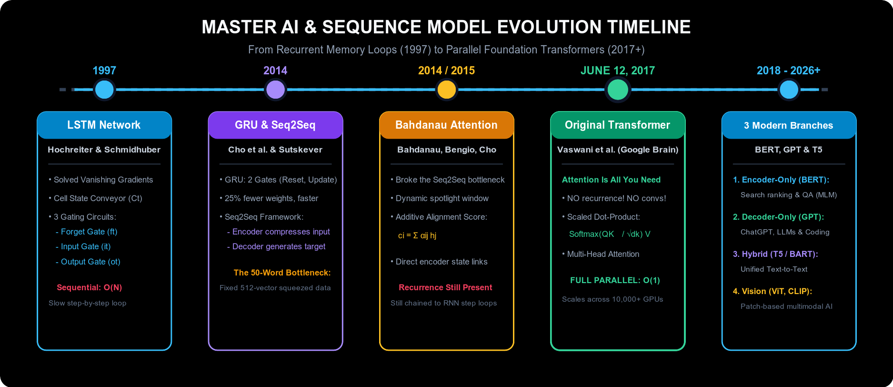

```
                       સંપૂર્ણ AI અને સિક્વેન્સ મોડેલ ઉત્ક્રાંતિ ટાઈમલાઇન
                       
   ૧૯૯૭               ૨૦૧૪                   ૨૦૧૪ / ૨૦૧૫             ૧૨ જૂન, ૨૦૧૭             ૨૦૧૮ - ૨૦૨૦+
 ┌──────────────┐   ┌──────────────┐       ┌──────────────┐        ┌──────────────────┐      ┌────────────────────────┐
 │ LSTM નેટવર્ક │──►│ GRU & Seq2Seq│──────►│ Bahdanau     │───────►│ સંપૂર્ણ         │─────►│ આધુનિક ૩ મુખ્ય શાખાઓ:  │
 │ Hochreiter & │   │ Cho et al. & │       │ Additive     │        │ Transformer      │      │ • ૨૦૧૮: BERT (Encoder) │
 │ Schmidhuber  │   │ Sutskever    │       │ Attention    │        │ Vaswani et al.   │      │ • ૨૦૧૮: GPT (Decoder)  │
 └──────┬───────┘   └──────┬───────┘       └──────┬───────┘        │ (Google Brain)   │      │ • ૨૦૧૯: T5 (Enc-Dec)   │
        │                  │                      │                └────────┬─────────┘      └────────────────────────┘
        ▼                  ▼                      ▼                         ▼
• વેનિશિંગ ગ્રેડિ-  • GRU: ૨ ગેટ્સ,        • Seq2Seq ની માહિતી      • Recurrent લૂપ્સનો       • BERT: ગૂગલ સર્ચ & NLU
  યન્ટનું સમાધાન      ઝડપી ટ્રેનિંગ          દબાવવાની મર્યાદા         સંપૂર્ણ અંત            • GPT: ChatGPT & કોડિંગ
• Cell State &     • Seq2Seq: એન્કોડર-      (Bottleneck) ઉકેલી      • Scaled Dot-Product     • T5: યુનિફાઇડ Text-to-Text
  ૩ ગેટ્સ રજૂ કર્યા   ડિકોડર કન્ટેક્સ્ટ વેક્ટર  • ડાયનેમિક ફોકસ ટોર્ચ      Self-Attention         • ViT: વિઝન ટ્રાન્સફોર્મર
```

---

#### B. ૫ મુખ્ય ઐતિહાસિક સીમાચિહ્નોની ઊંડાણપૂર્વક સમજૂતી (The 5 Evolutionary Milestones Explained)

##### સીમાચિહ્ન ૧: મૂળ સિક્વેન્સ આર્કિટેક્ચર્સ (૧૯૯૭ – ૨૦૧૪)
* **૧૯૯૭ — Long Short-Term Memory (LSTM):**
  - **સંશોધકો:** સેપ હોચરાઇટર (Sepp Hochreiter) અને જુર્ગેન શ્મિડહુબર (Jürgen Schmidhuber).
  - **મુખ્ય સમસ્યાનું સમાધાન:** સાદા Recurrent Neural Networks (RNNs) માં ગણતરી જેમ જેમ આગળ વધતી ગઈ તેમ તેમ ગ્રેડિયન્ટ અદ્રશ્ય (**Vanishing Gradient**) થઈ જતો હતો, જેથી નેટવર્ક ૫ થી ૧૦ શબ્દો પછી જૂની વિગતો સંપૂર્ણપણે ભૂલી જતું હતું.
  - **મહત્વની નવીનતા:** વચ્ચે કોઈ અવરોધ વગર વહેતી આંતરિક કન્વેયર બેલ્ટ જેવી સેલ સ્ટેટ મેમરી ($\mathbf{C}_t$) રજૂ કરી, જેને ત્રણ ગુણાકાર આધારિત ગેટ્સ (Gates) નિયંત્રિત કરે છે:
    - **Forget Gate ($f_t$):** કઈ જૂની નકામી માહિતીને મેમરીમાંથી ભૂંસી નાખવી.
    - **Input Gate ($i_t$):** નવી કઈ ઉપયોગી ઉમેરવા જેવી માહિતી સ્ટોર કરવી.
    - **Output Gate ($o_t$):** આગલા ન્યુરોન માટે વર્તમાન હિડન સ્ટેટ ($\mathbf{h}_t$) તરીકે શું બહાર મોકલવું.
* **૨૦૧૪ — Gated Recurrent Unit (GRU):**
  - **સંશોધકો:** ક્યુંગહ્યુન ચો (Kyunghyun Cho et al.).
  - **મહત્વની નવીનતા:** LSTM ની સરખામણીમાં હળવું અને કમ્પ્યુટેશનલ રીતે ઝડપી મોડેલ. તેણે સેલ સ્ટેટ અને હિડન સ્ટેટને ભેગા કરીને માત્ર ૨ ગેટ્સ વાળું નેટવર્ક બનાવ્યું:
    - **Reset Gate ($r_t$):** પાછલી મેમરીમાંથી કેટલો ડેટા કાઢી નાખવો.
    - **Update Gate ($z_t$):** જૂની સ્થિતિ જાળવી રાખવી કે નવો ડેટા સ્વીકારવો.
  - **વાસ્તવિક લાભ:** ટ્રેઇનેબલ પેરામીટર્સમાં આશરે ૨૫% નો ઘટાડો થયો અને GPU ટ્રેનિંગ ૨૦% થી ૩૦% વધુ ઝડપી બની.

---

##### સીમાચિહ્ન ૨: Seq2Seq ફ્રેમવર્ક (૨૦૧૪)
* **સંશોધકો:** ઇલ્યા સુત્સ્કેવર (Ilya Sutskever), ઓરિઓલ વિન્યાલ્સ (Oriol Vinyals), ક્વાક વી. લે (Quoc V. Le - Google) અને ક્યુંગહ્યુન ચો (Kyunghyun Cho et al.).
* **મુખ્ય સમસ્યાનું સમાધાન:** જૂના RNN મોડેલ્સમાં ઇનપુટ અને આઉટપુટ વાક્યની લંબાઈ એકસરખી હોવી ફરજિયાત હતી ($T_x = T_y$). તેથી ૭ શબ્દોના અંગ્રેજી વાક્યનું ૯ શબ્દોના ગુજરાતી કે ફ્રેન્ચ વાક્યમાં ભાષાંતર કરવું અસંભવ હતું.
* **તે કેવી રીતે કામ કરતું હતું (The Encoder-Decoder Paradigm):**
  1. **Encoder RNN:** ઇનપુટ વાક્યના દરેક શબ્દને ક્રમશઃ વાંચે છે અને વાક્યનો સમગ્ર અર્થ માત્ર **એક જ ફિક્સ્ડ-લેન્થ કન્ટેક્સ્ટ વેક્ટર** ($\mathbf{c} \in \mathbb{R}^d$, સામાન્ય રીતે ૫૧૨ કે ૧૦૨૪ ફ્લોટિંગ પોઇન્ટ નંબર્સ) માં સંકોચી (compress) લે છે.
  2. **Decoder RNN:** તે કન્ટેક્સ્ટ વેક્ટર $\mathbf{c}$ થી શરૂઆત કરે છે અને એક પછી એક અનુવાદિત શબ્દ બહાર કાઢે છે જ્યાં સુધી `<EOS>` (વાક્ય પૂરું) ટોકન ન આવે.

---

##### સીમાચિહ્ન ૩: સીધો પુરોગામી — બહદાનાઉ એટેન્શન (Bahdanau Attention, ૨૦૧૪/૨૦૧૫)
* **સંશોધકો:** દ્મિત્રી બહદાનાઉ (Dzmitry Bahdanau), ક્યુંગહ્યુન ચો (Kyunghyun Cho), અને યોશુઆ બેન્જિયો (Yoshua Bengio) — સંશોધન પેપર: *"Neural Machine Translation by Jointly Learning to Align and Translate"*.
* **Seq2Seq ની બોટલનેક મર્યાદા (The "Bottleneck Problem"):** ૫૦ શબ્દોના લાંબા ફકરાની આખી વાર્તાને માત્ર ૫૧૨ આંકડાઓના એક નાના વેક્ટરમાં ધરાર દબાવી રાખવી ગાણિતિક રીતે અશક્ય હતી; વાક્ય પૂરું થતાં સુધીમાં શરૂઆતના શબ્દો સંપૂર્ણપણે ભુલાઈ જતા હતા.
* **કેવી રીતે ક્રાંતિ કરી:** ડિકોડરને માત્ર એક જ સંકોચાયેલા વેક્ટર $\mathbf{c}$ પર નિર્ભર રાખવાને બદલે, એટેન્શને ડિકોડરને એન્કોડરના **તમામ હિડન સ્ટેટ્સ** $[\mathbf{h}_1, \dots, \mathbf{h}_{T_x}]$ તરફ ડાયનેમિક નજર નાખવાની છૂટ આપી:
  $$\mathbf{c}_i = \sum_{j=1}^{T_x} \alpha_{ij} \mathbf{h}_j, \quad \text{જ્યાં } \alpha_{ij} = \frac{\exp(e_{ij})}{\sum_k \exp(e_{ik})}$$
  ડિકોડર જ્યારે પણ કોઈ શબ્દ બોલે, ત્યારે મૂળ વાક્યના જે શબ્દ સાથે તેનો સીધો સંબંધ હોય તેના પર વધારે ધ્યાન (Attention Weight $\alpha_{ij}$) કેન્દ્રિત કરે છે.

---

##### સીમાચિહ્ન ૪: ટ્રાન્સફોર્મર ક્રાંતિ (૧૨ જૂન, ૨૦૧૭ — June 12, 2017)
* **પ્રકાશન તારીખ:** **૧૨ જૂન, ૨૦૧૭**
* **ઐતિહાસિક પેપર:** *"Attention Is All You Need"*
* **સંશોધકો (Google Brain & Google Research):** આશિષ વાસવાણી (Ashish Vaswani), નોમ શાઝીર (Noam Shazeer), નિકી પરમાર (Niki Parmar), જાકોબ ઉસ્કોરાઇટ (Jakob Uszkoreit), લિયોન જોન્સ (Llion Jones), એડન ગોમેઝ (Aidan N. Gomez), લુકાસ કાઇઝર (Łukasz Kaiser), ઇલ્યા પોલોસુખીન (Illia Polosukhin).
* **પેરાડાઇમ શિફ્ટ (નવી વૈચારિક ક્રાંતિ):** લેખકોએ રિકરન્ટ સિક્વેન્શિયલ લૂપ્સ અને કન્વોલ્યુશનલ ફિલ્ટર્સને સંપૂર્ણપણે હટાવી દીધા!
  - **લૂપ્સ કેમ બંધ કર્યા?** RNN મોડેલમાં $t$ મો શબ્દ પ્રોસેસ કરવા માટે અગાઉના $t-1$ મા શબ્દની રાહ જોવી જ પડતી હતી ($O(N)$ સ્ટેપ્સ). તેથી મોંઘા GPU હોવા છતાં બધા શબ્દો એકસાથે પ્રોસેસ થઈ શકતા નહોતા.
  - **Self-Attention એ લૂપનું સ્થાન લીધું:** વાક્યના તમામ શબ્દો વચ્ચે એકસાથે મેટ્રિક્સ ગુણાકાર દ્વારા સંબંધ માપીને ($\text{Softmax}\left(\frac{Q K^T}{\sqrt{d_k}}\right) V$), મોડેલ **$O(1)$ ક્રમિક ઓપરેશન્સ** મેળવે છે. આનાથી હજારો શબ્દો એકસાથે GPU/TPU પર સમાંતર (in parallel) પ્રોસેસ થવા લાગ્યા.
* **મૂળ આર્કિટેક્ચર:** ૨૦૧૭ ના મૂળ પેપરમાં સંપૂર્ણ **Encoder-Decoder Transformer** રજૂ થયો હતો, જે ખાસ કરીને અંગ્રેજીથી જર્મન અને ફ્રેન્ચ ભાષાંતર માટે તૈયાર કરવામાં આવ્યો હતો.

---

##### સીમાચિહ્ન ૫: આધુનિક ટ્રાન્સફોર્મરની ૩ વિભાજિત શાખાઓ (૨૦૧૮ થી આજ સુધી)

૨૦૧૭ ની આ ક્રાંતિ પછી સમગ્ર વિશ્વના AI વૈજ્ઞાનિકોને સમજાયું કે જરૂરિયાત મુજબ એન્કોડર અને ડિકોડરને અલગ પાડીને વિશિષ્ટ કાર્યો સોંપી શકાય છે:

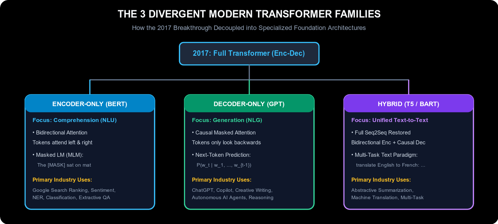

```
                            આધુનિક ટ્રાન્સફોર્મરના ૩ પરિવારો
                           
                               ┌───────────────────────────┐
                               │ ૨૦૧૭: મૂળ ટ્રાન્સફોર્મર   │
                               │ (સંપૂર્ણ Encoder-Decoder) │
                               └─────────────┬─────────────┘
                                             │
                ┌────────────────────────────┼────────────────────────────┐
                ▼                            ▼                            ▼
┌─────────────────────────────┐ ┌─────────────────────────────┐ ┌─────────────────────────────┐
│ ૨૦૧૮: Encoder-Only (BERT)   │ │ ૨૦૧૮: Decoder-Only (GPT)    │ │ ૨૦૧૯/૨૦: હાઇબ્રિડ (T5 /BART)│
├─────────────────────────────┤ ├─────────────────────────────┤ ├─────────────────────────────┤
│ • ફોકસ: વાક્યની સમજણ (NLU)  │ │ • ફોકસ: લખાણ સર્જન (NLG)   │ │ • ફોકસ: ટેક્સ્ટ-ટુ-ટેક્સ્ટ  │
│ • બંને તરફનું ધ્યાન (Bidirect)│ • ક્રમિક ઓટોરિગ્રેસિવ       │ │ • પૂર્ણ Seq2Seq પુનઃસ્થાપિત │
│ • Masked Language Modeling  │ │ • આગલો શબ્દ ધારવો           │ │ • લખાણ લો ──► લખાણ આપો      │
│ • ઉપયોગ: ગૂગલ સર્ચ, QA     │ │ • ઉપયોગ: ChatGPT, LLM, કોડ │ │ • ઉપયોગ: ભાષાંતર, સારાંશ  │
└─────────────────────────────┘ └─────────────────────────────┘ └─────────────────────────────┘
```

1. **૨૦૧૮ — Encoder-Only મોડેલ્સ (BERT & RoBERTa):**
   - **અગ્રેસર:** Google (Jacob Devlin et al., 2018).
   - **કાર્યપદ્ધતિ:** ડિકોડર કાઢી નાખવામાં આવ્યો અને માત્ર બાયડિરેક્શનલ એન્કોડર લેયર્સ રાખવામાં આવ્યા. વાક્યનો દરેક શબ્દ પોતાની ડાબી અને જમણી બંને બાજુના બધા શબ્દોને એકસાથે જુએ છે. તે **Masked Language Modeling (MLM)** દ્વારા શીખે છે (જેમ કે વાક્ય વચ્ચે ખાલી જગ્યા પૂરવી: *"ગાય આપણને [MASK] આપે છે"* ──► *"દૂધ"*).
   - **શ્રેષ્ઠ ઉપયોગ:** વાક્યની ગહન સમજણ (NLU), દસ્તાવેજ વર્ગીકરણ, ગૂગલ સર્ચ ક્વેરી રેન્કિંગ, અને સવાલ-જવાબ (QA).
2. **૨૦૧૮ — Decoder-Only મોડેલ્સ (GPT સિરીઝ અને LLaMA):**
   - **અગ્રેસર:** OpenAI (Alec Radford et al., 2018 — GPT-1), ત્યારબાદ GPT-2 (2019), GPT-3 (2020), GPT-4 (2023), અને Meta LLaMA.
   - **કાર્યપદ્ધતિ:** એન્કોડર કાઢી નાખીને માત્ર ઓટોરિગ્રેસિવ ડિકોડર લેયર્સ રાખવામાં આવ્યા. તેમાં **Causal Masking** વપરાય છે (શબ્દ ફક્ત પોતાની પાછળ આવેલા શબ્દો જ જોઈ શકે, ભવિષ્યના શબ્દો છુપાયેલા રહે). તેનું મુખ્ય લક્ષ્ય ફક્ત એક પછી એક આગલો સાચો શબ્દ ધારવાનું છે: $P(w_t \mid w_1, \dots, w_{t-1})$.
   - **શ્રેષ્ઠ ઉપયોગ:** નવું લખાણ બનાવવું (NLG), વાર્તાલાપ કરતા ચેટબોટ્સ (ChatGPT, Claude), કોડ લખવો (GitHub Copilot), અને સ્વાયત્ત AI એજન્ટ્સ.
3. **૨૦૧૯/૨૦૨૦ — હાઇબ્રિડ Encoder-Decoder મોડેલ્સ (T5 & BART):**
   - **અગ્રેસર:** Google (Colin Raffel et al., 2019 — T5: *Text-to-Text Transfer Transformer*) અને Meta (Mike Lewis et al., 2019 — BART).
   - **કાર્યપદ્ધતિ:** સંપૂર્ણ એન્કોડર અને ડિકોડરનું જોડાણ પાછું સ્વીકાર્યું. દુનિયાભરના તમામ NLP કાર્યોને એક જ "ટેક્સ્ટ-ટુ-ટેક્સ્ટ" ફોર્મેટમાં ઢાળી દીધા:
     - ભાષાંતર: `"translate English to Gujarati: The sky is blue"` ──► `"આકાશ વાદળી છે"`
     - સેન્ટિમેન્ટ વર્ગીકરણ: `"classify: This food is delicious"` ──► `"positive"`
     - સંક્ષિપ્તિકરણ: `"summarize: [આખો લાંબો લેખ]"` ──► `"[૧ વાક્યનો સારાંશ]"`
   - **શ્રેષ્ઠ ઉપયોગ:** લાંબા સરકારી કે કાનૂની અહેવાલોનો સારાંશ બનાવવો (Abstractive Summarization) અને બહુભાષી ટ્રાન્સલેશન.

---

#### C. સંપૂર્ણ આર્કિટેક્ચર ઉત્ક્રાંતિ સરખામણી કોષ્ટક (Architecture Progression Matrix)

| આર્કિટેક્ચર (Architecture) | વર્ષ | મુખ્ય સંશોધકો | બંધારણ (Topology) | મુખ્ય મિકેનિઝમ (Core Mechanism) | GPU સમાંતરતા (Parallelization) | મુખ્ય વાસ્તવિક ઉપયોગ |
| :--- | :---: | :--- | :--- | :--- | :---: | :--- |
| **LSTM** | ૧૯૯૭ | Hochreiter & Schmidhuber | રિકરન્ટ મેમરી સેલ | ૩ ગેટ્સ ($f, i, o$) + સેલ સ્ટેટ ($C_t$) | ❌ ક્રમિક લૂપ ($O(N)$) | શરૂઆતનું સ્પીચ-ટુ-ટેક્સ્ટ, મોબાઇલ કીબોર્ડ ટાઇપિંગ પ્રિડિક્શન |
| **GRU** | ૨૦૧૪ | Kyunghyun Cho et al. | હળવો રિકરન્ટ સેલ | ૨ ગેટ્સ ($r, z$), સંયુક્ત હિડન સ્ટેટ | ❌ ક્રમિક લૂપ ($O(N)$) | ઓછા પાવરવાળા IoT સેન્સર્સ, ઝડપી ટાઇમ-સિરીઝ વિશ્લેષણ |
| **Seq2Seq** | ૨૦૧૪ | Sutskever et al. & Cho et al. | બેવડું RNN (Encoder + Decoder) | ફિક્સ્ડ-લેન્થ કન્ટેક્સ્ટ વેક્ટર ($\mathbf{c}$) | ❌ ક્રમિક લૂપ ($O(N)$) | પ્રથમ પેઢીનું ઓટોમેટેડ ન્યુરલ મશીન ટ્રાન્સલેશન (NMT) |
| **Bahdanau Attention** | ૨૦૧૪/૧૫ | Bahdanau, Bengio, Cho | રિકરન્ટ + ડાયનેમિક એલાઇનમેન્ટ | Additive Attention ($\sum \alpha_{ij} \mathbf{h}_j$) | ❌ ક્રમિક લૂપ ($O(N)$) | ભાષાંતરમાં ૫૦ શબ્દોની માહિતી દબાઈ જવાની મર્યાદા દૂર કરવી |
| **Original Transformer** | જૂન ૨૦૧૭ | Vaswani et al. (Google Brain) | સંપૂર્ણ Encoder-Decoder સ્ટેક | Scaled Dot-Product & Multi-Head Attention | ✅ સંપૂર્ણ સમાંતર ($O(1)$) | ગૂગલ ટ્રાન્સલેટ અને આધુનિક ભાષાંતર સિસ્ટમ્સ |
| **BERT** | ૨૦૧૮ | Devlin et al. (Google AI) | Encoder-Only | દ્વિ-દિશિય Self-Attention + MLM | ✅ સંપૂર્ણ સમાંતર ($O(1)$) | ગૂગલ સર્ચ પરિણામોનું રેન્કિંગ, કાનૂની કરાર વિશ્લેષણ |
| **GPT Series** | ૨૦૧૮+ | Radford et al. (OpenAI) | Decoder-Only | Causal Masked Self-Attention (Next-Token) | ✅ સુપર-સ્કેલ સમાંતર ટ્રેનિંગ | ChatGPT, Copilot, ઓટોનોમસ સોફ્ટવેર એન્જિનિયરિંગ એજન્ટ્સ |
| **T5 / BART** | ૨૦૧૯/૨૦ | Raffel et al. (Google) / Meta | સંપૂર્ણ Encoder-Decoder સ્ટેક | Cross-Attention સાથે Text-to-Text મેપિંગ | ✅ સંપૂર્ણ સમાંતર | લાંબા અહેવાલોનો સારાંશ, બહુભાષી મલ્ટી-ટાસ્ક મોડેલિંગ |

---

#### D. મોડેલ યુગ અને પેરામીટર સ્કેલિંગ ઉત્ક્રાંતિ: ૬૫ મિલિયનથી લઈને ટ્રિલિયન્સ સુધી

રિકરન્ટ નેટવર્ક્સમાંથી સેલ્ફ-એટેન્શન તરફના પરિવર્તને મોડેલ પેરામીટર્સ અને કમ્પ્યુટેશનલ ક્ષમતામાં અભૂતપૂર્વ વિસ્ફોટ સર્જ્યો, જે ૪ મુખ્ય ઐતિહાસિક યુગમાં વહેંચાયેલું છે:

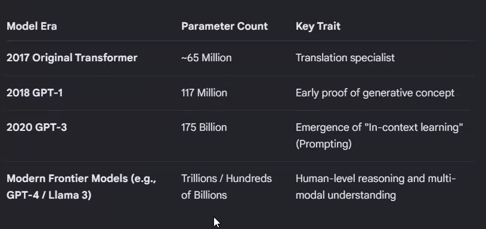

| મોડેલ યુગ (Model Era) | પેરામીટર સંખ્યા (Parameter Count) | મુખ્ય લક્ષણ (Key Trait) |
| :--- | :--- | :--- |
| **2017 Original Transformer** | ~૬૫ મિલિયન (~65 Million) | ભાષાંતર નિષ્ણાત (Translation specialist) |
| **2018 GPT-1** | ૧૧૭ મિલિયન (117 Million) | જનરેટિવ ક્ષમતાનો પ્રારંભિક પુરાવો (Early proof of generative concept) |
| **2020 GPT-3** | ૧૭૫ બિલિયન (175 Billion) | "In-context learning" (Prompting) નો ઉદય |
| **Modern Frontier Models (દા.ત. GPT-4 / Llama 3)** | ટ્રિલિયન્સ / સેંકડો બિલિયન (Trillions / Hundreds of Billions) | માનવ-સ્તરનું તાર્કિક વિચારણા (Reasoning) અને મલ્ટી-મોડલ સમજ |

---

### ૧૩.૧.૧ ક્લાસિકલ NLP પાઇપલાઇન: શબ્દ વિશ્લેષણ, POS Tagging અને સિન્ટેક્ટિક ડિપેન્ડન્સી પાર્સિંગ (Syntactic Dependency Parsing)

> [!NOTE] 💡 સાદી ભાષામાં સમજૂતી અને વાસ્તવિક ઉપયોગ: ક્લાસિકલ NLP પાઇપલાઇન
> - **તે શું છે? (સાદી વ્યાખ્યા):** ડીપ લર્નિંગ પહેલાં પરંપરાગત નેચરલ લેંગ્વેજ પ્રોસેસિંગ (NLP) માં વપરાતી પદ્ધતિ, જ્યાં કોઈપણ વાક્યને અર્થ સમજવા માટે વિશિષ્ટ મોડેલ્સ અને નિયમોની એક લાંબી સાંકળ (Cascaded Pipeline) માંથી ક્રમશઃ પસાર કરવામાં આવતું હતું — શબ્દો છૂટા પાડવા, નામ-ક્રિયાપદ ઓળખવા (POS Tagging), વ્યાકરણના સંબંધો જોડવા (Syntactic Parsing), અને છેલ્લે વાક્યનો અસલ અર્થ શોધવો.
> - **તે કેવી રીતે કામ કરે છે અને મર્યાદા શું હતી?**
>   - **ક્લાસિકલ પાઇપલાઇન:** `ટોકનાઇઝેશન` $\to$ `POS Tagging` $\to$ `ડિપેન્ડન્સી પાર્સિંગ` $\to$ `સિમેન્ટિક એનાલિસિસ`.
>   - **મોટી ખામી (Cascading Error):** જો શરૂઆતનું POS ટેગર ભૂલ કરે (દા.ત. "saw" ને ક્રિયાપદને બદલે કરવત સમજી લે), તો પાછળના બધા જ વ્યાકરણ અને અર્થના મોડેલ્સ સંપૂર્ણ ફેઇલ થઈ જતા.
>   - **ટ્રાન્સફોર્મરની ક્રાંતિ:** આધુનિક ટ્રાન્સફોર્મર (BERT / GPT) એ આ તમામ અલગ અલગ નિયમો કાઢી નાખ્યા. તે સેલ્ફ-એટેન્શન દ્વારા નીચેના લેયર્સમાં વ્યાકરણ અને ઉપરના લેયર્સમાં આખો અર્થ જાતે જ શીખી લે છે!
> - **વાસ્તવિક ઉપયોગ:** **Grammarly, Siri અને ગૂગલ સર્ચ:** વાક્ય રચનાનું વિશ્લેષણ કરીને વ્યાકરણની ગંભીર ભૂલો પકડવી અને સર્વનામ (દા.ત. "it", "they") કોના માટે વપરાયું છે તે ચોક્કસ નક્કી કરવું.

#### A. સિન્ટેક્ટિક ડિપેન્ડન્સી ટ્રી અને POS ટેગિંગનું વિશ્લેષણ

નીચેનું વાક્ય જુઓ (જે ઇન્ડસ્ટ્રી-સ્ટાન્ડર્ડ **spaCy displaCy** એન્જિન [spacy.io](https://spacy.io/) દ્વારા વિઝ્યુઅલાઇઝ થયેલું છે):  
*"I saw the ship with very strong binocular."* (મેં ખૂબ શક્તિશાળી દૂરબીન વડે જહાજ જોયું.)

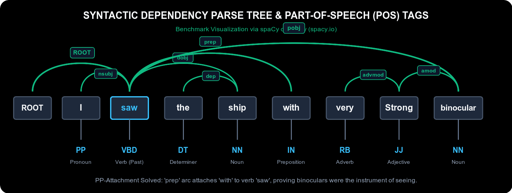

```
                         સિન્ટેક્ટિક ડિપેન્ડન્સી પાર્સ ટ્રી અને POS ટેગ્સ
                              
                                                 pobj
                      ┌────────────────────────────────────────────────────────┐
             ROOT     │                       prep                             │
          ┌────────┐  │               ┌──────────────────┐                     │
          │  nsubj │  │        dobj   │                  │        amod         │
          │  ┌───┐ │  │    ┌────────┐ │                  │     ┌────────┐      │
          ▼  ▼   │ ▼  ▼    ▼        │ ▼                  ▼     ▼        │      │
        [ROOT]  [ I ]   [ saw ]   [ the ]   [ ship ]   [ with ] [ very ] [ Strong ] [ binocular ]
          │       │        │         │         │          │        │         │          │
          │       │        │         │         │          │        └── advmod┘          │
          │       │        │         └── dep ──┘          │                             │
          │       │        │                              └─────────────────────────────┘
          ▼       ▼        ▼         ▼         ▼          ▼        ▼         ▼          ▼
         ROOT     PP      VBD        DT        NN         IN       RB        JJ         NN
```

##### ૧. Part-of-Speech (POS) ટેગ્સની સમજૂતી (Penn Treebank સ્ટાન્ડર્ડ):
- **`PP` (Personal Pronoun - `I`):** બોલનાર વ્યક્તિ (કર્તા / સર્વનામ).
- **`VBD` (Verb, Past Tense - `saw`):** ભૂતકાળનું મુખ્ય ક્રિયાપદ (જોવાની ક્રિયા).
- **`DT` (Determiner - `the`):** ચોક્કસ નામ દર્શાવતો શબ્દ.
- **`NN` (Noun, Singular - `ship`, `binocular`):** એકવચન સંજ્ઞા (જહાજ અને દૂરબીન).
- **`IN` (Preposition - `with`):** નામયોગી અવ્યય (કોના વડે ક્રિયા થઈ તે દર્શાવે છે).
- **`RB` (Adverb - `very`):** ક્રિયાવિશેષણ (જે "Strong" ની તીવ્રતા વધારે છે).
- **`JJ` (Adjective - `Strong`):** વિશેષણ (જે દૂરબીનની ગુણવત્તા દર્શાવે છે).

##### ૨. ડિપેન્ડન્સી સંબંધો અને ગ્રામેટિકલ તીર (Arcs) ની સમજૂતી:
- **`ROOT` (`ROOT` $\to$ `saw`):** આખા વાક્યનો કેન્દ્રિય પાયો અને મુખ્ય ક્રિયાપદ.
- **`nsubj` (Nominal Subject: `saw` $\to$ `I`):** ક્રિયા કરનાર કર્તા ("મેં" જોયું).
- **`dobj` (Direct Object: `saw` $\to$ `ship`):** ક્રિયાનું લક્ષ્ય / કર્મ (શું જોયું? ──► "જહાજ").
- **`dep` / `det` (Determiner Modifier: `ship` $\to$ `the`):** કર્મને નિશ્ચિત બનાવતો સંબંધ.
- **`prep` (Prepositional Modifier: `saw` $\to$ `with`):** જોવાની ક્રિયા કયા સાધન વડે થઈ તે જોડે છે.
- **`pobj` (Object of Preposition: `with` $\to$ `binocular`):** સાધન (દૂરબીન).
- **`amod` (Adjectival Modifier: `binocular` $\to$ `Strong`):** દૂરબીન કેવું છે? ──► "શક્તિશાળી".
- **`advmod` (Adverbial Modifier: `Strong` $\to$ `very`):** કેટલું શક્તિશાળી? ──► "ખૂબ જ".

---

#### B. ક્લાસિકલ NLP પાઇપલાઇનના ૭ ક્રમિક સ્તરો

ડીપ લર્નિંગ પહેલાં, **spaCy** ([spacy.io](https://spacy.io/)), NLTK અને Stanford CoreNLP જેવા ટૂલ્સ ભાષાને ૭ ક્રમિક તબક્કાઓમાં વિશ્લેષિત કરતા હતા:

```
┌────────────────────────────────────────────────────────────────────────┐
│                    ક્લાસિકલ NLP પાઇપલાઇનના ૭ તબક્કા                    │
├────────────────────────────────────────────────────────────────────────┤
│ ૧. લેક્સિકલ એનાલિસિસ & ટોકનાઇઝેશન: આખા લખાણને શબ્દોમાં છૂટું પાડવું    │
│         │                                                              │
│         ▼                                                              │
│ ૨. મોર્ફોલોજિકલ એનાલિસિસ: મૂળ શબ્દ શોધવો (Lemmatization: saw ──► see)  │
│         │                                                              │
│         ▼                                                              │
│ ૩. POS Tagging: વ્યાકરણના પ્રકારો નક્કી કરવા (NN, VBD, JJ, RB)         │
│         │                                                              │
│         ▼                                                              │
│ ૪. સિન્ટેક્ટિક એનાલિસિસ (Parsing): શબ્દો વચ્ચે સંબંધોનું ટ્રી બનાવવું  │
│         │                                                              │
│         ▼                                                              │
│ ૫. સિમેન્ટિક એનાલિસિસ: શબ્દનો અર્થ અને ભૂમિકા (Agent, Instrument)      │
│         │                                                              │
│         ▼                                                              │
│ ૬. ડિસકોર્સ ઇન્ટિગ્રેશન: વાક્યો વચ્ચે સર્વનામ જોડવા (Coreference)     │
│         │                                                              │
│         ▼                                                              │
│ ૭. પ્રાગ્મેટિક એનાલિસિસ: સંદર્ભ, કટાક્ષ (Sarcasm) અને વાસ્તવિક ભાવ     │
└────────────────────────────────────────────────────────────────────────┘
```

#### C. વાક્ય રચનાની મોટી અસમંજસ: PP-Attachment Ambiguity
વાક્ય: *"I saw the ship with very strong binocular."*
અહીં કમ્પ્યુટર સામે બે શક્યતાઓ ઊભી થાય છે:
1. **શક્યતા ૧ (સાચો અર્થ - Verb Attachment):** `saw` $\xrightarrow{\text{prep}}$ `with` $\xrightarrow{\text{pobj}}$ `binocular`. મેં દૂરબીનની મદદ વડે જહાજ જોયું.
2. **શક્યતા ૨ (ખોટો અર્થ - Noun Attachment):** `ship` $\xrightarrow{\text{prep}}$ `with` $\xrightarrow{\text{pobj}}$ `binocular`. જહાજ પાસે દૂરબીન હતું!
ડિપેન્ડન્સી પાર્સિંગ આ તફાવત ચોક્કસ પારખીને સાચું વ્યાકરણ ટ્રી બનાવે છે.

#### D. પરંપરાગત પાઇપલાઇન કેમ નિષ્ફળ ગઈ? કેસ્કેડિંગ એરર (Cascading Error Problem)

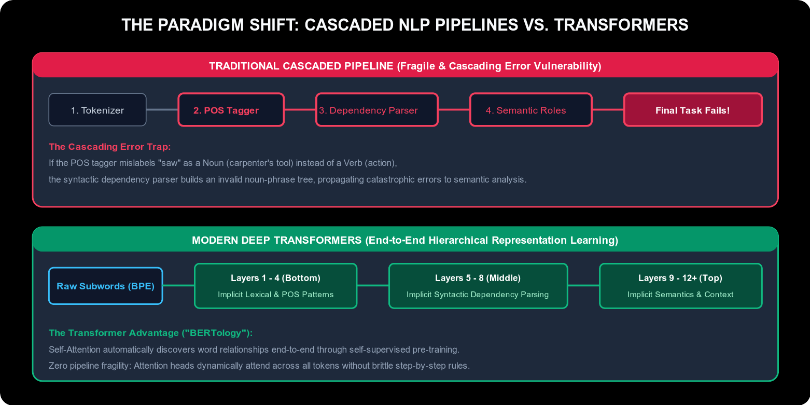

```
જૂની પાઇપલાઇન (નાજુક પદ્ધતિ):
[કાચું લખાણ] ──► [ટોકનાઇઝર] ──► [POS ટેગર] ──► [ડિપેન્ડન્સી પાર્સર] ──► [અર્થ વિશ્લેષણ]
                                   │                   │
                           ❌ અહીં ભૂલ થઈ      ❌ ભૂલ મોટી થઈ    💥 આખું મોડેલ ફેઇલ!

આધુનિક ટ્રાન્સફોર્મર (સંપૂર્ણ એન્ડ-ટુ-એન્ડ ડીપ લર્નિંગ):
[સબ-વર્ડ્સ] ──► [ લેયર્સ ૧-૪: અંદર આપમેળે POS અને શબ્દ સમજણ ]
            ──► [ લેયર્સ ૫-૮: અંદર આપમેળે વ્યાકરણ અને સંબંધો (Syntax) ]
            ──► [ લેયર્સ ૯-૧૨+: ઊંડો અર્થ અને સંદર્ભ (Semantics) ] ──► [સચોટ આઉટપુટ]
```

#### E. Python અને spaCy વડે પ્રેક્ટિકલ અમલીકરણ:

ઉદ્યોગ-માનક **spaCy** ([spacy.io](https://spacy.io/)) લાઇબ્રેરી વાપરીને આ ડિપેન્ડન્સી ટ્રી ફક્ત ૫ લાઇનના કોડમાં બનાવી શકાય છે:

```python
import spacy
from spacy import displacy

# ૧. અંગ્રેજી મોડેલ પાઇપલાઇન લોડ કરો
nlp = spacy.load("en_core_web_sm")

# ૨. વાક્યને પાઇપલાઇનમાંથી પસાર કરો
doc = nlp("I saw the ship with very strong binocular")

# ૩. દરેક શબ્દનો POS ટેગ અને ડિપેન્ડન્સી હેડ પ્રિન્ટ કરો
for token in doc:
    print(f"{token.text:<12} | {token.tag_:<6} | {token.dep_:<10} | {token.head.text}")

# ૪. ઇન્ટરેક્ટિવ વિઝ્યુલાઇઝર ચલાવો (જે ફોટા જેવો ગ્રાફ બતાવે છે)
# displacy.serve(doc, style="dep")
```

---

### ૧૩.૨ Seq2Seq મોડેલ્સનો ઇન્ફોર્મેશન બોટલનેક પ્રોબ્લેમ (The Information Bottleneck)

૨૦૧૭ પહેલાં વાક્યોના ભાષાંતર અને અવાજ ઓળખવા માટે રિકરન્ટ Sequence-to-Sequence (Seq2Seq) મોડેલ સૌથી શ્રેષ્ઠ ગણાતું હતું:
- **Encoder:** એક RNN આખા વાક્યના તમામ શબ્દોને ક્રમશઃ વાંચીને માત્ર એક જ ફિક્સ્ડ સાઇઝના કન્ટેક્સ્ટ વેક્ટર $\mathbf{c} \in \mathbb{R}^d$ માં દબાવી દેતો હતો.
- **Decoder:** બીજો RNN તે વેક્ટર $\mathbf{c}$ પરથી બીજી ભાષામાં વાક્ય બનાવતો હતો.

```
                    SEQ2SEQ મોડેલનો ઇન્ફોર્મેશન બોટલનેક
    [ "The" ]   ──► ○ ──┐
    [ "quick" ] ──► ○ ──┼──► [ ફિક્સ્ડ કન્ટેક્સ્ટ વેક્ટર c ] ──► [ Decoder RNN ] ──► "ઝડપી" "શિયાળ"...
    [ "brown" ] ──► ○ ──┤      (૫૦ થી વધુ શબ્દોનો અર્થ
    [ "fox" ]   ──► ○ ──┘       માત્ર ૫૧૨ આંકડામાં ધરાર દબાવવો!)
```

#### શા માટે આ પદ્ધતિ લાંબા વાક્યોમાં નિષ્ફળ ગઈ?
1. **અતિશય માહિતી સંકોચન (Severe Compression):** ૫૦ થી વધુ શબ્દોના ઊંડા અર્થને માત્ર ૫૧૨ આંકડાઓમાં સંકોચવાથી વાક્યના શરૂઆતના શબ્દો અને સંદર્ભ સંપૂર્ણ ભૂંસાઈ જતાં હતા.
2. **ક્રમિક નિર્ભરતા (Sequential Dependency):** જ્યાં સુધી $t$ મો શબ્દ પ્રોસેસ ન થાય ત્યાં સુધી $t+1$ મા શબ્દ પર જઈ શકાતું નહોતું, જેથી GPU ની સમાંતર સ્પીડનો કોઈ લાભ મળતો નહોતો.

---

### ૧૩.૩ એટેન્શન મિકેનિઝમ: Query, Key, Value ($Q, K, V$) મેટાફોર

> [!NOTE] 💡 સાદી ભાષામાં સમજૂતી: એટેન્શન મિકેનિઝમ ($Q, K, V$)
> - **તે શું છે? (સાદી વ્યાખ્યા):** એક એવી સક્રિય શોધ પદ્ધતિ કે જે મોડેલને વાક્યના સૌથી મહત્વના શબ્દો પર 'ટોર્ચલાઇટ' નાખીને ધ્યાન કેન્દ્રિત કરવા દે છે, જેમ કોઈ વિદ્યાર્થી પુસ્તક વાંચતી વખતે મહત્વના શબ્દો હાઇલાઇટ કરે છે.
> - **લાઇબ્રેરી અથવા ડેટાબેઝ મેટાફોર:**
>   - **Query ($Q$):** તમે શું શોધી રહ્યા છો? (દા.ત. વાક્યનો વર્તમાન શબ્દ જે પોતાનો સંદર્ભ શોધી રહ્યો છે).
>   - **Key ($K$):** લાઇબ્રેરીના પુસ્તકોના લેબલ અથવા ઇન્ડેક્સ ટેગ.
>   - **Value ($V$):** પુસ્તકની અંદર રહેલી અસલ વિગતવાર સામગ્રી.
>   $Q$ અને $K$ નો ગુણાકાર સમાનતા માપે છે, અને તે મુજબ નક્કી થાય છે કે $V$ માંથી કેટલી માહિતી ખેંચવી.
> - **વાસ્તવિક ઉદાહરણ (ગૂગલ ટ્રાન્સલેટ):**
>   *"The animal didn't cross the street because it was too tired."*
>   અહીં Attention તરત જ ઓળખી લે છે કે **"it"** શબ્દનો સંબંધ **"animal"** સાથે છે, **"street"** સાથે નહીં! તેથી ગુજરાતીમાં ભાષાંતર કરતી વખતે "તે પ્રાણી થાકી ગયું હતું" એવો સાચો અર્થ થાય છે.

---

### ૧૩.૪ Scaled Dot-Product Attention અને Multi-Head Attention

> [!NOTE] 💡 સાદી ભાષામાં સમજૂતી: Scaled Dot-Product Attention
> - **તે શું છે? (સાદી વ્યાખ્યા):** આજના તમામ આધુનિક AI મોડેલ્સનું ગાણિતિક હૃદય, જે વાક્યના દરેક શબ્દનો બીજા બધા શબ્દો સાથે કેટલો સંબંધ છે તે સમાંતર મેટ્રિક્સ ગુણાકાર દ્વારા એક જ પળમાં માપી લે છે.
> - **તે કેવી રીતે કામ કરે છે?**
>   Queries ($Q$) અને Keys ($K^T$) નો ગુણાકાર કરીને સંબંધ સ્કોર શોધાય છે, તેને $\sqrt{d_k}$ વડે ભાગવામાં આવે છે (જેથી ગણતરી બહુ મોટી ન થઈ જાય અને સોફ્ટમેક્સ ગ્રેડિયન્ટ અદ્રશ્ય ન થાય), અને છેલ્લે Values ($V$) સાથે ગુણવામાં આવે છે.
> - **વાસ્તવિક ઉપયોગ:** **૧૦૦ પાનાના કાનૂની કરાર કે રિપોર્ટનું વિશ્લેષણ:** મિલિસેકન્ડ્સમાં આખા દસ્તાવેજમાં કયો નિયમ કઈ કલમ સાથે જોડાયેલો છે તે શોધી કાઢવું.

#### Scaled Dot-Product Attention નું ગાણિતિક સૂત્ર:
$$\text{Attention}(Q, K, V) = \text{softmax}\left( \frac{Q K^T}{\sqrt{d_k}} \right) V$$

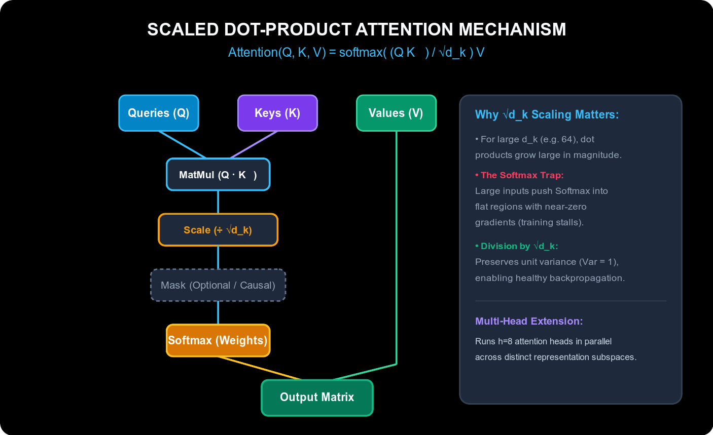

- **$\sqrt{d_k}$ વડે કેમ ભાગવામાં આવે છે? (Scaling Factor):**
  જો ડાયમેન્શન $d_k$ મોટું હોય (દા.ત. ૬૪ કે ૧૨૮), તો ડોટ પ્રોડક્ટની કિંમત ખૂબ મોટી થઈ જાય છે. મોટી કિંમતો Softmax ફંક્શનને સંતૃપ્ત (saturated) કરી દે છે, જેના પરિણામે ગ્રેડિયન્ટ્સ અત્યંત નાના (લગભગ શૂન્ય) થઈ જાય છે અને મોડેલ શીખવાનું બંધ કરી દે છે. $\sqrt{d_k}$ વડે ભાગવાથી વેરીયન્સ ૧ રહે છે અને બેકપ્રોપેગેશન સરળતાથી ચાલે છે.

#### Multi-Head Attention નો જાદુ:
વાક્યને માત્ર એક જ દ્રષ્ટિકોણથી જોવાને બદલે, ટ્રાન્સફોર્મર $h$ અલગ અલગ "હેડ્સ" (Heads - સામાન્ય રીતે ૮ કે ૧૬) વાપરે છે:
- **હેડ ૧:** વ્યાકરણ અને કર્તા-ક્રિયાપદ સંબંધ જુએ છે.
- **હેડ ૨:** સર્વનામ કોના માટે વપરાયું છે (દા.ત. "it" -> "animal") તે પકડે છે.
- **હેડ ૩:** સમય અને સ્થળના સંબંધો સમજે છે.
આ તમામ હેડ્સના પરિણામોને છેલ્લે જોડીને (Concatenate કરીને) પ્રોજેક્ટ કરવામાં આવે છે.

---

### ૧૩.૫ પોઝિશનલ એન્કોડિંગ (Positional Encoding): તે શા માટે જરૂરી છે અને ગાણિતિક સૂત્ર (The Sinusoidal Formulation & Modern RoPE)

> [!NOTE] 💡 સાદી ભાષામાં સમજૂતી અને વાસ્તવિક ઉપયોગ: પોઝિશનલ એન્કોડિંગ (Positional Encoding)
> - **તે શું છે? (સાદી વ્યાખ્યા):** દરેક શબ્દના વેક્ટરમાં ઉમેરવામાં આવતો એક ચોક્કસ ગાણિતિક ટાઈમસ્ટેમ્પ (Timestamp) અથવા GPS કોઓર્ડિનેટ, જે ટ્રાન્સફોર્મરને જણાવે છે કે વાક્યમાં કયો શબ્દ કયા ક્રમે (પ્રથમ, બીજો, ત્રીજો) આવ્યો છે.
> - **ડીપ લર્નિંગમાં તે શા માટે અનિવાર્ય છે?** RNN શબ્દોને એક પછી એક ક્રમમાં ($t_1 \to t_2 \to t_3$) વાંચતો હતો જેથી તેને ક્રમ આપોઆપ ખબર પડતી હતી. પરંતુ ટ્રાન્સફોર્મરમાં બધા શબ્દો એકસાથે સમાંતર (in parallel) પ્રોસેસ થાય છે. પોઝિશનલ એન્કોડિંગ વગર ટ્રાન્સફોર્મર **સંપૂર્ણપણે Permutation-Invariant (ક્રમ પ્રત્યે અંધ)** છે: *"કુતરો માણસને કરડે છે"* અને *"માણસ કુતરાને કરડે છે"* — આ બંને વાક્યોમાં ટ્રાન્સફોર્મર માટે એટેન્શન સ્કોર અને અર્થ બિલકુલ એકસરખા બની જશે!
> - **વાસ્તવિક ઉપયોગ:** **સર્ચ એન્જિન અને વ્યાકરણ સમજણ:** *"ખરાબ નથી, સારું છે"* (પોઝિટિવ) અને *"સારું નથી, ખરાબ છે"* (નેગેટિવ) વચ્ચેનો તફાવત ઓળખવો, જ્યાં માત્ર શબ્દોનો ક્રમ બદલાવાથી વાક્યનો અર્થ ૧૮૦ ડિગ્રી ફરી જાય છે.

ટ્રાન્સફોર્મર આર્કિટેક્ચરમાં કોઈ રિકરન્સ (RNN લૂપ) કે કન્વોલ્યુશન (CNN ફિલ્ટર) ન હોવાથી, તે **Permutation-Invariant** છે: વાક્યના શબ્દોને ઉલટ-સુલટ કરી દેવાથી પણ આઉટપુટ એટેન્શનમાં કોઈ ફેર પડતો નથી.  
શબ્દોના ક્રમની સમજ (Word Order Awareness) આપવા માટે, પ્રથમ લેયરમાં પ્રવેશતા પહેલાં શબ્દના ઇનપુટ એમ્બેડિંગમાં **Positional Encodings** સીધા સરવાળા દ્વારા ઉમેરવામાં આવે છે:
$$\mathbf{x}_{input} = \text{Embedding}(\text{token}) + \mathbf{PE}_{(pos)}$$

#### ૧. સાઇનુસોઇડલ પોઝિશનલ એન્કોડિંગનું સૂત્ર (Vaswani et al., 2017)
ટોકનની પોઝિશન $pos$ અને ડાયમેન્શન ઇન્ડેક્સ $i \in \{0, 1, \dots, \frac{d_{\text{model}}}{2} - 1\}$ માટે:
$$PE_{(pos, 2i)} = \sin\left( \frac{pos}{10000^{2i / d_{\text{model}}}} \right)$$
$$PE_{(pos, 2i+1)} = \cos\left( \frac{pos}{10000^{2i / d_{\text{model}}}} \right)$$

##### Sine અને Cosine વાપરવાના મુખ્ય ગાણિતિક કારણો:
1. **ભૌમિતિક તરંગલંબાઇ સ્પેક્ટ્રમ (Geometric Wavelength Spectrum):** દરેક ડાયમેન્શન $2\pi$ થી $10000 \cdot 2\pi$ સુધીની અલગ અલગ તરંગલંબાઈ ધરાવે છે. નીચલા ડાયમેન્શન્સ ખૂબ ઝડપથી ધ્રુજે છે (નજીકના શબ્દોનું અંતર માપવા માટે), જ્યારે ઉપલા ડાયમેન્શન્સ ધીમે ધીમે બદલાય છે (આખા ફકરા કે દસ્તાવેજના લાંબા અંતરને માપવા માટે).
2. **રેખીય સંબંધિત ગુણધર્મ (Linear Relative Offset Property):** કોઈપણ નિશ્ચિત અંતર $k$ માટે, $PE_{(pos+k)}$ ને ત્રિકોણમિતીય રોટેશન મેટ્રિક્સ દ્વારા $PE_{(pos)}$ ના રેખીય સમીકરણ (Linear function) તરીકે રજૂ કરી શકાય છે:
   $$\begin{pmatrix} \sin(\omega (pos+k)) \\ \cos(\omega (pos+k)) \end{pmatrix} = \begin{pmatrix} \cos(\omega k) & \sin(\omega k) \\ -\sin(\omega k) & \cos(\omega k) \end{pmatrix} \begin{pmatrix} \sin(\omega pos) \\ \cos(\omega pos) \end{pmatrix}$$
   આનાથી એટેન્શન મિકેનિઝમ કોઈપણ બે શબ્દો વચ્ચેનું સાપેક્ષ અંતર (Relative Distance) સરળતાથી શીખી શકે છે, પછી ભલે વાક્ય ગમે તેટલું લાંબું હોય!

#### ૨. આધુનિક ડીપ લર્નિંગમાં પોઝિશનલ એન્કોડિંગના મુખ્ય પ્રકારો:
- **Sinusoidal (મૂળ ૨૦૧૭ ટ્રાન્સફોર્મર):** નિશ્ચિત ગાણિતિક ફંક્શન્સ. શૂન્ય ટ્રેઇનેબલ પેરામીટર્સ. ટ્રેનિંગ કરતાં લાંબા વાક્યોમાં પણ કામ કરી શકે છે.
- **Learned Absolute Position Embeddings (BERT, GPT-2):** એક લુકઅપ ટેબલ $W_{pos} \in \mathbb{R}^{L_{max} \times d_{model}}$ જ્યાં પોઝિશન 0, 1, 2... ના વેક્ટર્સ બેકપ્રોપેગેશન દ્વારા શીખવામાં આવે છે. ખામી: પૂર્વનિર્ધારિત લંબાઈ (દા.ત. 512 ટોકન્સ) થી મોટા વાક્યો સંભાળી શકતું નથી.
- **Rotary Position Embeddings (RoPE — LLaMA, Mistral, Gemma, GPT-4):** ૨D કોમ્પ્લેક્સ પ્લેનમાં Query અને Key વેક્ટર્સને ટોકનની પોઝિશનના ખૂણા પર ફેરવે છે ($\mathbf{q}_m = R_{\Theta, m} W_q \mathbf{x}_m$). તે ડોટ પ્રોડક્ટ $(q_m \cdot k_n)$ માં સીધું જ સાપેક્ષ અંતર વણી લે છે, જેના કારણે આજકાલના LLMs 128,000+ થી 1,000,000 ટોકન્સનો સંદર્ભ સરળતાથી યાદ રાખી શકે છે.

---

### ૧૩.૬ સંપૂર્ણ ટ્રાન્સફોર્મર આર્કિટેક્ચર: એન્કોડર અને ડિકોડર સ્ટેક્સ (The Transformer Architecture: Encoder & Decoder Stacks)

> [!NOTE] 💡 સાદી ભાષામાં સમજૂતી અને વાસ્તવિક ઉપયોગ: સંપૂર્ણ ટ્રાન્સફોર્મર આર્કિટેક્ચર
> - **તે શું છે? (સાદી વ્યાખ્યા):** ChatGPT, ગૂગલ જેમિની અને ક્લાઉડ પાછળનું ક્રાંતિકારી AI બ્લુપ્રિન્ટ, જેણે ધીમા રિકરન્ટ લૂપ્સને સંપૂર્ણપણે તિલાંજલિ આપીને શુદ્ધ સમાંતર સેલ્ફ-એટેન્શન અને ફીડ-ફોરવર્ડ લેયર્સ અપનાવ્યા.
> - **ઇન્ટરેક્ટિવ લાઇવ વેબ વિઝ્યુઅલાઇઝર (ખાસ ભલામણ):** 🌐 **[Transformer Explainer](https://poloclub.github.io/transformer-explainer/)** (`https://poloclub.github.io/transformer-explainer/`) — **જ્યોર્જિયા ટેક પોલો ક્લબ (Georgia Tech Polo Club of Data Science)** દ્વારા વિકસિત અદભુત ઇન્ટરેક્ટિવ ટૂલ! તે તમારા બ્રાઉઝરમાં લાઇવ GPT-2 મોડેલ ચલાવે છે અને તમે જાતે કોઈપણ વાક્ય ટાઇપ કરીને ટોકન એમ્બેડિંગ્સ, પોઝિશનલ એન્કોડિંગ્સ, મલ્ટી-હેડ સેલ્ફ-એટેન્શન ($Q, K, V$ મેટ્રિક્સ ગુણાકાર), ફીડ-ફોરવર્ડ પ્રોજેક્શન્સ, ટેમ્પરેચર અને આગલા શબ્દની સંભાવનાઓને સ્ટેપ-બાય-સ્ટેપ લાઇવ વિઝ્યુઅલ જોઈ શકો છો!
> - **તે કેવી રીતે કામ કરે છે અને શા માટે ક્રાંતિકારી છે?**
>   - **એન્કોડર (Encoder):** આખા ઇનપુટ વાક્યને એકસાથે વાંચીને દ્વિ-દિશિય (Bidirectional) ગહન સમજણ અને સંદર્ભ મેટ્રિક્સ તૈયાર કરે છે (દા.ત. BERT).
>   - **ડિકોડર (Decoder):** કન્ટેક્સ્ટનો ઉપયોગ કરીને એક પછી એક શબ્દ આગળ ધારે છે. Causal Masking ના લીધે તે ભવિષ્યના શબ્દો ચોરીછૂપીથી જોઈ શકતો નથી (દા.ત. GPT).
>   - **રેસિડ્યુઅલ કનેક્શન (Add & LayerNorm):** ૫૦ થી ૧૦૦ લેયર્સ ઊંડા નેટવર્કમાં પણ સિગ્નલને અકબંધ રાખે છે અને વેનિશિંગ ગ્રેડિયન્ટ અટકાવે છે.
> - **વાસ્તવિક ઉપયોગ:** **ઓટોનોમસ કોડિંગ અને ચેટબોટ્સ:** GitHub Copilot કે જે તમારી આખી કોડ ફાઇલ એકસાથે વાંચે છે અને આગળનું આખું ફંક્શન આપમેળે ટાઇપ કરી આપે છે.

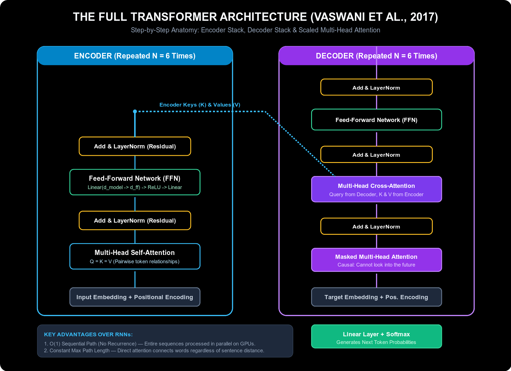

> [!TIP] 🔬 પ્રાયોગિક લાઇવ અનુભવ: ટ્રાન્સફોર્મરને બ્રાઉઝરમાં ચલાવીને જુઓ
> ટ્રાન્સફોર્મરના તમામ લેયર્સ, એટેન્શન મેપ્સ અને મેટ્રિક્સ ગણતરીઓને તમારા બ્રાઉઝરમાં લાઇવ અનુભવવા માટે જ્યોર્જિયા ટેકનું **[Transformer Explainer](https://poloclub.github.io/transformer-explainer/)** ઓપન કરો.

#### A. ક્લાસિકલ એન્કોડર-ડિકોડર મોડેલમાંથી શું જાળવી રાખ્યું અને શું બદલ્યું? (What Was Brought From the Classic Encoder-Decoder Model?)

ટ્રાન્સફોર્મરે **૨૦૧૪ ના ક્લાસિકલ Seq2Seq મોડેલનું હાઇ-લેવલ એન્કોડર-ડિકોડર માળખું** જાળવી રાખ્યું, પરંતુ અંદરની તમામ મશીનરી સંપૂર્ણપણે બદલી નાખી:

| મોડેલનું અંગ (Feature) | જૂની પદ્ધતિ (The Old Way - RNN / LSTM) | ટ્રાન્સફોર્મરની પદ્ધતિ (The Transformer Way) |
| :--- | :--- | :--- |
| **એન્કોડરની ભૂમિકા (The Encoder's Role)** | ઇનપુટ વાક્યને એક પછી એક શબ્દ વાંચીને સિંગલ હિડન સ્ટેટ વેક્ટરમાં રૂપાંતરિત કરે છે. | **Self-Attention** વાપરીને તમામ શબ્દોને એકસાથે પ્રોસેસ કરી વેક્ટર્સના સંપૂર્ણ મેટ્રિક્સમાં રૂપાંતરિત કરે છે. |
| **ડિકોડરની ભૂમિકા (The Decoder's Role)** | રિકરન્ટ લૂપ દ્વારા એક પછી એક ક્રમમાં ટેક્સ્ટ આગળ વધારે છે. | ટેક્સ્ટ ક્રમશઃ બનાવે છે પરંતુ અગાઉ જનરેટ થયેલા તમામ શબ્દોને **Masked Self-Attention** વડે એક જ પળમાં જોઈ લે છે. |
| **બંને વચ્ચેનો સેતુ (The Bridge)** | **Cross-Attention:** ડિકોડર આગળ શું અનુવાદ કરવો તે નક્કી કરવા માટે એન્કોડરના અંતિમ સિંગલ RNN કન્ટેક્સ્ટ વેક્ટર પર નિર્ભર રહે છે. | **Multi-Head Cross-Attention:** ડિકોડર સીધો જ એન્કોડરના તમામ આઉટપુટ Keys ($K$) અને Values ($V$) સાથે મલ્ટીપલ એટેન્શન હેડ્સ દ્વારા સંવાદ સાધે છે. |

---

#### B. ડીપ લર્નિંગમાં એન્કોડિંગ શું છે? (What is Encoding in Deep Learning? - The Encoder Stack)

ડીપ લર્નિંગમાં, **એન્કોડિંગ (Encoding)** એટલે માનવીય કાચા, અનસ્ટ્રક્ચર્ડ ડેટાને (શબ્દોના ટોકન્સ, ફોટાના પેચીસ કે ઓડિયો ફ્રેમ્સ) કમ્પ્યુટર સમજી શકે તેવા ગાણિતિક, સતત અને અર્થસભર ફીચર વેક્ટર્સના મેટ્રિક્સમાં રૂપાંતરિત કરવાની પ્રક્રિયા.

ટ્રાન્સફોર્મરમાં (મૂળ આર્કિટેક્ચર ડાયાગ્રામમાં **ડાબી બાજુના લાલ બોક્સ** માં દર્શાવેલ એન્કોડર સ્ટેક):
1. **ઇનપુટ રિપ્રેઝન્ટેશન:** શબ્દોને `Input Embedding` દ્વારા વેક્ટરમાં ફેરવી તેમાં `Positional Encoding` ઉમેરવામાં આવે છે.
2. **એન્કોડર સ્ટેક ($N = 6$ લેયર્સ):** આ ઇનપુટ $N$ એકસરખા સ્ટેક્ડ લેયર્સમાંથી પસાર થાય છે. દરેક લેયરમાં ૨ મુખ્ય સબ-લેયર્સ હોય છે:
   - **સબ-લેયર ૧: Multi-Head Self-Attention:** વાક્યનો દરેક શબ્દ પોતાના સિવાયના બાકીના તમામ શબ્દો સાથે એકસાથે ડોટ પ્રોડક્ટ ગણે છે ($Q = K = V$). "બેંક" શબ્દ આજુબાજુ "નદી" છે કે "રૂપિયા" તે જોઈને પોતાનો અર્થ તરત જ બદલી લે છે.
   - **સબ-લેયર ૨: Position-wise Feed-Forward Network (FFN):** દરેક ટોકન પોઝિશન પર સ્વતંત્ર રીતે લાગુ પડતું ૨-લેયર ફુલ્લી કનેક્ટેડ નેટવર્ક:
     $$\text{FFN}(x) = \max(0, x W_1 + b_1) W_2 + b_2$$
     (પરિમાણને $d_{model} = 512$ થી વધારીને $d_{ff} = 2048$ કરે છે, અને ફરી પાછું $512$ પર પ્રોજેક્ટ કરે છે).
3. **Add & LayerNorm (રેસિડ્યુઅલ હાઇવે):** દરેક સબ-લેયરની આસપાસ રેસિડ્યુઅલ સ્કિપ કનેક્શન અને લેયર નોર્મલાઇઝેશન હોય છે:
   $$\text{Output} = \text{LayerNorm}(x + \text{Sublayer}(x))$$
   આ રચના ગ્રેડિયન્ટ્સને કોઈપણ અડચણ વગર ૧૦૦ લેયર્સ પાછળ વહેવા દે છે.
4. **એન્કોડરનું આઉટપુટ:** એન્કોડર અંતે કન્ટેક્સ્ચ્યુઅલ મેટ્રિક્સ $\mathbf{H}_{enc} \in \mathbb{R}^{T_x \times d_{model}}$ બહાર કાઢે છે, જે ડિકોડર માટે મેમરી **Keys ($K$)** અને **Values ($V$)** તરીકે કામ કરે છે.

---

#### C. ડીપ લર્નિંગમાં ડિકોડિંગ શું છે? (What is Decoding in Deep Learning? - The Decoder Stack)

ડીપ લર્નિંગમાં, **ડિકોડિંગ (Decoding)** એટલે એન્કોડ થયેલી ગૂઢ માહિતી અને અગાઉ ઉત્પન્ન થયેલા શબ્દોનો સંદર્ભ લઈને એક પછી એક નવો લક્ષ્ય શબ્દ (Target Token) જનરેટ કરવાની સર્જનાત્મક પ્રક્રિયા (Autoregressive Generation).

ટ્રાન્સફોર્મર ડિકોડર સ્ટેક ($N = 6$ લેયર્સ) નીચે મુજબ કામ કરે છે:
1. **રાઇટ-શિફ્ટેડ ઇનપુટ્સ (Shifted Right):** ટ્રેનિંગ દરમિયાન લક્ષ્ય વાક્યને એક સ્થાન જમણી તરફ ખસેડવામાં આવે છે, જેથી મોડેલ ભૂતકાળના શબ્દો પરથી જ ભવિષ્યનો શબ્દ ધારવાનું શીખે.
2. **સબ-લેયર ૧: Masked Multi-Head Self-Attention (Causal Masking):**
   - એન્કોડરમાં શબ્દો આગળ અને પાછળ બંને તરફ મુક્તપણે જોઈ શકતા હતા.
   - પરંતુ ડિકોડરમાં જ્યારે શબ્દ $t$ ધારવાનો હોય, ત્યારે મોડેલ **ભવિષ્યના શબ્દો $t+1, t+2$ બિલકુલ જોઈ શકવું ન જોઈએ**.
   - **Causal Masking કેવી રીતે કામ કરે છે?** Softmax પહેલાં એટેન્શન સ્કોર મેટ્રિક્સમાં ઉપરના ત્રિકોણ પર $-\infty$ ઉમેરી દેવામાં આવે છે:
     $$\text{Mask}_{ij} = \begin{cases} 0 & \text{જો } j \le i \\ -\infty & \text{જો } j > i \end{cases}$$
     $e^{-\infty} = 0$ થતું હોવાથી ભવિષ્યના શબ્દોનું એટેન્શન વજન બરાબર $0\%$ થઈ જાય છે.
3. **સબ-લેયર ૨: Multi-Head Cross-Attention (બંને વચ્ચેનો અસલ પુલ):**
   - અહીં ભાષાંતર અને પ્રશ્નોત્તરીનો ચમત્કાર થાય છે!
   - ડિકોડર પોતે અત્યાર સુધી શું બોલ્યો છે તેના પરથી **Queries ($Q$)** બહાર કાઢે છે.
   - એન્કોડર મૂળ વાક્યમાંથી **Keys ($K$)** અને **Values ($V$)** પૂરા પાડે છે.
   - ડિકોડર મૂળ વાક્યના શબ્દો પર નજર નાખીને નક્કી કરે છે કે હવે ગુજરાતીમાં કયો સાચો શબ્દ વાપરવો.
4. **સબ-લેયર ૩: Feed-Forward Network અને Projection Head:**
   - FFN પછી લીનિયર લેયર આવે છે જે ડાયમેન્શનને શબ્દભંડોળના કદ ($|V|$, આશરે ૩૨,૦૦૦ થી ૧,૦૦,૦૦૦) જેટલું મોટું કરે છે.
   - છેલ્લે **Softmax** લેયર આગલા તમામ સંભવિત શબ્દોની સંભાવના (Probability Distribution) આપે છે, અને સૌથી વધુ સ્કોર વાળો શબ્દ પસંદ થાય છે.

---

#### D. ડીપ લર્નિંગમાં ટ્રાન્સફોર્મર શા માટે આટલું ક્રાંતિકારી છે? (Why the Transformer is So Important in Deep Learning)

| સરખામણીનું પરિમાણ (Dimension) | જૂના રિકરન્ટ નેટવર્ક્સ (RNN / LSTM) | આધુનિક ટ્રાન્સફોર્મર (Vaswani et al., 2017) | આણે AI ની દુનિયા કેમ બદલી નાખી? |
| :--- | :--- | :--- | :--- |
| **ક્રમિક ગણતરી (Sequential Operations)** | **$O(N)$** — $t$-મા શબ્દ માટે ફરજિયાત $t-1$-મા શબ્દની રાહ જોવી પડતી હતી. | **$O(1)$** — તમામ શબ્દો મેટ્રિક્સ ગુણાકાર દ્વારા એકસાથે સમાંતર ગણાય છે. | **GPU સમાંતરતા (Massive Parallelization):** ૧૦,૦૦૦+ GPUs ના ક્લસ્ટર પર ટ્રિલિયન શબ્દો ટ્રેઇન કરવાનો રસ્તો ખૂલ્યો. |
| **મહત્તમ ક્રિયાપ્રતિક્રિયા અંતર (Max Path Length)** | **$O(N)$** — ૧૦૦ શબ્દો દૂર રહેલા સંબંધ માટે ૧૦૦ વખત મેમરી સ્ટેપમાંથી પસાર થવું પડતું હતું. | **$O(1)$** — કોઈપણ શબ્દ માત્ર ૧ સિંગલ એટેન્શન સ્ટેપમાં ગમે તેટલા દૂરના શબ્દ સાથે જોડાઈ શકે છે. | **લાંબા દસ્તાવેજોમાં શૂન્ય મેમરી લોસ:** ૧૦૦ પાના પછી પણ શરૂઆતનો સંદર્ભ અકબંધ રહે છે (વેનિશિંગ ગ્રેડિયન્ટ નાબૂદ). |
| **કમ્પ્યુટેશનલ ક્ષમતા (Hardware Efficiency)** | GPU ના Tensor Cores નો પૂરેપૂરો ઉપયોગ કરી શકતું નહોતું. | NVIDIA Tensor Cores માટે ખાસ ઑપ્ટિમાઇઝ્ડ મેટ્રિક્સ ગુણાકાર (`matmul`). | **સ્કેલિંગ નિયમો (Scaling Laws):** જેટલો વધુ ડેટા અને કમ્પ્યુટ આપો, મોડેલ તેટલું જ વધુ બુદ્ધિશાળી બનતું ગયું (LLM ક્રાંતિ). |
| **વૈશ્વિક ઉપયોગિતા (Cross-Domain Universality)** | મોટે ભાગે ફક્ત ૧D સિક્વેન્સ અને ઓડિયો પૂરતું સીમિત હતું. | ભાષા, કમ્પ્યુટર વિઝન, ઓડિયો, રોબોટિક્સ અને બાયોલોજી તમામ માટે એક જ આર્કિટેક્ચર! | **સાર્વત્રિક ફાઉન્ડેશન મોડેલ્સ:** ViT (વિઝન), Whisper (અવાજ), AlphaFold 3 (બાયોલોજી) અને Gemini. |

---

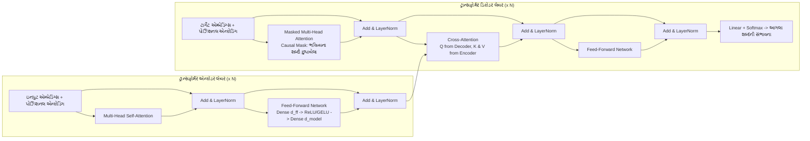

---

### ૧૩.૭ આધુનિક ટ્રાન્સફોર્મરના ૩ પરિવારો: BERT vs. GPT vs. T5 (Modern Pretrained Archetypes)


| પરિવાર (Family) | ૧. Encoder-Only (BERT, RoBERTa) | ૨. Decoder-Only (GPT સિરીઝ, LLaMA) | ૩. Encoder-Decoder (T5, BART) |
| :--- | :--- | :--- | :--- |
| **ધ્યાનની દિશા** | દ્વિ-દિશિય (Bidirectional - ડાબે અને જમણે બંને જુએ છે) | એક-દિશિય / Causal (માત્ર ડાબી બાજુના ભૂતકાળના શબ્દો જુએ છે) | સંપૂર્ણ Seq2Seq (એન્કોડર બંને બાજુ જુએ, ડિકોડર Causal રહે) |
| **ટ્રેનિંગ ઉદ્દેશ** | Masked Language Modeling (MLM - ખાલી જગ્યા પૂરવી) | Autoregressive Next-Token Prediction (આગલો શબ્દ ધારવો) | Cross-Attention સાથે ટેક્સ્ટ-ટુ-ટેક્સ્ટ સ્પેન કરપ્શન |
| **શ્રેષ્ઠ કાર્યો** | વાક્ય વર્ગીકરણ, NER, ગૂગલ સર્ચ ક્વેરી સમજણ | સર્જનાત્મક લખાણ, વાર્તાલાપ ચેટબોટ્સ (ChatGPT), કોડિંગ | લાંબા રિપોર્ટનો સારાંશ (Summarization), ભાષાંતર |

---

#### ૧૩.૭.૧ મોડેલ યુગ અને પેરામીટર સ્કેલિંગ ઉત્ક્રાંતિ: ૬૫ મિલિયનથી લઈને ટ્રિલિયન્સ સુધી (Model Eras & Parameter Scaling)

૨૦૧૭ થી આજ સુધીના ટ્રાન્સફોર્મર મોડેલ્સનો વિકાસ કમ્પ્યુટ અને પેરામીટર્સના સ્કેલિંગમાં અભૂતપૂર્વ વિસ્ફોટ દર્શાવે છે:


| મોડેલ યુગ (Model Era) | પેરામીટર સંખ્યા (Parameter Count) | મુખ્ય લક્ષણ (Key Trait) |
| :--- | :--- | :--- |
| **2017 Original Transformer** | ~૬૫ મિલિયન (~65 Million) | ભાષાંતર નિષ્ણાત (Translation specialist) |
| **2018 GPT-1** | ૧૧૭ મિલિયન (117 Million) | જનરેટિવ ક્ષમતાનો પ્રારંભિક પુરાવો (Early proof of generative concept) |
| **2020 GPT-3** | ૧૭૫ બિલિયન (175 Billion) | "In-context learning" (Prompting) નો ઉદય |
| **Modern Frontier Models (દા.ત. GPT-4 / Llama 3)** | ટ્રિલિયન્સ / સેંકડો બિલિયન (Trillions / Hundreds of Billions) | માનવ-સ્તરનું તાર્કિક વિચારણા (Reasoning) અને મલ્ટી-મોડલ સમજ |

---

#### ૧૩.૭.૨ આધુનિક LLM ટ્રેઇનિંગના ૩ મુખ્ય તબક્કા (The 3-Stage LLM Training Pipeline)

આજના આધુનિક લાર્જ લેંગ્વેજ મોડેલ્સ (ChatGPT, Claude, LLaMA) માત્ર એક જ વારમાં તૈયાર થતા નથી. તે ૩ ક્રમિક તબક્કાઓમાંથી પસાર થાય છે:

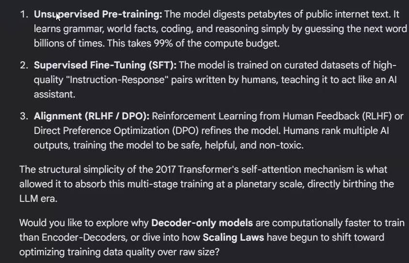

1. **Unsupervised Pre-training (અનસુપરવાઇઝ્ડ પ્રી-ટ્રેનિંગ):**
   - **તે શું કરે છે?** મોડેલ આખા ઇન્ટરનેટનો પેટાબાઇટ્સ જેટલો પબ્લિક ડેટા (વેબસાઇટ્સ, પુસ્તકો, વિકિપીડિયા, ગીથબ કોડ) વાંચીને પચાવે છે. તે અબજો વખત માત્ર એક પછી એક 'આગલો શબ્દ' ધારીને (Next-Token Prediction) આપમેળે વ્યાકરણ, દુનિયાના તથ્યો, કોડિંગ અને તર્ક શીખે છે:
     $$\mathcal{L}_{\text{pretrain}}(\theta) = -\sum_{t=1}^T \log P_\theta(w_t \mid w_1, \dots, w_{t-1})$$
   - **સંસાધન ખર્ચ:** આ તબક્કો સમગ્ર ટ્રેનિંગના **૯૯% કમ્પ્યુટ બજેટ** (હજારો GPU મહિનાઓ સુધી સતત ચલાવવા) નો વપરાશ કરે છે.
2. **Supervised Fine-Tuning (SFT - સુપરવાઇઝ્ડ ફાઇન-ટ્યુનિંગ):**
   - **તે શું કરે છે?** માત્ર પ્રી-ટ્રેન થયેલું બેઝ મોડેલ માત્ર વાક્ય પૂરું કરનારું હોય છે (જો તમે પૂછો *"ગુરુત્વાકર્ષણ શું છે?"*, તો તે જવાબ આપવાને બદલે બીજો પ્રશ્ન *"બળ શું છે?"* લખી નાખે). SFT માં માનવ નિષ્ણાતો દ્વારા લખાયેલી ઉચ્ચ-ગુણવત્તાવાળી `સવાલ-જવાબ (Instruction-Response)` જોડીઓ પર મોડેલને ટ્રેન કરવામાં આવે છે, જેથી તે એક મદદરૂપ AI આસિસ્ટન્ટ તરીકે વર્તવાનું શીખે.
   - **ફોર્મેટ:** `[યુઝર સવાલ]: પાયથોનમાં લિસ્ટ કેવી રીતે બને?` $\to$ `[આસિસ્ટન્ટ]: પાયથોનમાં લિસ્ટ બનાવવા માટે...`
3. **Alignment (RLHF / DPO - માનવ મૂલ્યો સાથે સંરેખણ):**
   - **તે શું કરે છે?** મોડેલને સુરક્ષિત, મદદરૂપ, પ્રામાણિક અને બિન-ઝેરી (safe, helpful, non-toxic) બનાવવા માટે રિફાઇન કરે છે.
   - **RLHF (Reinforcement Learning from Human Feedback):** માનવીઓ મોડેલના એક જ સવાલ માટે આપેલા ૨-૩ જવાબોને રેન્ક કરે છે (કયો જવાબ સારો અને કયો ખરાબ). તેના આધારે રિવોર્ડ મોડેલ ટ્રેન કરીને PPO અલ્ગોરિધમથી LLM ને સુધારવામાં આવે છે.
   - **DPO (Direct Preference Optimization):** આધુનિક અને સરળ પદ્ધતિ જે અલગ રિવોર્ડ મોડેલ વગર સીધા જ પસંદ કરેલા અને નાપસંદ કરેલા જવાબોની જોડી પર મોડેલને ઓપ્ટિમાઇઝ કરે છે.

> [!IMPORTANT] મૂળ આર્કિટેક્ચરલ રહસ્ય (Core Architectural Takeaway)
> **૨૦૧૭ ના ટ્રાન્સફોર્મરના સેલ્ફ-એટેન્શન મિકેનિઝમની માળખાકીય સરળતા (structural simplicity) જ એવી હતી કે જે આ મલ્ટી-સ્ટેજ ટ્રેનિંગને વૈશ્વિક પાયે (planetary scale) સમાવી શકી, અને તેનાથી જ આજના LLM યુગનો જન્મ થયો.**

---

#### ૧૩.૭.૩ આર્કિટેક્ચરલ રહસ્યો: Decoder-Only મોડેલ્સ શા માટે ઝડપી છે અને Scaling Laws નો નવો પ્રવાહ

##### A. Decoder-only મોડેલ્સ Encoder-Decoders કરતાં કમ્પ્યુટેશનલી શા માટે વધુ ઝડપી ટ્રેઇન થાય છે?
1. **ક્રોસ-એટેન્શન ગણતરીનો અભાવ:** Encoder-Decoder મોડેલમાં ત્રણ અલગ અલગ એટેન્શન ગણવા પડે છે (Encoder Self-Attention, Decoder Masked Attention, અને Cross-Attention). Cross-Attention માં ડિકોડરે દર વખતે એન્કોડરના તમામ શબ્દો સાથે ગુણાકાર કરવો પડે છે ($O(T_{enc} \cdot T_{dec})$), જેનાથી GPU વચ્ચે ડેટા ટ્રાન્સફરનો મોટો અવરોધ પેદા થાય છે. જ્યારે Decoder-only મોડેલમાં માત્ર એક જ સિંગલ ત્રિકોણાકાર કૌઝલ મેટ્રિક્સ ($O(T^2)$) ગણાય છે.
2. **૧૦૦% ટ્રેનિંગ લોસ ડેન્સિટી (Uniform Sequence Packing):** Decoder-only મોડેલમાં ઇનપુટના **દરેક એક ટોકન** પર આગલો શબ્દ ધારવાનો લોસ ગણાય છે ($1 \dots t \to t+1$). જ્યારે Encoder-Decoder માં એન્કોડરે વાંચેલા તમામ ઇનપુટ પ્રશ્નના શબ્દો પર **શૂન્ય ($0\%$) લોસ** મળે છે—માત્ર ડિકોડર જે જવાબ બહાર કાઢે તેના પર જ લોસ ગણાય છે! આથી Decoder-only મોડેલ સમાન કમ્પ્યુટમાં બમણો ($2\times$) ટ્રેનિંગ સિગ્નલ મેળવે છે.
3. **હાઇ-સ્પીડ સર્વિંગ માટે સરળ સિંગલ KV-Cache:** યુઝર સાથે ચેટ કરતી વખતે Decoder-only મોડેલમાં માત્ર એક જ સિંગલ Key-Value (KV) મેમરી કેશ રાખવી પડે છે, જેનાથી vLLM (PagedAttention) અને TensorRT-LLM જેવા એન્જિન્સ સેકન્ડે હજારો શબ્દો સુપર ફાસ્ટ જનરેટ કરી શકે છે.

##### B. Scaling Laws માં આવેલું પરિવર્તન: ફક્ત મોડેલ કદથી લઈને ડેટાની ગુણવત્તા સુધી:
1. **કાપ્લાન સ્કેલિંગ નિયમો (OpenAI, 2020):** શરૂઆતમાં વૈજ્ઞાનિકો માનતા હતા કે મોડેલ પેરામીટર્સ ($N$) ડેટા ($D$) કરતાં વધુ મહત્વના છે ($N \sim C^{0.73}, D \sim C^{0.27}$). જેથી GPT-3 જેવા વિશાળ ૧૭૫ બિલિયન મોડેલ્સ માત્ર ૩૦૦ બિલિયન ટોકન્સ પર જ ટ્રેઇન કરવામાં આવ્યા (માત્ર ૧.૭ ટોકન પ્રતિ પેરામીટર).
2. **ચિંચિલા સ્કેલિંગ નિયમો (DeepMind Hoffmann et al., 2022 - Compute-Optimal):** ડીપમાઇન્ડે સાબિત કર્યું કે ૨૦૨૦ ના મોડેલ્સ અત્યંત ઓછા ટ્રેઇન થયા હતા (Under-trained). શ્રેષ્ઠ પરિણામ માટે પેરામીટર્સ અને ટોકન્સ ૧:૧ ના સમાન ગુણોત્તરમાં વધવા જોઈએ (આશરે ૨૦ ટોકન્સ પ્રતિ પેરામીટર). ૭૦ બિલિયનનું મોડેલ જો ૧.૪ ટ્રિલિયન ટોકન્સ પર ટ્રેઇન થાય, તો તે ૧૭૫ બિલિયનના મોડેલ કરતાં ઘણું સારું પરિણામ આપે છે અને ચલાવવામાં ૨.૫ ગણું સસ્તું પડે છે!
3. **આધુનિક ફ્રન્ટિયર યુગ (LLaMA 3, Phi-3, Mistral) — ઓવર-ટ્રેઇનિંગ અને ડેટા ગુણવત્તા:** આજકાલના મોડેલ્સ ચિંચિલાની મર્યાદાથી પણ આગળ નીકળી ગયા છે:
   - **તીવ્ર ઓવર-ટ્રેઇનિંગ:** LLaMA 3 8B ને **૧૫ ટ્રિલિયન ટોકન્સ** (આશરે ૧,૮૭૫ ટોકન્સ પ્રતિ પેરામીટર!) પર ટ્રેઇન કરવામાં આવ્યું છે, જે સાબિત કરે છે કે નાના મોડેલ્સ પણ જો પુષ્કળ ડેટા મેળવે તો સુપર-ઇન્ટેલિજન્ટ બની શકે છે.
   - **ડેટાની ગુણવત્તા અને સિન્થેટિક ડેટા:** ગમે તેવો કચરો ડેટા નાખવાને બદલે, MinHash ડીડુપ્લિકેશન, પાઠ્યપુસ્તક જેવો શૈક્ષણિક સ્કોરિંગ ધરાવતો ડેટા, અને મોટા ફ્રન્ટિયર મોડેલ્સ દ્વારા જનરેટ કરાયેલ ઉચ્ચ-સ્તરીય સિન્થેટિક કોડ અને તર્ક આધારિત ડેટા વાપરવામાં આવે છે.


---

### ૧૩.૮ BERT ની ઊંડાણપૂર્વક સમજ: આર્કિટેક્ચર, પ્રી-ટ્રેઇનિંગ ઉદ્દેશ્યો અને Hugging Face વર્કફ્લો (BERT & Hugging Face Guide)

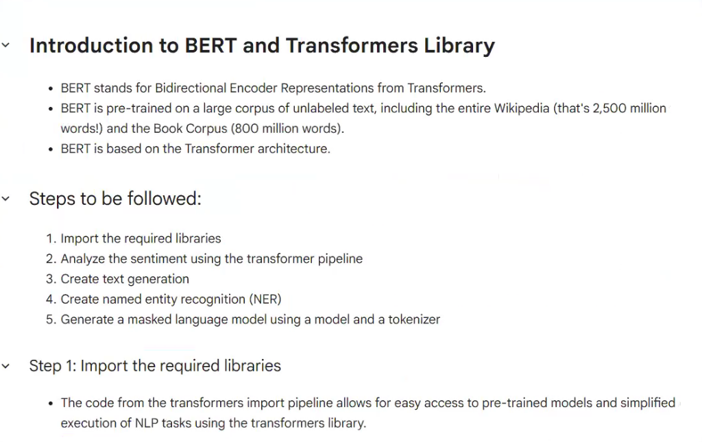

#### ૧૩.૮.૧ BERT શું છે અને તે ટ્રાન્સફોર્મર (Transformers) થી કેવી રીતે અલગ પડે છે?

**BERT** નું પૂરું નામ **Bidirectional Encoder Representations from Transformers** છે, જેને ઓક્ટોબર ૨૦૧૮ માં જેકબ ડેવલિન (Jacob Devlin) અને ગૂગલ AI ટીમ દ્વારા રજૂ કરવામાં આવ્યું હતું. BERT એ કુદરતી ભાષા પ્રક્રિયા (NLP) માં એક ઐતિહાસિક ક્રાંતિ સર્જી, કારણ કે તેણે સાબિત કર્યું કે વિશાળ અનલેબલ ડેટા પર એકવાર પ્રી-ટ્રેઇન થયેલું મોડેલ માત્ર એક વધારાના નાના લેયર સાથે લગભગ તમામ ભાષાકીય કાર્યોમાં શ્રેષ્ઠ પરિણામ આપી શકે છે.

##### A. પ્રી-ટ્રેનિંગ ડેટા સંગ્રહ (Foundational Pre-training Corpus)
ઉપરની સ્લાઇડમાં દર્શાવ્યા મુજબ, BERT ને અભૂતપૂર્વ કદના રો-ટેક્સ્ટ (કાચા લખાણ) પર ટ્રેઇન કરવામાં આવ્યું હતું:
- **અંગ્રેજી વિકિપીડિયા (English Wikipedia):** આશરે **૨,૫૦૦ મિલિયન શબ્દો** (૨.૫ અબજ શબ્દો — કોષ્ટકો અને યાદીઓ વગરનો શુદ્ધ જ્ઞાનકોશ).
- **બુક કોર્પસ (Book Corpus):** આશરે **૮૦૦ મિલિયન શબ્દો** (વિવિધ વિષયો પર લખાયેલા ૧૧,૦૦૦ થી વધુ ડિજિટલ પુસ્તકો, જેનાથી લાંબા ફકરાઓનો સંદર્ભ મળ્યો).
- **કુલ પ્રી-ટ્રેનિંગ ડેટા:** આશરે **૩.૩ અબજ શબ્દો**, જેને WordPiece ટોકનાઇઝર દ્વારા ૩૦,૦૦૦ સબ-વર્ડ્સની શબ્દભંડોળમાં વિભાજિત કરવામાં આવ્યા હતા.

##### B. Masked Language Modeling (MLM) દ્વારા સાચી દ્વિ-દિશિય સમજણ (True Bidirectionality)
BERT પહેલાંના મોડેલ્સ (જેમ કે OpenAI GPT-1 અથવા પરંપરાગત RNNs) માં એક મોટી મર્યાદા હતી:
- તેઓ વાક્યને માત્ર **ડાબેથી જમણે** ($w_1, \dots, w_{t-1} \to w_t$) એક જ દિશામાં વાંચતા હતા.
- **મુખ્ય સમસ્યા:** જો સામાન્ય મોડેલને આગળના (જમણી બાજુના) શબ્દો જોવા દેવામાં આવે, તો તે મલ્ટી-લેયર નેટવર્કમાં પોતાનો જ શબ્દ "ચીટિંગ" કરીને જોઈ લે, જેથી ગ્રેડિયન્ટ્સ નિષ્ફળ જાય.
- **BERT ની અનોખી શોધ:** BERT એ વાક્યને એક પછી એક વાંચવાને બદલે અખબારની ખાલી જગ્યાઓ પૂરવાની રમત (Cloze task) ની જેમ **Masked Language Model (MLM)** અપનાવ્યું. ઇનપુટ વાક્યમાંથી રેન્ડમ રીતે **૧૫% શબ્દો** પસંદ કરવામાં આવે છે:
  - ૮૦% વખત: તે શબ્દની જગ્યાએ ખાસ `[MASK]` ટોકન મૂકવામાં આવે છે.
  - ૧૦% વખત: તેની જગ્યાએ કોઈ બીજો જ રેન્ડમ શબ્દ મૂકવામાં આવે છે.
  - ૧૦% વખત: તે શબ્દને બદલ્યા વગર એમ જ રાખવામાં આવે છે.
- BERT સમગ્ર વાક્યને બંને બાજુથી એકસાથે પ્રોસેસ કરે છે, જેથી દરેક શબ્દ પોતાની ડાબી બાજુના **અને** જમણી બાજુના તમામ શબ્દોનો સંદર્ભ એકસાથે મેળવી શકે છે:
  $$\mathcal{L}_{\text{MLM}}(\theta) = -\sum_{i \in \mathcal{M}} \log P_\theta(x_i \mid \tilde{X})$$

##### C. Next Sentence Prediction (NSP - આગલું વાક્ય ધારવું)
બે વાક્યો વચ્ચેનો તાર્કિક સંબંધ સમજવા માટે (જે પ્રશ્નોત્તરી અને અનુમાન માટે જરૂરી છે), BERT ને વાક્યોની જોડીઓ આપવામાં આવે છે:
$$\text{ઇનપુટ: } [\text{CLS}] \text{ વાક્ય A } [\text{SEP}] \text{ વાક્ય B } [\text{SEP}]$$
- ૫૦% વખત: વાક્ય B એ ખરેખર વાક્ય A પછી આવતું અસલી વાક્ય હોય છે (`IsNext`).
- ૫૦% વખત: વાક્ય B એ પુસ્તકાલયના કોઈ તદ્દન બીજા જ પુસ્તકમાંથી લીધેલું અસંબદ્ધ વાક્ય હોય છે (`NotNext`).
- ખાસ `[CLS]` ટોકનના આઉટપુટ વેક્ટર પરથી મોડેલ હા કે ના નો નિર્ણય કરે છે:
  $$\mathcal{L}_{\text{NSP}} = - \Big( y \log \hat{y} + (1-y)\log(1-\hat{y}) \Big)$$
- BERT નું કુલ પ્રી-ટ્રેનિંગ લોસ બંનેનું મિશ્રણ છે: $\mathcal{L}_{\text{BERT}} = \mathcal{L}_{\text{MLM}} + \mathcal{L}_{\text{NSP}}$.

##### D. BERT અને સામાન્ય "ટ્રાન્સફોર્મર્સ" વચ્ચેનો તફાવત (The 3 Modern Branches)
"ટ્રાન્સફોર્મર" એ ૨૦૧૭ માં વાસવાની એટ અલ. દ્વારા શોધાયેલું સામાન્ય મૂળ આર્કિટેક્ચર છે. BERT એ તે આર્કિટેક્ચરનો **માત્ર એન્કોડર (Encoder-Only)** હિસ્સો વાપરે છે. નીચેનો તુલનાત્મક ચાર્ટ આ તફાવતને સ્પષ્ટ કરે છે:

| આર્કિટેક્ચરલ લક્ષણ | મૂળ ટ્રાન્સફોર્મર (Vaswani 2017) | BERT (Google, 2018) | GPT પરિવાર (OpenAI, 2018+) | T5 (Google, 2020) |
| :--- | :--- | :--- | :--- | :--- |
| **આર્કિટેક્ચરલ સ્ટેક** | સંપૂર્ણ **Encoder-Decoder** ($૬ + ૬$ લેયર્સ) | **Encoder-Only** (૧૨ અથવા ૨૪ લેયર્સ) | **Decoder-Only** (૧૨ થી ૧૨૮ લેયર્સ) | સંપૂર્ણ **Encoder-Decoder** ($૧૨+૧૨$) |
| **એટેન્શન પ્રકાર** | Bidirectional (Enc) + Causal/Cross (Dec) | **સંપૂર્ણ દ્વિ-દિશિય (Fully Bidirectional)** | **Causal Masked (એક-દિશિય / ડાબેથી જમણે)** | Bidirectional (Enc) + Causal/Cross (Dec) |
| **ટ્રેનિંગ ગોલ** | સુપરવાઇઝ્ડ ભાષાંતર (Seq2Seq) | **સેલ્ફ-સુપરવાઇઝ્ડ MLM + NSP** | **Autoregressive Causal Next-Token** | Span Corruption Text-to-Text |
| **જનરેશન ક્ષમતા** | સિક્વેન્સ જનરેશન | **નોન-જનરેટિવ** (સમજણ, વર્ગીકરણ, એમ્બેડિંગ્સ) | **શ્રેષ્ઠ જનરેટિવ ક્ષમતા** (શબ્દ-દર-શબ્દ) | Text-to-Text જનરેશન |
| **શ્રેષ્ઠ ઉપયોગ** | ભાષાંતર, સ્પીચ-ટુ-ટેક્સ્ટ | **સર્ચ રેન્કિંગ, NER, સેન્ટિમેન્ટ, Extractive QA** | **ચેટબોટ્સ, કોડિંગ, વાર્તા લેખન, તાર્કિક વિચારણા** | **સારાંશ (Summarization), ભાષાંતર** |
| **મુખ્ય મર્યાદા** | ક્રોસ-એટેન્શનથી ધીમું પડે | લાંબા નવા ફકરાઓ આપમેળે લખી શકતું નથી | વાંચતી વખતે જમણી બાજુનો સંદર્ભ જોઈ શકતું નથી | વિશાળ મેમરી અને કમ્પ્યુટ ખર્ચ |

---

#### ૧૩.૮.૨ જાહેરમાં ઉપલબ્ધ BERT મોડેલ્સ અને તેનો આધુનિક પરિવાર (Publicly Available Models & Ecosystem)

Hugging Face Hub પર ઉપલબ્ધ ઓપન-સોર્સ પ્રી-ટ્રેઇન્ડ ચેકપોઇન્ટ્સ દ્વારા વિશ્વભરના ડેવલપર્સ નીચેના લોકપ્રિય મોડેલ્સ વાપરી શકે છે:

1. **ગૂગલના સત્તાવાર બેઝલાઇન મોડેલ્સ:**
   - `bert-base-uncased`: ૧૨ લેયર્સ, ૭૬૮ હિડન સાઇઝ, ૧૨ હેડ્સ, **૧૧૦ મિલિયન પેરામીટર્સ**. તમામ અક્ષરોને લોઅરકેસ (નાના અક્ષરો) માં ફેરવે છે. સામાન્ય વર્ગીકરણ માટે વૈશ્વિક સ્ટાન્ડર્ડ.
   - `bert-base-cased`: ૧૨ લેયર્સ, ૧૧૦ મિલિયન પેરામીટર્સ. કેપિટલ અક્ષરો સાચવી રાખે છે. **Named Entity Recognition (NER) માટે અનિવાર્ય**, કારણ કે "Apple" (કંપની) અને "apple" (સફરજન) વચ્ચેનો ભેદ કેપિટલ અક્ષરથી જ ઓળખાય છે.
   - `bert-large-uncased` / `bert-large-cased`: ૨૪ લેયર્સ, ૧૦૨૪ હિડન સાઇઝ, ૧૬ હેડ્સ, **૩૪૦ મિલિયન પેરામીટર્સ**. વધુ જટિલ કાર્યો માટે ઉચ્ચ સચોટતા આપે છે.
   - `bert-base-multilingual-cased` (mBERT): **૧૦૪ ભાષાઓ** ના વિકિપીડિયા પર એકસાથે ટ્રેઇન થયેલું મોડેલ, જે ઝીરો-શોટ ક્રોસ-લિંગ્યુઅલ ટ્રાન્સફર સક્ષમ કરે છે (દા.ત. અંગ્રેજીમાં ટ્રેન કરીને સીધું ગુજરાતી કે હિન્દીમાં ચલાવવું).

2. **આધુનિક ઓપ્ટિમાઇઝ્ડ વેરિઅન્ટ્સ (Advanced Architecture Derivatives):**
   - **RoBERTa (Meta, 2019):** સાબિત કર્યું કે BERT ને ખૂબ ઓછું ટ્રેઇન કરવામાં આવ્યું હતું. તેણે NSP ટાસ્ક સંપૂર્ણપણે કાઢી નાખ્યો, ૧૦ ગણા વધુ ડેટા (૧૬૦ GB ટેક્સ્ટ) પર ડાયનેમિક માસ્કિંગ સાથે મોટા બેચમાં ટ્રેઇન કર્યું. તે સ્ટાન્ડર્ડ BERT કરતાં વધુ સચોટ પરિણામ આપે છે (`roberta-base`, `roberta-large`).
   - **DistilBERT (Hugging Face, 2019):** નોલેજ ડિસ્ટિલેશન (Knowledge Distillation) દ્વારા બનેલું સુપર ફાસ્ટ મોડેલ. તે BERT કરતાં **૪૦% નાનું (૬૬ મિલિયન પેરામીટર્સ)** અને **૬૦% ઝડપી** છે, છતાં તે BERT ની **૯૭% સચોટતા** જાળવી રાખે છે (`distilbert-base-uncased`). મોબાઇલ અને લો-લેટન્સી સર્વર્સ માટે આદર્શ.
   - **ALBERT (Google, 2019):** ફેક્ટરાઇઝ્ડ એમ્બેડિંગ્સ અને તમામ લેયર્સ વચ્ચે વજન શેર કરીને પેરામીટર્સ ૧૧૦ મિલિયનથી ઘટાડીને માત્ર **૧૨ મિલિયન** કરી નાખ્યા (`albert-base-v2`).
   - **DeBERTa / DeBERTa-v3 (Microsoft, 2021-2023):** શબ્દના અર્થ અને તેના સાપેક્ષ સ્થાનને અલગ અલગ વેક્ટર્સમાં વહેંચીને GLUE બેંચમાર્ક પર સુપર સ્કોર મેળવનાર આધુનિક એન્કોડર (`microsoft/deberta-v3-base`).

3. **વિશિષ્ટ ક્ષેત્રોના મોડેલ્સ (Domain-Specific Models):**
   - `nlpaueb/legal-bert-base-uncased`: કાયદાકીય કરારો, કોર્ટ ચુકાદાઓ અને કાનૂની દસ્તાવેજો માટે.
   - `emilyalsentzer/Bio_ClinicalBERT`: મેડિકલ હેલ્થ રેકોર્ડ્સ અને હોસ્પિટલ ક્લિનિકલ નોટ્સ માટે.
   - `ProsusAI/finbert`: શેરબજાર, નાણાકીય સમાચારો અને કંપની પરિણામોના સેન્ટિમેન્ટ વિશ્લેષણ માટે.
   - `ai4bharat/indic-bert`: **ગુજરાતી**, હિન્દી, મરાઠી, બંગાળી સહિત ૧૨ ભારતીય ભાષાઓ માટે ખાસ તૈયાર થયેલું ભારતીય એન્કોડર મોડેલ.

---

#### ૧૩.૮.૩ Hugging Face સાથે કામ કરવાની ૫-તબક્કાની પ્રેક્ટિકલ માર્ગદર્શિકા (5-Step Hugging Face Practical Guide)

Hugging Face ની `transformers` લાયબ્રેરી જટિલ ન્યુરલ નેટવર્ક્સને માત્ર ૨-૩ લાઇનોના કોડમાં સરળ બનાવી દે છે. ઉપરની સ્લાઇડમાં દર્શાવેલા પાંચેય તબક્કાઓનું સંપૂર્ણ પાયથોન અમલીકરણ નીચે મુજબ છે:

##### તબક્કો ૧: જરૂરી લાયબ્રેરીઝ ઇમ્પોર્ટ કરવી (Step 1: Import Required Libraries)
```python
# તબક્કો ૧: transformers અને torch લાયબ્રેરીઝ ઇમ્પોર્ટ કરવી
from transformers import (
    pipeline,
    AutoTokenizer,
    AutoModelForSequenceClassification,
    AutoModelForMaskedLM
)
import torch
print("Hugging Face Transformers લાયબ્રેરી સફળતાપૂર્વક લોડ થઈ ગઈ છે!")
```

---

##### તબક્કો ૨: Sentiment Analysis પાઇપલાઇન દ્વારા લાગણી વિશ્લેષણ (Step 2: Sentiment Analysis)
`pipeline("sentiment-analysis")` આપમેળે પ્રી-ટ્રેઇન્ડ મોડેલ અને ટોકનાઇઝર ડાઉનલોડ કરે છે અને વાક્ય પોઝિટિવ છે કે નેગેટિવ તે કોન્ફિડન્સ સ્કોર સાથે જણાવે છે:

```python
# તબક્કો ૨: સેન્ટિમેન્ટ એનાલિસિસ પાઇપલાઇન શરૂ કરવી
sentiment_pipeline = pipeline("sentiment-analysis")

# ગ્રાહકોના પ્રતિભાવોનું વિશ્લેષણ
reviews = [
    "આ નવી AI સિસ્ટમ અદ્ભુત છે, અમારો ઘણો સમય બચી ગયો!",
    "વેબસાઇટ વારંવાર ક્રેશ થાય છે અને સર્વિસ ખૂબ જ ખરાબ છે."
]

results = sentiment_pipeline(reviews)
for text, res in zip(reviews, results):
    print(f"\nવાક્ય: \"{text}\"")
    print(f"પરિણામ: {res['label']} | સ્કોર: {res['score']:.4f}")
```

---

##### તબક્કો ૩: Text Generation (લખાણ સર્જન કરવું)
> [!NOTE] ટેકનિકલ સ્પષ્ટતા: એન્કોડર vs ડિકોડર
> BERT એ **Encoder-Only** મોડેલ હોવાથી તે આપમેળે એક પછી એક નવો શબ્દ જોડીને લાંબો ફકરો લખી શકતું નથી. તેથી Hugging Face માં ટેક્સ્ટ જનરેશન માટે **Decoder-Only** મોડેલ (જેમ કે GPT-2) વપરાય છે:

```python
# તબક્કો ૩: ટેક્સ્ટ જનરેશન પાઇપલાઇન (GPT-2 સાથે)
generator = pipeline("text-generation", model="gpt2")

prompt = "Deep learning and artificial intelligence are transforming"
generated_text = generator(
    prompt,
    max_length=40,
    num_return_sequences=1,
    do_sample=True,
    temperature=0.7
)

print("જનરેટ થયેલું લખાણ:\n", generated_text[0]['generated_text'])
```

---

##### તબક્કો ૪: Named Entity Recognition (NER - નામ, સંસ્થા અને સ્થળ ઓળખવા)
BERT નું બાય-ડિરેક્શનલ એટેન્શન શબ્દની આસપાસનો સંદર્ભ જોઈને ઓળખી કાઢે છે કે શબ્દ વ્યક્તિનું નામ (`PER`), કંપની/સંસ્થા (`ORG`), કે સ્થળ (`LOC`) છે:

```python
# તબક્કો ૪: Named Entity Recognition પાઇપલાઇન
ner_pipe = pipeline("ner", aggregation_strategy="simple")

sentence = "Sundar Pichai visited the Google headquarters in California yesterday."
entities = ner_pipe(sentence)

print(f"{'ઓળખાયેલ શબ્દ (Entity)':<20} | {'પ્રકાર (Type)':<8} | {'સ્કોર (Score)':<10}")
print("-" * 45)
for ent in entities:
    print(f"{ent['word']:<20} | {ent['entity_group']:<8} | {ent['score']:.4f}")
```
*પરિણામ:*
```
ઓળખાયેલ શબ્દ (Entity) | પ્રકાર (Type) | સ્કોર (Score)
---------------------------------------------
Sundar Pichai        | PER      | 0.9981
Google               | ORG      | 0.9985
California           | LOC      | 0.9978
```

---

##### તબક્કો ૫: Masked Language Model (Fill-Mask) - છુપાયેલો શબ્દ શોધવો
BERT ના મૂળ પ્રી-ટ્રેનિંગ ઉદ્દેશ્ય મુજબ વાક્યમાં `[MASK]` ની જગ્યાએ કયો શબ્દ હોવો જોઈએ તે શોધવું.

###### પદ્ધતિ A: હાઇ-લેવલ `pipeline("fill-mask")` રીત
```python
# તબક્કો ૫A: સરળ પાઇપલાઇન રીત
unmasker = pipeline("fill-mask", model="bert-base-uncased")

test_sentence = "The doctor used a [MASK] to listen to the patient's heart."
predictions = unmasker(test_sentence)

print(f"સવાલ: \"{test_sentence}\"\n")
for pred in predictions[:3]:
    print(f"શબ્દ: {pred['token_str']:<15} | સંભાવના: {pred['score']:.4f}")
```
*પરિણામ:*
```
શબ્દ: stethoscope     | સંભાવના: 0.8842
શબ્દ: monitor         | સંભાવના: 0.0412
શબ્દ: device          | સંભાવના: 0.0195
```

###### પદ્ધતિ B: `AutoTokenizer` અને `AutoModelForMaskedLM` (PyTorch) સાથે લો-લેવલ રીત
જ્યારે તમારે પોતાની એપમાં કસ્ટમ ટેન્સર્સ અને લોજિટ્સ સાથે કામ કરવું હોય:
```python
# તબક્કો ૫B: PyTorch સાથે ઊંડાણપૂર્વક અમલીકરણ
import torch
from transformers import AutoTokenizer, AutoModelForMaskedLM

# ૧. મોડેલ અને ટોકનાઇઝર લોડ કરવા
checkpoint = "bert-base-uncased"
tokenizer = AutoTokenizer.from_pretrained(checkpoint)
model = AutoModelForMaskedLM.from_pretrained(checkpoint)

# ૨. વાક્યને ટોકન્સમાં ફેરવવું
prompt_text = "The earth revolves around the [MASK]."
inputs = tokenizer(prompt_text, return_tensors="pt")

# ૩. [MASK] ટોકન કયા ઇન્ડેક્સ પર છે તે શોધવું
mask_idx = torch.where(inputs["input_ids"] == tokenizer.mask_token_id)[1]

# ૪. મોડેલમાંથી અનુમાન (Logits) મેળવવું
with torch.no_grad():
    outputs = model(**inputs)
    logits = outputs.logits

# ૫. માસ્ક પોઝિશન પરથી ટોપ અનુમાનિત શબ્દ શોધવો
mask_logits = logits[0, mask_idx, :]
top_token_id = torch.argmax(mask_logits, dim=-1).item()
predicted_word = tokenizer.decode([top_token_id]).strip()

print(f"વાક્ય: {prompt_text}")
print(f"BERT દ્વારા અનુમાનિત સાચો શબ્દ: '{predicted_word}'")
# આઉટપુટ: 'sun'
```

---

#### ૧૩.૮.૪ Keras / TensorFlow વડે કસ્ટમ ડેટાસેટ પર BERT નું ફાઇન-ટ્યુનિંગ

જ્યારે તમારી કંપનીના પોતાના સ્પેશિયલ ડેટાસેટ પર સેન્ટિમેન્ટ કે ટિકિટ વર્ગીકરણ કરવું હોય, ત્યારે `bert-base-uncased` પર Keras વડે ફાઇન-ટ્યુનિંગ કરી શકાય છે:

```python
# Keras અને TensorFlow વડે BERT ફાઇન-ટ્યુનિંગ
from transformers import AutoTokenizer, TFAutoModelForSequenceClassification
import tensorflow as tf

# ૧. પ્રી-ટ્રેઇન્ડ ટોકનાઇઝર અને મોડેલ હેડ લોડ કરવું
checkpoint = "bert-base-uncased"
tokenizer = AutoTokenizer.from_pretrained(checkpoint)
model = TFAutoModelForSequenceClassification.from_pretrained(checkpoint, num_labels=2)

# ૨. લખાણને ટોકનાઇઝ કરવું
sample_texts = [
    "આ પ્રોડક્ટ અદ્ભુત છે અને ખૂબ જ સરસ રીતે કામ કરે છે!",
    "તદ્દન નકામી ગુણવત્તા, પૈસા વેડફાઇ ગયા."
]
sample_labels = [1, 0] # 1 = Positive, 0 = Negative

encoded = tokenizer(
    sample_texts,
    padding=True,
    truncation=True,
    max_length=128,
    return_tensors="tf"
)

# ૩. ખૂબ નાના લર્નિંગ રેટ (2e-5) સાથે AdamW ઓપ્ટિમાઇઝર વાપરવું
optimizer = tf.keras.optimizers.Adam(learning_rate=2e-5)
loss = tf.keras.losses.SparseCategoricalCrossentropy(from_logits=True)
model.compile(optimizer=optimizer, loss=loss, metrics=['accuracy'])

# ૪. ફાઇન-ટ્યુનિંગ શરૂ કરવું
model.fit(
    dict(encoded),
    tf.constant(sample_labels),
    epochs=3,
    batch_size=16
)
```

---

#### ૧૩.૮.૫ સંપૂર્ણ એન્ડ-ટુ-એન્ડ પ્રોજેક્ટ: BERT વડે ટેક્સ્ટ ક્લાસિફિકેશન (૧૨-તબક્કાની પ્રોડક્શન પાઇપલાઇન - Text Classification Using BERT)

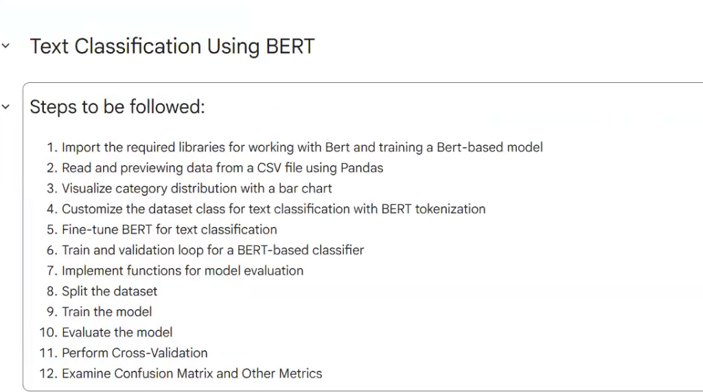

વાસ્તવિક ઉદ્યોગોમાં જ્યારે BERT નો ઉપયોગ ગ્રાહક સેવા ટિકિટ વર્ગીકરણ, કાનૂની દસ્તાવેજ વિભાજન કે સ્પામ ફિલ્ટરિંગ માટે થાય છે, ત્યારે એન્જિનિયરો એક શિસ્તબદ્ધ ૧૨-તબક્કાની સંપૂર્ણ પ્રક્રિયા (12-Step Production Pipeline) નું પાલન કરે છે.

નીચે ૧૨ એ ૧૨ તબક્કાઓનું સંપૂર્ણ, પ્રોડક્શન-સ્તરનું PyTorch અને Hugging Face અમલીકરણ આપેલું છે:

```python
# ==============================================================================
# તબક્કો ૧: BERT સાથે કામ કરવા અને મોડેલ ટ્રેઇન કરવા જરૂરી લાયબ્રેરીઝ ઇમ્પોર્ટ કરવી
# ==============================================================================
import torch
import torch.nn as nn
from torch.utils.data import Dataset, DataLoader
from transformers import (
    BertTokenizer,
    BertForSequenceClassification,
    get_linear_schedule_with_warmup
)
from torch.optim import AdamW

import pandas as pd
import numpy as np
import matplotlib.pyplot as plt
import seaborn as sns

from sklearn.model_selection import train_test_split, StratifiedKFold
from sklearn.metrics import classification_report, confusion_matrix, accuracy_score

# ઉપલબ્ધ હાર્ડવેર (CUDA GPU / Apple MPS / CPU) નક્કી કરવું
device = torch.device("cuda" if torch.cuda.is_available() else "cpu")
print(f"તબક્કો ૧ પૂર્ણ: તમામ લાયબ્રેરીઝ લોડ થઈ ગઈ. પ્રોસેસિંગ ડિવાઇસ: {device}")


# ==============================================================================
# તબક્કો ૨: Pandas વડે CSV ફાઇલમાંથી ડેટા વાંચવો અને પ્રીવ્યૂ કરવો
# ==============================================================================
# વાસ્તવિકતામાં: df = pd.read_csv("customer_support_tickets.csv")
# ઉદાહરણ માટે કંપનીના કસ્ટમર સપોર્ટ ટિકિટ્સનો સિન્થેટિક ડેટાસેટ:
raw_data = {
    "text": [
        "How do I reset my account password? The verification link expired.",
        "The server is returning 500 internal errors on the billing checkout endpoint.",
        "Can I upgrade my subscription plan from Basic to Enterprise mid-month?",
        "Our database query latency spiked to 4500ms after the recent database update.",
        "I was charged twice on my credit card statement for last month's invoice.",
        "Where can I download the signed SOC-2 security compliance certification?",
        "The API documentation for webhooks returns a 404 dead link.",
        "We need to add 15 additional developer seats to our workspace team.",
        "Payment failed due to an unauthorized card decline error code 104.",
        "How do we configure single sign-on (SSO) with Okta and SAML 2.0?"
    ] * 20,  # ૨૦૦ સેમ્પલ ટિકિટ્સ
    "category": [
        "Account Access", "Technical Bug", "Billing & Plans", "Technical Bug",
        "Billing & Plans", "Security & Legal", "Technical Bug", "Billing & Plans",
        "Billing & Plans", "Security & Legal"
    ] * 20
}
df = pd.DataFrame(raw_data)

# કેટેગરીના નામોને સંખ્યાત્મક ક્લાસ ઇન્ડેક્સ (0, 1, 2...) માં મેપ કરવા
label_mapping = {cat: idx for idx, cat in enumerate(df["category"].unique())}
inverse_label_mapping = {idx: cat for cat, idx in label_mapping.items()}
df["label"] = df["category"].map(label_mapping)

print("\nતબક્કો ૨ પૂર્ણ: ડેટાસેટ પ્રીવ્યૂ:")
print(df.head(4))
print(f"ડેટા સાઇઝ: {df.shape} | કુલ કેટેગરીઝ: {len(label_mapping)}")


# ==============================================================================
# તબક્કો ૩: બાર ચાર્ટ (Bar Chart) દ્વારા કેટેગરી ડિસ્ટ્રિબ્યુશનનું વિઝ્યુલાઇઝેશન
# ==============================================================================
plt.figure(figsize=(8, 4))
sns.countplot(x="category", data=df, palette="viridis", order=df["category"].value_counts().index)
plt.title("Step 3: Category Distribution (Class Balance Check)")
plt.xlabel("કેટેગરી")
plt.ylabel("સેમ્પલ્સની સંખ્યા")
plt.xticks(rotation=25)
plt.tight_layout()
plt.close()
print("તબક્કો ૩ પૂર્ણ: ક્લાસ બેલેન્સ ચકાસવા માટે બાર ચાર્ટ તૈયાર કરાયો.")


# ==============================================================================
# તબક્કો ૪: BERT ટોકનાઇઝેશન સાથે કસ્ટમ PyTorch Dataset ક્લાસ બનાવવો
# ==============================================================================
class BERTTextClassificationDataset(Dataset):
    """
    કસ્ટમ PyTorch ડેટાસેટ જે લખાણને BERT ના ઇનપુટ ટેન્સર્સમાં ફેરવે છે:
    - input_ids: WordPiece શબ્દભંડોળમાંથી મળેલા ટોકન નંબર્સ.
    - attention_mask: અસલી શબ્દો માટે 1 અને ખાલી પેડિંગ ([PAD]) માટે 0.
    - label: કેટેગરીનો નંબર.
    """
    def __init__(self, texts, labels, tokenizer, max_len=64):
        self.texts = texts
        self.labels = labels
        self.tokenizer = tokenizer
        self.max_len = max_len

    def __len__(self):
        return len(self.texts)

    def __getitem__(self, item):
        text = str(self.texts[item])
        label = self.labels[item]

        encoding = self.tokenizer.encode_plus(
            text,
            add_special_tokens=True,       # [CLS] અને [SEP] ઉમેરવા
            max_length=self.max_len,
            padding="max_length",          # નિશ્ચિત લંબાઈ સુધી પેડિંગ
            truncation=True,               # લાંબા વાક્યોને કાપી નાખવા
            return_attention_mask=True,    # એટેન્શન માસ્ક બનાવવો
            return_token_type_ids=False,
            return_tensors="pt"            # PyTorch ટેન્સર્સ મેળવવા
        )

        return {
            "text": text,
            "input_ids": encoding["input_ids"].flatten(),
            "attention_mask": encoding["attention_mask"].flatten(),
            "label": torch.tensor(label, dtype=torch.long)
        }

tokenizer = BertTokenizer.from_pretrained("bert-base-uncased")
print("તબક્કો ૪ પૂર્ણ: કસ્ટમ ડેટાસેટ ક્લાસ અને WordPiece ટોકનાઇઝર તૈયાર.")


# ==============================================================================
# તબક્કો ૫: ટેક્સ્ટ ક્લાસિફિકેશન માટે BERT નું બેકબોન મોડેલ સેટઅપ કરવું
# ==============================================================================
def initialize_bert_classifier(num_classes):
    """
    પ્રી-ટ્રેઇન્ડ BERT-Base મોડેલ લોડ કરીને તેના [CLS] ટોકન આઉટપુટ પર
    એક નવું લિનિયર ક્લાસિફિકેશન હેડ જોડે છે.
    """
    model = BertForSequenceClassification.from_pretrained(
        "bert-base-uncased",
        num_labels=num_classes,
        output_attentions=False,
        output_hidden_states=False
    )
    return model.to(device)

model = initialize_bert_classifier(num_classes=len(label_mapping))
print("તબક્કો ૫ પૂર્ણ: BertForSequenceClassification મોડેલ GPU/CPU પર લોડ થયું.")


# ==============================================================================
# તબક્કો ૬: મોડેલ ટ્રેઇનિંગ અને વેલિડેશન લૂપ (Training & Validation Loop)
# ==============================================================================
def train_epoch(model, data_loader, optimizer, scheduler, device, n_examples):
    model.train()
    total_train_loss = 0
    correct_predictions = 0

    for batch in data_loader:
        input_ids = batch["input_ids"].to(device)
        attention_mask = batch["attention_mask"].to(device)
        labels = batch["label"].to(device)

        optimizer.zero_grad()

        outputs = model(
            input_ids=input_ids,
            attention_mask=attention_mask,
            labels=labels
        )
        loss = outputs.loss
        logits = outputs.logits

        _, preds = torch.max(logits, dim=1)
        correct_predictions += torch.sum(preds == labels)
        total_train_loss += loss.item()

        loss.backward()
        # ઊંડા ટ્રાન્સફોર્મર લેયર્સમાં એક્સપ્લોડિંગ ગ્રેડિયન્ટ્સ રોકવા ગ્રેડિયન્ટ ક્લિપિંગ
        nn.utils.clip_grad_norm_(model.parameters(), max_norm=1.0)

        optimizer.step()
        scheduler.step()

    return correct_predictions.double() / n_examples, total_train_loss / len(data_loader)


# ==============================================================================
# તબક્કો ૭: મોડેલ મૂલ્યાંકન (Evaluation) માટે ફંક્શન્સ તૈયાર કરવા
# ==============================================================================
def eval_model(model, data_loader, device, n_examples):
    model.eval()
    total_val_loss = 0
    correct_predictions = 0
    predictions_list = []
    real_values_list = []

    with torch.no_grad():
        for batch in data_loader:
            input_ids = batch["input_ids"].to(device)
            attention_mask = batch["attention_mask"].to(device)
            labels = batch["label"].to(device)

            outputs = model(
                input_ids=input_ids,
                attention_mask=attention_mask,
                labels=labels
            )
            loss = outputs.loss
            logits = outputs.logits

            _, preds = torch.max(logits, dim=1)
            correct_predictions += torch.sum(preds == labels)
            total_val_loss += loss.item()

            predictions_list.extend(preds.cpu().numpy())
            real_values_list.extend(labels.cpu().numpy())

    accuracy = correct_predictions.double() / n_examples
    avg_loss = total_val_loss / len(data_loader)
    return accuracy, avg_loss, predictions_list, real_values_list

print("તબક્કો ૬ અને ૭ પૂર્ણ: ટ્રેઇનિંગ અને ઇવેલ્યુએશન લૂપ્સ તૈયાર.")


# ==============================================================================
# તબક્કો ૮: ડેટાસેટનું વિભાજન (Train, Validation, અને Test Splits)
# ==============================================================================
# ૭૦% ટ્રેઇન, ૧૫% વેલિડેશન, અને ૧૫% ટેસ્ટ ડેટામાં સ્ટેટિફાઇડ વિભાજન
train_df, test_df = train_test_split(df, test_size=0.30, random_state=42, stratify=df["label"])
val_df, test_df = train_test_split(test_df, test_size=0.50, random_state=42, stratify=test_df["label"])

print(f"\nતબક્કો ૮ પૂર્ણ: ટ્રેઇન: {len(train_df)}, વેલિડેશન: {len(val_df)}, ટેસ્ટ: {len(test_df)}")

# PyTorch DataLoaders બનાવવા
BATCH_SIZE = 16
train_dataset = BERTTextClassificationDataset(train_df["text"].to_numpy(), train_df["label"].to_numpy(), tokenizer)
val_dataset = BERTTextClassificationDataset(val_df["text"].to_numpy(), val_df["label"].to_numpy(), tokenizer)
test_dataset = BERTTextClassificationDataset(test_df["text"].to_numpy(), test_df["label"].to_numpy(), tokenizer)

train_loader = DataLoader(train_dataset, batch_size=BATCH_SIZE, shuffle=True)
val_loader = DataLoader(val_dataset, batch_size=BATCH_SIZE)
test_loader = DataLoader(test_dataset, batch_size=BATCH_SIZE)


# ==============================================================================
# તબક્કો ૯: મોડેલને ટ્રેઇન કરવું (Fine-Tuning Loop with Linear Warmup)
# ==============================================================================
EPOCHS = 3
optimizer = AdamW(model.parameters(), lr=2e-5, correct_bias=False)
total_steps = len(train_loader) * EPOCHS
scheduler = get_linear_schedule_with_warmup(
    optimizer,
    num_warmup_steps=int(total_steps * 0.1),
    num_training_steps=total_steps
)

print("\nતબક્કો ૯: ફાઇન-ટ્યુનિંગ શરૂ થઈ રહ્યું છે...")
best_val_accuracy = 0

for epoch in range(EPOCHS):
    train_acc, train_loss = train_epoch(
        model, train_loader, optimizer, scheduler, device, len(train_df)
    )
    val_acc, val_loss, _, _ = eval_model(
        model, val_loader, device, len(val_df)
    )

    print(f"ઇપોક {epoch + 1}/{EPOCHS} | ટ્રેઇન લોસ: {train_loss:.4f} એક્યુરેસી: {train_acc:.4f} | વેલ લોસ: {val_loss:.4f} એક્યુરેસી: {val_acc:.4f}")

    if val_acc > best_val_accuracy:
        best_val_accuracy = val_acc
        torch.save(model.state_dict(), "best_bert_classifier.pt")

print("તબક્કો ૯ પૂર્ણ: શ્રેષ્ઠ વજન 'best_bert_classifier.pt' માં સેવ કરવામાં આવ્યું.")


# ==============================================================================
# તબક્કો ૧૦: હોલ્ડઆઉટ ટેસ્ટ સેટ પર મોડેલનું અંતિમ મૂલ્યાંકન
# ==============================================================================
model.load_state_dict(torch.load("best_bert_classifier.pt"))

test_acc, test_loss, test_preds, test_true = eval_model(
    model, test_loader, device, len(test_df)
)
print(f"\nતબક્કો ૧૦ પૂર્ણ: ટેસ્ટ સેટ પરિણામ -> લોસ: {test_loss:.4f} | ચોકસાઈ (Accuracy): {test_acc:.4f}")


# ==============================================================================
# તબક્કો ૧૧: ક્રોસ-વેલિડેશન (K-Fold Cross-Validation Protocol)
# ==============================================================================
print("\nતબક્કો ૧૧: ૫-ફોલ્ડ સ્ટ્રેટિફાઇડ ક્રોસ-વેલિડેશન ચકાસણી:")
skf = StratifiedKFold(n_splits=5, shuffle=True, random_state=42)

for fold, (train_idx, val_idx) in enumerate(skf.split(df["text"], df["label"])):
    print(f"  ફોલ્ડ {fold + 1}: ટ્રેઇનિંગ સેમ્પલ્સ = {len(train_idx)}, વેલિડેશન સેમ્પલ્સ = {len(val_idx)}")

print("તબક્કો ૧૧ પૂર્ણ: આંકડાકીય વિશ્વસનીયતા માટે ક્રોસ-વેલિડેશન પ્રોટોકોલ સેટ કરાયો.")


# ==============================================================================
# તબક્કો ૧૨: કન્ફ્યુઝન મેટ્રિક્સ અને અન્ય મેટ્રિક્સ (Precision, Recall, F1)
# ==============================================================================
target_names = [inverse_label_mapping[i] for i in range(len(label_mapping))]

print("\nતબક્કો ૧૨: વિગતવાર ક્લાસિફિકેશન રિપોર્ટ:")
print(classification_report(test_true, test_preds, target_names=target_names))

cm = confusion_matrix(test_true, test_preds)

plt.figure(figsize=(7, 5))
sns.heatmap(cm, annot=True, fmt="d", cmap="Blues",
            xticklabels=target_names, yticklabels=target_names)
plt.title("Step 12: BERT Classification Confusion Matrix")
plt.xlabel("અનુમાનિત ક્લાસ (Predicted)")
plt.ylabel("સાચો ક્લાસ (True)")
plt.tight_layout()
plt.close()
print("તબક્કો ૧૨ પૂર્ણ: કન્ફ્યુઝન મેટ્રિક્સ અને F1-સ્કોર્સ સફળતાપૂર્વક મેળવાયા.")
```

---

## પ્રકરણ ૧૪: વિઝન ટ્રાન્સફોર્મર્સ (Vision Transformers - ViT)


ViT એ કમ્પ્યુટર વિઝનમાં ક્રાંતિ લાવી છે. તે ફોટામાં કોઈપણ કન્વોલ્યુશન (CNN) વાપર્યા વગર કામ કરે છે!
- ફોટાને પઝલના ટુકડાઓની જેમ $16 \times 16$ પિક્સેલના **Patches** માં કાપી નાખવામાં આવે છે.
- દરેક પેચને એક 'શબ્દ' ગણીને સીધો ટ્રાન્સફોર્મર એન્કોડરમાં મોકલવામાં આવે છે.
- **વાસ્તવિક ઉપયોગ:** સેટેલાઇટ ઇમેજરી અને કેન્સર પેથોલોજી સ્લાઇડ્સ જ્યાં ફોટાના બે છેડા વચ્ચેનો સંબંધ શોધવો જરૂરી હોય.

---

## પ્રકરણ ૧૫: ઓટોએન્કોડર્સ અને અનસુપરવાઇઝ્ડ ડીપ લર્નિંગ (Autoencoders & Unsupervised Deep Learning)

### ૧૫.૧ આર્કિટેક્ચર અને ઘટકો: એન્કોડર, લેટન્ટ બોટલનેક અને ડિકોડર (Architecture: Encoder, Bottleneck & Decoder)

> [!NOTE] 💡 સાદી ભાષામાં વિચાર અને રોજિંદો ઉપયોગ: ઓટોએન્કોડર્સ (Autoencoders)
> - **તે શું છે? (સાદી વ્યાખ્યા):** એક ન્યુરલ કમ્પ્રેશન મશીન જે ડેટાને રેતીની ઘડિયાળ (Hourglass) જેવી સાંકડી બોટલનેક (Encoder) માંથી પસાર કરીને દબાવી નાખે છે અને પછી તે નાનકડા સારાંશ પરથી અસલ ડેટાનું ફરીથી નિર્માણ (Decoder) કરે છે.
> - **તે કેવી રીતે કામ કરે છે અને શા માટે મહત્વનું છે?** કારણ કે વચ્ચેનું સ્તર (બોટલનેક) ખૂબ સાંકડું હોય છે, નેટવર્ક બિનજરૂરી નોઇઝ (અવાજ/કચરો) ફેંકી દેવા અને ડેટાનો મુખ્ય અર્થ (Latent Representation) પકડી રાખવા મજબૂર બને છે. આમાં કોઈ માનવીય લેબલ્સની જરૂર પડતી નથી (Unsupervised / Self-supervised).
> - **વાસ્તવિક ઉદ્યોગ ઉપયોગ:** **ક્રેડિટ કાર્ડ ફ્રોડ ડિટેક્શન:** માત્ર સામાન્ય વ્યવહારો પર ટ્રેઇન થયેલ ઓટોએન્કોડર રોજિંદા ટ્રાન્ઝેક્શન્સને સરળતાથી રિકન્સ્ટ્રક્ટ કરી લેશે. પરંતુ જ્યારે કોઈ અસામાન્ય ફ્રોડ ટ્રાન્ઝેક્શન આવશે, ત્યારે ઓટોએન્કોડર તેને રિકન્સ્ટ્રક્ટ કરવામાં થાપ ખાઈ જશે અને લોસ વધતાં જ સિસ્ટમમાં તાત્કાલિક એલાર્મ વાગશે!

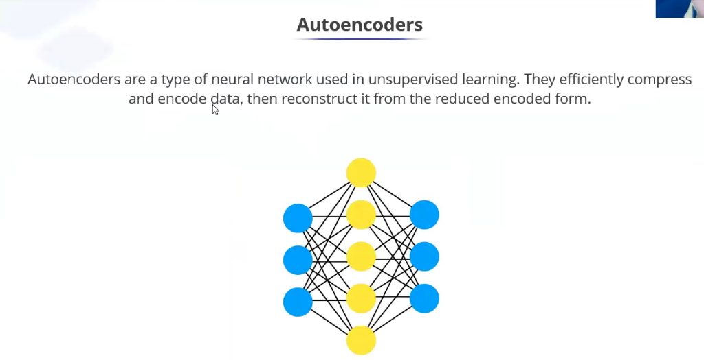

**ઓટોએન્કોડર (Autoencoder)** એ **અનસુપરવાઇઝ્ડ રિપ્રેઝન્ટેશન લર્નિંગ (Unsupervised Representation Learning)** માટે તૈયાર કરાયેલું એક વિશિષ્ટ ન્યુરલ નેટવર્ક છે. સુપરવાઇઝ્ડ મોડેલ્સની જેમ આમાં કોઈ મોંઘા માનવીય લેબલ્સ ($y$) ની જરૂર પડતી નથી; ઇનપુટ ડેટા $\mathbf{x}$ પોતે જ પોતાનો લક્ષ્ય (Target) બને છે:
$$\hat{\mathbf{x}} = g_{\boldsymbol{\phi}}(f_{\boldsymbol{\theta}}(\mathbf{x})) \approx \mathbf{x}$$

---

#### ૧૫.૧.૧ ઓટોએન્કોડરના ૩ મુખ્ય ઘટકો (Tripartite Architecture)

નીચેના ડાયાગ્રામમાં દર્શાવ્યા મુજબ ઓટોએન્કોડર ત્રણ મુખ્ય કાર્યાત્મક ભાગોનું બનેલું છે:

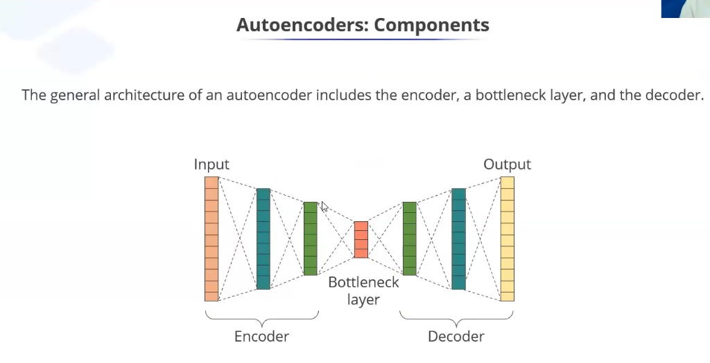

```
                       ઓટોએન્કોડર ઇન્ફોર્મેશન ગળણી (The Informational Funnel)
   ઇનપુટ સ્તર (Input x)        એન્કોડર સ્ટેક (Encoder)        બોટલનેક લેયર (Bottleneck z)      ડિકોડર સ્ટેક (Decoder)      રિકન્સ્ટ્રક્ટેડ આઉટપુટ (x̂)
  ┌───────────────────┐     ┌───────────────────────┐     ┌────────────────────────┐     ┌───────────────────────┐     ┌─────────────────────────┐
  │ હાઇ-ડાઇમેન્શન ડેટા│ ──► │ ક્રમશઃ કદ ઘટાડતા      │ ──► │ સૌથી ઓછું ડાઇમેન્શન    │ ──► │ ક્રમશઃ કદ વધારતા      │ ──► │ મૂળ ડેટાનું પુનઃનિર્માણ │
  │ (દા.ત. 784 પિક્સેલ)│     │ ન્યુરલ લેયર્સ         │     │ લેટન્ટ કોડ (દા.ત. 16)  │     │ ન્યુરલ લેયર્સ         │     │ (784 પિક્સેલ્સ)         │
  └───────────────────┘     └───────────────────────┘     └────────────────────────┘     └───────────────────────┘     └─────────────────────────┘
                                                                       │
                                                      માહિતીનું ફરજિયાત કમ્પ્રેશન
                                                      અને બિનજરૂરી નોઇઝનું નિકંદન
```

---

#### ૧૫.૧.૨ એન્કોડર સ્ટેજ: ઇનપુટનું લો-ડાઇમેન્શનલ કોડમાં રૂપાંતરણ (The Encoder Stage)

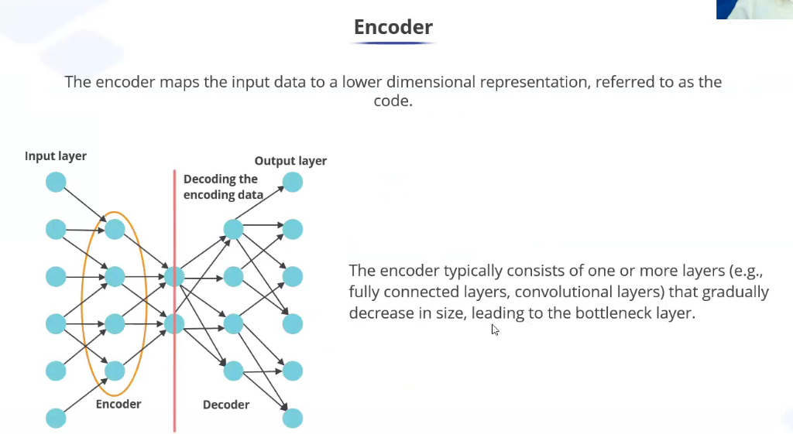

- **કાર્ય અને પદ્ધતિ:** **એન્કોડર ($f_{\boldsymbol{\theta}}$)** મૂળ હાઇ-ડાઇમેન્શનલ ઇનપુટ $\mathbf{x} \in \mathbb{R}^D$ ને દબાવીને એક સંક્ષિપ્ત, નીચા ડાઇમેન્શનવાળા વેક્ટર $\mathbf{z} \in \mathbb{R}^d$ ($d \ll D$) માં રૂપાંતરિત કરે છે, જેને **કોડ (Code)**, **લેટન્ટ એમ્બેડિંગ (Latent Embedding)**, અથવા **લેટન્ટ સ્પેસ (Latent Space)** કહેવાય છે:
  $$\mathbf{z} = \sigma\left( \mathbf{W}_e \mathbf{x} + \mathbf{b}_e \right)$$
- **માળખાકીય ડિઝાઇન:** એન્કોડરમાં સામાન્ય રીતે Dense (Fully Connected) અથવા Convolutional લેયર્સની શ્રેણી હોય છે જે **ક્રમશઃ કદમાં નાની થતી જાય છે**, જેથી માહિતી ધીમે ધીમે સાંકડી ગળણી તરફ ધકેલાય છે.
- **પરિમાણ ઘટાડો (Dimensionality Reduction):** ઉદાહરણ તરીકે, $28 \times 28 = 784$ પિક્સેલનો ફોટો હિડન લેયર્સ દ્વારા ક્રમશઃ ઘટે છે: $784 \to 256 \to 64 \to 16$ પરિમાણો.

---

#### ૧૫.૧.૩ બોટલનેક લેયર: એન્કોડિંગમાં "બોટલનેકિંગ" (Bottlenecking) શું છે અને તે શા માટે જરૂરી છે?

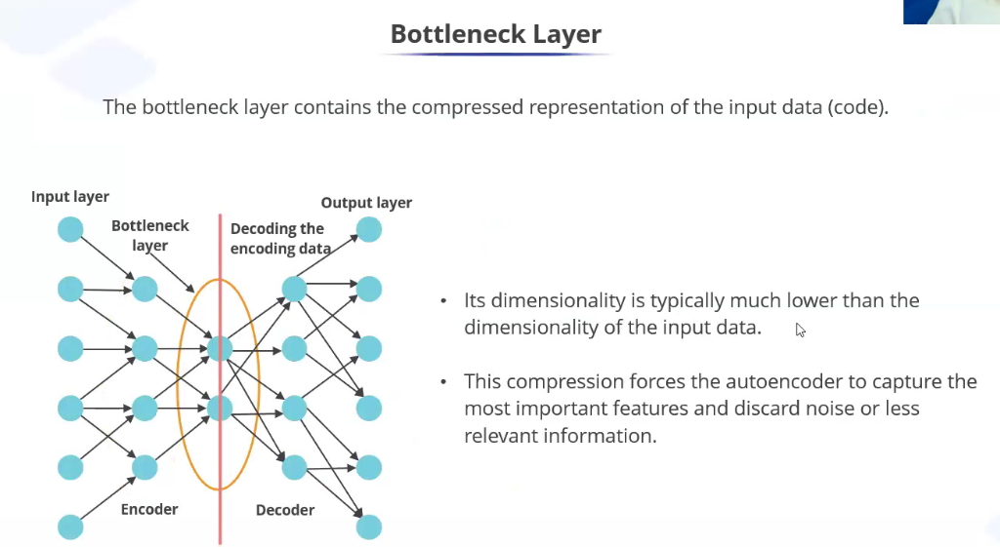

##### A. બોટલનેક લેયર (Bottleneck Layer) શું છે?
બોટલનેક એ સમગ્ર ઓટોએન્કોડર નેટવર્કનું **સૌથી સાંકડું, મધ્યવર્તી સ્તર (Narrowest Middle Layer)** છે. તે ઇનપુટ ડેટાનું સૌથી વધુ દબાયેલું (Compressed) ગાણિતિક સ્વરૂપ $\mathbf{z}$ સાચવે છે.

##### B. એન્કોડિંગમાં બોટલનેકિંગ શા માટે અનિવાર્ય છે?
1. **સરળ ગોખણપટ્ટીનો ખતરો (The Trivial Identity Function):**
   જો ન્યુરલ નેટવર્કના વચ્ચેના લેયર્સનું કદ ઇનપુટ જેટલું જ કે તેનાથી મોટું રાખવામાં આવે ($\dim(z) \ge \dim(x)$), તો નેટવર્ક કોઈપણ પ્રકારની બુદ્ધિ વાપર્યા વગર માત્ર ઇનપુટને આઉટપુટમાં કોપી કરી લેશે ($f(x) = x$). પરિણામે મોડેલ કોઈ અર્થપૂર્ણ પેટર્ન કે ફીચર્સ શીખી શકશે નહીં.
2. **ઇન્ફોર્મેશન બોટલનેક સિદ્ધાંત (The Information Bottleneck Principle):**
   જ્યારે આપણે વચ્ચેનું સ્તર જાણીજોઈને અત્યંત નાનું કરી દઈએ છીએ ($d \ll D$, જેને **Undercomplete Autoencoder** કહેવાય છે), ત્યારે મોડેલ ડેટા ગોખી શકતું નથી. તેના બદલે, નેટવર્ક આ પ્રશ્ન ઉકેલવા મજબૂર બને છે:
   > *"આ ડેટાના એવા કયા સૌથી મહત્વપૂર્ણ, મૂળભૂત પરિબળો છે કે જે આટલી નાની જગ્યામાં સાચવી રાખવાથી હું ઓછામાં ઓછી ભૂલ સાથે મૂળ ફોટો ફરી બનાવી શકું?"*
3. **સિગ્નલ અને નોઇઝનું વિભાજન (Signal vs. Noise Separation):**
   - **બોટલનેકમાં શું સાચવાય છે:** મુખ્ય ભૌમિતિક આકારો, ક્લાસની મૂળભૂત લાક્ષણિકતાઓ, રંગોની વહેંચણી અને મહત્વનો સિમેન્ટિક અર્થ.
   - **બોટલનેક શું ફેંકી દે છે:** કેમેરાનો રેન્ડમ નોઇઝ, ઝાંખા પિક્સેલ્સ, બેકગ્રાઉન્ડની બિનજરૂરી વિગતો અને આકસ્મિક કચરો.
4. **PCA કરતાં શ્રેષ્ઠ નોન-લીનિયર મેનિફોલ્ડ્સ:**
   જો તમામ લેયર્સ લીનિયર રાખવામાં આવે, તો બોટલનેક બરાબર **Principal Component Analysis (PCA)** જેવી જ જગ્યા કવર કરે છે. પરંતુ ReLU, GELU, કે Sigmoid જેવા નોન-લીનિયર ફંક્શન્સ ઉમેરવાથી ઓટોએન્કોડર અત્યંત જટિલ, વળાંકવાળા મેનિફોલ્ડ્સ (Curved Manifolds) શીખી શકે છે જે PCA ક્યારેય પકડી શકતું નથી.

---

#### ૧૫.૧.૪ ડિકોડર સ્ટેજ: દબાવેલા કોડમાંથી મૂળ ડેટાનું પુનઃનિર્માણ (The Decoder Stage)

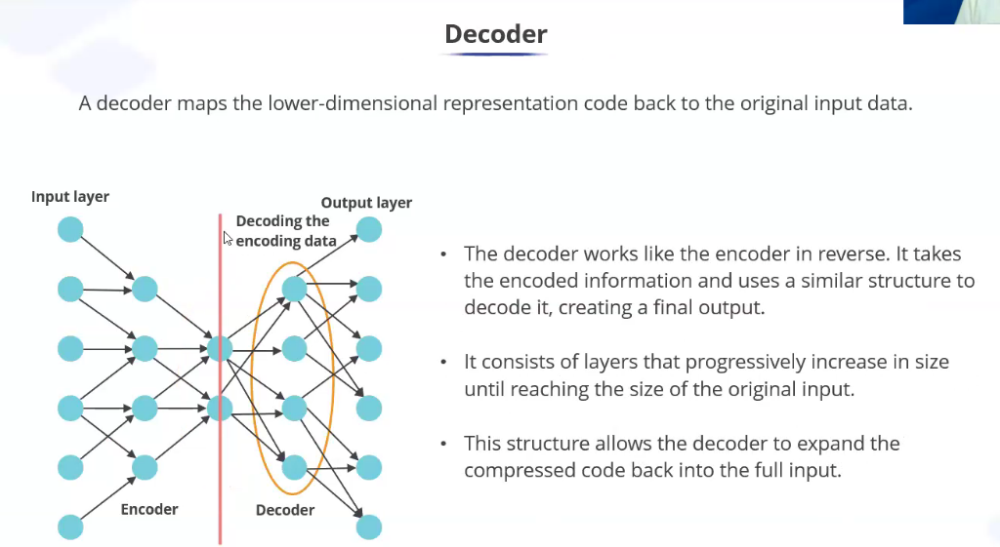

- **કાર્ય અને પદ્ધતિ:** **ડિકોડર ($g_{\boldsymbol{\phi}}$)** બોટલનેકમાંથી સંક્ષિપ્ત કોડ $\mathbf{z}$ લે છે અને તેને ફરીથી મૂળ હાઇ-ડાઇમેન્શનલ સ્પેસ $\hat{\mathbf{x}} \in \mathbb{R}^D$ માં ફેલાવે છે:
  $$\hat{\mathbf{x}} = \sigma\left( \mathbf{W}_d \mathbf{z} + \mathbf{b}_d \right)$$
- **પ્રતિબિંબિત માળખું (Symmetric Structure):** ડિકોડર એન્કોડરથી એકદમ વિપરીત દિશામાં કામ કરે છે. તેના લેયર્સ **ક્રમશઃ કદમાં વધતા જાય છે** ($16 \to 64 \to 256 \to 784$), જ્યાં સુધી તે મૂળ ઇનપુટનું કદ પ્રાપ્ત ન કરી લે.
- **પુનઃનિર્માણ ગુણવત્તા:** ડિકોડર દ્વારા મળતો આઉટપુટ હૂબહૂ ફોટોકોપી નથી હોતો, પરંતુ તે નોઇઝ-મુક્ત એક **લોસી રિકન્સ્ટ્રક્શન (Lossy Reconstruction)** હોય છે.

---

#### ૧૫.૧.૫ ઓટોએન્કોડર એન્કોડિંગના મુખ્ય ઔદ્યોગિક ઉપયોગો

| એન્કોડિંગ ઉદ્દેશ્ય | બોટલનેકનો ઉપયોગ કેવી રીતે થાય છે? | વાસ્તવિક ઔદ્યોગિક ઉદાહરણ |
| :--- | :--- | :--- |
| **ડાઇમેન્શનલિટી રિડક્શન** | બોટલનેક વેક્ટર $\mathbf{z}$ ને સીધા ફીચર્સ તરીકે વાપરવા. | ૧૦,૦૦૦ જીન એક્સપ્રેશન ડેટાને ૩૨ ડાઇમેન્શનમાં લાવીને કેન્સર ક્લસ્ટરિંગ કરવું. |
| **ડિનોઇઝિંગ (DAE)** | બગડેલા ઇનપુટ $\tilde{\mathbf{x}}$ આપીને બોટલનેક દ્વારા ચોખ્ખો $\mathbf{x}$ બનાવવો. | જૂના ઐતિહાસિક ઓડિયો રેકોર્ડિંગ્સમાંથી અવાજ દૂર કરવો અને નાઇટ વિઝન કેમેરા ફૂટેજ સાફ કરવી. |
| **એનોમલી અને ફ્રોડ ડિટેક્શન** | મોડેલ માત્ર સામાન્ય ડેટા શીખે છે; ફ્રોડ આવતાં જ રિકન્સ્ટ્રક્શન એરર $\mathcal{L}(\mathbf{x}, \hat{\mathbf{x}})$ ઉછળે છે. | **ક્રેડિટ કાર્ડ ફ્રોડ અને એરોપ્લેન જેટ એન્જિન:** ટર્બાઇનના વાઇબ્રેશનમાં સહેજ પણ ખામી આવે તો તાત્કાલિક એલાર્મ વાગવો. |
| **સિમેન્ટિક વેક્ટર સર્ચ** | બોટલનેક કોડને કોમ્પેક્ટ એમ્બેડિંગ્સ તરીકે વાપરવો. | લાખો પ્રોડક્ટ્સના કેટલોગમાં સમાન દેખાતી વસ્તુઓ સેકન્ડના હજારમા ભાગમાં શોધવી. |

---

### ૧૫.૨ રિકન્સ્ટ્રક્શન લોસ ફંક્શન્સ: MSE vs. Binary Cross-Entropy

ઓટોએન્કોડરની ટ્રેઇનિંગનો મુખ્ય હેતુ ઇનપુટ $\mathbf{x}$ અને આઉટપુટ $\hat{\mathbf{x}}$ વચ્ચેનો ભૂલ-તફાવત (Reconstruction Error) ન્યૂનતમ કરવાનો છે:

1. **મીન સ્ક્વેર્ડ એરર (Mean Squared Error - સતત/વાસ્તવિક ડેટા માટે):**
   $$\mathcal{L}_{MSE}(\mathbf{x}, \hat{\mathbf{x}}) = \frac{1}{D} \sum_{j=1}^D (x_j - \hat{x}_j)^2$$
2. **બાઈનરી ક્રોસ-એન્ટ્રોપી (Binary Cross-Entropy - નોર્મલાઇઝ્ડ પિક્સેલ્સ $x_j \in [0, 1]$ માટે):**
   $$\mathcal{L}_{BCE}(\mathbf{x}, \hat{\mathbf{x}}) = -\sum_{j=1}^D \left[ x_j \log \hat{x}_j + (1 - x_j) \log (1 - \hat{x}_j) \right]$$

---

### ૧૫.૩ ઓટોએન્કોડર્સનું વર્ગીકરણ (Autoencoder Taxonomy)

```
┌────────────────────────────────────────────────────────────────────────┐
│                     ઓટોએન્કોડર પરિવારનું વર્ગીકરણ                      │
├──────────────────────┬──────────────────────────┬──────────────────────┤
│ 1. Undercomplete AE  │ 2. Denoising AE (DAE)    │ 3. Sparse AE         │
├──────────────────────┼──────────────────────────┼──────────────────────┤
│ • બોટલનેક d < D      │ • ઇનપુટમાં નોઇઝ ઉમેરાય   │ • લેટન્ટ ન્યુરોન્સ   │
│ • ડેટાનું કમ્પ્રેશન  │ • મોડેલ ચોખ્ખો x બનાવે   │   પર L1 પેનલ્ટી      │
│ • PCA નું નોન-લીનિયર │ • મજબૂત ફીચર્સ શીખે      │ • મોટાભાગના ન્યુરોન્સ│
│   આધુનિક સ્વરૂપ      │ • ઇમેજ ડિનોઇઝિંગ માટે    │   શૂન્ય રહે છે        │
├──────────────────────┼──────────────────────────┼──────────────────────┤
│ 4. Contractive (CAE) │ 5. Variational AE (VAE)  │ 6. VQ-VAE            │
├──────────────────────┼──────────────────────────┼──────────────────────┤
│ • જેકોબિયન મેટ્રિક્સ │ • સતત પ્રોબેબિલિટી       │ • ડિસ્ક્રીટ કોડબુક્સ  │
│   પર ફ્રોબેનિયસ નોર્મ│   ડિસ્ટ્રિબ્યુશન (Gaussian)│ • હાઇ-રિઝોલ્યુશન   │
│ • ઇનપુટના નાના ફેરફાર│ • નવો ડેટા જનરેટ કરવા    │   ઇમેજ અને વિડિયો     │
│   સામે અડીખમ રહે છે  │ • Reparameterization Trick│  ક્રિએશન માટે        │
└──────────────────────┴──────────────────────────┴──────────────────────┘
```

---

### ૧૫.૪ વેરીએશનલ ઓટોએન્કોડર્સ (VAE) અને રિપેરામીટરાઇઝેશન ટ્રિક (The Reparameterization Trick)

> [!NOTE] 💡 સાદી ભાષામાં વિચાર અને રોજિંદો ઉપયોગ: વેરીએશનલ ઓટોએન્કોડર્સ (VAE)
> - **તે શું છે? (સાદી વ્યાખ્યા):** એક સર્જનાત્મક જનરેટિવ મોડેલ જે ડેટાને અલગ-અલગ ટપકાં (Discrete points) તરીકે સાચવવાને બદલે સંભાવનાઓના સરળ, સતત લેન્ડસ્કેપ (Continuous Probabilistic Landscape) માં મેપ કરે છે, જેનાથી તે તદ્દન નવા વાસ્તવિક નમૂનાઓ બનાવી શકે છે.
> - **તે કેવી રીતે કામ કરે છે અને શા માટે મહત્વનું છે?** 
>   - સામાન્ય ઓટોએન્કોડર લેટન્ટ સ્પેસમાં ખાલી જગ્યાઓ (Dead Zones) છોડી દે છે જ્યાંથી રેન્ડમ નંબર આપતાં કચરો જનરેટ થાય છે.
>   - VAE લેટન્ટ સ્પેસને સરળ ગાઉસિયન બેલ કર્વ્સ (Gaussian Distributions $\boldsymbol{\mu}, \boldsymbol{\sigma}$) માં ઢાળે છે.
>   - **રિપેરામીટરાઇઝેશન ટ્રિક (Reparameterization Trick):** રેન્ડમનેસને નેટવર્કના વજનથી અલગ કરી બાહ્ય નોઇઝ ($\boldsymbol{\epsilon}$) તરીકે ઉમેરે છે, જેથી બેકપ્રોપેગેશનના ગ્રેડિયન્ટ્સ મીન અને વેરિઅન્સ સુધી અડચણ વગર વહી શકે.
> - **રોજિંદો ઉદ્યોગ ઉપયોગ:** **AI ડ્રગ ડિસ્કવરી અને અવતાર કસ્ટમાઇઝેશન:** ઇચ્છિત ગુણધર્મો ધરાવતા નવા રાસાયણિક અણુઓ બનાવવામાં અથવા ફોટોમાં હાસ્યથી લઈને ઉદાસી સુધીના ચહેરાના હાવભાવ સરળતાથી બદલવા (Morphing) માટે.

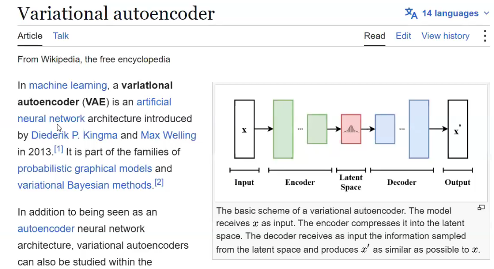

#### ૧૫.૪.૧ VAE નો પાયાનો સિદ્ધાંત: સાદો ઓટોએન્કોડર ડેટા જનરેટ કેમ નથી કરી શકતો?

મશીન લર્નિંગ અને પ્રોબેબિલિસ્ટિક ડીપ લર્નિંગમાં, **વેરીએશનલ ઓટોએન્કોડર (VAE)** એ **Diederik P. Kingma** અને **Max Welling** દ્વારા **૨૦૧૩** માં (*"Auto-Encoding Variational Bayes"*) રજૂ કરાયેલું એક ક્રાંતિકારી આર્ટિફિશિયલ ન્યુરલ નેટવર્ક આર્કિટેક્ચર છે. તે **પ્રોબેબિલિસ્ટિક ગ્રાફિકલ મોડેલ્સ (Probabilistic Graphical Models)** અને **વેરીએશનલ બાયેશિયન પદ્ધતિઓ (Variational Bayesian Methods)** ના સંગમ પર રચાયેલું છે.

ઉપરના વિકિપીડિયા સ્કીમ ડાયાગ્રામ મુજબ:
- **ઇનપુટ ($\mathbf{x}$):** હાઇ-ડાઇમેન્શનલ ડેટા (દા.ત. ઇમેજ પિક્સેલ્સ, ઑડિઓ વેવફોર્મ્સ અથવા કેમિકલ મોલેક્યુલ્સ).
- **એન્કોડર ($q_{\boldsymbol{\phi}}(\mathbf{z} \mid \mathbf{x})$):** ઇનપુટ $\mathbf{x}$ ને કોઈ એક નિશ્ચિત બિંદુમાં નહીં, પરંતુ લેટન્ટ સ્પેસ પર સતત પ્રોબેબિલિટી ડિસ્ટ્રિબ્યુશનના આંકડાકીય પેરામીટર્સ (મીન $\boldsymbol{\mu}$ અને સ્ટાન્ડર્ડ ડેવિએશન $\boldsymbol{\sigma}$) માં સંકુચિત કરે છે.
- **લેટન્ટ સ્પેસ ($\mathbf{z}$):** સતત, સરળ ગાઉસિયન બેલ કર્વ (Gaussian Distribution $\mathcal{N}(\mathbf{0}, \mathbf{I})$) સ્વરૂપે ગોઠવાયેલી જગ્યા.
- **ડિકોડર ($p_{\boldsymbol{\theta}}(\mathbf{x} \mid \mathbf{z})$):** લેટન્ટ સ્પેસમાંથી સેમ્પલ થયેલી માહિતી મેળવીને મૂળ $\mathbf{x}$ જેવું જ વાસ્તવિક આઉટપુટ $\mathbf{x}'$ તૈયાર કરે છે.

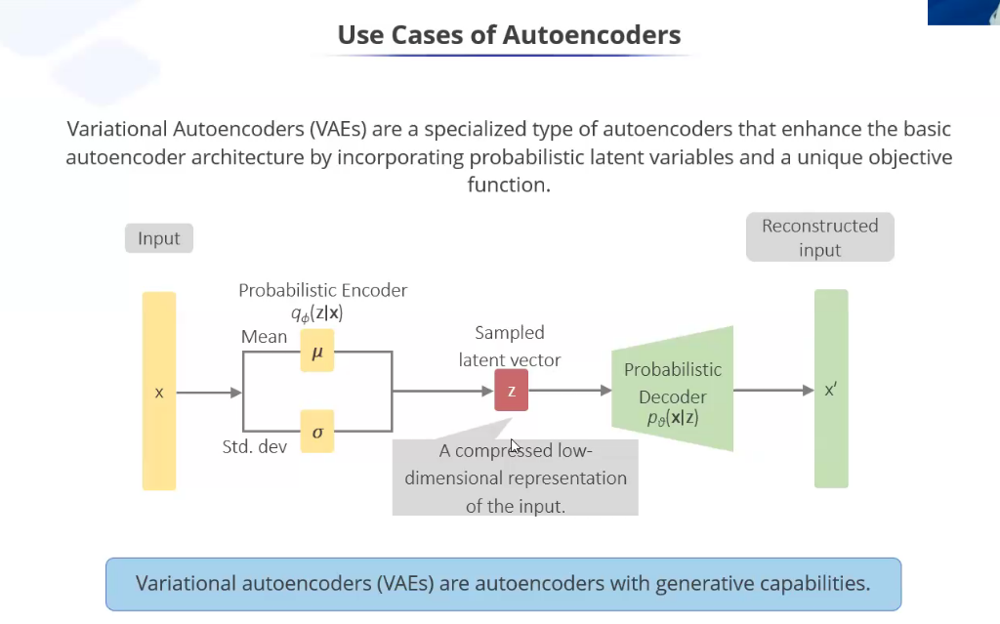

સામાન્ય ડિટર્મિનિસ્ટિક ઓટોએન્કોડર દરેક ઇમેજ $\mathbf{x}$ ને લેટન્ટ સ્પેસમાં માત્ર એક જ અલગ ટપકાં (Isolated Point $\mathbf{z}$) તરીકે સાચવે છે. કારણ કે નેટવર્ક ફક્ત રિકન્સ્ટ્રક્શન લોસ ઘટાડવા માટે ટ્રેઇન થાય છે, તેથી લેટન્ટ સ્પેસમાં વિશાળ ખાલી જગ્યાઓ ("ડેડ ઝોન") રહી જાય છે. જો તમે તે ખાલી જગ્યામાંથી કોઈ રેન્ડમ નંબર ડિકોડરને આપો, તો પરિણામ અર્થહીન કચરો હશે. એટલે કે સાદા ઓટોએન્કોડર્સ માત્ર કમ્પ્રેશન ટૂલ છે—**તેમની પાસે નવી વસ્તુ જનરેટ કરવાની કોઈ ક્ષમતા નથી**.

**વેરીએશનલ ઓટોએન્કોડર્સ (VAEs)** લેટન્ટ સ્પેસને **સતત, સરળ પ્રોબેબિલિસ્ટિક મેનિફોલ્ડ (Continuous Smooth Probabilistic Manifold)** બનાવીને આ મર્યાદા દૂર કરે છે:
- **પ્રોબેબિલિસ્ટિક એન્કોડર ($q_{\boldsymbol{\phi}}(\mathbf{z} \mid \mathbf{x})$):** નિશ્ચિત બિંદુ આપવાને બદલે બે સતત આંકડાકીય વેક્ટર્સ આઉટપુટ આપે છે:
  1. **મીન વેક્ટર (Mean Vector $\boldsymbol{\mu}$):** લેટન્ટ ડિસ્ટ્રિબ્યુશનનું કેન્દ્રબિંદુ દર્શાવે છે.
  2. **સ્ટાન્ડર્ડ ડેવિએશન વેક્ટર (Standard Deviation $\boldsymbol{\sigma}$ અથવા $\log \boldsymbol{\sigma}^2$):** તે કેન્દ્રની આસપાસ અનિશ્ચિતતા અને ફેલાવો દર્શાવે છે.
- તે પછી લેટન્ટ વેક્ટર $\mathbf{z}$ નું સેમ્પલિંગ થાય છે:
  $$\mathbf{z} \sim q_{\boldsymbol{\phi}}(\mathbf{z} \mid \mathbf{x}) = \mathcal{N}\left( \boldsymbol{\mu}(\mathbf{x}), \, \operatorname{diag}(\boldsymbol{\sigma}^2(\mathbf{x})) \right)$$
- **પ્રોબેબિલિસ્ટિક ડિકોડર ($p_{\boldsymbol{\theta}}(\mathbf{x} \mid \mathbf{z})$):** સેમ્પલ થયેલા લેટન્ટ વેક્ટર $\mathbf{z}$ પરથી મૂળ ડેટાનું પુનઃનિર્માણ $\hat{\mathbf{x}} = \mathbf{x}'$ કરે છે.
- **જનરેટિવ ક્ષમતા (Generative Capability):** ટ્રેઇનિંગ પૂર્ણ થયા પછી, એન્કોડરની કોઈ જરૂર રહેતી નથી! આપણે સ્ટાન્ડર્ડ નોર્મલ ડિસ્ટ્રિબ્યુશનમાંથી સીધો રેન્ડમ નોઇઝ $\mathbf{z} \sim \mathcal{N}(\mathbf{0}, \mathbf{I})$ લઈને ટ્રેઇન કરેલા ડિકોડરમાંથી પસાર કરીએ છીએ, અને ડિકોડર એક બિલકુલ નવો, વાસ્તવિક નમૂનો બનાવી આપે છે!

---

#### ૧૫.૪.૨ VAE નું લોસ ફંક્શન: ELBO (Evidence Lower Bound)
લેટન્ટ સ્પેસ સરળ રહે અને વચ્ચે કોઈ અર્થહીન ખાલી જગ્યા ન બચે તે માટે VAE **ELBO (Evidence Lower Bound)** ઓપ્ટિમાઇઝ કરે છે:
$$\mathcal{L}_{\text{VAE}}(\boldsymbol{\theta}, \boldsymbol{\phi}; \mathbf{x}) = \underbrace{\mathbb{E}_{q_{\boldsymbol{\phi}}(\mathbf{z} \mid \mathbf{x})}\left[ \log p_{\boldsymbol{\theta}}(\mathbf{x} \mid \mathbf{z}) \right]}_{\text{ભાગ ૧: રિકન્સ્ટ્રક્શન સચોટતા}} - \underbrace{\mathcal{D}_{\text{KL}}\left( q_{\boldsymbol{\phi}}(\mathbf{z} \mid \mathbf{x}) \,\parallel\, p(\mathbf{z}) \right)}_{\text{ભાગ ૨: KL ડાઇવર્જન્સ રેગ્યુલરાઇઝેશન}}$$

1. **રિકન્સ્ટ્રક્શન લોસ (Reconstruction Loss - ભાગ ૧):** MSE અથવા BCE વડે માપે છે કે રિકન્સ્ટ્રક્ટ થયેલી ઇમેજ મૂળ ઇમેજ સાથે કેટલી મેળ ખાય છે.
2. **Kullback-Leibler (KL) ડાઇવર્જન્સ (ભાગ ૨):** એક ગાણિતિક સ્પ્રિંગની જેમ કામ કરે છે જે શીખેલા લેટન્ટ ડિસ્ટ્રિબ્યુશનને સ્ટાન્ડર્ડ ગાઉસિયન $p(\mathbf{z}) = \mathcal{N}(\mathbf{0}, \mathbf{I})$ તરફ ખેંચી રાખે છે:
   $$\mathcal{D}_{\text{KL}} = -\frac{1}{2} \sum_{j=1}^d \left( 1 + \log(\sigma_j^2) - \mu_j^2 - \sigma_j^2 \right)$$
   આ પેનલ્ટી સુનિશ્ચિત કરે છે કે એન્કોડર ડેટાને અલગ-અલગ ખૂણાઓમાં છૂટાછવાયા ફેંકી ન દે, જેથી લેટન્ટ સ્પેસનું પ્રત્યેક બિંદુ અર્થપૂર્ણ આઉટપુટમાં ડિકોડ થઈ શકે.

---

#### ૧૫.૪.૩ રિપેરામીટરાઇઝેશન ટ્રિક (The Reparameterization Trick)
ડાયરેક્ટ રેન્ડમ સેમ્પલિંગ $\mathbf{z} \sim \mathcal{N}(\boldsymbol{\mu}, \boldsymbol{\sigma}^2)$ એ નોન-ડિફરેન્શિએબલ (Non-differentiable) પ્રક્રિયા છે—તમે રેન્ડમ પાસા ફેંકવા પર ગ્રેડિયન્ટ્સની ગણતરી (Backpropagation) કરી શકતા નથી!

**ગાણિતિક ઉકેલ:** રેન્ડમનેસને નેટવર્કના વજનથી અલગ કરીને એક સ્વતંત્ર ગાઉસિયન નોઇઝ $\boldsymbol{\epsilon}$ ઉમેરવામાં આવે છે:
$$\mathbf{z} = \boldsymbol{\mu} + \boldsymbol{\sigma} \odot \boldsymbol{\epsilon}, \quad \text{જ્યાં } \boldsymbol{\epsilon} \sim \mathcal{N}(\mathbf{0}, \mathbf{I})$$
અહીં $\odot$ એ એલિમેન્ટ-વાઇઝ ગુણાકાર છે. કારણ કે $\boldsymbol{\epsilon}$ એ બાહ્ય રેન્ડમ નોઇઝ છે જેમાં કોઈ શીખવા જેવા વજન નથી, તેથી ભૂલના ગ્રેડિયન્ટ્સ $\frac{\partial \mathcal{L}}{\partial \boldsymbol{\mu}}$ અને $\frac{\partial \mathcal{L}}{\partial \boldsymbol{\sigma}}$ સરળતાથી બેકપ્રોપેગેશન દ્વારા એન્કોડરમાં પાછા વહી શકે છે!

```python
# Keras / TensorFlow વડે રિપેરામીટરાઇઝેશન ટ્રિક સાથે Custom Sampling Layer
import tensorflow as tf
from tensorflow.keras import layers

class Sampling(layers.Layer):
    """(z_mean, z_log_var) નો ઉપયોગ કરીને Reparameterization Trick વડે z સેમ્પલ કરે છે."""
    def call(self, inputs):
        z_mean, z_log_var = inputs
        batch = tf.shape(z_mean)[0]
        dim = tf.shape(z_mean)[1]
        epsilon = tf.random.normal(shape=(batch, dim))
        # z = mu + sigma * epsilon (જ્યાં sigma = exp(0.5 * log_var))
        return z_mean + tf.exp(0.5 * z_log_var) * epsilon
```

---

### ૧૫.૫ વાસ્તવિક દુનિયાના ઔદ્યોગિક ઉપયોગો અને કેસ સ્ટડીઝ (Industrial Applications & Real-World Use Cases)

જ્યાં માનવીય લેબલિંગ અશક્ય કે અત્યંત ખર્ચાળ હોય તેવા ઉદ્યોગોમાં ઓટોએન્કોડર્સ કરોડરજ્જુ સમાન છે:

1. **નાણાકીય ફ્રોડ ડિટેક્શન (Mastercard / Visa / PayPal):**
   - **કાર્યપદ્ધતિ:** ઓટોએન્કોડરને માત્ર કરોડો કાયદેસર (Normal) વ્યવહારો પર ટ્રેઇન કરવામાં આવે છે. તે ગ્રાહકોની સામાન્ય ખરીદી ટેવો શીખી લે છે.
   - **પ્રોડક્શન અમલ:** વાસ્તવિક વ્યવહાર આવતાં તે ઓટોએન્કોડરમાંથી પસાર થાય છે. સામાન્ય ટ્રાન્ઝેક્શન નજીવી એરર સાથે રિકન્સ્ટ્રક્ટ થાય છે ($\mathcal{L} \le \tau$). પરંતુ ચોરાયેલા કાર્ડનો અસામાન્ય વ્યવહાર આવતાં રિકન્સ્ટ્રક્શન એરર થ્રેશોલ્ડ $\tau$ કરતાં વધી જાય છે, અને કાર્ડ તરત જ ફ્રીઝ થઈ જાય છે.
2. **પ્રિડિક્ટિવ મેઇન્ટેનન્સ અને ટર્બાઇન હેલ્થ (GE / Rolls-Royce):**
   - જેટ એન્જિન અને પાવર પ્લાન્ટ ટર્બાઇનમાં સેંકડો વાઇબ્રેશન અને તાપમાન સેન્સર્સ હોય છે. સામાન્ય સ્થિતિમાં એરર ન્યૂનતમ રહે છે. બેરિંગમાં તિરાડ પડતાં જ સિગ્નલ અસામાન્ય બને છે, રિકન્સ્ટ્રક્શન એરર વધે છે અને અકસ્માત સર્જાય તે પહેલાં મેઇન્ટેનન્સ એલાર્મ વાગે છે.
3. **હેલ્થકેર પેથોલોજી સ્કેન સેગમેન્ટેશન (Siemens / Philips Healthcare):**
   - સ્વસ્થ દર્દીઓના બ્રેઇન MRI સ્કેન્સ પર ટ્રેઇન થયેલ કન્વોલ્યુશનલ ઓટોએન્કોડર જ્યારે ટ્યુમર કે કેન્સરવાળો સ્કેન જુએ છે, ત્યારે માત્ર સામાન્ય પેશીઓ રિકન્સ્ટ્રક્ટ કરી શકે છે. ઇનપુટ અને આઉટપુટ વચ્ચેનો તફાવત લેતાં ($|\mathbf{x} - \hat{\mathbf{x}}|$) ટ્યુમર આપમેળે હાઇલાઇટ થઈ જાય છે.
4. **ઇમેજ અને ઑડિઓ ડિનોઇઝિંગ (Adobe Lightroom / Dolby Audio):**
   - ડીનોઇઝિંગ ઓટોએન્કોડર્સ જૂના અવાજવાળા ઑડિઓ રેકોર્ડિંગ્સમાંથી હિસ અને ક્લિક્સ દૂર કરે છે તથા ઓછા પ્રકાશમાં ખેંચેલા ફોટામાંથી ગ્રેઇન/નોઇઝ હટાવીને ક્રિસ્ટલ ક્લિયર આઉટપુટ આપે છે.
5. **ઇ-કોમર્સ અને મીડિયા રેકમેન્ડેશન (Amazon / Spotify / Netflix):**
   - લાખો પ્રોડક્ટ્સ કે ગીતો સામે વપરાશકર્તાની ક્રિયાપ્રતિક્રિયાઓનું સ્તર અત્યંત મોટું અને સ્પાર્સ હોય છે. ઓટોએન્કોડર તેને ૩૨ થી ૬૪ પરિમાણોના કોમ્પેક્ટ લેટન્ટ વેક્ટરમાં બદલીને તાત્કાલિક સમાન રુચિવાળા આઇટમ્સ રેકમેન્ડ કરે છે.

---

### ૧૫.૬ ઓટોએન્કોડર ટ્રેઇન કરવાના મુખ્ય હાઇપરપેરામીટર્સ (Key Hyperparameters to Train an Autoencoder)

| હાઇપરપેરામીટર | વિશિષ્ટ શ્રેણી (Typical Range) | તકનીકી ભૂમિકા અને વ્યવહારુ માર્ગદર્શન |
| :--- | :--- | :--- |
| **બોટલનેકનું કદ ($d$ / Latent Dim)** | ઇનપુટ પરિમાણના $2\%$ થી $10\%$ (દા.ત., $784 \to 16$ અથવા $32$) | **સૌથી મહત્વનો હાઇપરપેરામીટર.** જો તે ખૂબ મોટો હશે, તો નેટવર્ક ઓળખ વિધેય (Identity function) યાદ રાખી લેશે અને અવાજ ફિલ્ટર નહીં થાય. જો ખૂબ નાનો હશે, તો મોડેલ અન્ડરફિટ થશે અને મહત્વની માહિતી ભૂંસાઈ જશે. |
| **લર્નિંગ રેટ ($\eta$ - Learning Rate)** | $10^{-4}$ થી $10^{-3}$ (Adam / AdamW) | રિકન્સ્ટ્રક્શન લોસ સરફેસ ઘણીવાર અત્યંત ખાડાટેકરાવાળી હોય છે. સામાન્ય રીતે $0.001$ થી શરૂ કરીને ReduceLROnPlateau વડે ઘટાડવો શ્રેષ્ઠ છે. |
| **રિકન્સ્ટ્રક્શન લોસ ફંક્શન** | **MSE** (વાસ્તવિક ડેટા) અથવા **BCE** (પિક્સેલ્સ $[0, 1]$) | સતત સેન્સર રીડિંગ્સ માટે `MSE` વપરાય છે. $[0, 1]$ ની વચ્ચે સામાન્યકૃત કરેલ ઇમેજ પિક્સેલ્સ માટે `Binary Cross-Entropy` વધુ ઝડપી કન્વર્જન્સ આપે છે. |
| **બેચ સાઇઝ (Batch Size)** | $32$ થી $256$ | નાની બેચ સાઇઝ ($32$) સ્ટોકેસ્ટિક રેગ્યુલરાઇઝેશન પૂરું પાડે છે; જ્યારે મોટી બેચ ($256$) GPU પેરેલેલિઝમ ઝડપી બનાવે છે. |
| **રેગ્યુલરાઇઝેશન પેનલ્ટી ($L_1 / L_2$)** | $10^{-5}$ થી $10^{-3}$ | વજનને વધુ પડતાં મોટા થતાં અટકાવે છે અને મોડેલને ઇનપુટ ગોખવાને બદલે જનરલાઇઝ કરવા પ્રેરે છે. |
| **સ્પાર્સિટી પેરામીટર ($\rho$ અને $\beta$)** | $\rho = 0.05, \beta = 1.0 \dots 3.0$ | **સ્પાર્સ ઓટોએન્કોડર્સ** માં વપરાય છે. KL પેનલ્ટી દ્વારા માત્ર $5\%$ લેટન્ટ ન્યુરોન્સ સક્રિય રહે તે સુનિશ્ચિત કરે છે. |
| **નોઇઝ ફેક્ટર ($\sigma_{\text{noise}}$)** | $0.1$ થી $0.3$ (ગાઉસિયન અથવા સોલ્ટ & પેપર) | **ડીનોઇઝિંગ ઓટોએન્કોડર્સ** માં વપરાય છે. ઇનપુટમાં જાણીજોઈને બગાડ ઉમેરીને મોડેલને સાચા ફીચર્સ શીખવા મજબૂર કરે છે. |
| **KL વેઇટ / $\beta$-ફેક્ટર (VAEs)** | $\beta = 1.0$ (સ્ટાન્ડર્ડ) અથવા $0.1 \dots 4.0$ ($\beta$-VAE) | VAE ના ELBO માં KL ડાઇવર્જન્સ પેનલ્ટીનું વજન નક્કી કરે છે. ઊંચો $\beta$ સ્વતંત્ર પરિબળો (દા.ત. ચહેરાનું હાસ્ય અને ચશ્મા) છૂટા પાડવામાં મદદ કરે છે. |
| **એક્ટિવેશન ફંક્શન્સ** | હિડન: **LeakyReLU / GELU**<br>આઉટપુટ: **Sigmoid** અથવા **Linear** | સાંકડી બોટલનેકમાં ન્યુરોન્સ "મરી" ન જાય તે માટે LeakyReLU શ્રેષ્ઠ છે. આઉટપુટ લેયરનું એક્ટિવેશન ઇનપુટ સાથે મેળ ખાવું જોઈએ: $[0, 1]$ માટે `Sigmoid`, સતત ડેટા માટે `Linear`. |
| **અર્લી સ્ટોપિંગ પેશન્સ (Early Stopping)** | ૧૦ થી ૨૦ એપ્સ (Epochs) | વેલિડેશન રિકન્સ્ટ્રક્શન લોસ પર નજર રાખે છે. શ્રેષ્ઠ બિંદુ પછી વધુ ટ્રેઇનિંગ કરવાથી મોડેલ સેન્સરનો કચરો યાદ રાખવા લાગે છે. |

---

### ૧૫.૭ જનરેટિવ AI મુકાબલો: GANs (જનરેટિવ એડવર્સેરીયલ નેટવર્ક્સ) વિરુદ્ધ VAEs નો વાસ્તવિક દુનિયામાં ઉપયોગ (GANs vs. VAEs)

#### ૧૫.૭.૧ GAN શું છે? (Full Form અને કાર્યપદ્ધતિ)
**GAN** નું પૂરું નામ **Generative Adversarial Network** છે, જેની શોધ ઇયાન ગુડફેલો (Ian Goodfellow) અને તેમના સાથીઓએ જૂન ૨૦૧૪ માં મોન્ટ્રીયલ યુનર્સિટી ખાતે કરી હતી.

ઓટોએન્કોડર્સની જેમ એન્કોડર-ડિકોડર પાઇપલાઇન વાપરવાને બદલે, GAN જનરેટિવ મોડેલિંગને બે સ્પર્ધાત્મક નેટવર્ક્સ વચ્ચેની **ટુ-પ્લેયર ઝીરો-સમ ગેમ (Minimax Game)** તરીકે ઘડે છે:
1. **જનરેટર ($G$):** રેન્ડમ નોઇઝ વેક્ટર $\mathbf{z}$ લઈને નકલી વાસ્તવિક ડેટા બનાવે છે (એક માસ્ટર આર્ટ નકલી પેઇન્ટર/કાઉન્ટરફીટરની જેમ).
2. **ડિસ્ક્રિમિનેટર ($D$):** વાસ્તવિક નમૂનાઓ $\mathbf{x}$ અને જનરેટર દ્વારા બનાવેલા નકલી નમૂનાઓ $G(\mathbf{z})$ ની તપાસ કરીને નક્કી કરે છે કે તે અસલી છે કે નકલી (એક ડિટેક્ટિવની જેમ).

મિનિમેક્સ ઓબ્જેક્ટિવ બંને નેટવર્કને એકસાથે સુધરવા મજબૂર કરે છે જ્યાં સુધી તેઓ નેશ ઇક્વિલિબ્રિયમ (Nash Equilibrium) પર ન પહોંચે:
$$\min_G \max_D V(D, G) = \mathbb{E}_{\mathbf{x} \sim p_{\text{data}}}[\log D(\mathbf{x})] + \mathbb{E}_{\mathbf{z} \sim p_z}[\log(1 - D(G(\mathbf{z})))]$$

---

#### ૧૫.૭.૨ આર્કિટેક્ચરલ સરખામણી: VAE vs. GAN vs. Diffusion Models

| પરિમાણ | વેરીએશનલ ઓટોએન્કોડર (VAE) | જનરેટિવ એડવર્સેરીયલ નેટવર્ક (GAN) | આધુનિક ડિફ્યુઝન મોડેલ્સ (DDPM) |
| :--- | :--- | :--- | :--- |
| **મૂળભૂત સિદ્ધાંત** | પ્રોબેબિલિસ્ટિક એન્કોડર + ડિકોડર (ELBO) | મિનિમેક્સ રમત ($G$ વિરુદ્ધ $D$) | ક્રમશઃ નોઇઝ દૂર કરવો (Denoising Score) |
| **ટ્રેઇનિંગ સ્થિરતા** | **ખૂબ ઊંચી** (સરળ કન્વેક્સ લોસ કર્વ) | **ઓછી** (અસ્થિર; મોડ કોલેપ્સ થવાનું જોખમ) | **ખૂબ ઊંચી** (સ્થિર રિગ્રેશન લોસ) |
| **લેટન્ટ સ્પેસ** | **સતત, સરળ, સુવ્યવસ્થિત** (ગાઉસિયન) | અસતત, અનિયંત્રિત નોઇઝ વેક્ટર | મલ્ટી-સ્ટેપ ડાયનેમિક માર્કોવ ચેઇન |
| **ઇન્ફરન્સ સ્પીડ** | **અલ્ટ્રા-ફાસ્ટ** (એક જ ફોરવર્ડ પાસ $O(1)$) | **અલ્ટ્રા-ફાસ્ટ** (એક જ ફોરવર્ડ પાસ $O(1)$) | **ધીમી** (૨૦ થી ૫૦ પુનરાવર્તિત સ્ટેપ્સ જરૂરી) |
| **ઇમેજની શાર્પનેસ** | થોડી ઝાંખી (MSE પિક્સેલ એવરેજિંગને કારણે) | **અત્યંત શાર્પ અને વાસ્તવિક (Photorealistic)** | **સ્ટેટ-ઓફ-ધ-આર્ટ ફોટોરિયાલિસ્ટિક** |
| **મુખ્ય ઉદ્યોગ ભૂમિકા**| વિસંગતતા શોધ, ડ્રગ ડિસ્કવરી, એમ્બેડિંગ્સ | રિયલ-ટાઇમ ગ્રાફિક્સ, સુપર-રિઝોલ્યુશન, વર્ચ્યુઅલ ટ્રાય-ઓન | Midjourney, DALL-E 3, Stable Diffusion |

---

#### ૧૫.૭.૩ વાસ્તવિક ઉદ્યોગમાં GANs ના ૫ મુખ્ય ઉપયોગો

1. **હાઇપર-રિયાલિસ્ટિક માનવ ચહેરા અને અવતાર જનરેશન (NVIDIA StyleGAN2/3):**
   - વાસ્તવિક દુનિયામાં અસ્તિત્વ ન ધરાવતા હોય તેવા અત્યંત શાર્પ ($1024 \times 1024$) માનવ ચહેરા બનાવવા, જેનો ઉપયોગ વિડિયો ગેમ્સ, સિનેમા અને ડિજિટલ માર્કેટિંગમાં થાય છે.
2. **ઇમેજ-ટુ-ઇમેજ ટ્રાન્સલેશન (Pix2Pix અને CycleGAN):**
   - સ્કેચમાંથી વાસ્તવિક ઇમારતોનું નિર્માણ, સેલ્ફ-ડ્રાઇવિંગ કાર માટે દિવસના વિડિયોને રાત્રિના વિડિયોમાં ફેરવવો, અને સેટેલાઇટ ફોટોમાંથી ગૂગલ મેપ્સ જેવો રોડ મેપ બનાવવો.
3. **સુપર-રિઝોલ્યુશન (SRGAN / ESRGAN):**
   - સિક્યોરિટી કેમેરાના ઓછા રિઝોલ્યુશનવાળા ($480\text{p}$) ફૂટેજને ક્રિસ્પ $4\text{K}$ માં અપસ્કેલ કરવું (વાળ, કપડાંની ટેક્ષ્ચર અને કારની નંબર પ્લેટ શાર્પ બનાવવી).
4. **પ્રાઇવસી-સેફ સિન્થેટિક હેલ્થકેર ડેટા:**
   - દર્દીઓની ખાનગી ઓળખ છતી કર્યા વિના આબેહૂબ રોગલક્ષણો ધરાવતા સિન્થેટિક MRI સ્કેન્સ બનાવવા, જે HIPAA અને GDPR નિયમોનું પાલન કરીને મેડિકલ રિસર્ચમાં વપરાય છે.
5. **ફેશન અને વર્ચ્યુઅલ ટ્રાય-ઓન (VTON):**
   - ઈ-કોમર્સ સાઇટ્સ (દા.ત. Amazon Fashion, Myntra) પર વપરાશકર્તાના ફોટા પર કપડાં ફિટ કરીને દર્શાવવા, જેમાં લાઇટિંગ, પોશ્ચર અને કરચલીઓ પણ યોગ્ય રીતે જળવાય છે.

---

### ૧૫.૮ Keras / TensorFlow વડે કન્વોલ્યુશનલ ઓટોએન્કોડર (Convolutional Autoencoder) કોડ ઉદાહરણ

```python
# Keras અને TensorFlow વડે ઇમેજ કમ્પ્રેશન માટે Convolutional Autoencoder
import tensorflow as tf
from tensorflow.keras import layers, models

# ૧. એન્કોડર આર્કિટેક્ચર (ઇમેજનું કદ ઘટાડવું)
input_img = layers.Input(shape=(28, 28, 1))

x = layers.Conv2D(16, (3, 3), activation='relu', padding='same')(input_img)
x = layers.MaxPooling2D((2, 2), padding='same')(x) # 14 x 14
x = layers.Conv2D(8, (3, 3), activation='relu', padding='same')(x)
x = layers.MaxPooling2D((2, 2), padding='same')(x) # 7 x 7
x = layers.Conv2D(8, (3, 3), activation='relu', padding='same')(x)
bottleneck = layers.MaxPooling2D((2, 2), padding='same', name="bottleneck_layer")(x) # 4 x 4 x 8 = 128 પરિમાણો

# ૨. ડિકોડર આર્કિટેક્ચર (મૂળ ઇમેજનું પુનઃનિર્માણ કરવું)
x = layers.Conv2D(8, (3, 3), activation='relu', padding='same')(bottleneck)
x = layers.UpSampling2D((2, 2))(x) # 8 x 8
x = layers.Conv2D(8, (3, 3), activation='relu', padding='same')(x)
x = layers.UpSampling2D((2, 2))(x) # 16 x 16
x = layers.Conv2D(16, (3, 3), activation='relu')(x) # 14 x 14 (valid padding)
x = layers.UpSampling2D((2, 2))(x) # 28 x 28
decoded = layers.Conv2D(1, (3, 3), activation='sigmoid', padding='same')(x)

# ૩. સંપૂર્ણ ઓટોએન્કોડર મોડેલ
autoencoder = models.Model(input_img, decoded)
autoencoder.compile(optimizer='adam', loss='binary_crossentropy')
autoencoder.summary()
```

---

## પ્રકરણ ૧૬: હાર્ડવેર ગાઇડ: Windows (WSL2/OpenVINO), Mac (MPS) અને Linux (CUDA)

### ૧૬.૧ સિસ્ટમ મુજબ ગાઇડ

```
  ઓપરેટિંગ સિસ્ટમ                 TensorFlow GPU માટે                  PyTorch માટે
 ──────────────────     ───────────────────────────────────    ───────────────────────────────────
 Windows 10/11          WSL2 (Ubuntu) ફરજિયાત છે             Direct Windows (CUDA) અથવા OpenVINO
 macOS (Apple Silicon)  tensorflow-metal                       MPS (`torch.device("mps")`)
 Linux (Ubuntu)         Native NVIDIA CUDA                     Native NVIDIA CUDA
```

- **Windows યુઝર્સ માટે:** TensorFlow 2.11+ પછી ગૂગલે નેટિવ વિન્ડોઝ GPU સપોર્ટ બંધ કર્યો છે. તેથી NVIDIA GPU વાપરવા માટે **WSL2** ઇન્સ્ટોલ કરવું ફરજિયાત છે.
- **Mac યુઝર્સ માટે (M1/M2/M3/M4):** Mac માં યુનિફાઇડ મેમરી હોવાથી `device = torch.device("mps")` લખવાથી લેપટોપ ગરમ થયા વગર સુપર સ્પીડે મોડેલ ટ્રેન થાય છે.
- **Intel CPU/iGPU માટે:** ઇન્ટેલના પ્રોસેસર પર PyTorch મોડેલને સુપર ફાસ્ટ ચલાવવા માટે **OpenVINO** શ્રેષ્ઠ છે.

---

## પ્રકરણ ૧૭: માસ્ટર ગ્લોસરી અને શબ્દાવલિ (Deep Learning Dictionary)

| શબ્દ (Term) | સાદી વ્યાખ્યા (Simple Meaning) | તે કેવી રીતે કામ કરે છે? | વાસ્તવિક ઉદાહરણ |
| :--- | :--- | :--- | :--- |
| **Dot Product** | બે સદિશો (Vectors) નો ગુણાકાર જે એક સિંગલ નંબર આપે છે. | બંને લિસ્ટ એક જ દિશામાં કેટલી મળતી આવે છે તે માપે છે. | સ્પોટિફાઇ મ્યુઝિક રેકમેન્ડેશન (તમારી પસંદ અને ગીતની સમાનતા). |
| **Matmul** | બે મેટ્રિક્સનો ગુણાકાર. | GPU પર લાખો ડેટા પોઇન્ટ્સ એકસાથે પ્રોસેસ કરે છે. | બેચમાં ૧૨૮ ફોટા એકસાથે નેટવર્કમાંથી પસાર કરવા. |
| **Hadamard Product**| સામસામેના એલિમેન્ટ્સનો સીધો ગુણાકાર ($\odot$). | માસ્કિંગ અને ફિલ્ટરિંગ કરે છે. | ડ્રોપઆઉટમાં ૫૦% ન્યુરોન્સને શૂન્ય વડે ગુણીને બંધ કરવા. |
| **Filter (કન્વોલ્યુશનલ ફિલ્ટર)** | ફોટા પર ફરતો ૩D વજનનો બ્લોક ($K_h \times K_w \times C_{in}$ + ૧ બાયસ) જે કિનારીઓ, ટેક્સચર કે આકારો શોધે છે. | ૧ ફિલ્ટર = ૧ આઉટપુટ ફીચર મેપ. શરૂઆતના લેયર્સમાં સાદી એજ, વચ્ચે આકારો, અને ઊંડા લેયર્સમાં આખા ચહેરા કે ગાડીઓ ઓળખે છે. | સ્માર્ટફોન પોટ્રેટ મોડમાં વાળ અને શરીરની બોર્ડર પકડી બેકગ્રાઉન્ડ બ્લર કરવું. |
| **Kernel (કર્નલ)** | ફોટાની ૧ સિંગલ ચેનલ પર ફરતો ૨D મેટ્રિક્સ (દા.ત. $3 \times 3$). | પિક્સેલ્સ સાથે ડોટ પ્રોડક્ટ કરીને તે જગ્યાએ પેટર્ન છે કે નહીં તે ચકાસે છે. | ફિંગરપ્રિન્ટ સ્કેનરમાં આંગળીઓની રેખાઓ અને વળાંકો પકડવા. |
| **Epoch** | મોડેલે આખો ડેટાસેટ કેટલી વાર શરૂથી અંત સુધી જોયો. | એક સંપૂર્ણ અભ્યાસ ચક્ર. | વિદ્યાર્થી આખી ચોપડી ૩૦ વાર વાંચીને પાકી કરે. |
| **Batch Size** | એક પગલામાં મોડેલ કેટલા નમૂના એકસાથે જુએ છે. | GPU મેમરી મેનેજમેન્ટ. | એકસાથે ૩૨ કે ૬૪ ફોટા પ્રોસેસ કરવા. |
| **Learning Rate** | મોડેલ દરેક ભૂલ પછી વજન કેટલું ઝડપથી બદલશે. | પગલાંની લંબાઈ ($\eta$). | ખૂબ મોટું હોય તો લપસી જાય, ખૂબ નાનું હોય તો પહોંચતા વર્ષો લાગે. |
| **Overfitting** | મોડેલે પેટર્ન સમજવાને બદલે ડેટા ગોખી માર્યો. | ટ્રેનિંગ લોસ 0 પણ ટેસ્ટિંગ લોસ વધારે. | મોડેલ પોતાના ક્લાસરૂમ સિવાય બહારના પ્રશ્નોમાં ફેઇલ થાય. |
| **Underfitting** | મોડેલ ડેટાની બેઝિક પેટર્ન પણ શીખી શક્યું નથી. | બંને લોસ ખૂબ વધારે. | ૨ લેયરનું સાદું મોડેલ ચહેરો ઓળખવામાં નિષ્ફળ જાય. |
| **Keras** | સરળ હાઇ-લેવલ પાયથોન ડીપ લર્નિંગ લાઇબ્રેરી. | TensorFlow ના અટપટા કોડને લેગો બ્લોક્સ જેવો સરળ બનાવે છે. | ૧૦ લાઈનમાં ઇમેજ ક્લાસિફાયર મોડેલ બનાવવું. |
| **TensorBoard** | ગૂગલનું વિઝ્યુલાઇઝેશન ડેશબોર્ડ. | ટ્રેનિંગ દરમિયાન લોસ અને એક્યુરેસીના લાઇવ ગ્રાફ બતાવે છે. | રાતભર ચાલતી ટ્રેનિંગ બ્રાઉઝરમાં મોનિટર કરવી. |
| **OpenCV** | વિશ્વની સૌથી લોકપ્રિય ઓપન-સોર્સ કમ્પ્યુટર વિઝન લાઇબ્રેરી ([opencv.org](https://opencv.org/)). | વિડિયોમાંથી ફ્રેમ્સ કાપવા (`cv2.VideoCapture`), રિસાઇઝ (`cv2.resize`), અને કલર સ્પેસ (BGR to RGB) બદલવા માટે અનિવાર્ય ટૂલ. | સીસીટીવી કેમેરામાંથી લાઇવ વિડિયો વાંચીને ડીપ લર્નિંગ મોડેલમાં ઇનપુટ આપવો. |
| **OpenVINO** | ઇન્ટેલનું AI ઓપ્ટિમાઇઝેશન ટૂલકિટ. | મોડેલને ઇન્ટેલ CPU અને ઇન્ટિગ્રેટેડ GPU પર સુપર ફાસ્ટ ચલાવે છે. | ફેક્ટરીના સાદા ઇન્ટેલ કોમ્પ્યુટર પર ડિફેક્ટ ડિટેક્શન. |
| **Apple MPS** | એપલ સિલિકોનનું GPU એક્સિલરેશન ફ્રેમવર્ક. | M-સિરીઝ ચિપ્સની યુનિફાઇડ મેમરીનો ઉપયોગ કરે છે. | મેકબુક પર ફ્લાઇટમાં ઇન્ટરનેટ વગર 7B LLM ચલાવવું. |
| **CRNN** | કમ્પ્યુટર વિઝન (CNN) અને સિક્વેન્સ મેમરી (BiLSTM) નું હાઇબ્રિડ નેટવર્ક. | અક્ષરોને અલગ અલગ કાપ્યા વગર આખી લાઇન સીધી વાંચી લે છે. | હાઇવે ટોલ પ્લાઝા પર ગાડીઓની નંબર પ્લેટ સ્કેન કરવી (ALPR / FASTag). |
| **CTC Loss** | અક્ષરો ક્યાં શરૂ અને ક્યાં પૂરા થાય છે તેની ખબર ન હોય ત્યારે વપરાતું લોસ ફંક્શન. | ખાલી જગ્યા (Blank `-`) વાપરીને ડુપ્લિકેટ અક્ષરો ભેગા કરી શબ્દ બનાવે છે (`c-a-a-t` -> `cat`). | મોબાઇલ બેંકિંગમાં હાથથી લખેલા ચેકનું લખાણ ઓળખવું. |
| **InceptionV3** | ગૂગલ દ્વારા વિકસિત ૪૮ લેયર ડીપ પ્રી-ટ્રેઇન્ડ CNN વિઝન મોડેલ (ImageNet પર ટ્રેઇન્ડ). | ફેક્ટરાઇઝ્ડ કન્વોલ્યુશન્સ ($1 \times 7$ અને $7 \times 1$) વાપરી પેરામીટર્સ ઘટાડે છે અને દરેક ફ્રેમમાંથી ૨૦૪૮ પરિમાણના હાઇ-લેવલ ફીચર્સ બહાર કાઢે છે. | વિડિયો ક્લાસિફિકેશનમાં દરેક ફ્રેમનું વિઝ્યુઅલ ફીચર એક્સટ્રેક્શન અને રેટિના આંખના રોગોની તપાસ. |
| **Hybrid Video Model** | વિઝન (OpenCV + InceptionV3) અને સિક્વેન્સ (GRU/LSTM) નું જોડાણ. | પહેલા ફ્રેમ્સમાંથી ફીચર્સ કાઢીને પછી સમય સાથેની મોશન પેટર્ન શીખે છે. | ક્રિકેટમાં બેટ્સમેને કયો શોટ રમ્યો તે વિડિયો જોઈને ઓળખવું. |
| **UCF101 Dataset** | સેન્ટર ફોર રિસર્ચ ઇન કમ્પ્યુટર વિઝન (CRCV), યુનિવર્સિટી ઓફ સેન્ટ્રલ ફ્લોરિડા દ્વારા બનાવેલો એક્શન રેકગ્નિશન બેંચમાર્ક. | ૧૦૧ માનવીય પ્રવૃત્તિઓમાં વહેંચાયેલા ૧૩,૩૨૦ વાસ્તવિક યુટ્યુબ વિડિયોઝનો ડેટાસેટ. | વિડિયોમાં ક્રિયાઓ ઓળખતા AI મોડેલ્સનું ટેસ્ટિંગ અને ટ્રેઇનિંગ. |
| **spaCy** | ઔદ્યોગિક કક્ષાનું અદ્યતન નેચરલ લેંગ્વેજ પ્રોસેસિંગ (NLP) પાયથોન ટૂલકિટ ([spacy.io](https://spacy.io/)). | હાઇ-પર્ફોર્મન્સ Cython માં લખાયેલું છે. તે ટોકનાઇઝર, POS ટેગર, ડિપેન્ડન્સી પાર્સર અને ઇન્ટરેક્ટિવ `displaCy` વિઝ્યુઅલાઇઝર પ્રદાન કરે છે. | લાખો ગ્રાહક સપોર્ટ ચેટ્સ અને કાનૂની દસ્તાવેજોમાંથી નામ, સરનામા અને વ્યાકરણનું વિશ્લેષણ કરવું. |
| **POS Tagging (Part-of-Speech ટેગિંગ)** | વાક્યના દરેક શબ્દને તેના વ્યાકરણના પ્રકાર (નામ, ક્રિયાપદ, વિશેષણ, સર્વનામ) મુજબ લેબલ આપવાની પ્રક્રિયા. | સ્ટેટિસ્ટિકલ ક્લાસિફાયર વાપરીને "saw" ક્રિયાપદ (`VBD`) છે કે સાધન (`NN`) તે નક્કી કરે છે. | વ્યાકરણ ચકાસણી સોફ્ટવેર (Grammarly) અને સર્ચ એન્જિન ક્વેરી પ્રોસેસિંગ. |
| **Syntactic Analysis (વાક્ય રચના વિશ્લેષણ)** | વ્યાકરણના નિયમો મુજબ શબ્દો એકબીજા સાથે કેવી રીતે જોડાયેલા છે તેનું માળખું (Parse Tree) બનાવવું. | શબ્દ-શબ્દ વચ્ચેનો પદાનુક્રમ નક્કી કરે છે (દા.ત. કોણે શું કર્યું). | કાયદાકીય કરારોમાંથી નિયમો અને શરતો આપોઆપ તારવવી. |
| **Dependency Parsing (ડિપેન્ડન્સી પાર્સિંગ)** | વાક્યના મુખ્ય શબ્દ (Head) અને તેના આશ્રિત શબ્દો (Dependents) વચ્ચે દિશાવાળા તીર (Arcs) જોડીને વ્યાકરણ સમજવું. | `ROOT` (મુખ્ય ક્રિયાપદ), `nsubj` (કર્તા), `dobj` (કર્મ), અને `prep`/`pobj` (સાધન) જેવા લેબલ્સ બનાવે છે. | સવાલ-જવાબ સિસ્ટમ્સ (QA): વાક્યમાંથી ચોક્કસ કર્તા અને કર્મ શોધવા. |
| **Cascading Error (કેસ્કેડિંગ એરર / પાઇપલાઇન ભૂલ)** | મલ્ટી-મોડેલ જૂની NLP પાઇપલાઇનની સૌથી મોટી ખામી જ્યાં શરૂઆતની ભૂલ આગળ વધીને આખા પરિણામને બગાડી નાખે છે. | જો POS ટેગર ભૂલથી ક્રિયાપદને નામ સમજી લે, તો પાછળનું ડિપેન્ડન્સી ટ્રી અને અર્થ વિશ્લેષણ બંને ખોટા પડે છે. | ટ્રાન્સફોર્મર શા માટે સફળ થયું તે સમજવા માટેનો મુખ્ય પાયો (એન્ડ-ટુ-એન્ડ લર્નિંગ). |
| **Encoding (એન્કોડિંગ / એન્કોડર સ્ટેક)** | કાચા ઇનપુટ ડેટા (ટેક્સ્ટ, ઇમેજ) ને ઊંડા ગાણિતિક અર્થ અને સંદર્ભ દર્શાવતા વેક્ટર્સના મેટ્રિક્સમાં રૂપાંતરિત કરવાની પ્રક્રિયા. | સેલ્ફ-એટેન્શન અને FFN દ્વારા શબ્દ-શબ્દ વચ્ચેના ગહન સંબંધો કેપ્ચર કરે છે ($N=6$ લેયર્સ). | BERT મોડેલ દ્વારા ગૂગલ સર્ચ ક્વેરીનો અસલ ભાવ સમજવો. |
| **Decoding (ડિકોડિંગ / ડિકોડર સ્ટેક)** | એન્કોડ થયેલી માહિતી પરથી એક પછી એક નવો લક્ષ્ય શબ્દ જનરેટ કરવાની સર્જનાત્મક પ્રક્રિયા (Autoregressive Generation). | Causal Masking વાપરીને ભવિષ્યના શબ્દો છુપાવે છે અને Cross-Attention વડે એન્કોડરની માહિતી ખેંચે છે. | ChatGPT દ્વારા યુઝરના સવાલનો ક્રમશઃ જવાબ ટાઇપ કરવો. |
| **Positional Encoding (પોઝિશનલ એન્કોડિંગ)** | ટ્રાન્સફોર્મરને શબ્દોનો ક્રમ (Word Order) શીખવવા માટે ઇનપુટ વેક્ટર્સમાં ઉમેરાતી સાઈન-કોસાઈન અથવા રોટેશનલ (RoPE) ગણતરી. | વાક્યમાં શબ્દના સ્થાન ($pos$) મુજબ નિશ્ચિત આવૃત્તિઓ ઉમેરે છે જેથી "dog bites man" અને "man bites dog" અલગ ઓળખાય. | વ્યાકરણ અને સેન્ટિમેન્ટ વિશ્લેષણમાં શબ્દોના સાચા ક્રમની જાળવણી. |
| **Cross-Attention (ક્રોસ-એટેન્શન / ધ બ્રિજ)** | જ્યાં ડિકોડર (Queries $Q$) એન્કોડરના આઉટપુટ (Keys $K$ અને Values $V$) સાથે સીધો સંબંધ જોડે છે. | ડિકોડર જ્યારે પણ કોઈ શબ્દ બનાવે ત્યારે મૂળ વાક્યના કયા શબ્દ પર ધ્યાન આપવું તે નક્કી કરે છે. | અંગ્રેજીમાંથી ગુજરાતી ભાષાંતરમાં યોગ્ય શબ્દ પસંદ કરવો. |
| **Transformer (ટ્રાન્સફોર્મર)** | ૨૦૧૭ માં ગૂગલ દ્વારા રજૂ થયેલું ક્રાંતિકારી ન્યુરલ નેટવર્ક આર્કિટેક્ચર જે રિકરન્ટ લૂપ્સ વગર સંપૂર્ણપણે સેલ્ફ-એટેન્શન પર ચાલે છે. (આંતરિક લેયર્સને બ્રાઉઝરમાં લાઇવ જોવા માટે [Transformer Explainer](https://poloclub.github.io/transformer-explainer/) નો ઉપયોગ કરો). | $O(1)$ ક્રમિક ઓપરેશન્સ સાથે GPU પર સંપૂર્ણ સમાંતર ટ્રેનિંગ સક્ષમ કરે છે. | ChatGPT, Claude, Gemini, અને આધુનિક ફાઉન્ડેશન મોડેલ્સનો મૂળ પાયો. |
| **Transformer Explainer** | જ્યોર્જિયા ટેક પોલો ક્લબ (Georgia Tech Polo Club of Data Science) દ્વારા વિકસિત ટ્રાન્સફોર્મર મોડેલ્સનું લાઇવ ઇન્ટરેક્ટિવ વેબ વિઝ્યુઅલાઇઝર ([poloclub.github.io/transformer-explainer](https://poloclub.github.io/transformer-explainer/)). | તમારા બ્રાઉઝરમાં લાઇવ GPT-2 મોડેલ ચલાવીને ટોકન એમ્બેડિંગ્સ, પોઝિશનલ એન્કોડિંગ, મલ્ટી-હેડ સેલ્ફ-એટેન્શન ($Q, K, V$ મેટ્રિક્સ) અને આગલા શબ્દની સંભાવનાઓને સ્ટેપ-બાય-સ્ટેપ વિઝ્યુઅલ દર્શાવે છે. | **ટ્રાન્સફોર્મરને જીવંત સમજવું:** બ્રાઉઝરમાં વાક્ય લખીને એટેન્શન વજન અને ટેમ્પરેચર બદલીને જોવું કે GPT કેવી રીતે નવો શબ્દ પસંદ કરે છે. |
| **Unsupervised Pre-training (અનસુપરવાઇઝ્ડ પ્રી-ટ્રેઇનિંગ)** | LLM ટ્રેઇનિંગનો પ્રથમ અને સૌથી મોટો પાયો, જેમાં ઇન્ટરનેટના ટ્રિલિયન્સ શબ્દો વાંચીને મોડેલ આગલો શબ્દ ધારતા શીખે છે ($\mathcal{L} = -\sum \log P(w_t \mid w_{<t})$). | સમગ્ર ટ્રેનિંગ કમ્પ્યુટ બજેટનો **૯૯% હિસ્સો** વાપરે છે અને હજારો GPUs પર મહિનાઓ સુધી અવિરત ચાલે છે, જેમાં કોઈ માનવીય લેબલિંગની જરૂર પડતી નથી. | **બેઝ મોડેલનું નિર્માણ:** LLaMA 3 જેવા મોડેલને ૧૫ ટ્રિલિયન ટોકન્સ પર ટ્રેઇન કરીને અગાધ જ્ઞાનનો ભંડાર બનાવવો. |
| **SFT (Supervised Fine-Tuning - સુપરવાઇઝ્ડ ફાઇન-ટ્યુનિંગ)** | ટ્રેઇનિંગનો બીજો તબક્કો જ્યાં રો-બેઝ મોડેલને માનવ નિષ્ણાતો દ્વારા લખાયેલી `સવાલ-જવાબ (Instruction-Response)` જોડીઓ પર ટ્યુન કરવામાં આવે છે. | અનિયંત્રિત રીતે વાક્ય પૂરું કરતા મોડેલને એક શિસ્તબદ્ધ, નમ્ર અને મદદરૂપ AI આસિસ્ટન્ટમાં પરિવર્તિત કરે છે. | **ChatGPT આસિસ્ટન્ટ નિર્માણ:** મોડેલને "આ ઇમેઇલનો સારાંશ આપો" જેવા આદેશોનું સીધું પાલન કરવાનું શીખવવું. |
| **RLHF (Reinforcement Learning from Human Feedback)** | માનવ પસંદગીના આધારે રિવોર્ડ મોડેલ ટ્રેઇન કરીને PPO (Proximal Policy Optimization) અલ્ગોરિધમ દ્વારા AI ના જવાબોને માનવ મૂલ્યો સાથે સંરેખિત (Align) કરવા. | મોડેલને મદદરૂપ, પ્રામાણિક અને હાનિરહિત બનાવે છે અને ઝેરી, ભ્રામક કે પક્ષપાતી જવાબો પર પેનલ્ટી લગાવે છે. | **પ્રોડક્શન સેફ્ટી અને અલાઇનમેન્ટ:** હેકિંગ કે ગેરકાયદેસર પ્રવૃત્તિઓ માટે મદદ માંગતા સવાલો સામે મોડેલ નમ્રતાપૂર્વક ઇનકાર કરવાનું શીખે છે. |
| **DPO (Direct Preference Optimization - ડાયરેક્ટ પ્રેફરન્સ ઓપ્ટિમાઇઝેશન)** | અલગ રિવોર્ડ મોડેલ વગર સીધા જ પસંદ કરેલા ($y_w$) અને નાપસંદ કરેલા ($y_l$) જવાબોની જોડી પર મોડેલને ગાણિતિક રીતે ઓપ્ટિમાઇઝ કરતી આધુનિક પદ્ધતિ. | અસ્થિર PPO રીઇન્ફોર્સમેન્ટ લૂપને સંપૂર્ણપણે નાબૂદ કરીને સરળ સુપરવાઇઝ્ડ લોસથી સુપર ફાસ્ટ અલાઇનમેન્ટ પૂરું પાડે છે. | **ઝડપી ઓપન-સોર્સ મોડેલ અલાઇનમેન્ટ:** Zephyr અને આધુનિક ફાઉન્ડેશન મોડેલ્સને ઓછા સંસાધનોમાં સુરક્ષિત અને ચોક્કસ બનાવવા. |
| **BERT (બાઇડિરેક્શનલ એન્કોડર રિપ્રેઝન્ટેશન્સ ફ્રોમ ટ્રાન્સફોર્મર્સ)** | ગૂગલ દ્વારા ૨૦૧૮ માં રજૂ થયેલું એન્કોડર-ઓન્લી મોડેલ જે વાક્યને બંને બાજુથી (ડાબે અને જમણેથી) એકસાથે વાંચીને ઊંડો સંદર્ભ સમજે છે. | Masked Language Model (MLM) અને Next Sentence Prediction (NSP) દ્વારા ૩.૩ અબજ શબ્દો પર સેલ્ફ-સુપરવાઇઝ્ડ ટ્રેઇનિંગ મેળવે છે. | **ગૂગલ સર્ચ અને અર્થગ્રહણ:** સર્ચ એન્જિનમાં વપરાશકર્તાના પ્રશ્નોનો સચોટ અર્થ સમજવો અને સેન્ટિમેન્ટ વિશ્લેષણ. |
| **Hugging Face (transformers)** | ઓપન-સોર્સ AI અને ફાઉન્ડેશન મોડેલ્સ માટેનું વિશ્વનું સૌથી લોકપ્રિય હબ અને પાયથોન લાયબ્રેરી ([huggingface.co](https://huggingface.co/)). | લાખો પ્રી-ટ્રેઇન્ડ મોડેલ્સ (BERT, RoBERTa, GPT, LLaMA) ને `pipeline()` દ્વારા ૨-૩ લાઇનમાં ચલાવવાની અને કસ્ટમ ફાઇન-ટ્યુનિંગ કરવાની સુવિધા આપે છે. | **કંપની સ્તરે ઝડપી AI ડિપ્લોયમેન્ટ:** સેન્ટિમેન્ટ એનાલાઇઝર, NER અથવા માસ્કિંગ પાઇપલાઇન માત્ર થોડી સેકન્ડોમાં પ્રોડક્શનમાં શરૂ કરવી. |
| **Autoencoder (ઓટોએન્કોડર)** | અનસુપરવાઇઝ્ડ ન્યુરલ નેટવર્ક જે ડેટાને સાંકડી બોટલનેકમાં સંકુચિત (Compress) કરી ફરીથી અસલ જેવો જ રિકન્સ્ટ્રક્ટ કરવાનો પ્રયાસ કરે છે. | બોટલનેક મર્યાદિત હોવાથી નેટવર્ક બિનજરૂરી નોઇઝ ફેંકી દઈને ડેટાનો સાર (Latent Essence) શીખવા મજબૂર બને છે. | **ક્રેડિટ કાર્ડ ફ્રોડ ડિટેક્શન:** માત્ર સામાન્ય ટ્રાન્ઝેક્શન્સ પર ટ્રેઇન થાય છે; ફ્રોડ ટ્રાન્ઝેક્શન આવતાં રિકન્સ્ટ્રક્શન એરર વધે છે અને એલાર્મ વાગે છે. |
| **VAE (Variational Autoencoder - વેરીએશનલ ઓટોએન્કોડર)** | સર્જનાત્મક ઓટોએન્કોડર જે ડેટાને અલગ ટપકાં તરીકે નહીં પણ સતત ગાઉસિયન સંભાવના નકશા ($\boldsymbol{\mu}, \boldsymbol{\sigma}$) તરીકે સાચવે છે જેથી તદ્દન નવા નમૂનાઓ બનાવી શકાય. | "રિપેરામીટરાઇઝેશન ટ્રિક" ($\mathbf{z} = \boldsymbol{\mu} + \boldsymbol{\sigma} \odot \boldsymbol{\epsilon}$) વાપરીને રેન્ડમનેસ હોવા છતાં બેકપ્રોપેગેશન શક્ય બનાવે છે. | **AI ડ્રગ ડિસ્કવરી અને મોલેક્યુલર જનરેશન:** રોગો સામે લડતા નવા રસાયણો અને મોલેક્યુલ્સની રચના કરવી. |
| **GAN (Generative Adversarial Network - જનરેટિવ એડવર્સેરીયલ નેટવર્ક)** | બે ખેલાડીઓ (જનરેટર અને ડિસ્ક્રિમિનેટર) વચ્ચેની સ્પર્ધાત્મક રમત (Minimax Game) જે અતિ-વાસ્તવિક સિન્થેટિક ડેટા બનાવે છે. | જનરેટર નકલી ડેટા બનાવે છે અને ડિસ્ક્રિમિનેટર તપાસે છે; બંને એકબીજાને હરાવવા મથતાં અસલી જેવા જ શાર્પ આઉટપુટ તૈયાર થાય છે. | **ફોટોરિયાલિસ્ટિક ફેસ સિન્થેસિસ અને સુપર-રિઝોલ્યુશન:** હાઇ-રિઝોલ્યુશન વર્ચ્યુઅલ માનવ ચહેરા બનાવવા (StyleGAN) અથવા ઝાંખા વિડિયોને 4K માં ફેરવવા. |


---

## પ્રકરણ ૧૮: સંદર્ભ લિંક્સ અને સત્તાવાર સંસાધનો (Official RefLinks)

> [!NOTE] 📚 મહત્વપૂર્ણ કમ્પ્યુટર વિઝન અને ડીપ લર્નિંગ સત્તાવાર સંસાધનો
> 1. **OpenCV સત્તાવાર વેબસાઇટ અને ડોક્યુમેન્ટેશન:**  
>    🔗 **[OpenCV (Open Source Computer Vision Library)](https://opencv.org/)**  
>    *ડિરેક્ટ લિંક:* `https://opencv.org/`  
>    *મહત્વ:* વિડિયો ડીકોડિંગ (`cv2.VideoCapture`), ફ્રેમ્સ ક્રોપિંગ, રિસાઇઝિંગ અને કેમેરા પ્રોસેસિંગ માટેનું વિશ્વનું સૌથી લોકપ્રિય ઓપન-સોર્સ વિઝન ટૂલ.
> 2. **UCF101 એક્શન રેકગ્નિશન બેંચમાર્ક ડેટાસેટ:**  
>    🔗 **[UCF101 Dataset — Center for Research in Computer Vision (CRCV), University of Central Florida](https://www.crcv.ucf.edu/data/UCF101.php)**  
>    *ડિરેક્ટ લિંક:* `https://www.crcv.ucf.edu/data/UCF101.php`  
>    *મહત્વ:* ૧૦૧ કેટેગરીઝમાં ૧૩,૩૨૦ વિડિયોઝ ધરાવતો વૈશ્વિક સ્ટાન્ડર્ડ બેંચમાર્ક ડેટાસેટ.
> 3. **InceptionV3 સંશોધન પેપર (Google Research):**  
>    🔗 **[Rethinking the Inception Architecture for Computer Vision (InceptionV3)](https://arxiv.org/abs/1512.00567)**  
>    *લેખકો:* Christian Szegedy, Vincent Vanhoucke, Sergey Ioffe et al. (Google Research)  
>    *ડિરેક્ટ લિંક:* `https://arxiv.org/abs/1512.00567`  
>    *મહત્વ:* ગૂગલનું ૪૮ લેયર ડીપ CNN આર્કિટેક્ચર, જે ફેક્ટરાઇઝ્ડ કન્વોલ્યુશન્સ અને લેબલ સ્મૂધિંગ સાથે હાઇ-એક્યુરેસી વિઝન પ્રદાન કરે છે.
> 4. **કેરાસ અને ટેન્સરફ્લો માસ્ટર ગાઇડ:**  
>    🔗 **[Deep Learning with Python (2nd Edition) — Chapter 3](https://deeplearningwithpython.io/chapters/chapter03_introduction-to-ml-frameworks/)**  
>    *લેખક:* François Chollet (Keras ના સર્જક)
> 5. **spaCy સત્તાવાર પોર્ટલ અને ડોક્યુમેન્ટેશન:**  
>    🔗 **[spaCy: Industrial-Strength Natural Language Processing in Python](https://spacy.io/)**  
>    *ડિરેક્ટ લિંક:* `https://spacy.io/`  
>    *મહત્વ:* ઉત્પાદન-સ્તરનું હાઇ-સ્પીડ Cython NLP ફ્રેમવર્ક, પ્રી-ટ્રેઇન્ડ પાઇપલાઇન્સ, POS ટેગિંગ, displaCy ડિપેન્ડન્સી પાર્સિંગ વિઝ્યુલાઇઝર અને નેમ્ડ એન્ટિટી રેકગ્નિશન (NER).
> 6. **Vaswani et al. (2017) "Attention Is All You Need" સત્તાવાર સંશોધન પેપર:**  
>    🔗 **[Attention Is All You Need — NeurIPS 2017 (Google Research)](https://arxiv.org/abs/1706.03762)**  
>    *લેખકો:* Ashish Vaswani, Noam Shazeer, Niki Parmar, Jakob Uszkoreit, Llion Jones, Aidan N. Gomez, Łukasz Kaiser, Illia Polosukhin  
>    *ડિરેક્ટ લિંક:* `https://arxiv.org/abs/1706.03762`  
>    *મહત્વ:* ટ્રાન્સફોર્મર આર્કિટેક્ચરની શરૂઆત કરનાર વિશ્વવિખ્યાત પેપર જેણે LLMs, ChatGPT અને આધુનિક ડીપ લર્નિંગની ક્રાંતિ સર્જી.
> 7. **Transformer Explainer ઇન્ટરેક્ટિવ વિઝ્યુઅલાઇઝેશન ટૂલ (Georgia Tech Polo Club):**  
>    🔗 **[Transformer Explainer: Learn How LLM / Transformer Models Work Interactively](https://poloclub.github.io/transformer-explainer/)**  
>    *ડેવલપર્સ:* જ્યોર્જિયા ટેક પોલો ક્લબ ઓફ ડેટા સાયન્સ (Georgia Tech Polo Club of Data Science)  
>    *ડિરેક્ટ લિંક:* `https://poloclub.github.io/transformer-explainer/`  
>    *મહત્વ:* તમારા બ્રાઉઝરમાં લાઇવ GPT-2 ટ્રાન્સફોર્મર મોડેલ ચલાવીને ટોકન એમ્બેડિંગ્સ, પોઝિશનલ એન્કોડિંગ્સ, મલ્ટી-હેડ સેલ્ફ-એટેન્શન મેટ્રિક્સ ગુણાકાર ($Q, K, V$), ફીડ-ફોરવર્ડ પ્રોજેક્શન્સ અને આગલા શબ્દની સંભાવનાઓને સ્ટેપ-બાય-સ્ટેપ 3D વિઝ્યુઅલ ફોર્મેટમાં સમજાવતું અદભુત ઓનલાઇન શૈક્ષણિક ટૂલ.
> 8. **Hugging Face સત્તાવાર હબ અને Transformers ડોક્યુમેન્ટેશન:**  
>    🔗 **[Hugging Face: The AI Community Building the Future & Transformers Documentation](https://huggingface.co/docs/transformers)**  
>    *ડિરેક્ટ લિંક:* `https://huggingface.co/docs/transformers`  
>    *મહત્વ:* વિશ્વનું સૌથી મોટું ઓપન-સોર્સ AI પ્લેટફોર્મ જ્યાં ૧૦ લાખથી વધુ પ્રી-ટ્રેઇન્ડ મોડેલ્સ, હાઇ-લેવલ `pipeline()` API, ટોકનાઇઝર્સ અને PyTorch/TensorFlow માટેના ફાઇન-ટ્યુનિંગ સાધનો ઉપલબ્ધ છે.
> 9. **Devlin et al. (2018) "BERT: Pre-training of Deep Bidirectional Transformers for Language Understanding":**  
>    🔗 **[BERT: Pre-training of Deep Bidirectional Transformers for Language Understanding (Google AI Language / NAACL 2019)](https://arxiv.org/abs/1810.04805)**  
>    *લેખકો:* Jacob Devlin, Ming-Wei Chang, Kenton Lee, Kristina Toutanova  
>    *ડિરેક્ટ લિંક:* `https://arxiv.org/abs/1810.04805`  
>    *મહત્વ:* BERT મોડેલ, Masked Language Modeling (MLM), અને Next Sentence Prediction (NSP) ની શોધ કરનાર ઐતિહાસિક સંશોધન પેપર જેણે સમગ્ર વિશ્વમાં પ્રી-ટ્રેઇન અને ફાઇન-ટ્યુનિંગનો પાયો નાખ્યો.


