# Advanced Generative AI & Agentic Systems — Master Class Notes & Industry Guide

Welcome to **`ClassnoteAdvanceGenerativeAI.md`**! This is the comprehensive, sequential master note repository for the **Advanced Generative AI** program. It directly follows the course curriculum (Lessons 1 through 8), illustrated with extracted instructor infographic slides, intuitive everyday layman analogies, clear conceptual explanations, and cutting-edge **modern industry upgrades** (Agentic AI, LangGraph, Model Context Protocol, Advanced Modular RAG, GraphRAG, QLoRA, and vLLM).

---

## 📂 Master Table of Contents

- [Executive Curriculum Map: Slides vs. Modern Industry Reality](#executive-curriculum-map-slides-vs-modern-industry-reality)
- [Module 1: Introduction to Generative AI Models (Lesson 01)](#module-1-introduction-to-generative-ai-models-lesson-01)
  - [1.1 What is Generative AI? The Creative Mind Analogy](#11-what-is-generative-ai-the-creative-mind-analogy)
  - [1.2 Types of Generative AI Models (Infographic)](#12-types-of-generative-ai-models-infographic)
  - [1.3 Variational Autoencoders (VAEs)](#13-variational-autoencoders-vaes)
    - [A. Layman Analogy: The Magic Recipe Book](#a-layman-analogy-the-magic-recipe-book)
    - [B. Architecture & Latent Space (Infographic)](#b-architecture--latent-space-infographic)
    - [C. The Reparameterization Trick & The Blurriness Drawback](#c-the-reparameterization-trick--the-blurriness-drawback)
  - [1.4 Generative Adversarial Networks (GANs)](#14-generative-adversarial-networks-gans)
    - [A. Layman Analogy: The Art Counterfeiter vs. The Detective](#a-layman-analogy-the-art-counterfeiter-vs-the-detective)
    - [B. GAN Architecture & The Minimax Game (Infographic)](#b-gan-architecture--the-minimax-game-infographic)
    - [C. Real-World Applications & Deepfake Technology](#c-real-world-applications--deepfake-technology)
  - [1.5 Transformer-Based Models & Attention Mechanisms](#15-transformer-based-models--attention-mechanisms)
    - [A. Layman Analogy: Reading Room Spotlight](#a-layman-analogy-reading-room-spotlight)
    - [B. Transformer Architecture & Attention Stages (Infographics)](#b-transformer-architecture--attention-stages-infographics)
    - [C. Self-Attention Mechanics: Query, Key, Value (Infographic)](#c-self-attention-mechanics-query-key-value-infographic)
    - [D. Multi-Head Attention: Looking at Multiple Perspectives (Infographic)](#d-multi-head-attention-looking-at-multiple-perspectives-infographic)
  - [1.6 Introduction to Retrieval-Augmented Generation (RAG)](#16-introduction-to-retrieval-augmented-generation-rag)
    - [A. Layman Analogy: Closed-Book Memory vs. Open-Book Exam](#a-layman-analogy-closed-book-memory-vs-open-book-exam)
    - [B. Core Components & Process Flow of RAG (Infographics)](#b-core-components--process-flow-of-rag-infographics)
- [Module 2: Large Language Models & LangChain Foundations (Lesson 02)](#module-2-large-language-models--langchain-foundations-lesson-02)
  - [2.1 How LLMs Work: Autocomplete at Cosmic Scale](#21-how-llms-work-autocomplete-at-cosmic-scale)
  - [2.2 LLM Architecture & Training Stages (Infographics)](#22-llm-architecture--training-stages-infographics)
  - [2.3 Introduction to LangChain: The Lego Set of AI (Infographic)](#23-introduction-to-langchain-the-lego-set-of-ai-infographic)
  - [2.4 LangChain Framework Architecture (Infographic)](#24-langchain-framework-architecture-infographic)
  - [2.5 [Industry Upgrade] Modern LCEL vs. Deprecated Chains](#25-industry-upgrade-modern-lcel-vs-deprecated-chains)
- [Module 3: Advanced Prompt Engineering (Lessons 03 & 04)](#module-3-advanced-prompt-engineering-lessons-03--04)
  - [3.1 The Anatomy of an Effective Prompt (Infographic)](#31-the-anatomy-of-an-effective-prompt-infographic)
  - [3.2 Zero-Shot vs. Few-Shot In-Context Learning](#32-zero-shot-vs-few-shot-in-context-learning)
  - [3.3 Chain-of-Thought (CoT) Prompting: Show Your Homework (Infographic)](#33-chain-of-thought-cot-prompting-show-your-homework-infographic)
  - [3.4 Self-Consistency: Voting Among Multiple Experts (Infographic)](#34-self-consistency-voting-among-multiple-experts-infographic)
  - [3.5 Tree of Thoughts (ToT): Navigating the Maze with Backtracking (Infographic)](#35-tree-of-thoughts-tot-navigating-the-maze-with-backtracking-infographic)
  - [3.6 [Industry Upgrade] Test-Time Compute & System 2 Reasoning Models](#36-industry-upgrade-test-time-compute--system-2-reasoning-models)
- [Module 4: LangChain Application Development & Vector Stores (Lessons 05 & 06)](#module-4-langchain-application-development--vector-stores-lessons-05--06)
  - [4.1 Chatbot Application Flow & Model I/O (Infographics)](#41-chatbot-application-flow--model-io-infographics)
  - [4.2 Document Ingestion: Loaders & Text Splitters](#42-document-ingestion-loaders--text-splitters)
  - [4.3 How VectorStores Work: The Semantic Coordinate System (Infographic)](#43-how-vectorstores-work-the-semantic-coordinate-system-infographic)
  - [4.4 LangChain Chains: Stuff, Refine, and Map-Reduce (Infographic)](#44-langchain-chains-stuff-refine-and-map-reduce-infographic)
  - [4.5 [Industry Upgrade] Production Advanced RAG & GraphRAG](#45-industry-upgrade-production-advanced-rag--graphrag)
- [Module 5: Agentic AI & Autonomous Multi-Agent Systems (Lesson 06 & Industry Reality)](#module-5-agentic-ai--autonomous-multi-agent-systems-lesson-06--industry-reality)
  - [5.1 What is an Agent? The Assistant with Hands and Eyes](#51-what-is-an-agent-the-assistant-with-hands-and-eyes)
  - [5.2 LangChain Agents Baseline (Infographic)](#52-langchain-agents-baseline-infographic)
  - [5.3 [Industry Essential] LangGraph: State Machines, Cyclic Flows & Time-Travel](#53-industry-essential-langgraph-state-machines-cyclic-flows--time-travel)
  - [5.4 [Industry Essential] Model Context Protocol (MCP): The Universal Standard](#54-industry-essential-model-context-protocol-mcp-the-universal-standard)
  - [5.5 Multi-Agent Orchestration Patterns: Supervisors & Swarms](#55-multi-agent-orchestration-patterns-supervisors--swarms)
- [Module 6: LLM Fine-Tuning & Customization (Lesson 07)](#module-6-llm-fine-tuning--customization-lesson-07)
  - [6.1 The Customization Spectrum: Prompting vs. RAG vs. Fine-Tuning](#61-the-customization-spectrum-prompting-vs-rag-vs-fine-tuning)
  - [6.2 Fine-Tuning Process & Traditional Frameworks (Infographics)](#62-fine-tuning-process--traditional-frameworks-infographics)
  - [6.3 [Industry Upgrade] Parameter-Efficient Fine-Tuning: LoRA, QLoRA & DoRA](#63-industry-upgrade-parameter-efficient-fine-tuning-lora-qlora--dora)
  - [6.4 [Industry Upgrade] Alignment: RLHF vs. Direct Preference Optimization (DPO)](#64-industry-upgrade-alignment-rlhf-vs-direct-preference-optimization-dpo)
- [Module 7: Benchmark, Evaluation & Production LLMOps (Lesson 08)](#module-7-benchmark-evaluation--production-llmops-lesson-08)
  - [7.1 What is Benchmarking? The Standardized Exam (Infographics)](#71-what-is-benchmarking-the-standardized-exam-infographics)
  - [7.2 Academic Benchmarks: ROUGE, GLUE, SuperGLUE & HELM](#72-academic-benchmarks-rouge-glue-superglue--helm)
  - [7.3 [Industry Upgrade] Modern Evaluation: LLM-as-a-Judge & RAGAS](#73-industry-upgrade-modern-evaluation-llm-as-a-judge--ragas)
  - [7.4 [Industry Upgrade] High-Throughput Serving: vLLM & PagedAttention](#74-industry-upgrade-high-throughput-serving-vllm--pagedattention)
- [Module 8: Master Reference Links & Official Documentation](#module-8-master-reference-links--official-documentation)
  - [8.1 LangChain & Orchestration Ecosystem](#81-langchain--orchestration-ecosystem)
  - [8.2 Agentic AI, Multi-Agent Systems & Protocols](#82-agentic-ai-multi-agent-systems--protocols)
  - [8.3 Foundational AI Research Papers (ArXiv)](#83-foundational-ai-research-papers-arxiv)
  - [8.4 Vector Databases & Advanced Retrieval](#84-vector-databases--advanced-retrieval)
  - [8.5 Model Customization, Fine-Tuning & Evaluation](#85-model-customization-fine-tuning--evaluation)
  - [8.6 High-Performance Serving, LLMOps & Security](#86-high-performance-serving-llmops--security)

---

## Executive Curriculum Map: Slides vs. Modern Industry Reality

```
Course Lesson Plan (Slides)                  Modern Enterprise Reality (2025/2026)
├── Lesson 1: GenAI Models, VAE, GAN, RAG ──> Modular RAG, Latent Diffusion (SD/FLUX)
├── Lesson 2: LLMs & LangChain Intro ────────> LCEL (LangChain Expression Language)
├── Lessons 3 & 4: Advanced Prompt Eng. ────> System 2 Reasoning, Test-Time Compute (o1/DeepSeek-R1)
├── Lessons 5 & 6: App Dev & Vector Stores ──> Hybrid Search (BM25 + Dense), GraphRAG, Rerankers
├── Lesson 6 (Agents): LangChain Agents ─────> LangGraph (Cyclic Graphs), Multi-Agent Swarms, MCP
├── Lesson 7: Fine-Tuning & Falcon-7B ───────> QLoRA (NF4 4-bit), Unsloth, DPO/ORPO Alignment
└── Lesson 8: Benchmarking (ROUGE/GLUE) ─────> LLM-as-a-Judge, RAGAS Triad, vLLM PagedAttention
```

---

## Module 1: Introduction to Generative AI Models (Lesson 01)

### 1.1 What is Generative AI? The Creative Mind Analogy

> [!TIP] The Everyday Layman Analogy: The Art Student vs. The Exam Grader
> - **Traditional Machine Learning (Discriminative)** is like an **Exam Grader**: You hand it a photo, and it grades it: *"This is a dog, 98% confidence."* It draws boundaries between categories.
> - **Generative AI** is like an **Art Student**: You give it a blank canvas or a rough sketch, and it invents a completely new, realistic painting that has never existed before, but feels completely authentic.

Generative AI learns the underlying patterns, structures, and distribution of training data to create novel text, images, code, audio, and video.

---

### 1.2 Types of Generative AI Models (Infographic)

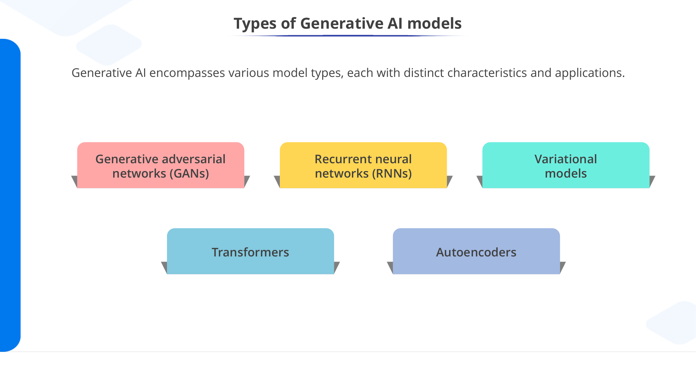

Generative AI is not a single model; it encompasses several core families:
1. **Autoencoders & Variational Autoencoders (VAEs):** Compress data into a dense representation and reconstruct it; used for image denoising, synthetic image generation, and compression.
2. **Generative Adversarial Networks (GANs):** Two networks locked in competition (Generator vs. Discriminator) to generate hyper-realistic images.
3. **Transformers:** Sequence-to-sequence models with self-attention; the foundation for modern LLMs (GPT, Llama, Gemini) and language translation.
4. **Recurrent Neural Networks (RNNs / LSTMs):** Earlier sequence processors that process tokens one by one; superseded by Transformers.
5. **Diffusion Models (Modern):** Add noise step-by-step and learn to reverse the noise to generate pristine visuals (Midjourney, Stable Diffusion, FLUX).

---

### 1.3 Variational Autoencoders (VAEs)

#### A. Layman Analogy: The Magic Recipe Book
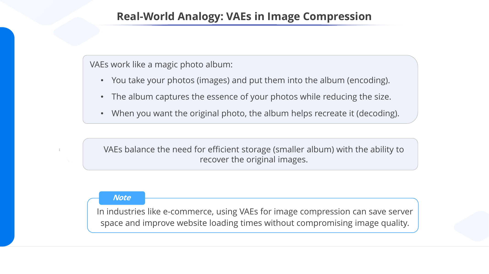

> [!NOTE] Layman Analogy: The Chef's Flavor Knobs
> Imagine baking cakes:
> - A standard photocopy machine only duplicates exact cakes. If you ask for a cake it hasn't seen, it fails.
> - A **Variational Autoencoder** breaks cakes down into fundamental "flavor knobs" (Sweetness, Fluffiness, Chocolate intensity) along a smooth slider. By twisting the knobs to a brand-new combination, the baker bakes a completely new, delicious cake!

#### B. Architecture & Latent Space (Infographic)
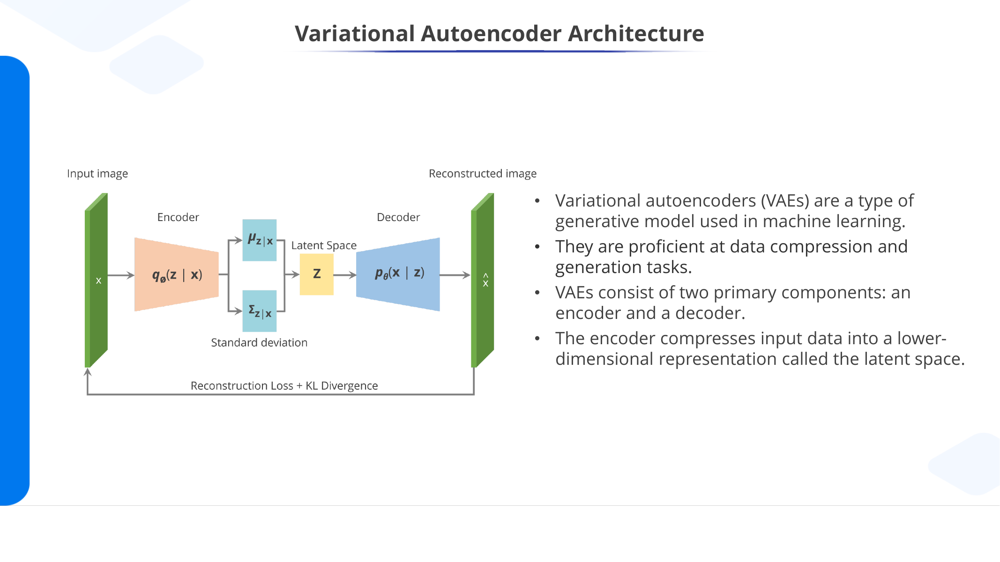

A VAE consists of two interconnected networks:
1. **The Encoder:** Takes input $x$ (e.g., an image) and compresses it not into a single static point, but into a **probability distribution** characterized by a **Mean ($\mu$)** and a **Variance ($\sigma^2$)**.
2. **The Latent Space ($z$):** A smooth, continuous space where similar items cluster together.
3. **The Decoder:** Samples a latent vector $z \sim \mathcal{N}(\mu, \sigma^2)$ and reconstructs the data into $\hat{x}$.

#### C. The Reparameterization Trick & The Blurriness Drawback

**The Reparameterization Trick:**
Because sampling a random number is non-differentiable (gradients cannot backpropagate through pure randomness), VAEs separate the randomness:
$$z = \mu(x) + \sigma(x) \odot \epsilon \quad \text{where } \epsilon \sim \mathcal{N}(0, I)$$
This allows the neural network to calculate gradients with respect to $\mu$ and $\sigma$ while keeping the randomness external.

**The Major Drawback of VAEs:**
VAEs optimize Mean Squared Error (MSE), which averages out ambiguous pixel possibilities. In practice, this causes VAE-generated images to look **blurry and smooth**, lacking fine, crisp edges. This limitation led directly to the invention of GANs and Diffusion models!

---

### 1.4 Generative Adversarial Networks (GANs)

#### A. Layman Analogy: The Art Counterfeiter vs. The Detective

> [!NOTE] Layman Analogy: The Police and the Counterfeiter
> - The **Generator** is a dishonest art counterfeiter trying to paint fake Picassos.
> - The **Discriminator** is a skilled police detective trying to catch fakes.
> - At first, the counterfeiter paints terrible scribbles, and the detective easily catches them.
> - But every time the counterfeiter gets caught, they learn what gave them away and improve.
> - As the detective gets sharper, the counterfeiter gets even better, until the fakes are indistinguishable from original masterpieces!

#### B. GAN Architecture & The Minimax Game (Infographic)
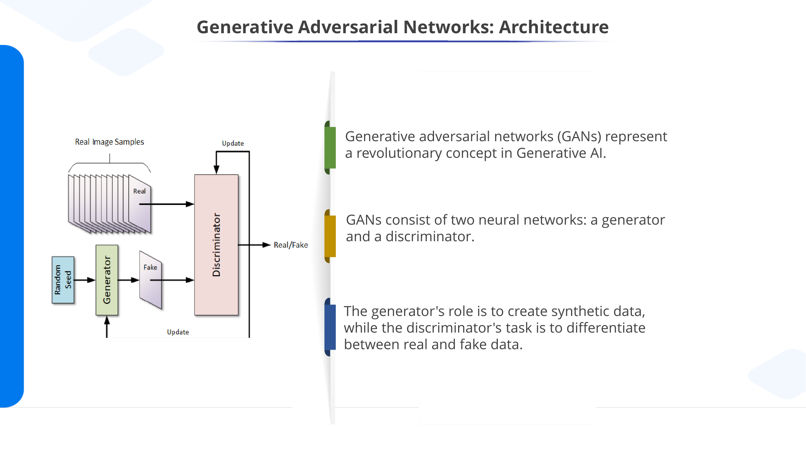

Mathematically, the Generator $G$ and Discriminator $D$ engage in a zero-sum game:
$$\min_G \max_D V(D, G) = \mathbb{E}_{x \sim P_{\text{real}}}[\log D(x)] + \mathbb{E}_{z \sim P_z}[\log(1 - D(G(z)))]$$

- **Generator Goal:** Make $D(G(z)) \to 1$ (fool the discriminator).
- **Discriminator Goal:** Output $1$ for real data and $0$ for fake data.

#### C. Real-World Applications & Deepfake Technology
- **Healthcare:** Creating synthetic MRI/CT scans to augment rare disease datasets without violating patient privacy (HIPAA compliance).
- **Style Transfer & Super-Resolution:** Turning low-resolution camera footage into 4K clarity.
- **Deepfakes:** Swapping faces and generating synthetic voice clones in media and entertainment.

---

### 1.5 Transformer-Based Models & Attention Mechanisms

#### A. Layman Analogy: Reading Room Spotlight

> [!NOTE] Layman Analogy: The Flashlight in a Dark Library
> In older models (RNNs), reading a sentence was like reading a book through a tiny peephole, one word at a time. By the time you reached page 10, you forgot what happened on page 1.
> The **Transformer** sees the entire page all at once and shines **adaptive flashlights (Attention)** connecting related words together across long distances, no matter how far apart they are.

#### B. Transformer Architecture & Attention Stages (Infographics)
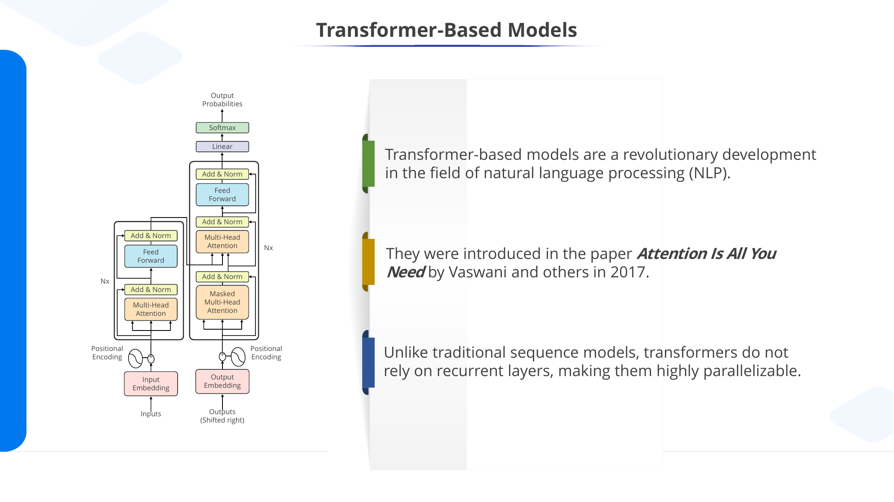
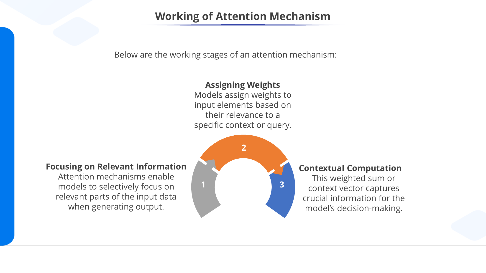
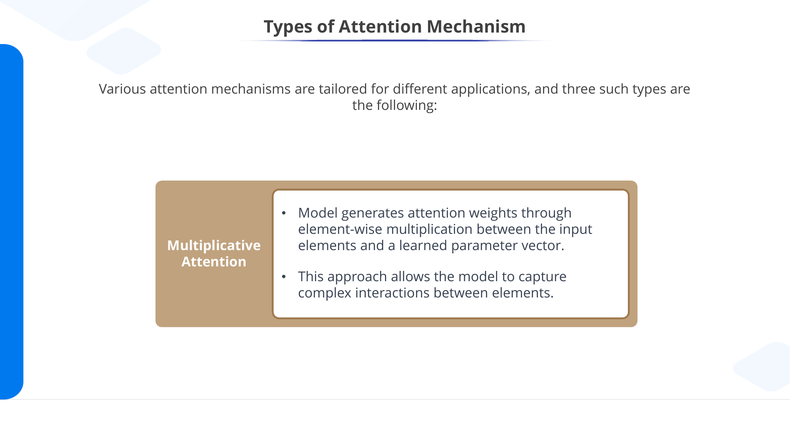

Attention operates in three distinct forms:
1. **Self-Attention:** Relates different words within the *same* sentence (e.g., resolving pronouns: *"The animal didn't cross the street because **it** was too tired"* $\to$ "it" attends to "animal").
2. **Cross-Attention:** Connects source sentences to target sentences (e.g., in language translation: English Query attends to French Keys/Values).
3. **Causal (Masked) Attention:** Prevents the model from peeking at future tokens in text generation.

#### C. Self-Attention Mechanics: Query, Key, Value (Infographic)
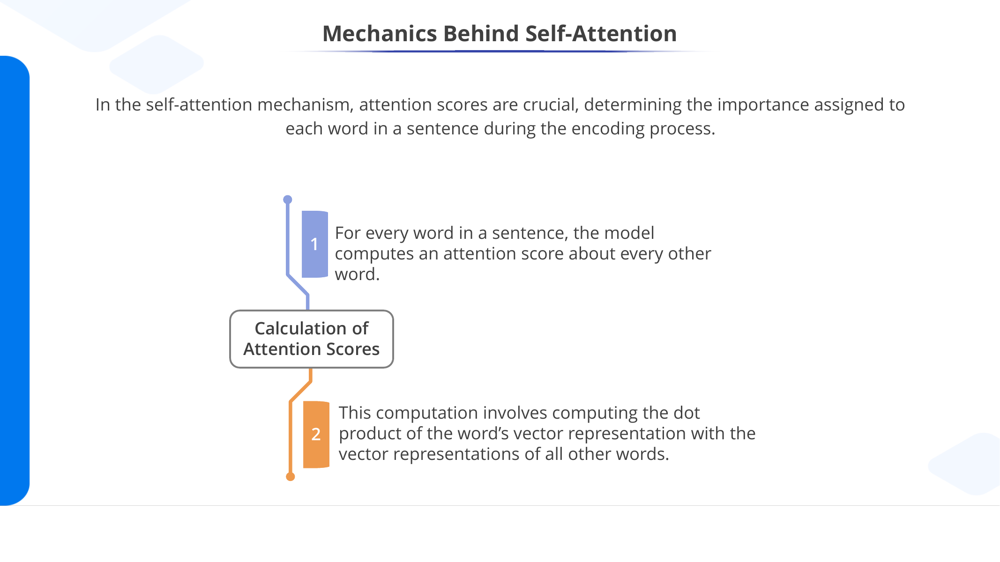

Attention behaves like a YouTube search:
- **Query ($Q$):** What you type into the search bar (what a word is looking for).
- **Key ($K$):** The video title and tags (what a word offers to others).
- **Value ($V$):** The actual video content you watch (the semantic meaning).

$$\text{Attention}(Q, K, V) = \text{Softmax}\left(\frac{Q K^T}{\sqrt{d_k}}\right) V$$

#### D. Multi-Head Attention: Looking at Multiple Perspectives (Infographic)
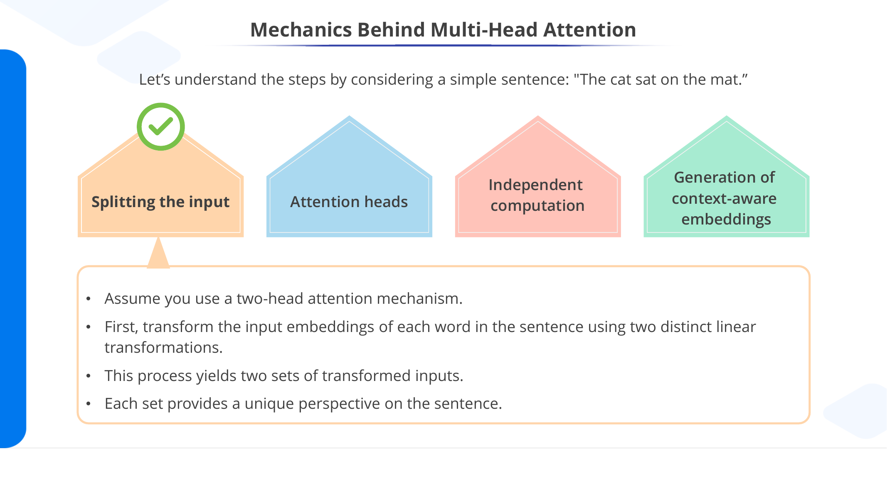

In the sentence *"The cat sat on the mat"*:
- **Head 1** focuses on grammar relationships (*"cat"* $\to$ *"sat"*).
- **Head 2** focuses on spatial prepositions (*"sat"* $\to$ *"on"* $\to$ *"mat"*).
- **Head 3** tracks noun identities (*"cat"*, *"mat"*).
Combining multiple heads allows the model to simultaneously understand grammar, tone, context, and semantic nuance!

---

### 1.6 Introduction to Retrieval-Augmented Generation (RAG)

#### A. Layman Analogy: Closed-Book Memory vs. Open-Book Exam

> [!NOTE] Layman Analogy: The Smart Student taking an Exam
> - **Pure LLM (Without RAG):** Taking a difficult medicine exam completely closed-book from memory. The student might be brilliant, but if asked about a new research paper published yesterday, they will either guess or **hallucinate** plausible-sounding nonsense.
> - **LLM with RAG:** The student takes an open-book exam with instant access to the entire medical library. When a question is asked, an assistant fetches the exact 3 relevant textbook pages and hands them to the student to write the answer. Zero hallucinations, verified facts!

#### B. Core Components & Process Flow of RAG (Infographics)
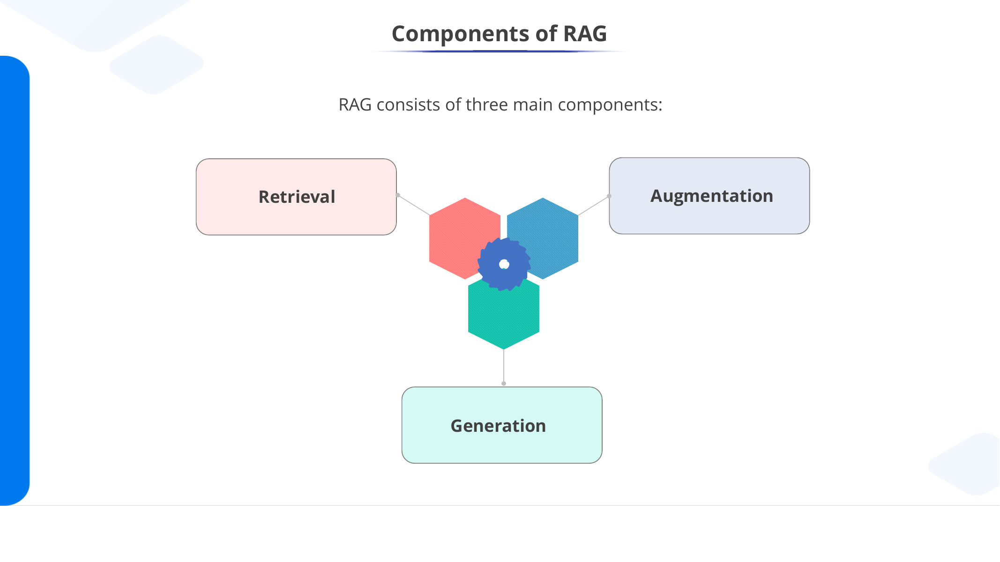
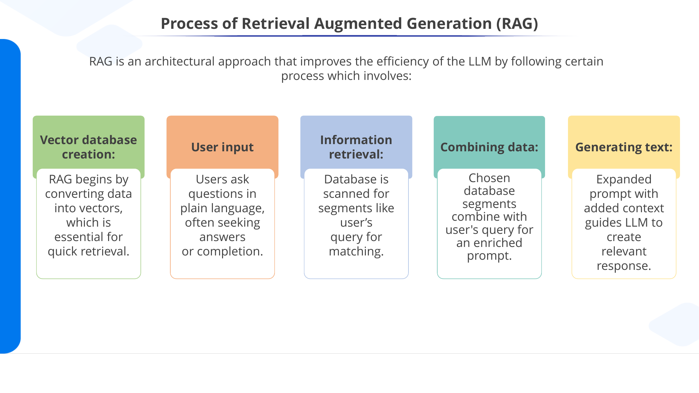

RAG operates across 3 pillars:
1. **Retrieval Engine:** Scans external databases (vector databases) to find chunks matching the user's query.
2. **Context Augmentation:** Combines the user's prompt with the retrieved document chunks into an augmented prompt.
3. **Generation Engine:** The LLM synthesizes a fluent, cited answer grounded strictly in the provided documents.

---

## Module 2: Large Language Models & LangChain Foundations (Lesson 02)

### 2.1 How LLMs Work: Autocomplete at Cosmic Scale

An LLM is essentially an ultra-advanced next-token predictor. Trained on trillions of words from the web, it calculates probability distributions over vocabulary:
$$P(w_t \mid w_1, w_2, \dots, w_{t-1})$$

### 2.2 LLM Architecture & Training Stages (Infographics)
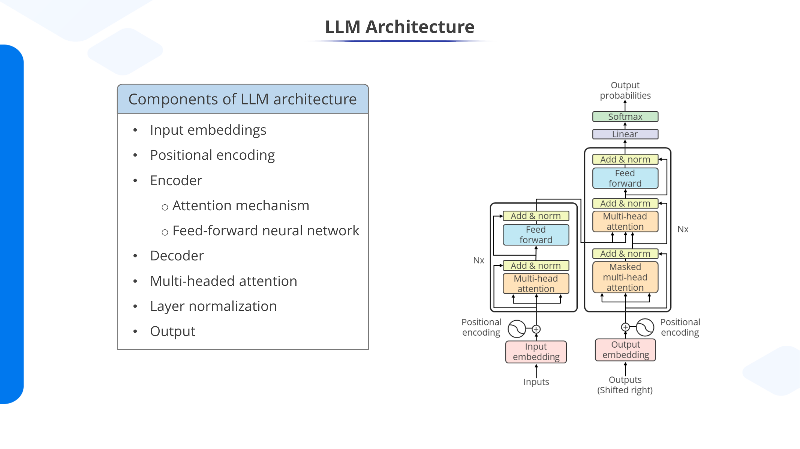
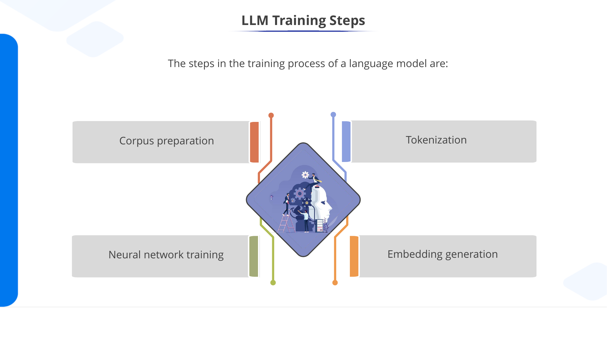

Building a modern foundation model follows three distinct sequential steps:
1. **Pretraining (Self-Supervised):** Consumes massive internet corpora ($>15$ trillion tokens) on GPU clusters to learn grammar, facts, and reasoning.
2. **Instruction Tuning / SFT (Supervised Fine-Tuning):** Teaches the raw text completer to act as a helpful conversational assistant using curated Question/Answer datasets.
3. **Alignment (RLHF / DPO):** Steers the model to be helpful, honest, and harmless, suppressing toxic or unsafe generations.

---

### 2.3 Introduction to LangChain: The Lego Set of AI (Infographic)
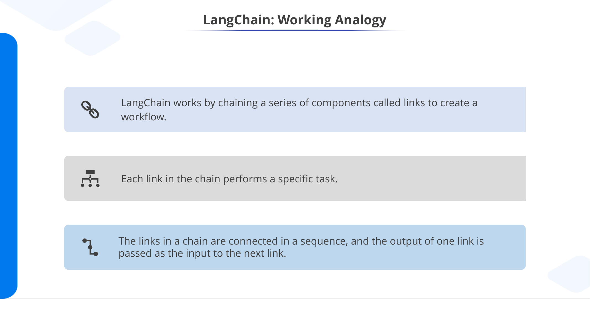

> [!NOTE] Layman Analogy: The Lego Modular Toolkit
> Using an LLM directly via raw API calls is like buying raw plastic pellets. You have to write boilerplate code for prompts, JSON parsing, database queries, and retry logic.
> **[LangChain (langchain.com)](https://www.langchain.com/)** provides pre-built, interlocking Lego bricks: Snap together a Prompt brick, a Model brick, a Memory brick, and an Output Parser brick to build complete AI systems in minutes. Check out the official documentation at [python.langchain.com](https://python.langchain.com/).

### 2.4 LangChain Framework Architecture (Infographic)
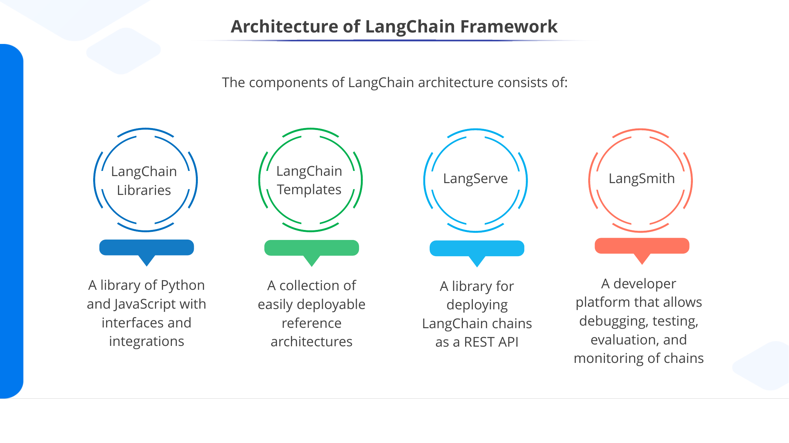

The LangChain ecosystem is structured in layers:
- **LangChain Core:** Base abstractions and the LangChain Expression Language (LCEL).
- **LangChain Community / Partners:** Third-party integrations (OpenAI, Anthropic, HuggingFace, Chroma, Pinecone).
- **LangSmith:** Debugging, tracing, monitoring, and evaluation platform.
- **LangServe:** Deploying chains as production REST APIs.

---

### 2.5 [Industry Upgrade] Modern LCEL vs. Deprecated Chains

> [!WARNING] Classroom vs Production: Do Not Use Legacy `LLMChain`
> Early slides reference `LLMChain` and `SequentialChain`. In modern production (LangChain v0.2+), these legacy classes are **deprecated**.
> Always use **LCEL (LangChain Expression Language)** using the pipe operator `|`:

```python
# Modern Production LCEL Standard
from langchain_core.prompts import ChatPromptTemplate
from langchain_core.output_parsers import StrOutputParser
from langchain_openai import ChatOpenAI

prompt = ChatPromptTemplate.from_template("Explain {topic} in simple terms.")
model = ChatOpenAI(model="gpt-4o")
parser = StrOutputParser()

# Clean, streaming-compatible, traceable pipeline
chain = prompt | model | parser
response = chain.invoke({"topic": "Quantum Computing"})
```

---

## Module 3: Advanced Prompt Engineering (Lessons 03 & 04)

### 3.1 The Anatomy of an Effective Prompt (Infographic)
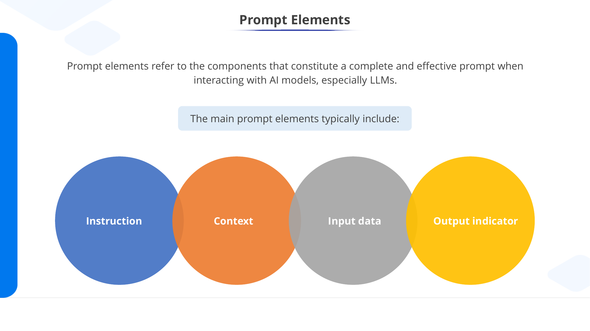

A production-grade prompt consists of 4 core building blocks:
1. **Instruction:** The specific task you want the model to perform (*"Summarize the following contract"*).
2. **Context:** External background information or persona framing (*"You are a corporate legal compliance officer"*).
3. **Input Data:** The raw content to process (*"Contract text: [...]"*).
4. **Output Indicator:** Constraints on the expected format (*"Return a JSON object with keys: parties, obligations, risks"*).

---

### 3.2 Zero-Shot vs. Few-Shot In-Context Learning

- **Zero-Shot:** Asking the model to solve a problem with zero prior examples.
- **Few-Shot:** Providing 2 to 5 worked examples in the prompt. This "primes" the model's in-context attention weights, drastically improving accuracy on niche formatting or complex classification tasks.

---

### 3.3 Chain-of-Thought (CoT) Prompting: Show Your Homework (Infographic)
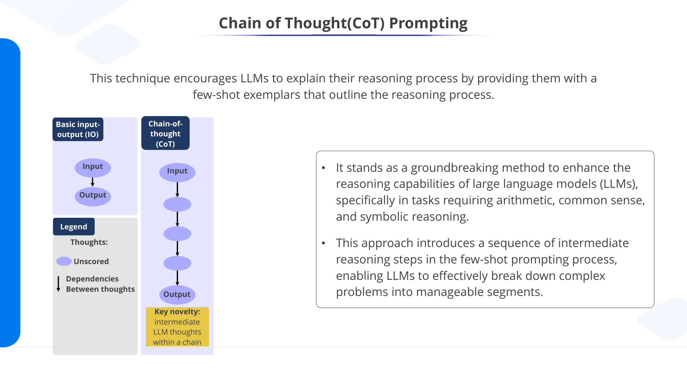

> [!NOTE] Layman Analogy: Showing Your Work in Math Class
> If a math teacher asks: *"What is 347 × 89?"*, blurt out an instant answer and you will probably make an arithmetic error.
> But if you write down each step on scrap paper:
> 1. $347 \times 80 = 27,760$
> 2. $347 \times 9 = 3,123$
> 3. $27,760 + 3,123 = 30,883$
> You get it right every time! **CoT forces the LLM to write intermediate reasoning tokens**, allowing future tokens to attend to earlier calculated facts.

---

### 3.4 Self-Consistency: Voting Among Multiple Experts (Infographic)
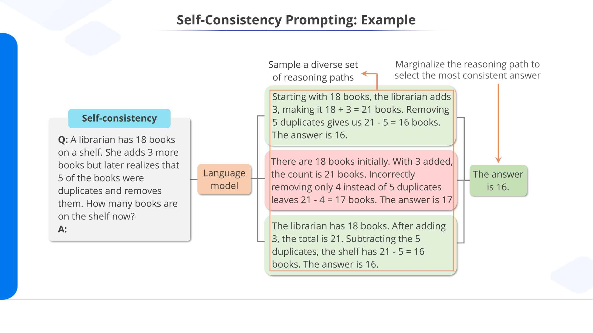

> [!NOTE] Layman Analogy: The Medical Board Consultation
> Instead of trusting the opinion of a single doctor on a tricky diagnosis, you ask 5 independent specialists. If 4 of them diagnose Condition A and 1 diagnoses Condition B, you confidently proceed with Condition A.
> **Self-Consistency** samples multiple reasoning paths at temperature $T=0.7$ and selects the majority answer.

---

### 3.5 Tree of Thoughts (ToT): Navigating the Maze with Backtracking (Infographic)
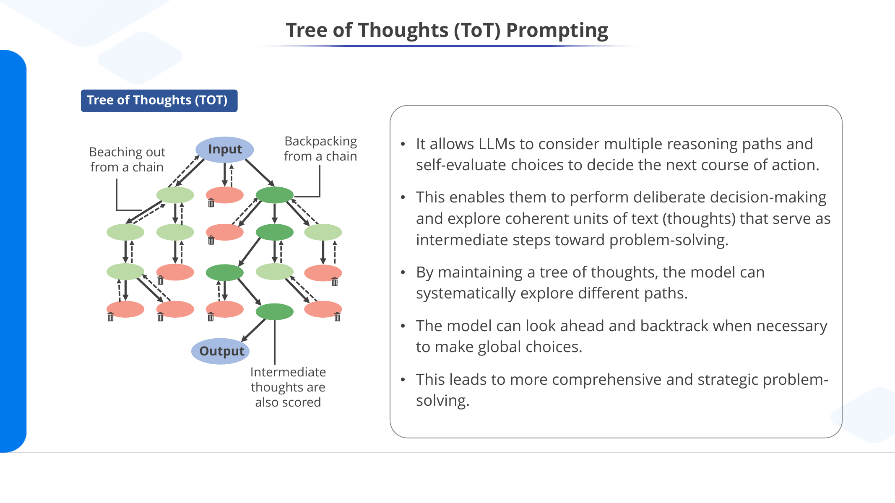

Linear Chain-of-Thought cannot backtrack if it makes an early mistake. **Tree of Thoughts** introduces exploration algorithms:
- Evaluates multiple possible next thoughts.
- Backtracks when a reasoning branch leads to a dead end.
- Enables strategic problem solving like writing complex code, chess playing, or mathematical proofs.

---

### 3.6 [Industry Upgrade] Test-Time Compute & System 2 Reasoning Models

In 2024–2026, the industry achieved a major paradigm shift with **Reasoning Models (OpenAI o1/o3, DeepSeek-R1, Gemini 2.0 Thinking)**:
- Rather than relying on manual prompt tricks (like writing *"Let's think step by step"*), these models are trained via Reinforcement Learning to generate internal, variable-length reasoning traces.
- They dynamically scale **Test-Time Compute**: spending 3 seconds on an easy query, but up to 60 seconds generating thousands of hidden thinking tokens, exploring hypotheses, and verifying code before producing the final answer.

---

## Module 4: LangChain Application Development & Vector Stores (Lessons 05 & 06)

### 4.1 Chatbot Application Flow & Model I/O (Infographics)
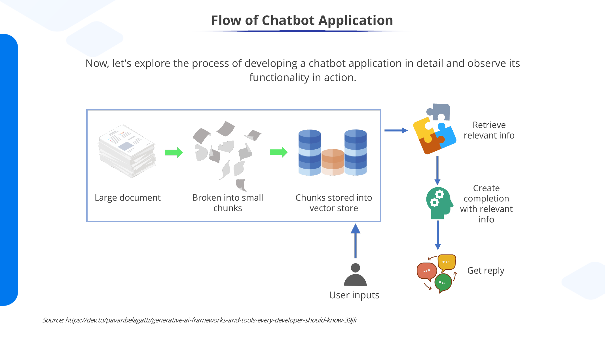
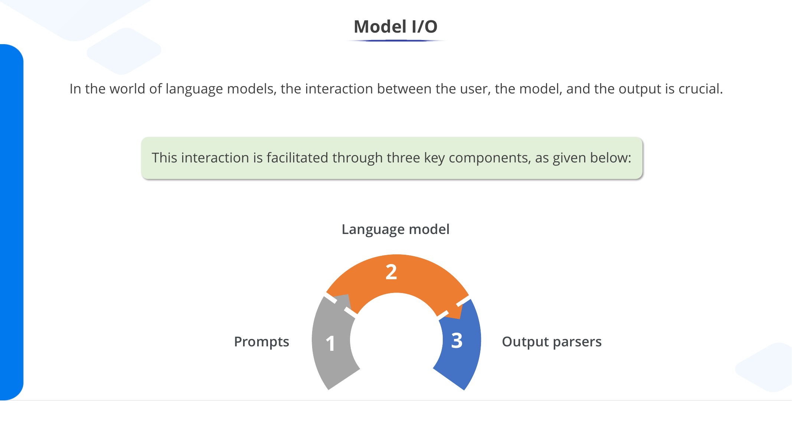

---

### 4.2 Document Ingestion: Loaders & Text Splitters

To feed enterprise documents into LLMs, we must chunk them appropriately:
- **CharacterTextSplitter:** Splits strictly on character count (can cut sentences in half).
- **RecursiveCharacterTextSplitter (Standard):** Tries splitting sequentially on `\n\n`, then `\n`, then spaces, preserving semantic paragraphs and sentences intact.

---

### 4.3 How VectorStores Work: The Semantic Coordinate System (Infographic)
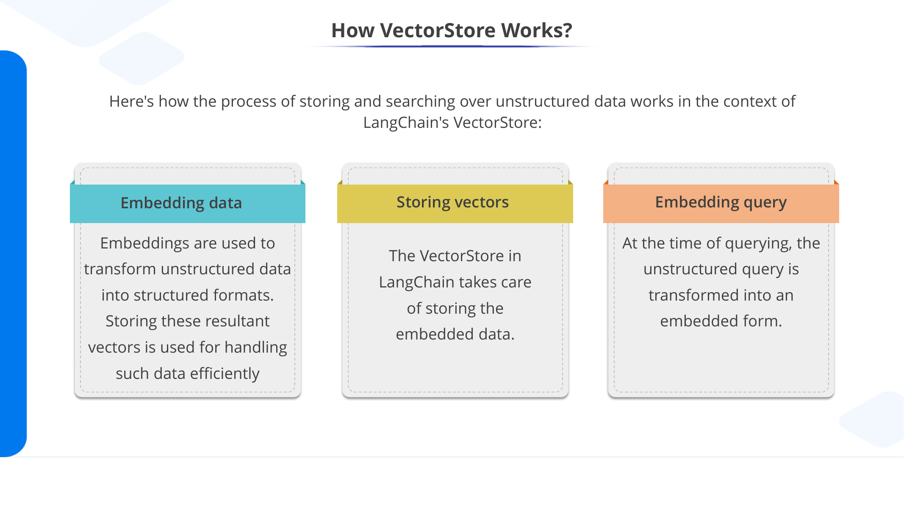

> [!NOTE] Layman Analogy: The Celestial Library
> In a traditional library, books are arranged by alphabetical titles (keyword search). If you search for *"Canines"*, you might miss a book titled *"All About Puppies"*.
> In a **Vector Database**, books are placed in a 3D coordinate room based on **meaning**:
> - *"Puppy"*, *"Dog"*, and *"Canine"* float right next to each other in space!
> - When you ask a question, the vector store calculates cosine similarity to fetch semantically nearest neighbors.

---

### 4.4 LangChain Chains: Stuff, Refine, and Map-Reduce (Infographic)
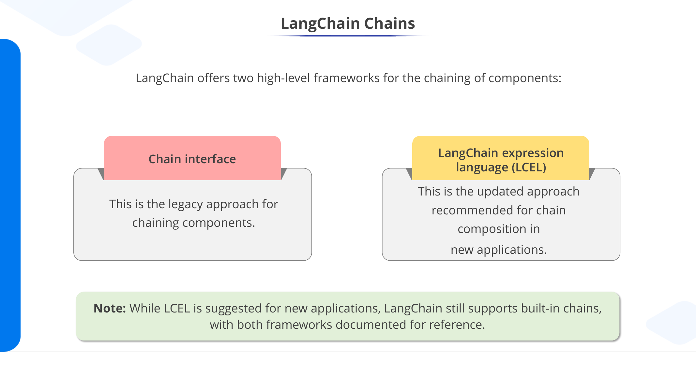

When handling documents longer than the model's context window:
1. **Stuff Chain:** Stuffs all documents into a single prompt (simple, but fails if context is exceeded).
2. **Refine Chain:** Passes the first chunk to the LLM, gets an answer, then passes the next chunk to *refine* that answer sequentially.
3. **Map-Reduce Chain:** Summarizes each chunk independently in parallel (**Map**), then combines all summaries into a final synthesis (**Reduce**).

---

### 4.5 [Industry Upgrade] Production Advanced RAG & GraphRAG

Standard Naive RAG fails in production due to lost-in-the-middle context and low recall. Production enterprise RAG implements:
1. **Hybrid Search:** Combines dense semantic vector search (HNSW index) with sparse keyword search (BM25) using **Reciprocal Rank Fusion (RRF)**:
   $$RRF(d) = \sum_{m \in \{\text{Vector}, \text{BM25}\}} \frac{1}{60 + \text{rank}_m(d)}$$
2. **Cross-Encoder Re-Ranking:** Runs top-50 retrieved candidates through Cohere Rerank or BGE-Reranker-Large to identify the top-5 truly relevant chunks.
3. **GraphRAG:** Combines Knowledge Graphs (entities, relations) with vector search to answer complex multi-hop questions across entire document repositories.

---

## Module 5: Agentic AI & Autonomous Multi-Agent Systems (Lesson 06 & Industry Reality)

### 5.1 What is an Agent? The Assistant with Hands and Eyes

> [!NOTE] Layman Analogy: The Difference Between a Consultant and a General Contractor
> - A standard **LLM** is like a **Consultant**: You ask a question, and they give you advice. But they cannot execute anything themselves.
> - An **Agentic AI** is like a **General Contractor**: You tell them *"Renovate the kitchen"*. They inspect the room, hire plumbers, order materials from suppliers, check building codes, fix mistakes, and report back when the job is done.

An Agent has:
1. **Brain:** Reasoning model for planning.
2. **Tools (Hands):** APIs, Python code execution, web scrapers, database connectors.
3. **Memory:** Short-term state and long-term historical context.
4. **Perception:** Observing tool outputs and deciding next actions.

---

### 5.2 LangChain Agents Baseline (Infographic)
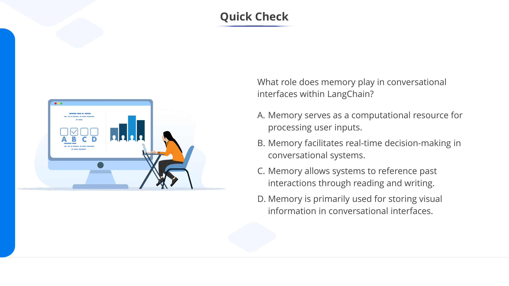

In early LangChain, agents followed the basic **ReAct (Reason + Act)** pattern:
```
Thought: I need to check the stock price of Apple.
Action: YahooFinanceTool("AAPL")
Observation: $225.50
Thought: Now I have the answer.
Final Answer: Apple is currently trading at $225.50.
```

---

### 5.3 [Industry Essential] LangGraph: State Machines, Cyclic Flows & Time-Travel

> [!IMPORTANT] The Industry Standard for Production Agents
> Real-world business workflows are **not linear**. They require loops (retry on error), conditional branches, and human approvals before destructive actions. **LangGraph** models agents as state machines:

```python
from langgraph.graph import StateGraph, END
from typing import TypedDict, Annotated
import operator

class State(TypedDict):
    messages: Annotated[list, operator.add]
    attempts: int

def call_model(state: State):
    # LLM decides whether to call a tool or finish
    ...

def execute_tools(state: State):
    # Executes external API / Python code
    ...

builder = StateGraph(State)
builder.add_node("agent", call_model)
builder.add_node("tools", execute_tools)

builder.set_entry_point("agent")
builder.add_conditional_edges("agent", should_continue, {"continue": "tools", "end": END})
builder.add_edge("tools", "agent") # Cyclic feedback loop!

agent_app = builder.compile()
```

---

### 5.4 [Industry Essential] Model Context Protocol (MCP): The Universal Standard

Created by Anthropic and adopted across the industry, **Model Context Protocol (MCP)** is the "USB-C standard for AI":
- Previously: Every developer wrote custom API integrations for each tool.
- With MCP: Any agent connects to any database, Git repo, or CLI tool over a standardized JSON-RPC protocol.

---

### 5.5 Multi-Agent Orchestration Patterns: Supervisors & Swarms

In complex software engineering or enterprise research, single agents struggle with context overload. Production systems employ multi-agent teams:
- **Supervisor Pattern:** A manager agent delegates tasks to specialized worker agents (e.g., Coder Agent, Tester Agent, Reviewer Agent).
- **Hierarchical Swarms:** Agents dynamically pass control to one another using lightweight handoffs.

---

## Module 6: LLM Fine-Tuning & Customization (Lesson 07)

### 6.1 The Customization Spectrum: Prompting vs. RAG vs. Fine-Tuning

| Technique | When to Use | Layman Analogy | Cost & Complexity |
| :--- | :--- | :--- | :--- |
| **Prompt Engineering** | Zero data preparation; general reasoning | Explaining instructions clearly to an intern | Lowest |
| **RAG** | Dynamic, frequently updated company knowledge | Taking an open-book exam with textbooks | Medium |
| **Fine-Tuning** | Changing model tone, style, syntax, or niche domain vocabulary | Sending a doctor to specialized cardiology residency | High |
| **Pretraining** | Building a new foundational language model from scratch | Teaching a child a brand-new language from birth | Millions of Dollars |

---

### 6.2 Fine-Tuning Process & Traditional Frameworks (Infographics)
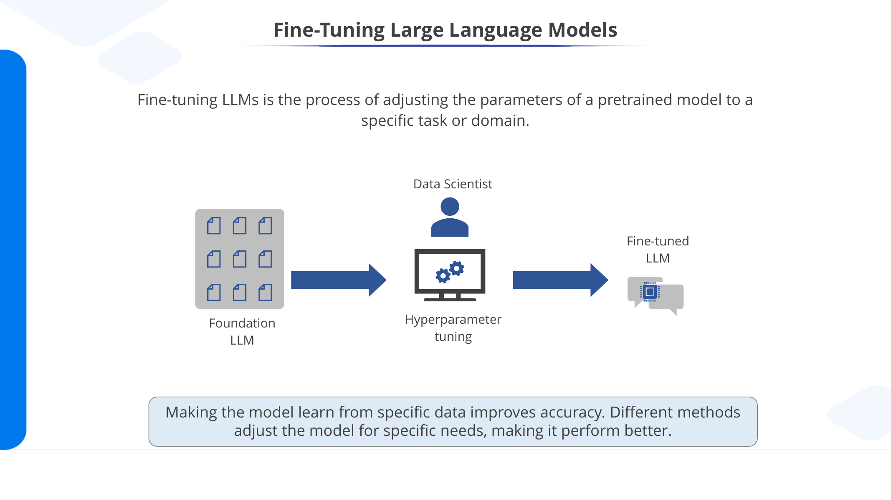
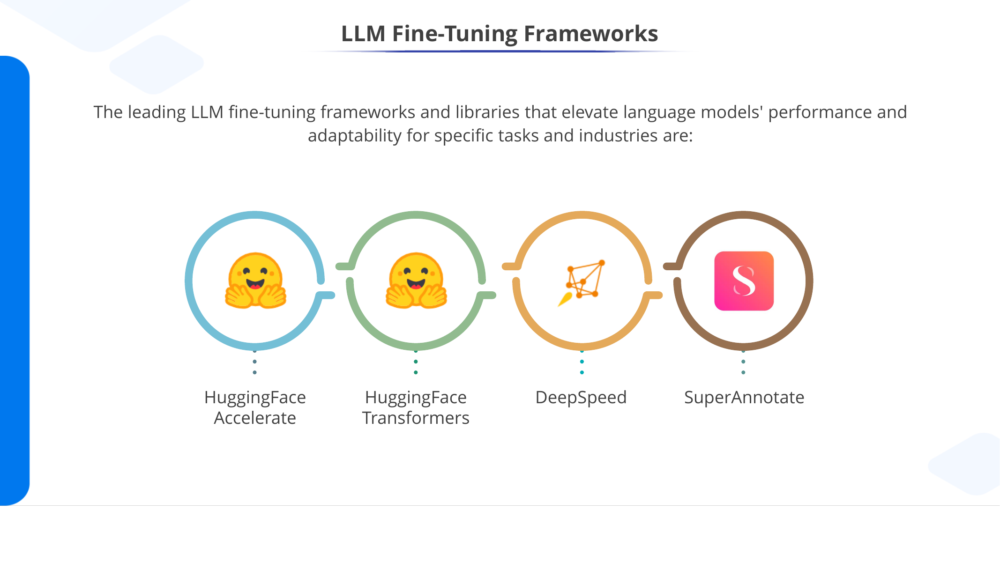

---

### 6.3 [Industry Upgrade] Parameter-Efficient Fine-Tuning: LoRA, QLoRA & DoRA

Full fine-tuning of a 70-billion-parameter model requires multiple $30,000 GPUs just to store optimizer states.

**LoRA (Low-Rank Adaptation):**
Freezes original base weights $W_0$ and adds tiny trainable adapter matrices $A$ and $B$:
$$W = W_0 + \Delta W = W_0 + \frac{\alpha}{r} (B \cdot A)$$
- Reduces trainable parameters by **$>99\%$**!

**QLoRA (Quantized LoRA):**
- Quantizes the base model down to **4-bit NormalFloat (NF4)**.
- Allows fine-tuning a massive 70B parameter model on a single consumer GPU workstation (24GB–48GB VRAM) with zero performance loss!

---

### 6.4 [Industry Upgrade] Alignment: RLHF vs. Direct Preference Optimization (DPO)

- **RLHF (Reinforcement Learning from Human Feedback):** Requires training a separate reward model and tuning a complex PPO reinforcement learning loop. Prone to mathematical instabilities.
- **DPO (Direct Preference Optimization):** Derives an exact analytical loss function operating directly on preference pairs $(y_{\text{chosen}} \succ y_{\text{rejected}})$:
  $$\mathcal{L}_{\text{DPO}}(\theta) = -\mathbb{E}\left[ \log \sigma \left( \beta \log \frac{\pi_\theta(y_w \mid x)}{\pi_{\text{ref}}(y_w \mid x)} - \beta \log \frac{\pi_\theta(y_l \mid x)}{\pi_{\text{ref}}(y_l \mid x)} \right) \right]$$
  DPO is now the dominant industry method used to align models like Llama 3 and Mistral.

---

## Module 7: Benchmark, Evaluation & Production LLMOps (Lesson 08)

### 7.1 What is Benchmarking? The Standardized Exam (Infographics)
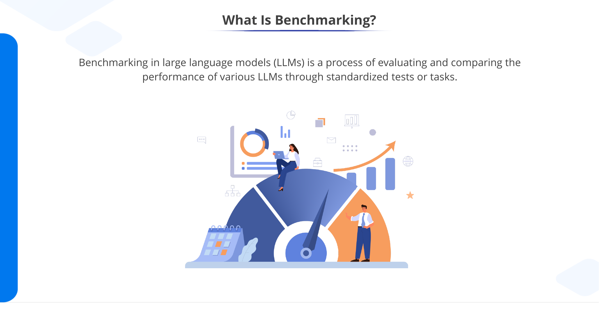
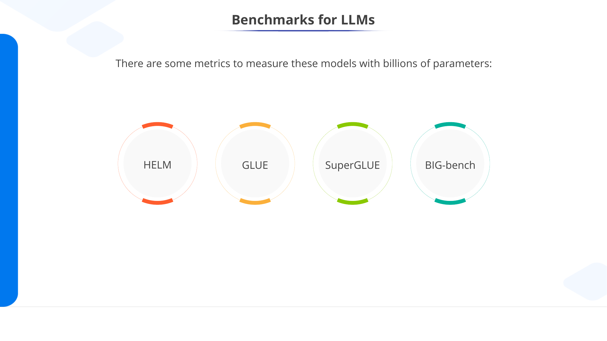

---

### 7.2 Academic Benchmarks: ROUGE, GLUE, SuperGLUE & HELM
- **ROUGE (Recall-Oriented Understudy for Gisting Evaluation):** Measures n-gram overlap between generated text and reference text.
- **GLUE / SuperGLUE:** Tests sentence grammar, sentiment, and reading comprehension.
- **HELM (Holistic Evaluation of Language Models):** Stanford benchmark evaluating accuracy, robustness, fairness, and toxicity across models.

---

### 7.3 [Industry Upgrade] Modern Evaluation: LLM-as-a-Judge & RAGAS

N-gram overlap metrics (like ROUGE and BLEU) fail to evaluate reasoning and fluency. Modern production systems rely on:
1. **LLM-as-a-Judge:** Using a frontier model (GPT-4o / Claude 3.5 Sonnet) with strict rubrics to evaluate and score output quality.
2. **RAGAS Triad:** Automatically evaluates RAG pipelines on:
   - **Faithfulness:** No hallucinations beyond retrieved text.
   - **Answer Relevance:** Direct answer to user's question.
   - **Context Recall & Precision:** Quality of retrieved chunks.

---

### 7.4 [Industry Upgrade] High-Throughput Serving: vLLM & PagedAttention

In production, running raw HuggingFace pipelines is too slow and suffers from GPU memory fragmentation.
- **vLLM with PagedAttention:** Manages the KV-cache like operating system virtual memory pages.
- Enables continuous batching and yields **5x–10x higher serving throughput**, drastically cutting enterprise GPU cloud hosting costs.

---

## Module 8: Master Reference Links & Official Documentation

### 8.1 LangChain & Orchestration Ecosystem
- **LangChain Official Website:** [langchain.com](https://www.langchain.com/) — The primary home for the LangChain project and enterprise products.
- **LangChain Documentation (Python):** [python.langchain.com](https://python.langchain.com/) — Comprehensive guides, API references, tutorials, and ecosystem integrations.
- **LangChain Expression Language (LCEL):** [LCEL Conceptual Guide](https://python.langchain.com/docs/concepts/lcel/) — The modern declarative way to compose production chains using `|`.
- **LangChain Hub:** [smith.langchain.com/hub](https://smith.langchain.com/hub) — Community repository for sharing and discovering reusable system prompts and chains.
- **LangServe (Deployment Engine):** [python.langchain.com/docs/langserve/](https://python.langchain.com/docs/langserve/) — Deploy LangChain runnables as production-ready REST APIs.
- **LangSmith:** [www.langchain.com/langsmith](https://www.langchain.com/langsmith) — Full observability, latency tracing, token cost monitoring, and dataset testing for LLM pipelines.
- **LlamaIndex:** [docs.llamaindex.ai](https://docs.llamaindex.ai/) — Advanced data framework and ingestion pipelines specialized for LLM indexing and RAG.

### 8.2 Agentic AI, Multi-Agent Systems & Protocols
- **LangGraph:** [langchain-ai.github.io/langgraph](https://langchain-ai.github.io/langgraph/) — Industry standard for building cyclic, stateful multi-agent systems with human-in-the-loop controls.
- **Model Context Protocol (MCP) by Anthropic:** [modelcontextprotocol.io](https://modelcontextprotocol.io/) — The open standard for connecting AI models to tools, file systems, and enterprise data repositories.
- **Anthropic Computer Use API:** [docs.anthropic.com/en/docs/build-with-claude/computer-use](https://docs.anthropic.com/en/docs/build-with-claude/computer-use) — Official guide to enabling agents to interact with desktops, browsers, and GUI elements.
- **OpenAI Tool / Function Calling Guide:** [platform.openai.com/docs/guides/function-calling](https://platform.openai.com/docs/guides/function-calling) — Native JSON-schema function execution with GPT models.
- **Microsoft AutoGen:** [microsoft.github.io/autogen](https://microsoft.github.io/autogen/) — Multi-agent conversation framework for complex autonomous workflows.
- **CrewAI Framework:** [docs.crewai.com](https://docs.crewai.com/) — Role-playing multi-agent collaboration framework.

### 8.3 Foundational AI Research Papers (ArXiv)
- **Transformers & Attention:** *Attention Is All You Need* (Vaswani et al., 2017) — [arXiv:1706.03762](https://arxiv.org/abs/1706.03762)
- **Variational Autoencoders:** *Auto-Encoding Variational Bayes* (Kingma & Welling, 2013) — [arXiv:1312.6114](https://arxiv.org/abs/1312.6114)
- **Generative Adversarial Networks:** *Generative Adversarial Nets* (Goodfellow et al., 2014) — [arXiv:1406.2661](https://arxiv.org/abs/1406.2661)
- **Retrieval-Augmented Generation:** *Retrieval-Augmented Generation for Knowledge-Intensive NLP Tasks* (Lewis et al., 2020) — [arXiv:2005.11401](https://arxiv.org/abs/2005.11401)
- **Chain-of-Thought Reasoning:** *Chain-of-Thought Prompting Elicits Reasoning in Large Language Models* (Wei et al., 2022) — [arXiv:2201.11903](https://arxiv.org/abs/2201.11903)
- **Self-Consistency Prompting:** *Self-Consistency Improves Chain of Thought Reasoning in Language Models* (Wang et al., 2022) — [arXiv:2203.11171](https://arxiv.org/abs/2203.11171)
- **Tree of Thoughts:** *Tree of Thoughts: Deliberate Problem Solving with Large Language Models* (Yao et al., 2023) — [arXiv:2305.10601](https://arxiv.org/abs/2305.10601)
- **ReAct Agent Pattern:** *ReAct: Synergizing Reasoning and Acting in Language Models* (Yao et al., 2022) — [arXiv:2210.03629](https://arxiv.org/abs/2210.03629)
- **LoRA (Low-Rank Adaptation):** *LoRA: Low-Rank Adaptation of Large Language Models* (Hu et al., 2021) — [arXiv:2106.09685](https://arxiv.org/abs/2106.09685)
- **QLoRA (Quantized LoRA):** *QLoRA: Efficient Finetuning of Quantized LLMs* (Dettmers et al., 2023) — [arXiv:2305.14314](https://arxiv.org/abs/2305.14314)
- **Direct Preference Optimization:** *Direct Preference Optimization: Your Language Model is Secretly a Reward Model* (Rafailov et al., 2023) — [arXiv:2305.18290](https://arxiv.org/abs/2305.18290)
- **Microsoft GraphRAG:** *From Local to Global: A Graph RAG Approach to Query-Focused Summarization* (Edge et al., 2024) — [arXiv:2404.16130](https://arxiv.org/abs/2404.16130)

### 8.4 Vector Databases & Advanced Retrieval
- **ChromaDB:** [trychroma.com](https://www.trychroma.com/) — Lightweight open-source embedding database for prototyping and production.
- **Qdrant Vector Database:** [qdrant.tech](https://qdrant.tech/) — High-performance Rust-based vector search engine with rich payload filtering.
- **Pinecone:** [pinecone.io](https://www.pinecone.io/) — Managed serverless vector database designed for hyperscale RAG.
- **Milvus:** [milvus.io](https://milvus.io/) — Open-source distributed vector database built for massive enterprise datasets.
- **FAISS (Facebook AI Similarity Search):** [github.com/facebookresearch/faiss](https://github.com/facebookresearch/faiss) — Foundational C++ / Python library for dense vector clustering and similarity search.
- **Microsoft GraphRAG Documentation:** [microsoft.github.io/graphrag](https://microsoft.github.io/graphrag/) — Extracting knowledge graphs and community summaries from unstructured text.

### 8.5 Model Customization, Fine-Tuning & Evaluation
- **Hugging Face Hub & Transformers:** [huggingface.co](https://huggingface.co/) — The epicenter of open-source AI models, datasets, and pipelines.
- **Hugging Face TRL (Transformer Reinforcement Learning):** [huggingface.co/docs/trl](https://huggingface.co/docs/trl) — Framework for training SFT, DPO, and PPO models.
- **Unsloth:** [unsloth.ai](https://unsloth.ai/) — High-speed, low-memory LoRA and QLoRA fine-tuning (2x–5x faster, 80% less VRAM).
- **Axolotl:** [github.com/OpenAccess-AI-Collective/axolotl](https://github.com/OpenAccess-AI-Collective/axolotl) — Streamlined configuration-driven fine-tuning tool for top open-weights models.
- **DeepSpeed:** [deepspeed.ai](https://www.deepspeed.ai/) — Microsoft library for distributed training and ZeRO memory optimization.
- **RAGAS (Automated RAG Evaluation):** [docs.ragas.io](https://docs.ragas.io/) — Industry-standard evaluation framework for measuring RAG faithfulness, answer relevance, and context recall.
- **TruLens:** [trulens.org](https://www.trulens.org/) — Instrumentation and feedback functions evaluating the RAG Triad.

### 8.6 High-Performance Serving, LLMOps & Security
- **vLLM:** [docs.vllm.ai](https://docs.vllm.ai/) — High-throughput LLM serving engine featuring PagedAttention and continuous batching.
- **SGLang:** [sgl-project.github.io](https://sgl-project.github.io/) — High-performance structured execution engine with RadixAttention for KV-cache reuse.
- **Ollama:** [ollama.com](https://ollama.com/) — Run Llama 3, Mistral, and DeepSeek locally on macOS, Linux, and Windows.
- **Langfuse:** [langfuse.com](https://langfuse.com/) — Open-source observability and analytics platform for LLM applications.
- **OWASP Top 10 for LLMs:** [genai.owasp.org](https://genai.owasp.org/) — Industry standard security vulnerabilities guide for GenAI applications (Prompt Injection, Insecure Output Handling, Data Poisoning).

---

## Live Class Notes & Session Logs
- **Session Track:** IHFC / Simplilearn Advanced Generative AI Specialization
- **Sequential Slides Integrated:** Lessons 1 through 8 complete.
- **Visual Diagram Index:** 20+ slide infographics extracted and embedded directly in [`images/`](file:///media/jignesh/Data/my_projects/IHFC-Leaning/6.%20Advance%20Generative%20AI/images).
