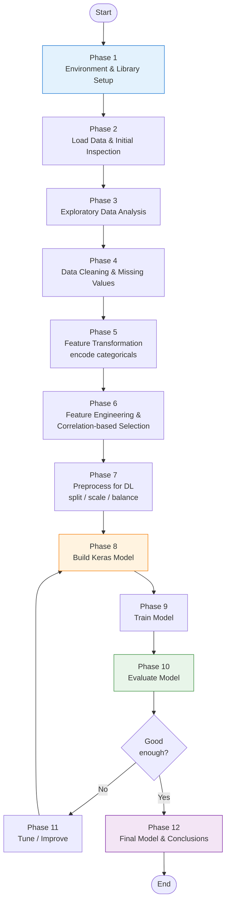
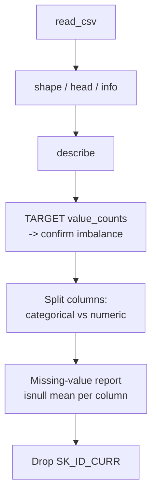
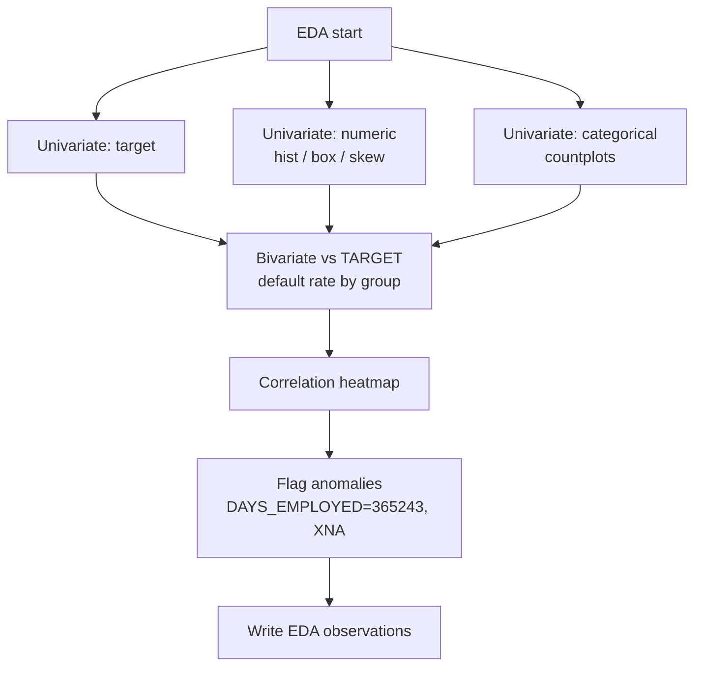
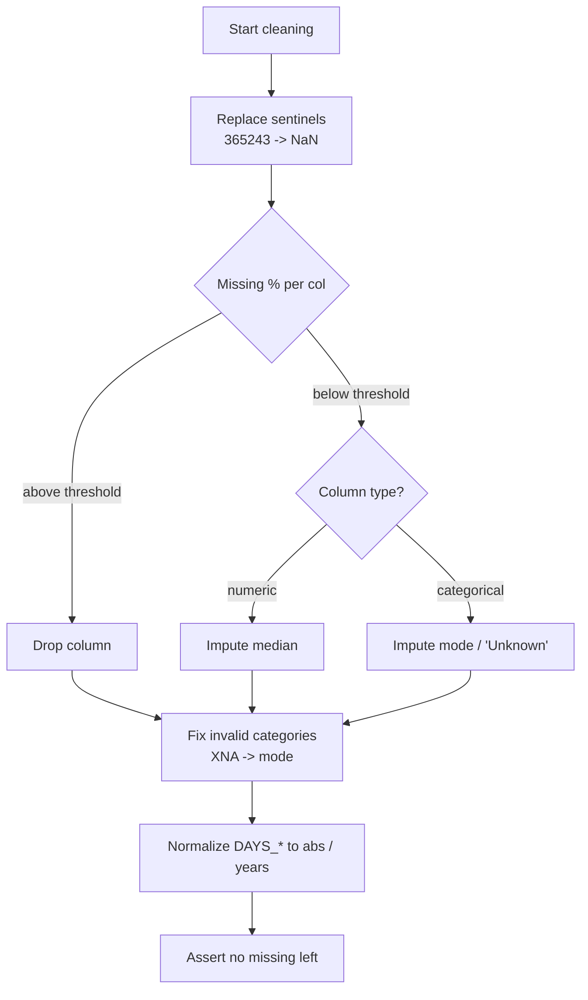
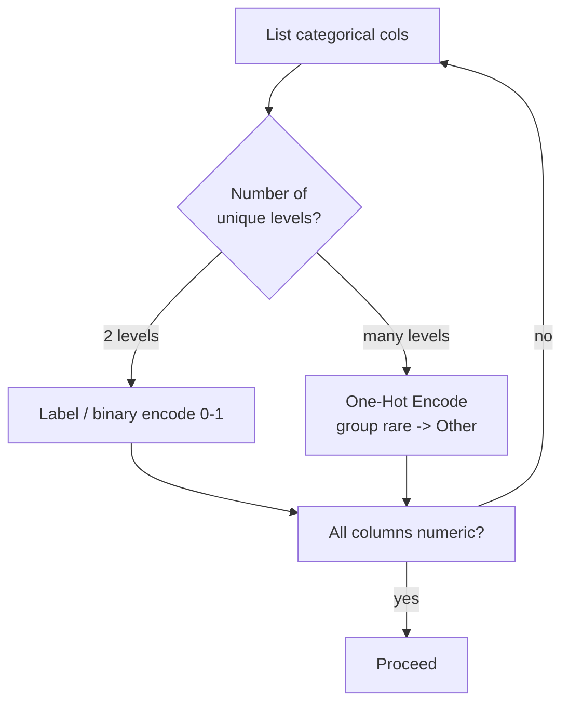
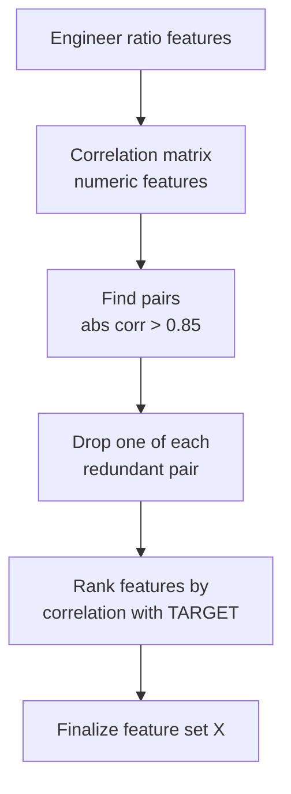
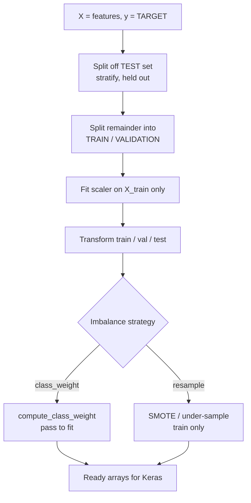
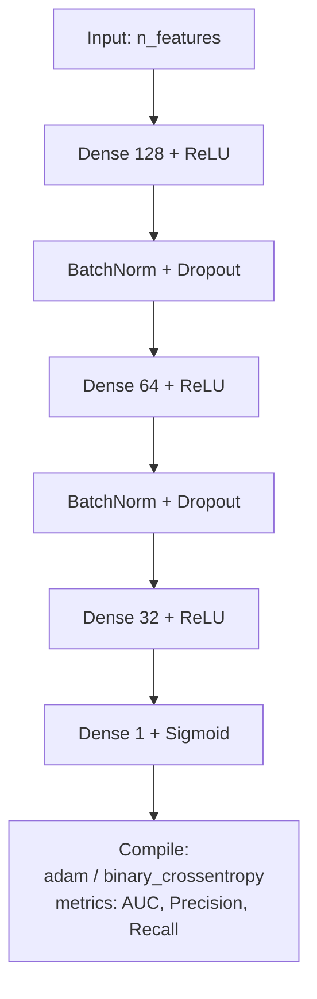
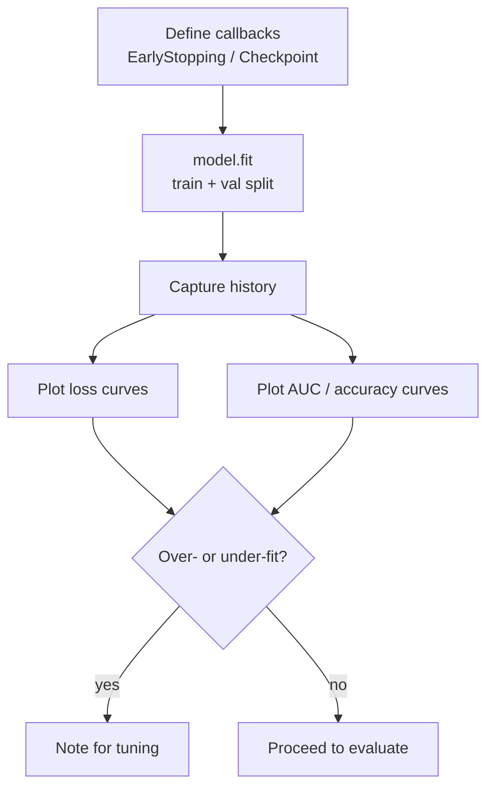
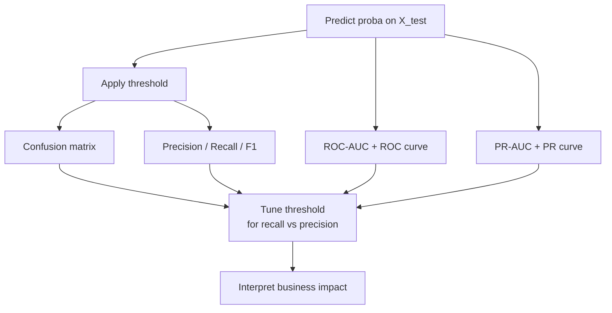

# Project 5.1 — Home Loan Data Analysis (Deep Learning)

> **Goal:** Build a deep-learning model (Keras + TensorFlow) that predicts whether an
> applicant will repay a home loan, using historical application data.
> **Type:** Binary classification on a highly **imbalanced** tabular dataset.

---

## 0. Project Facts (verified from the data)

| Item | Value |
|------|-------|
| Dataset file | `CEP_1_Datasets/loan_data (1).csv` |
| Data dictionary | `CEP_1_Datasets/Data_Dictionary.csv` |
| Shape | **307,511 rows × 122 columns** (this is the Home Credit *application* table) |
| ID column | `SK_ID_CURR` (drop before modeling) |
| Target column | `TARGET` |
| Class balance | `0` = 282,686 (91.9%) · `1` = 24,825 (**8.1%** minority) → **imbalanced** |
| Feature types | ~16 categorical (`object`), rest numeric; many columns have heavy missing values |

> ⚠️ **Target semantics — verify before training.** The bundled `Data_Dictionary.csv`
> says `TARGET`: *"Whether the loan was repaid (1 for yes, 0 for no)."* However, this is the
> standard **Home Credit Default Risk** dataset, where the original meaning is the
> **opposite**: `1 = client with payment difficulties (default)`, `0 = repaid`. The 8.1%
> rate of `1`s matches the original "default" rate, not a "repaid" rate. **Trust the data
> dictionary your course supplied, but state your assumption explicitly in the notebook**
> and keep it consistent through EDA, metrics, and conclusions. The modelling steps below
> are identical either way.

---

## 1. End-to-End Pipeline (high-level flowchart)



---

## 2. Phase-by-Phase Tasks & Subtasks

Legend: `[ ]` = to do. Tick them off as you build the notebook.

### Phase 1 — Environment & Library Setup
- [ ] Create/activate a virtual environment (or use Colab).
- [ ] Install dependencies: `pandas numpy matplotlib seaborn scikit-learn tensorflow imbalanced-learn`.
- [ ] Import libraries and set reproducibility:
  - [ ] `numpy`, `pandas` for data; `matplotlib.pyplot`, `seaborn` for plots.
  - [ ] `sklearn` for `train_test_split`, scalers, `metrics`, `compute_class_weight`.
  - [ ] `tensorflow` / `keras` for the model (`Sequential`, `Dense`, `Dropout`, `BatchNormalization`, callbacks).
  - [ ] Set seeds: `np.random.seed(42)`, `tf.random.set_seed(42)`.
  - [ ] Configure display: `pd.set_option('display.max_columns', None)`.


### Phase 2 — Load Data & Initial Inspection
- [ ] Load CSV: `df = pd.read_csv('CEP_1_Datasets/loan_data (1).csv')`.
  - Large file (~166 MB). Optionally pass `dtype`/`low_memory=False`, or load a sample while prototyping.
- [ ] Inspect: `df.shape`, `df.head()`, `df.info()`, `df.describe(include='all')`.
- [ ] Confirm target: `df['TARGET'].value_counts(normalize=True)` → note the 8%/92% imbalance.
- [ ] List dtypes: separate categorical (`object`) vs numeric columns.
- [ ] Quantify missingness: `df.isnull().mean().sort_values(ascending=False)`.
- [ ] Drop the ID column `SK_ID_CURR` (keep a copy if needed for submission).



### Phase 3 — Exploratory Data Analysis (EDA)
- [ ] **Target analysis:** bar/pie of `TARGET` → visualize imbalance.
- [ ] **Numeric features:** histograms/KDE, boxplots; check skew and outliers.
  - [ ] Inspect `DAYS_BIRTH` (convert to years: `-DAYS_BIRTH/365`).
  - [ ] Inspect `DAYS_EMPLOYED` — watch the **anomaly `365243`** (sentinel for "not employed"); treat as NaN.
  - [ ] Inspect `AMT_INCOME_TOTAL`, `AMT_CREDIT`, `AMT_ANNUITY`, `AMT_GOODS_PRICE` (right-skewed → consider log).
  - [ ] `EXT_SOURCE_1/2/3` — typically the strongest predictors; plot vs TARGET.
- [ ] **Categorical features:** countplots (`CODE_GENDER`, `NAME_CONTRACT_TYPE`, `NAME_EDUCATION_TYPE`, `NAME_FAMILY_STATUS`, `NAME_INCOME_TYPE`, `OCCUPATION_TYPE`, `ORGANIZATION_TYPE`).
- [ ] **Bivariate:** default rate grouped by key categoricals; numeric distributions split by `TARGET`.
- [ ] **Correlation heatmap** of numeric features vs `TARGET` (top positive/negative).
- [ ] Note data-quality issues (`CODE_GENDER` has an `XNA`; `XNA` in `ORGANIZATION_TYPE`).
- [ ] Write 3–5 bullet observations to carry into cleaning/engineering.



### Phase 4 — Data Cleaning & Missing Values
- [ ] Replace sentinel anomalies with NaN (e.g. `DAYS_EMPLOYED == 365243`).
- [ ] **Drop columns** with excessive missingness (choose a threshold, e.g. > 50–60% missing) — many building/`_AVG`/`_MODE`/`_MEDI` columns qualify.
- [ ] **Impute remaining missing values:**
  - [ ] Numeric → median (robust to skew) via `SimpleImputer(strategy='median')`.
  - [ ] Categorical → mode / constant `"Unknown"`.
- [ ] Fix invalid categories (e.g. map `CODE_GENDER == 'XNA'` to mode).
- [ ] Convert `DAYS_*` negative values to positive magnitudes (`.abs()`), optionally to years.
- [ ] Verify: `df.isnull().sum().sum() == 0` after imputation.



### Phase 5 — Feature Transformation (encode categoricals → numeric)
> Assignment Task 1: *Transform categorical values into numerical values.*
- [ ] Identify remaining categorical columns.
- [ ] **Binary categories** (2 levels, e.g. `FLAG_OWN_CAR`, `FLAG_OWN_REALTY`, `NAME_CONTRACT_TYPE`) → **Label/binary encode** (0/1).
- [ ] **Multi-class categories** → **One-Hot Encode** (`pd.get_dummies` or `OneHotEncoder`).
  - [ ] Watch cardinality: `ORGANIZATION_TYPE`, `OCCUPATION_TYPE` have many levels → OHE is fine but inflates width; optionally group rare levels into `"Other"`.
- [ ] Ensure the final frame is fully numeric: `df.select_dtypes('object').shape[1] == 0`.



### Phase 6 — Feature Engineering & Correlation-based Selection
> Assignment Task 3: *Check correlation between features and drop strongly correlated ones.*
- [ ] (Optional) Create domain ratios that often help:
  - [ ] `CREDIT_INCOME_RATIO = AMT_CREDIT / AMT_INCOME_TOTAL`
  - [ ] `ANNUITY_INCOME_RATIO = AMT_ANNUITY / AMT_INCOME_TOTAL`
  - [ ] `CREDIT_TERM = AMT_ANNUITY / AMT_CREDIT`
  - [ ] `EMPLOYED_TO_AGE = DAYS_EMPLOYED / DAYS_BIRTH`
- [ ] Compute correlation matrix on numeric features.
- [ ] **Drop one of each pair** with `|corr| > 0.85–0.90` (e.g. `AMT_GOODS_PRICE` ↔ `AMT_CREDIT`; the `_AVG`/`_MODE`/`_MEDI` triples are near-duplicates).
- [ ] Keep features most correlated with `TARGET` (e.g. `EXT_SOURCE_*`).
- [ ] Record the final feature list and why columns were dropped.



### Phase 7 — Preprocess for Deep Learning
- [ ] Separate `X` (features) and `y = TARGET`.
- [ ] **3-way split — Train / Validation / Test** (stratified on `y` to preserve imbalance):
  - [ ] First split off the **test set** (held out, touched only once at the very end): `train_test_split(X, y, test_size=0.2, stratify=y, random_state=42)`.
  - [ ] Then split the remainder into **train / validation** (e.g. another 80/20, `stratify` again).
  - [ ] Rationale: validation guides tuning; the untouched test set gives an unbiased final score (see Phase 10/12).
- [ ] **Feature scaling** — **fit the scaler on train only**, then transform train, validation, and test (`StandardScaler` or `MinMaxScaler`). Fitting on all data = leakage. NN training needs scaled inputs.
- [ ] **Handle class imbalance** (pick one, justify it):
  - [ ] **Class weights** via `compute_class_weight('balanced', ...)` → pass to `model.fit(class_weight=...)` *(recommended — no data leakage, cheap).*
  - [ ] **SMOTE / oversampling** on the *training set only* (`imblearn`).
  - [ ] Undersample majority class.
- [ ] Confirm shapes of `X_train, X_test, y_train, y_test`.



### Phase 8 — Build the Keras Model
> Assignment Task 4: *Create a deep learning model using Keras with TensorFlow backend.*
- [ ] Define a `Sequential` feed-forward network:
  - [ ] Input layer sized to `X_train.shape[1]`.
  - [ ] 2–4 `Dense` hidden layers (e.g. 128 → 64 → 32) with `relu`.
  - [ ] `BatchNormalization` + `Dropout` (0.2–0.4) to regularize.
  - [ ] Output: `Dense(1, activation='sigmoid')` (binary).
- [ ] Compile: `loss='binary_crossentropy'`, `optimizer='adam'`,
      `metrics=['accuracy', AUC, Precision, Recall]` (accuracy alone is misleading on imbalanced data).
- [ ] `model.summary()`.



### Phase 9 — Train the Model
- [ ] Add callbacks: `EarlyStopping(monitor='val_auc'/'val_loss', patience=5, restore_best_weights=True)`, optional `ReduceLROnPlateau`, `ModelCheckpoint`.
- [ ] `model.fit(X_train, y_train, validation_data=(X_val, y_val), epochs=50, batch_size=256, class_weight=..., callbacks=...)` — use the explicit validation set from Phase 7.
- [ ] Plot training vs validation **loss** and **AUC/accuracy** curves → check over/underfitting.



### Phase 10 — Evaluate the Model (on the validation set)
> Evaluate on **validation** here while you iterate — keep the test set untouched for Phase 12.
- [ ] Predict probabilities on `X_val`; threshold (start 0.5, then tune).
- [ ] Report **imbalance-aware metrics**: Confusion matrix, Precision, Recall, F1, **ROC-AUC**, PR-AUC.
- [ ] Plot ROC curve and Precision-Recall curve.
- [ ] **Select the decision threshold** on validation for the business goal (catching defaulters → favor recall). Lock this threshold before touching the test set.
- [ ] Interpret: which errors matter most (false negatives = missed defaults).



### Phase 11 — Tune / Improve (iterate)
- [ ] Try architecture changes (layers/units), dropout rates, learning rate, batch size.
- [ ] Compare imbalance strategies (class weights vs SMOTE).
- [ ] Optional: compare against a baseline (Logistic Regression / RandomForest) for sanity.
- [ ] Keep a small results table (config → val AUC / F1) to pick the best.

### Phase 12 — Final Test Evaluation, Save & Conclusions
- [ ] **Final test evaluation (once):** apply the locked threshold to predictions on the **held-out `X_test`** → report the same metric set. This is your unbiased, reportable score.
- [ ] Retrain best config; save model (`model.save('home_loan_model.keras')`) and the scaler/encoders.
- [ ] Final evaluation summary + key drivers of default (e.g. `EXT_SOURCE_*`).
- [ ] Write conclusion: performance, limitations, next steps.
- [ ] Clean notebook: ordered cells, markdown explanations, runs top-to-bottom.


---

## 3. Deliverables Checklist
- [ ] Jupyter/Colab notebook covering Phases 1–12, runnable top-to-bottom.
- [ ] EDA visualizations with written observations.
- [ ] Documented feature transformation + correlation-based feature dropping.
- [ ] Trained Keras model with imbalance handling.
- [ ] Evaluation with confusion matrix + ROC-AUC + classification report.
- [ ] Short conclusion mapping results back to the business objective.

## 4. Common Pitfalls (Home Credit specific)
- Judging the model by **accuracy** — a trivial "predict 0" model already scores ~92%. Use **AUC / recall / F1**.
- Forgetting the `DAYS_EMPLOYED == 365243` anomaly.
- Scaling or running SMOTE **before** the train/test split → data leakage.
- Keeping all `_AVG`/`_MODE`/`_MEDI` triplets (near-duplicate, highly correlated).
- Not stating your `TARGET` interpretation (see warning in §0).

---

## 5. Recommended Notebook Section Order (22 headings)

Use these as the **Markdown headings in the notebook, in this exact order**. The right
column shows which plan phase covers each heading, so nothing is missed.

| # | Notebook heading | Plan phase |
|---|------------------|-----------|
| 1 | Project Overview and Business Problem | §0 + Phase intro |
| 2 | Importing Required Libraries | Phase 1 |
| 3 | Loading the Dataset | Phase 2 |
| 4 | Data Understanding | Phase 2 |
| 5 | Data Cleaning and Quality Checks | Phase 4 |
| 6 | Univariate Exploratory Data Analysis | Phase 3 |
| 7 | Bivariate Exploratory Data Analysis | Phase 3 |
| 8 | Multivariate Exploratory Data Analysis | Phase 3 (heatmap / interactions) |
| 9 | Feature Transformation | Phase 5 |
| 10 | Correlation Analysis and Feature Selection | Phase 6 |
| 11 | Feature and Target Separation | Phase 7 |
| 12 | Train, Validation, and Test Split | Phase 7 |
| 13 | Data Preprocessing and Scaling | Phase 7 |
| 14 | Class Imbalance Handling | Phase 7 |
| 15 | Deep Learning Model Architecture | Phase 8 |
| 16 | Model Compilation and Training | Phase 8 + 9 |
| 17 | Training History and Overfitting Analysis | Phase 9 |
| 18 | Model Evaluation (validation) | Phase 10 |
| 19 | Model Improvement and Threshold Selection | Phase 10 + 11 |
| 20 | Final Test Evaluation | Phase 12 |
| 21 | Saving the Model and Preprocessing Pipeline | Phase 12 |
| 22 | Business Insights, Limitations, and Conclusion | Phase 12 |

> **Build order tip:** complete headings 1–10 (through EDA + feature work) and **validate the
> dataset — especially the `TARGET` meaning — before writing any neural-network code.** The
> highest-value early checkpoint is confirming the target variable. After that, prioritise
> **leakage-free preprocessing** (fit scalers/SMOTE on train only) and **imbalance-aware
> evaluation metrics** that reveal whether the model actually identifies defaults, not just
> the majority class.
```
