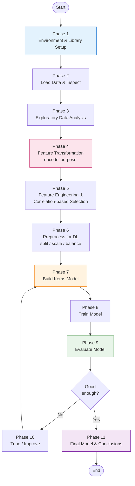
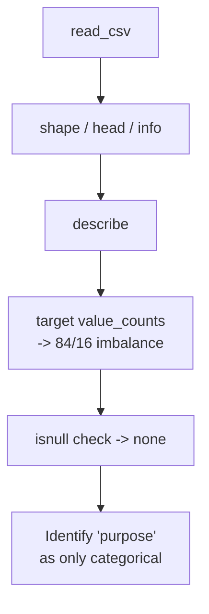
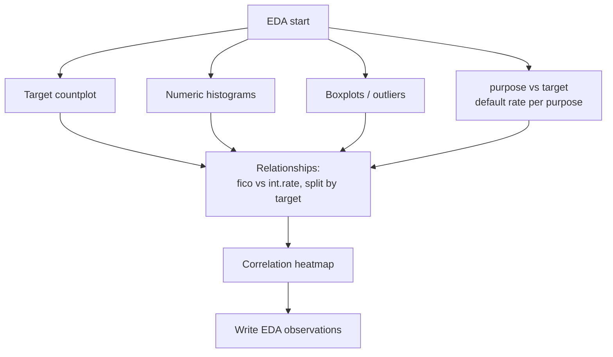
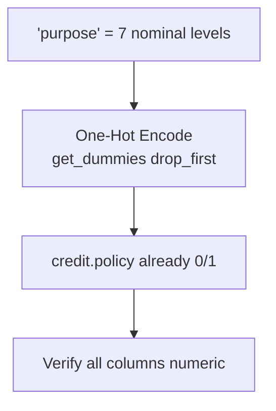
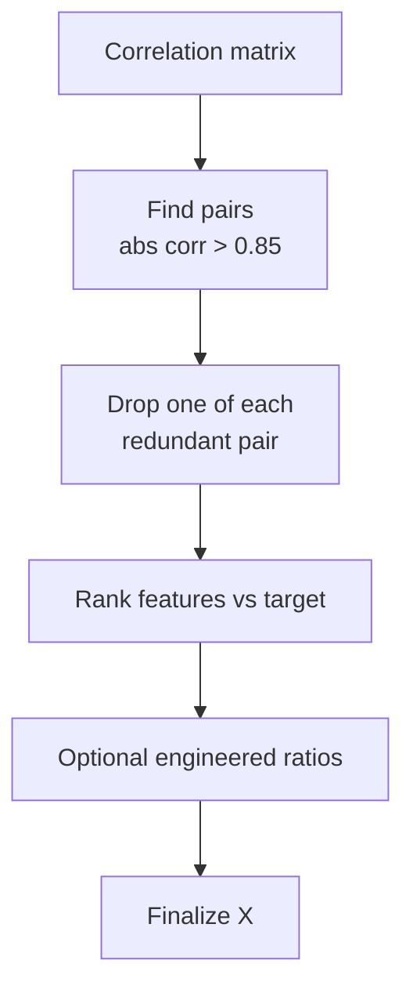
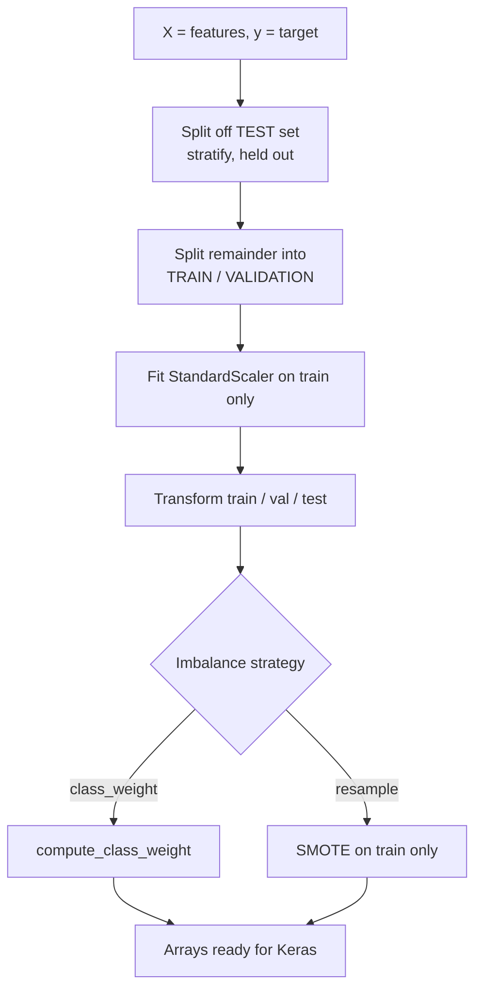
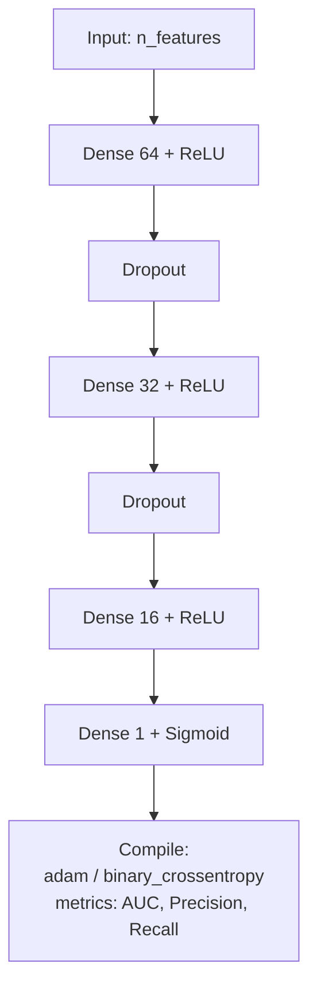
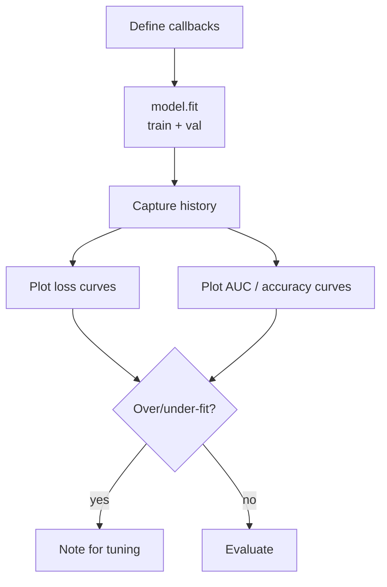
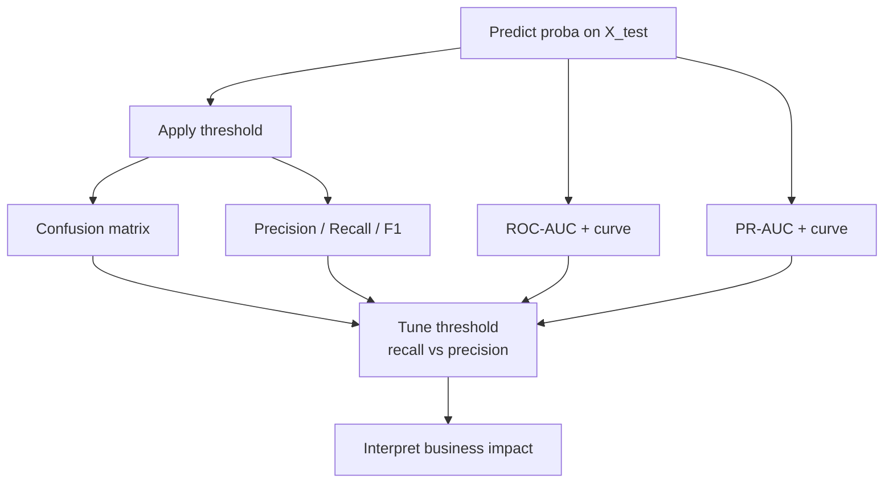

# Project 5.2 — Lending Club Loan Data Analysis (Deep Learning)

> **Objective:** Build a deep-learning model (Keras + TensorFlow) that predicts whether a
> loan will **default** (not be fully paid), using Lending Club historical data (2007–2015).
> **Type:** Binary classification on an **imbalanced** tabular dataset.
> **Domain:** Finance.

**Assignment tasks (from the project doc):**
1. **Feature Transformation** — transform categorical values into numerical (discrete).
2. **Exploratory Data Analysis** of the different factors in the dataset.
3. **Additional Feature Engineering** — check feature correlation and drop strongly correlated features.
4. **Modeling** — build a deep learning model using Keras with a TensorFlow backend.

---

## 0. Project Facts (verified from the data)

| Item | Value |
|------|-------|
| Main dataset | `CEP_2_Datasets/loan_data (2).csv` |
| Shape | **9,578 rows × 14 columns** |
| Target column | `not.fully.paid` (1 = loan not fully paid / **default**, 0 = paid) |
| Class balance | `0` = 8,045 (84%) · `1` = 1,533 (**16%** minority) → **imbalanced** |
| Categorical column | `purpose` (7 levels) → needs encoding |
| Missing values | None in the clean file |
| Extra files | `input.csv` (9,578×18, already numeric + one-hot `purpose`) and `output.csv` (target) — a **pre-processed X/y pair** you can optionally use to shortcut Phases 4–5 |

**Columns & types:**
`credit.policy` (0/1), `purpose` (categorical), `int.rate`, `installment`, `log.annual.inc`,
`dti`, `fico`, `days.with.cr.line`, `revol.bal`, `revol.util`, `inq.last.6mths`,
`delinq.2yrs`, `pub.rec`, `not.fully.paid` (target).

`purpose` values: `all_other, credit_card, debt_consolidation, educational, home_improvement, major_purchase, small_business`.

> 💡 **Two paths:** either start from the raw `loan_data (2).csv` and do your own encoding
> (recommended — it covers Task 1), **or** load the ready `input.csv` / `output.csv`
> directly for modeling. The plan below uses the raw file so all four tasks are demonstrated.

---

## 1. End-to-End Pipeline (high-level flowchart)



---

## 2. Phase-by-Phase Tasks & Subtasks

Legend: `[ ]` = to do. Tick them off as you build the notebook.

### Phase 1 — Environment & Library Setup
- [ ] Create/activate a virtual environment (or use Colab).
- [ ] Install: `pandas numpy matplotlib seaborn scikit-learn tensorflow imbalanced-learn`.
- [ ] Import and configure:
  - [ ] `numpy`, `pandas`; `matplotlib.pyplot`, `seaborn`.
  - [ ] `sklearn`: `train_test_split`, `StandardScaler`, `metrics`, `compute_class_weight`.
  - [ ] `tensorflow` / `keras`: `Sequential`, `Dense`, `Dropout`, `BatchNormalization`, callbacks.
  - [ ] Set seeds `np.random.seed(42)`, `tf.random.set_seed(42)`.


### Phase 2 — Load Data & Initial Inspection
- [ ] `df = pd.read_csv('CEP_2_Datasets/loan_data (2).csv')`.
- [ ] `df.shape`, `df.head()`, `df.info()`, `df.describe()`.
- [ ] `df['not.fully.paid'].value_counts(normalize=True)` → note **16% default** imbalance.
- [ ] `df.isnull().sum()` → confirm no missing (clean file).
- [ ] Identify the single categorical column `purpose`; the rest are numeric.



### Phase 3 — Exploratory Data Analysis (EDA)
> Assignment Task 2.
- [ ] **Target:** countplot of `not.fully.paid` → visualize imbalance.
- [ ] **Numeric distributions:** histograms of `fico`, `int.rate`, `dti`, `log.annual.inc`, `revol.util`, `installment`, `days.with.cr.line`, `revol.bal`.
- [ ] **Outliers:** boxplots (esp. `revol.bal`, `days.with.cr.line` — right-skewed).
- [ ] **`purpose` vs default:** countplot of `purpose` hued by `not.fully.paid`; default rate per purpose (e.g. `small_business` tends to default more).
- [ ] **`credit.policy` vs default:** compare default rate by policy flag.
- [ ] **Key relationships:**
  - [ ] `fico` vs `int.rate` (lower FICO → higher rate).
  - [ ] `fico` / `int.rate` distribution split by `not.fully.paid`.
- [ ] **Correlation heatmap** of numeric features.
- [ ] Write 3–5 bullet observations.



### Phase 4 — Feature Transformation (encode `purpose`)
> Assignment Task 1.
- [ ] `purpose` is nominal with 7 levels → **One-Hot Encode**: `pd.get_dummies(df, columns=['purpose'], drop_first=True)`.
  - (`drop_first=True` avoids the dummy-variable trap.)
- [ ] `credit.policy` is already 0/1 — leave as is.
- [ ] Confirm the frame is fully numeric: `df.select_dtypes('object').shape[1] == 0`.



### Phase 5 — Feature Engineering & Correlation-based Selection
> Assignment Task 3.
- [ ] Compute correlation matrix on numeric features (+ target).
- [ ] Identify pairs with high `|corr|` (e.g. `fico` ↔ `int.rate` are strongly related).
- [ ] **Drop one feature from any pair with `|corr| > ~0.85`** to reduce redundancy — document each drop.
- [ ] Rank features by correlation with `not.fully.paid`; note the strongest signals (`int.rate`, `fico`, `inq.last.6mths`, `credit.policy`).
- [ ] (Optional) engineer ratios such as `installment / (annual_inc)` if useful.
- [ ] Finalize feature set `X`.



### Phase 6 — Preprocess for Deep Learning
- [ ] Split `X` (features) and `y = not.fully.paid` (**Feature & Target Separation**).
- [ ] **3-way split — Train / Validation / Test**, stratified on `y`:
  - [ ] First hold out the **test set**: `train_test_split(X, y, test_size=0.2, stratify=y, random_state=42)`.
  - [ ] Then split the remainder into **train / validation** (e.g. 80/20, `stratify` again).
  - [ ] Validation guides tuning; the untouched test set gives the unbiased final score (Phase 9/11).
- [ ] **Scale** numeric features — **fit the scaler on train only**, transform train/val/test (`StandardScaler`). Fitting on all data = leakage. NNs need scaled inputs.
- [ ] **Handle imbalance** (pick one, justify):
  - [ ] **Class weights** (`compute_class_weight('balanced', ...)`) → `model.fit(class_weight=...)` *(recommended).*
  - [ ] **SMOTE** oversampling on the **training set only**.
- [ ] Confirm array shapes.



### Phase 7 — Build the Keras Model
> Assignment Task 4.
- [ ] `Sequential` feed-forward network:
  - [ ] Input sized to `X_train.shape[1]`.
  - [ ] 2–3 `Dense` hidden layers (e.g. 64 → 32 → 16) with `relu`.
  - [ ] `Dropout` (0.2–0.3) (+ optional `BatchNormalization`) to regularize.
  - [ ] Output `Dense(1, activation='sigmoid')`.
- [ ] Compile: `loss='binary_crossentropy'`, `optimizer='adam'`, `metrics=['accuracy', AUC, Precision, Recall]`.
- [ ] `model.summary()`.



### Phase 8 — Train the Model
- [ ] Callbacks: `EarlyStopping(monitor='val_loss'/'val_auc', patience=5, restore_best_weights=True)`, optional `ReduceLROnPlateau`.
- [ ] `model.fit(X_train, y_train, validation_data=(X_val, y_val), epochs=100, batch_size=64, class_weight=..., callbacks=...)` — use the explicit validation set from Phase 6.
- [ ] Plot training vs validation **loss** and **AUC/accuracy** → diagnose over/underfit.



### Phase 9 — Evaluate the Model (on the validation set)
> Evaluate on **validation** while iterating — keep the test set untouched for Phase 11.
- [ ] Predict probabilities on `X_val`; apply threshold (start 0.5).
- [ ] **Imbalance-aware metrics:** confusion matrix, Precision, Recall, F1, **ROC-AUC**, PR-AUC.
- [ ] Plot ROC and Precision-Recall curves.
- [ ] **Select the threshold** on validation, toward **recall** (catching defaulters matters for a lender). Lock it before touching the test set.
- [ ] Interpret false negatives (missed defaults) vs false positives (rejected good loans).



### Phase 10 — Tune / Improve (iterate)
- [ ] Vary layers/units, dropout, learning rate, batch size, epochs.
- [ ] Compare imbalance strategies (class weights vs SMOTE).
- [ ] Optional baseline (Logistic Regression / RandomForest) for a sanity check.
- [ ] Keep a results table (config → val AUC / F1) and pick the best.

### Phase 11 — Final Test Evaluation, Save & Conclusions
- [ ] **Final test evaluation (once):** apply the locked threshold to predictions on the **held-out `X_test`** → report the same metric set. This is your unbiased, reportable score.
- [ ] Retrain best config; save `model.save('lending_club_model.keras')` + scaler/encoder.
- [ ] Final metrics summary and the main drivers of default.
- [ ] Conclusion: performance, limitations, next steps; clean, top-to-bottom notebook.


---

## 3. Deliverables Checklist
- [ ] Notebook covering Phases 1–11, runnable top-to-bottom.
- [ ] EDA visualizations + written observations (Task 2).
- [ ] `purpose` encoded to numeric (Task 1).
- [ ] Correlation analysis + dropped redundant features (Task 3).
- [ ] Keras/TensorFlow model with imbalance handling (Task 4).
- [ ] Evaluation: confusion matrix + ROC-AUC + classification report.
- [ ] Conclusion tied to the business objective.

## 4. Common Pitfalls
- Judging by **accuracy** — predicting "all paid" already scores ~84%. Use **AUC / recall / F1**.
- Scaling or SMOTE **before** the split → data leakage.
- One-hot encoding `purpose` without `drop_first` (dummy-variable trap).
- Ignoring the imbalance entirely (model learns to predict only the majority class).

---

## 5. Recommended Notebook Section Order (22 headings)

Use these as the **Markdown headings in the notebook, in this exact order**. The right
column shows which plan phase covers each heading, so nothing is missed.

| # | Notebook heading | Plan phase |
|---|------------------|-----------|
| 1 | Project Overview and Business Problem | §0 + intro |
| 2 | Importing Required Libraries | Phase 1 |
| 3 | Loading the Dataset | Phase 2 |
| 4 | Data Understanding | Phase 2 |
| 5 | Data Cleaning and Quality Checks | Phase 2 (clean file — verify, no missing) |
| 6 | Univariate Exploratory Data Analysis | Phase 3 |
| 7 | Bivariate Exploratory Data Analysis | Phase 3 |
| 8 | Multivariate Exploratory Data Analysis | Phase 3 (heatmap / interactions) |
| 9 | Feature Transformation | Phase 4 |
| 10 | Correlation Analysis and Feature Selection | Phase 5 |
| 11 | Feature and Target Separation | Phase 6 |
| 12 | Train, Validation, and Test Split | Phase 6 |
| 13 | Data Preprocessing and Scaling | Phase 6 |
| 14 | Class Imbalance Handling | Phase 6 |
| 15 | Deep Learning Model Architecture | Phase 7 |
| 16 | Model Compilation and Training | Phase 7 + 8 |
| 17 | Training History and Overfitting Analysis | Phase 8 |
| 18 | Model Evaluation (validation) | Phase 9 |
| 19 | Model Improvement and Threshold Selection | Phase 9 + 10 |
| 20 | Final Test Evaluation | Phase 11 |
| 21 | Saving the Model and Preprocessing Pipeline | Phase 11 |
| 22 | Business Insights, Limitations, and Conclusion | Phase 11 |

> **Build order tip:** complete headings 1–10 (through EDA + feature work) and **validate the
> dataset — confirm the target `not.fully.paid` and the class balance — before writing any
> neural-network code.** After that, prioritise **leakage-free preprocessing** (fit
> scalers/SMOTE on train only) and **imbalance-aware evaluation metrics** that reveal whether
> the model actually identifies defaults, not just the majority ("fully paid") class.
```
